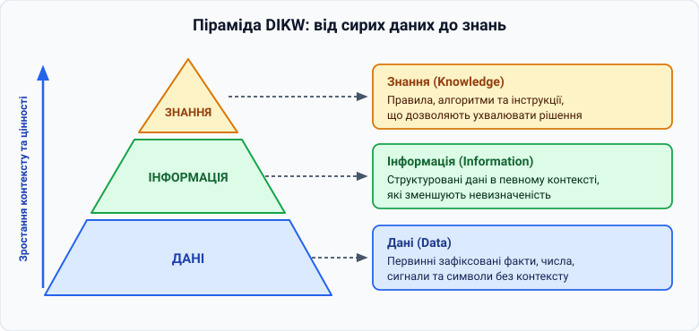

# Урок 1. Інформація та інформаційні системи: поняття, призначення

<div class="how-to">

**Як працювати з уроком**

1. Ознайомтеся з теоретичним матеріалом: усвідомте ланцюжок «дані → інформація → знання» та призначення інформаційних систем.
2. Виконайте покрокове практичне завдання в терміналі операційної системи та перевірте себе в блоці **«Спробуйте самі»**.
3. Дайте відповіді на 10 запитань закріплювального тесту для оцінки рівня засвоєння теми.

</div>

## Мета уроку

Сформувати базове технічне розуміння понять інформації, інформаційних процесів та інформаційних систем для майбутньої професійної діяльності за фахом «Оператор з обробки інформації та програмного забезпечення». На практиці ви:

- навчитеся розрізняти сирі дані, змістовну інформацію та знання на рівні роботи цифрових систем;
- дослідите базові інформаційні процеси (введення, обробка, зберігання, виведення) за допомогою утиліт командного рядка;
- протестуєте перетворення неструктурованих даних у структурований журнал операцій за допомогою конвеєрів (pipelines) та текстових фільтрів;
- проведете експрес-діагностику локальної комп'ютерної системи як первинної ланки великої інформаційної мережі.

## Що знадобиться

- Робоча станція під керуванням ОС Linux або Windows (із середовищем командного рядка Bash: WSL, Git Bash або рідний термінал Linux).
- Стандартні утиліти обробки потоків тексту (`cat`, `grep`, `wc`, `awk`, `date`).
- Текстовий редактор або середовище розробки для перегляду структурованих документів.

## Теорія

### Дані, інформація, повідомлення та знання

У повсякденному спілкуванні терміни «дані» та «інформація» нерідко використовують як слова-синоніми. Проте у комп'ютерних науках і в роботі оператора з обробки інформації та програмного забезпечення ці поняття мають суворе розмежування, яке описується класичною моделлю **DIKW** (*Data, Information, Knowledge, Wisdom* — Дані, Інформація, Знання, Мудрість).

1. **Дані (Data)** — це зафіксовані факти, сигнали, числові значення, символи або необроблені двійкові послідовності, які ще не мають конкретного контексту і самі по собі не несуть практичного сенсу для кінцевого користувача.
   *Приклад:* послідовність символів `2026-11-16; 4113; 95.5; OK`. Без опису схеми чи призначення це просто набір байтів у пам'яті комп'ютера.
2. **Повідомлення (Message)** — це форма подання даних для передачі каналом зв'язку від джерела до приймача за допомогою сигналів, символів або кодів.
3. **Інформація (Information)** — це дані, які впорядковані, структуровані, інтерпретовані в певному контексті та зрозумілі одержувачу. Інформація зменшує ступінь невизначеності (ентропії) про стан деякої системи або об'єкта.
   *Приклад:* якщо ми знаємо контекст, наведений вище рядок стає зрозумілим: «16 листопада 2026 року учень групи № 4113 склав кваліфікаційний тест на 95.5 балів, статус операції — підтверджено (OK)».
4. **Знання (Knowledge)** — це осмислена та апробована на практиці інформація, інтегрована з досвідом, алгоритмами та правилами ухвалення рішень.
   *Приклад:* на основі інформації про успішність заклад освіти ухвалює регламентне рішення: учням із рейтингом вище 90 балів надати рекомендацію для працевлаштування та призначити підвищену стипендію.

| Рівень піраміди | Технічна сутність | Приклад для оператора ІТ |
| :--- | :--- | :--- |
| **Дані** | Сирі байти, логи, символи без схеми | `192.168.1.15; 443; 12480; 200` |
| **Інформація** | Дані з контекстом, схемою та призначенням | Клієнт 192.168.1.15 завантажив 12.48 КБ через порт 443 (HTTPS), код відповіді сервера — успішно (200) |
| **Знання** | Правила, шаблони, алгоритми реакції | Якщо обсяг завантаження з однієї IP-адреси перевищує 500 МБ за 1 хвилину — тимчасово заблокувати доступ за підозрою у витоку даних |

<div class="clip">



*Піраміда DIKW: дані, інформація, знання*

</div>

### Інформаційні процеси

Будь-яка діяльність з цифровими технологіями зводиться до ланцюжка фундаментальних інформаційних процесів:

1. **Збирання та сприйняття:** фіксація первинних фактів за допомогою клавіатури, сканера штрихкодів, сенсорів, датчиків IoT або оптичного розпізнавання тексту (OCR).
2. **Введення та реєстрація:** первинне перетворення сигналів у цифровий двійковий формат та збереження в оперативній пам'яті чи тимчасовому буфері.
3. **Зберігання:** розміщення інформації на постійних носіях (SSD, HDD, оптичні диски, хмарні сховища) за певними правилами організації (файлові системи, реляційні та нереляційні бази даних).
4. **Обробка:** виконання арифметичних, логічних операцій, фільтрація, сортування, агрегація, перекодування та нормалізація.
5. **Передача:** транспортування даних через фізичні лінії зв'язку (мідні кабелі крученої пари, оптоволокно, радіохвилі Wi-Fi / LTE / 5G) з використанням мережевих протоколів.
6. **Захист:** шифрування, контроль цілісності за хеш-сумами, резервне копіювання, автентифікація та авторизація доступу.
7. **Відображення та подання:** візуалізація у зручній формі (інтерфейси програм, графіки, друковані відомості, цифрові звіти).

### Поняття та призначення інформаційної системи (ІС)

**Інформаційна система (ІС)** — це взаємопов'язана сукупність технічних засобів (апаратного забезпечення), програмного забезпечення, інформаційних ресурсів (баз даних), персоналу (фахівців) та організаційних правил (регламентів), призначена для збирання, зберігання, обробки, пошуку та видачі інформації для досягнення поставленої мети.

Головне призначення інформаційних систем полягає в:

- **Автоматизації рутинних і повторюваних операцій:** вивільненні людини від трудомістких ручних розрахунків і механічного переписування відомостей.
- **Підвищенні швидкості та точності обробки даних:** сучасна ІС обробляє мільйони транзакцій на секунду з нульовою ймовірністю арифметичної помилки.
- **Централізації та узгодженості інформації:** усуненні розбіжностей і дублювання даних між різними підрозділами організації.
- **Забезпеченні надійного контролю та аудиту:** фіксації кожного кроку користувача (хто, коли та які зміни вніс до бази даних).
- **Підтримці прийняття управлінських рішень:** формуванні аналітичних звітів, діаграм, прогнозів у реальному часі.

### Сфери застосування та типові приклади сучасних ІС

Сьогодні оператор стикається з різними класами ІС:

- **Державні інформаційні системи:** Єдиний державний вебпортал електронних послуг «Дія», електронна система охорони здоров'я eHealth, система публічних закупівель ProZorro.
- **Банківські та платіжні ІС:** системи електронних міжбанківських розрахунків (СЕП НБУ), процесингові центри карток (Visa, Mastercard), клієнт-банкінг.
- **Логістичні та поштові системи:** автоматизовані системи сортування, трекінгу посилок та управління складом (наприклад, ІС «Нова Пошта», «Укрпошта»).
- **Освітні платформи:** автоматизовані комплекси обліку здобувачів освіти (ЄДЕБО), системи дистанційного навчання (Moodle, Google Classroom).

<div class="more-link">

**Хочете знати більше?** <span class="optional">Необов’язково</span>

Україна має визначну історичну спадщину в розвитку теорії інформаційних систем. Ще у 1960–1970-х роках під керівництвом академіка Віктора Михайловича Глушкова в Інституті кібернетики в Києві було розроблено концепцію Загальнодержавної автоматизованої системи обліку та обробки інформації (ЗДАС / ОГАС). Це був революційний проєкт створення загальнонаціональної комп'ютерної мережі для оперативного керування економікою, який на десятиліття випередив появу сучасних корпоративних ERP-систем та інтернету.

</div>

## Покроково

Як оператор з обробки інформації ви повинні вміти моделювати та досліджувати інформаційні потоки на базовому технічному рівні. Виконаємо практичну роботу в консолі.

### 1. Створіть робочу директорію та змоделюйте журнал вхідних подій

Відкрийте термінал і створіть робочу папку для першого уроку:

```bash
mkdir -p ~/cpto_it_lab/lesson01
cd ~/cpto_it_lab/lesson01
```

Тепер створіть файл неструктурованих даних `raw_events.log`, що фіксує події входу операторів до корпоративної мережі:

```bash
cat << 'LOG_DATA' > raw_events.log
2026-11-16 08:30:15|user:shevchenko|ip:192.168.1.101|status:SUCCESS|bytes:4520
2026-11-16 08:31:02|user:koval|ip:192.168.1.105|status:FAILED|bytes:0
2026-11-16 08:32:44|user:melnyk|ip:192.168.1.112|status:SUCCESS|bytes:12890
2026-11-16 08:33:10|user:koval|ip:192.168.1.105|status:SUCCESS|bytes:3400
2026-11-16 08:35:50|user:bondarenko|ip:192.168.1.120|status:SUCCESS|bytes:51200
2026-11-16 08:36:12|user:shevchenko|ip:192.168.1.101|status:SUCCESS|bytes:8900
LOG_DATA
```

### 2. Реалізуйте інформаційний процес обробки та фільтрації

Сирі рядки логу — це дані. Щоб перетворити їх на інформацію (знайти всі неуспішні спроби входу або активність конкретного оператора), застосуємо утиліту `grep`:

```bash
echo "=== Невдалі спроби авторизації (потенційні інциденти безпеки) ==="
grep "status:FAILED" raw_events.log
```

Далі порахуємо загальну кількість успішних сесій в системі за допомогою конвеєра (`|`) та утиліти підрахунку `wc -l`:

```bash
echo -n "Кількість успішних сеансів: "
grep "status:SUCCESS" raw_events.log | wc -l
```

### 3. Отримайте знання: розрахуйте сумарний трафік за допомогою потокового аналізатора `awk`

Тепер підсумуємо обсяг переданих байтів для успішних сеансів:

```bash
awk -F'|' '/status:SUCCESS/ { split($5, b, ":"); total += b[2] } END { printf "Загальний обсяг трафіку: %.2f КБ
", total / 1024 }' raw_events.log
```

Ми трансформували розрізнені рядки лог-файлу в чіткий показник навантаження мережі, придатний для системного адміністратора та керівника підрозділу.

<div class="try">

**Спробуйте самі**

Дослідіть власну робочу станцію як елемент локальної інформаційної системи. Виконайте в терміналі команду, яка виводить ім'я хоста, назву операційної системи, архітектуру процесора та поточну дату:

```bash
echo "=== ПАСПОРТ РОБОЧОЇ СТАНЦІЇ ОПЕРАТОРА ==="
echo "Вузол мережі: $(hostname)"
echo "Операційна система: $(uname -s -r -m)"
echo "Поточна системна дата та час: $(date '+%Y-%m-%d %H:%M:%S')"
```

Потім додайте перевірку дискового простору, щоб переконатися, що системний розділ інформаційної системи не переповнений:

```bash
df -h / | awk 'NR==2 {print "Вільне місце на диску:", $4, "з", $2, "(використано " $5 ")"}'
```

<details>
<summary>Перевірити очікуваний результат і повний розв’язок</summary>

Очікуваний вивід у терміналі повинен мати структурований вигляд, подібний до наступного:

```text
=== ПАСПОРТ РОБОЧОЇ СТАНЦІЇ ОПЕРАТОРА ===
Вузол мережі: lab-pc-4113
Операційна система: Linux 6.6.0-generic x86_64
Поточна системна дата та час: 2026-11-16 08:45:00
Вільне місце на диску: 45G з 100G (використано 55%)
```

Якщо всі команди виконано без помилок, ви успішно здійснили процедуру базового аудиту апаратно-програмного стану комп'ютера, що є щоденним регламентним обов'язком оператора на початку робочої зміни.

</details>

</div>

## Підсумок

- **Дані** — це фіксовані первинні символи та байти; **інформація** — це дані, поміщені в контекст і зрозумілі людині чи алгоритму; **знання** — правила та висновки для ухвалення практичних рішень.
- Фундаментальні **інформаційні процеси** включають збирання, введення, збереження, обробку, передачу, захист і відображення даних.
- **Інформаційна система (ІС)** — це взаємозв'язок обладнання, програм, сховищ даних, кваліфікованого персоналу та регламентів роботи.
- Основна мета впровадження ІС — усунення людських помилок, автоматизація повторюваних операцій та надійна координація виробничих процесів.

## Тест

<div class="test-box">

10 запитань за матеріалом уроку. На початку тесту вкажіть **прізвище, ім’я та групу**.

<!-- GOOGLE_FORM_START:lesson-01 -->
[Відкрити тест у новій вкладці](https://docs.google.com/forms/d/e/1FAIpQLScf2n3wuh7oWPs5T32cGxoafn4dP7d2OSTbk0coBZrM77acsQ/viewform)

<iframe src="https://docs.google.com/forms/d/e/1FAIpQLScf2n3wuh7oWPs5T32cGxoafn4dP7d2OSTbk0coBZrM77acsQ/viewform?embedded=true" loading="lazy" title="Тест lesson-01">Завантаження…</iframe>
<!-- GOOGLE_FORM_END:lesson-01 -->

</div>

## Додаткове завдання

<span class="optional">Необов’язково</span> Виконуйте, якщо бажаєте розширити практичні навички в середовищі Linux.

**Базовий рівень.** Створіть у каталозі `~/cpto_it_lab/lesson01` файл `inventory.txt`, що містить інвентарні номери та назви комп'ютерної техніки кабінету (не менше 5 одиниць). За допомогою команди `sort` упорядкуйте техніку за алфавітом, а результат запишіть у новий файл `sorted_inventory.txt`.

**Проєктний рівень.** Напишіть короткий bash-скрипт `system_report.sh`, який автоматично створює текстовий файл звіту з інформацією про ім'я комп'ютера, версію операційної системи, обсяг вільної оперативної пам'яті (команда `free -h`) та список поточних авторизованих користувачів (команда `who`). Додайте коментарі українською мовою до кожного рядка коду.
