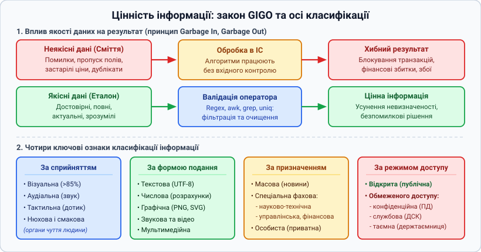

# Урок 2. Цінність та класифікація інформації

<div class="how-to">

**Як працювати з уроком**

1. Вивчіть фундаментальні властивості інформації, критерії її цінності та класифікацію за ключовими ознаками.
2. Виконайте покрокове практичне завдання з аудиту якості даних у терміналі та розв'яжіть задачу в блоці **«Спробуйте самі»**.
3. Пройдіть перевірочний тест із 10 запитань для закріплення вивченого матеріалу.

</div>

## Мета уроку

Опанувати професійні критерії оцінювання якості, цінності та правового статусу інформації в роботі оператора з обробки інформації та програмного забезпечення. На практиці ви:

- навчитеся діагностувати якість інформації за критеріями достовірності, повноти, актуальності та своєчасності;
- дослідите принципи класифікації інформації за формою подання, способом сприйняття та рівнем конфіденційності;
- реалізуєте в командному рядку автоматизовану перевірку цілісності та валідності цифрового реєстру даних;
- застосуєте регулярні вирази (Regex) для виявлення дефектів інформації (відсутні поля, некоректні формати, дублікати).

## Що знадобиться

- Комп'ютер під керуванням ОС Linux або Windows із середовищем командного рядка Bash.
- Стандартні утиліти обробки тексту: `cat`, `grep` (з підтримкою розширених регулярних виразів `-E`), `awk`, `sort`, `uniq`.
- Текстовий редактор для перегляду та редагування табличних файлів формату CSV.

## Теорія

### Властивості інформації та критерії її цінності

Не вся інформація, яка циркулює в комп'ютерних системах, має однакову корисність. Цінність інформації визначається тим, наскільки вона допомагає користувачеві чи організації досягати поставленої мети, усувати невизначеність і приймати своєчасні безпомилкові рішення.

У професійній практиці оператора якість і цінність інформації оцінюють за такими основними критеріями:

1. **Достовірність (правдивість):** відсутність спотворень і помилок, точна відповідність реальному стану об'єкта або процесу. Спотворена інформація призводить до неправильних рішень (наприклад, помилка в номері банківського рахунку чи коді товару).
2. **Повнота:** достатність відомостей для ухвалення правильного рішення або виконання регламентної дії. Неповні дані змушують оператора діяти наосліп або переривати бізнес-процес.
3. **Актуальність (своєчасність):** інформація має бути доставлена саме тоді, коли вона потрібна, і відповідати поточному моменту часу. Навіть абсолютно точний прогноз погоди за вчорашній день має нульову цінність для польоту літака сьогодні.
4. **Адекватність:** рівень відповідності створеного інформаційного образу реальному об'єкту, процесу чи явищу.
5. **Доступність:** можливість своєчасного та безперешкодного одержання інформації авторизованим користувачем за наявності відповідних прав.
6. **Захищеність (цілісність та конфіденційність):** стан даних, за якого гарантується захист від несанкціонованого доступу, навмисної або випадкової модифікації та знищення.
7. **Зрозумілість (ергономічність):** інформація повинна бути подана у мовній, символьній та візуальній формі, зрозумілій адресату (людині-оператору чи програмному модулю).

| Властивість | Сутність дефекту інформації | Наслідок для підприємства |
| :--- | :--- | :--- |
| **Недостовірність** | У базі клієнтів записано неправильний телефон | Неможливо зв'язатися із замовником, втрата замовлення |
| **Неповнота** | Зазначено суму оплати, але не вказано валюту платежу | Блокування бухгалтерської транзакції |
| **Неактуальність** | Використано прайс-лист тримісячної давнини | Фінансові збитки через продаж товарів за заниженими цінами |
| **Незрозумілість** | Звіт містить необроблені шістнадцяткові коди замість опису помилки | Оператор не може оперативно зреагувати на збій системи |

В інформатиці діє фундаментальний закон: **GIGO** (*Garbage In, Garbage Out* — «Сміття на вході — сміття на виході»). Якщо оператор вводить у систему некоректні, неповні чи помилкові дані, жоден найдосконаліший алгоритм чи штучний інтелект не зможе видати якісний результат.

### Класифікація інформації

У сучасних інформаційних системах інформацію класифікують за декількома незалежними ознаками:

#### 1. За способом сприйняття людиною
- **Візуальна:** сприймається органами зору (текст, графіки, відео, колірні індикатори) — понад 85 % інформації в роботі оператора;
- **Аудіальна (звукова):** мова, звукові системні сповіщення, музика;
- **Тактильна:** сприймається на дотик (вібровідгук сенсорного екрана, шрифт Брайля);
- **Нюхова та смакова:** застосовується у спеціалізованих хімічних і харчових виробництвах.

#### 2. За формою цифрового подання
- **Текстова:** послідовність символів, закодованих у стандартах ASCII, UTF-8 тощо;
- **Числова:** цифри, розрахункові величини, фінансові показники, індекси;
- **Графічна:** растрові (PNG, JPEG) та векторні (SVG) зображення, креслення, схеми;
- **Звукова:** оцифрований аудіосигнал (WAV, MP3, AAC);
- **Відеоінформація:** послідовність динамічних кадрів зі звуковим супроводом (MP4, MKV);
- **Мультимедійна (комбінована):** синтез тексту, звуку, графіки та анімації.

#### 3. За суспільним і функціональним призначенням
- **Масова:** суспільно-політична, новинна, розважальна;
- **Спеціальна:** професійна інформація, необхідна для виконання фахових завдань:
  - *науково-технічна:* проєктна документація, патенти, формули;
  - *управлінська:* розпорядження, накази, інструкції, договори;
  - *економічна та фінансова:* баланси, накладні, податкові звіти;
  - *статистична:* узагальнені показники діяльності галузей чи демографічні дані;
- **Особиста:** персональні контакти, приватне листування, щоденники.

#### 4. За режимом доступу та правовим статусом
Відповідно до законодавства України (зокрема Законів «Про інформацію» та «Про захист персональних даних»), інформація поділяється на:
- **Відкриту:** доступ до якої не обмежений законодавством (публічні державні реєстри, новини, відкриті стандарти).
- **З обмеженим доступом:**
  - *Конфіденційна:* інформація про фізичну особу (персональні дані: паспортні відомості, реєстраційний номер облікової картки платника податків — РНОКПП, адреса проживання, стан здоров'я) або комерційна таємниця підприємства;
  - *Таємна:* відомості, що містять державну таємницю і становлять інтерес національної безпеки;
  - *Службова:* інформація, створена в органах державної влади або місцевого самоврядування для внутрішнього службового користування (із грифом «Для службового користування»).

Оператор з обробки інформації несе пряму юридичну відповідальність за нерозголошення конфіденційних і персональних даних, до яких отримує доступ під час виконання посадових обов'язків!

<div class="clip">



*Рис. Принцип GIGO, критерії якості та класифікація інформації*

</div>

<div class="more-link">

**Хочете знати більше?** <span class="optional">Необов’язково</span>

Наукове обґрунтування кількісної оцінки інформації дав американський математик Клод Шеннон у праці 1948 року «Математична теорія зв'язку». Він запропонував розглядати інформацію як міру усунення невизначеності (ентропії). Якщо певна подія має кілька рівноймовірних наслідків, інформація про те, який саме наслідок відбувся, зменшує невизначеність. Якщо подій дві (наприклад, кидання монети: «герб» чи «число»), вибір однієї з них дає рівно 1 біт інформації. Поняття біта як двійкового розряду (*binary digit*) стало фундаментальною одиницею вимірювання всього цифрового світу.

</div>

## Покроково

Практичне завдання оператора: виконати вхідний контроль якості та очищення реєстру користувачів перед імпортом до корпоративної бази даних.

### 1. Підготуйте тестовий реєстр клієнтів із типовими дефектами

Створіть робочий каталог та файл `clients.csv`:

```bash
mkdir -p ~/cpto_it_lab/lesson02
cd ~/cpto_it_lab/lesson02

cat << 'CSV_DATA' > clients.csv
id,full_name,phone,tax_id,status
101,Ткаченко Олександр Миколайович,+380501112233,2845612345,active
102,Кравчук Ірина Петрівна,,3124598765,active
103,Шевченко Василь Іванович,+380672223344,INVALID_TAX,active
104,Сидоренко Олена Василівна,+380931234567,2987456321,blocked
105,Коваленко Дмитро Юрійович,+3804412345,2745632189,active
106,Ткаченко Олександр Миколайович,+380501112233,2845612345,active
107,Бойко Вікторія Романівна,+380998887766,,active
CSV_DATA
```

У цьому файлі навмисно змодельовано типові дефекти:
- Рядок 102: порушення **повноти** (відсутній номер телефону);
- Рядок 103: порушення **достовірності** (замість 10-значного РНОКПП записано текст);
- Рядок 105: порушення **достовірності формату** (номер телефону містить лише 10 символів замість стандарту +380XXXXXXXXX);
- Рядки 101 і 106: **надлишковість** (повний дублікат запису);
- Рядок 107: порушення **повноти** (відсутній обов'язковий податковий номер).

### 2. Виявіть порушення повноти інформації (порожні поля)

За допомогою утиліти `awk` знайдемо всі записи, у яких поле номера телефону ($3) або податкового номера ($4) не заповнене:

```bash
echo "=== Записи з порушенням повноти (порожній телефон або РНОКПП) ==="
awk -F',' 'NR > 1 && ($3 == "" || $4 == "") { print "ID:", $1, "| ПІБ:", $2, "| Помилка: пропущене обов'''язкове поле" }' clients.csv
```

### 3. Перевірте достовірність формату за допомогою регулярних виразів

Податковий номер (РНОКПП) громадянина України має містити рівно 10 цифр. Знайдемо рядки, де це правило порушено:

```bash
echo "=== Записи з недостовірним РНОКПП (очікується 10 цифр) ==="
awk -F',' 'NR > 1 && $4 !~ /^[0-9]{10}$/ { print "ID:", $1, "| Поточне значення:", $4 }' clients.csv
```

Перевіримо правильність українського формату мобільного номера (`+380` та 9 цифр):

```bash
echo "=== Некоректні мобільні номери ==="
awk -F',' 'NR > 1 && $3 !~ /^\+380[0-9]{9}$/ && $3 != "" { print "ID:", $1, "| Телефон:", $3 }' clients.csv
```

<div class="try">

**Спробуйте самі**

Знайдіть у реєстрі надлишкові дані — повторювані записи, які дублюють інформацію про одного й того самого користувача. Використайте конвеєр із команд виділення стовпців, сортування та підрахунку унікальних значень:

```bash
echo "=== Пошук дублікатів клієнтів за ПІБ та телефоном ==="
tail -n +2 clients.csv | awk -F',' '{print $2 "," $3}' | sort | uniq -c | grep -v '^ *1 '
```

<details>
<summary>Перевірити очікуваний результат і повний розв’язок</summary>

Утиліта `uniq -c` підраховує кількість повторень кожного відсортованого рядка. Фільтр `grep -v '^ *1 '` відсікає унікальні записи (де лічильник дорівнює 1) і залишає лише дублікати. Очікуваний вивід:

```text
=== Пошук дублікатів клієнтів за ПІБ та телефоном ===
      2 Ткаченко Олександр Миколайович,+380501112233
```

Розв'язок наочно демонструє, що клієнт Ткаченко О. М. внесений до системи двічі (рядки ID 101 та ID 106). Оператор повинен вилучити надлишковий запис, щоб уникнути подвійного списання коштів чи надсилання спаму.

</details>

</div>

## Підсумок

- Головними критеріями цінності інформації є **достовірність**, **повнота**, **актуальність**, **своєчасність**, **адекватність** та **захищеність**.
- Порушення принципу **GIGO** («сміття на вході — сміття на виході») паралізує роботу навіть найсучасніших автоматизованих систем.
- За формою подання цифрова інформація поділяється на текстову, числову, графічну, звукову, відео та мультимедійну.
- За правовим режимом інформація поділяється на **відкриту** та **з обмеженим доступом** (конфіденційна, таємна, службова). Захист персональних даних є прямою посадовою відповідальністю оператора.

## Тест

<div class="test-box">

10 запитань за матеріалом уроку. На початку тесту вкажіть **прізвище, ім’я та групу**.

🔗 <!-- GOOGLE_FORM_URL:lesson-02 --> *(Посилання на Google Форму буде додано після масового імпорту тесту)*

</div>

## Додаткове завдання

<span class="optional">Необов’язково</span> Виконуйте для поглиблення знань щодо перевірки даних регулярними виразами.

**Базовий рівень.** Створіть файл `emails.txt`, що містить 6 адрес електронної пошти, серед яких дві навмисно мають помилки (наприклад, відсутній символ `@` або відсутня крапка в доменній частині). За допомогою команди `grep -E` виведіть лише синтаксично правильні адреси.

**Проєктний рівень.** Напишіть bash-скрипт `clean_registry.sh`, який зчитує вхідний файл `clients.csv`, відфільтровує всі дефектні рядки (без телефону, з невалідним РНОКПП або дублікати) та створює очищений валідний файл `clients_clean.csv`.
