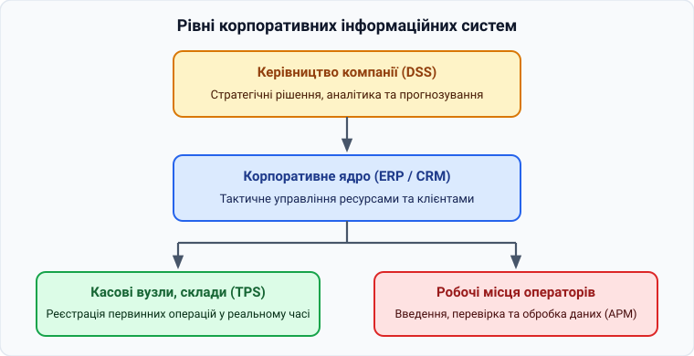

# Урок 3. Класифікація інформаційних систем

<div class="how-to">

**Як працювати з уроком**

1. Ознайомтеся з класифікацією інформаційних систем за ступенем автоматизації, функціональним призначенням, масштабом та архітектурою.
2. Виконайте покрокове практичне завдання з розгортання та діагностики компонентів клієнт-серверної системи в терміналі.
3. Пройдіть контрольний тест із 10 запитань для перевірки засвоєння матеріалу.

</div>

## Мета уроку

Сформувати системне уявлення про класифікацію, типи та архітектурні моделі сучасних інформаційних систем, з якими щоденно взаємодіє оператор з обробки інформації та програмного забезпечення. На практиці ви:

- навчитеся розрізняти автоматизовані, автоматичні та ручні інформаційні системи;
- з'ясуєте призначення та відмінності систем класів TPS, ERP, CRM, DSS, CAD та GIS;
- запустите навчальну клієнт-серверну інформаційну систему та надішлете запити за допомогою консольного клієнта `curl`;
- дослідите стан мережевих сокетів та роботу сервера за допомогою системної утиліти `ss`.

## Що знадобиться

- Робоча станція під керуванням Linux або Windows (із встановленим Bash).
- Консольний клієнт передачі даних `curl` та утиліти аналізу мережі `ss` або `netstat`.
- Інтерпретатор Python 3 для запуску локального навчального мікросервера інформаційної системи.

## Теорія

<div class="clip">


*Класична архітектура комп'ютера фон Неймана<sup>[1]</sup>*

</div>

### Класифікація за ступенем автоматизації

Ступінь участі людини в процесах збирання, перетворення та прийняття рішень є первинним критерієм поділу інформаційних систем:

1. **Ручні інформаційні системи:** характеризуються повною відсутністю електронних обчислювальних засобів. Усі операції з пошуку, сортування та внесення записів виконуються людиною вручну (наприклад, традиційна паперова картотека чи бібліотечний формуляр минулих десятиліть).
2. **Автоматизовані інформаційні системи (АІС):** передбачають обов'язкову взаємодію людини (оператора, диспетчера, фахівця) та комплексу комп'ютерних засобів. Рутинні обчислення та збереження бере на себе машина, але остаточне рішення, введення первинних даних та верифікацію здійснює людина. Переважна більшість систем у бізнесі, державних органах та освіті є саме автоматизованими.
3. **Автоматичні інформаційні системи:** функціонують повністю автономно без участі людини в контурі управління. Людина лише налаштовує систему або контролює її аварійний стан (наприклад, система керування світлофорами на основі датчиків трафіку, автопілот літака, автоматична система пожежогасіння серверної чи роботизована лінія зварювання).

### Класифікація за функціональним призначенням та характером завдань

У сучасних організаціях впроваджують спеціалізовані класи систем, оптимізовані під конкретні задачі бізнесу:

| Абревіатура | Повна назва | Призначення | Приклад для оператора |
| :--- | :--- | :--- | :--- |
| **TPS** | *Transaction Processing System* (Система обробки транзакцій) | Швидка реєстрація однотипних первинних операцій у реальному часі | Програмні РРО, касові вузли супермаркету, термінали оплати, облік квитків |
| **ERP** | *Enterprise Resource Planning* (Система планування ресурсів підприємства) | Комплексне керування всіма ресурсами: виробництвом, складом, фінансами, кадрами | Внесення прибуткових накладних, розрахунок зарплати, списання матеріалів (SAP, Odoo, BAS) |
| **CRM** | *Customer Relationship Management* (Система управління відносинами з клієнтами) | Зберігання контактів клієнтів, облік історії замовлень, дзвінків, етапів воронки продажів | Оператор кол-центру фіксує звернення клієнта, створює лід, планує повторний дзвінок |
| **DSS** | *Decision Support System* (Система підтримки прийняття рішень) | Аналітична обробка даних, побудова прогнозів та моделей для керівництва | Побудова дашбордів динаміки продажів за півріччя, аналіз прибутковості філій |
| **CAD/CAM** (САПР) | *Computer-Aided Design / Manufacturing* (Автоматизоване проєктування) | Створення креслень, тривимірних цифрових моделей деталей та плат | Робота інженера в середовищах AutoCAD, SolidWorks, FreeCAD |
| **GIS** (ГІС) | *Geographic Information System* (Геоінформаційна система) | Збирання, аналіз та візуалізація просторових та географічних даних | Публічна кадастрова карта, Google Maps, навігаційні системи логістики |

<div class="clip">



*Ієрархія корпоративних інформаційних систем: DSS, ERP/CRM, TPS та робочі місця операторів*

</div>

### Класифікація за масштабом

- **Одиночні (Desktop / Настільні):** розраховані на одного користувача на одному ПК. Дані зберігаються локально (наприклад, однокористувацький графічний редактор чи локальна база контактів).
- **Групові (Робочі групи):** призначені для спільної роботи невеликого відділу (до 20–50 осіб) у межах локальної комп'ютерної мережі (LAN). Використовують спільні папки або локальний сервер.
- **Корпоративні:** об'єднують сотні й тисячі користувачів великого підприємства, територіально розподілені філії, заводи та представництва (WAN). Мають багаторівневу ієрархію прав доступу та високу відмовостійкість.
- **Глобальні (Національні / Інтернет-масштабу):** охоплюють користувачів цілої країни чи всього світу (Єдиний державний реєстр, банківська мережа SWIFT, Вікіпедія, хмарні сервіси Google).

### Класифікація за архітектурою побудови

- **Централізовані (Мейнфрейми, Клієнт-Сервер із товстим або тонким клієнтом):** уся обробка даних та база зосереджені на центральному сервері, а робочі станції операторів надсилають запити та відображають результат.
- **Розподілені (Хмарні, Мікросервісні, Peer-to-Peer):** функціонал системи розділено між багатьма незалежними серверами чи вузлами, які взаємодіють мережевими протоколами. Якщо один вузол тимчасово виходить з ладу, система продовжує функціонувати.

<div class="more-link">

**Хочете знати більше?** <span class="optional">Необов’язково</span>

Еволюція архітектури інформаційних систем пройшла три великі епохи:
1. **1960–1970-ті:** Ера мейнфреймів (IBM System/360). Гігантська центральна ЕОМ займала цілу залу, а користувачі взаємодіяли з нею через «німі термінали» (монітор і клавіатура без власного процесора).
2. **1980–1990-ті:** Ера персональних комп'ютерів та архітектури «клієнт-сервер» (Client-Server). Потужність робочих станцій зросла, що дало змогу перенести інтерфейс та базову логіку на ПК користувача.
3. **2010-ті й дотепер:** Ера хмарних обчислень (Cloud Computing) та мікросервісів. Програми не встановлюються локально, а працюють у веббраузері або через мобільні додатки, спираючись на розподілені дата-центри по всьому світу.

</div>

## Покроково

Як оператор ІТ, ви маєте чітко розуміти принцип клієнт-серверної взаємодії, вміти перевіряти доступність серверних служб і діагностувати мережеві збої.

### 1. Створіть робочу директорію та підготуйте навчальний серверний модуль

Створіть робочу папку для практичної роботи:

```bash
mkdir -p ~/cpto_it_lab/lesson03
cd ~/cpto_it_lab/lesson03
```

Створіть компактний серверний скрипт на Python `server_is.py`, який симулює API інформаційної системи обліку замовлень:

```bash
cat << 'PY_SERVER' > server_is.py
import http.server
import json
import socketserver

PORT = 8085

class SimpleISHandler(http.server.SimpleHTTPRequestHandler):
    def do_GET(self):
        if self.path == "/api/status":
            self.send_response(200)
            self.send_header("Content-Type", "application/json; charset=utf-8")
            self.end_headers()
            data = {"status": "ONLINE", "system": "ERP-Warehouse", "load_percent": 24}
            self.wfile.write(json.dumps(data, ensure_ascii=False).encode("utf-8"))
        elif self.path == "/api/orders":
            self.send_response(200)
            self.send_header("Content-Type", "application/json; charset=utf-8")
            self.end_headers()
            orders = [
                {"id": 101, "item": "SSD 512GB", "qty": 10, "state": "IN_STOCK"},
                {"id": 102, "item": "RAM DDR4 16GB", "qty": 25, "state": "RESERVED"}
            ]
            self.wfile.write(json.dumps(orders, ensure_ascii=False).encode("utf-8"))
        else:
            self.send_response(404)
            self.end_headers()

with socketserver.TCPServer(("", PORT), SimpleISHandler) as httpd:
    print(f"Сервер ІС запущено на порті {PORT}")
    httpd.serve_forever()
PY_SERVER
```

### 2. Запустіть сервер ІС у фоновому режимі та перевірте мережевий сокет

Запустіть скрипт у фоновому режимі, зберігши його системний ідентифікатор процесу (PID):

```bash
python3 server_is.py > server.log 2>&1 &
SERVER_PID=$!
echo "Сервер працює з PID: $SERVER_PID"
sleep 1
```

Перевірте за допомогою утиліти `ss` (Socket Statistics), чи відкрився TCP-порт `8085` у стані `LISTEN`:

```bash
ss -tlpn | grep 8085
```

Якщо порт активний, серверна частина інформаційної системи готова до обслуговування клієнтів.

### 3. Надішліть запити до сервера за допомогою консольного клієнта `curl`

Змоделюйте роботу робочої станції оператора (клієнта), надіславши запит на перевірку стану системи:

```bash
echo "=== Перевірка доступності сервера ІС ==="
curl -s http://127.0.0.1:8085/api/status
echo ""
```

Тепер отримайте актуальний реєстр замовлень зі складу:

```bash
echo "=== Отримання списку замовлень (відповідь сервера ІС) ==="
curl -s http://127.0.0.1:8085/api/orders
echo ""
```

Після успішного тестування завершіть фоновий процес сервера:

```bash
kill $SERVER_PID
echo "Сервер ІС зупинено."
```

<div class="try">

**Спробуйте самі**

Перевірте, як поводиться клієнт інформаційної системи, якщо сервер недоступний або адреса вказана помилково. Виконайте запит `curl` на неіснуючий порт `8999` із прапорцем відображення помилки підключення:

```bash
curl -I http://127.0.0.1:8999/api/status
```

<details>
<summary>Перевірити очікуваний результат і повний розв’язок</summary>

Оскільки на порту 8999 жодна служба не слухає запити, операційна система відхилить TCP-з'єднання і утиліта `curl` поверне повідомлення:

```text
curl: (7) Failed to connect to 127.0.0.1 port 8999: Connection refused
```

Для оператора з обробки інформації помилка `Connection refused` (Код 7) є чітким діагностичним маркером: серверний процес зупинено, вказано неправильний порт або вхідний трафік заблоковано міжмережевим екраном (Firewall).

</details>

</div>

## Підсумок

- За **ступенем автоматизації** ІС поділяють на ручні, автоматизовані (де обов'язково присутня людина-оператор) та повністю автоматичні (автономні).
- До базових функціональних класів належать **TPS** (транзакційні касові системи), **ERP** (комплексні ресурси підприємства), **CRM** (робота з клієнтами) та **DSS** (аналітика для керівників).
- За **масштабом** системи варіюються від настільних (одиночних) до корпоративних та глобальних інтернет-систем.
- Архітектура **клієнт-сервер** є основою переважної більшості сучасних ІС, де клієнтське робоче місце взаємодіє з віддаленими серверами за мережевими протоколами.

## Тест

<div class="test-box">

10 запитань за матеріалом уроку. На початку тесту вкажіть **прізвище, ім’я та групу**.

<!-- GOOGLE_FORM_START:lesson-03 -->
[Відкрити тест у новій вкладці](https://docs.google.com/forms/d/e/1FAIpQLSdgLv-FYAf8BexWuyCvCH3G9M3ZAaatlGsFLfKA3dB8vrMBgA/viewform)

<iframe src="https://docs.google.com/forms/d/e/1FAIpQLSdgLv-FYAf8BexWuyCvCH3G9M3ZAaatlGsFLfKA3dB8vrMBgA/viewform?embedded=true" loading="lazy" title="Тест lesson-03">Завантаження…</iframe>
<!-- GOOGLE_FORM_END:lesson-03 -->

</div>

## Додаткове завдання

<span class="optional">Необов’язково</span> Виконуйте для практичного закріплення навичок тестування мережевих служб.

**Базовий рівень.** Запустіть стандартний вбудований HTTP-сервер Python у робочій папці: `python3 -m http.server 8080 &`. Перевірте за допомогою `curl -I http://127.0.0.1:8080`, чи повертає сервер успішний HTTP-код `200 OK`. Після тесту зупиніть сервер.

**Проєктний рівень.** Підготуйте аналітичну порівняльну таблицю у форматі Markdown для двох систем: **CRM** та **ERP**. Опишіть, які саме операції виконує в кожній системі оператор з обробки інформації та які вхідні й вихідні документи при цьому формуються.

## Джерела

1. [Von_Neumann_architecture.svg](https://commons.wikimedia.org/wiki/File:Von_Neumann_architecture.svg), Wikimedia Commons.
