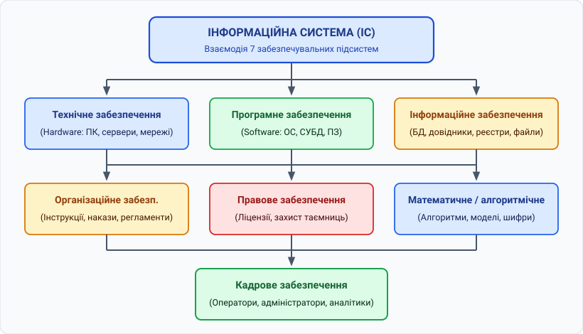

# Урок 4. Структура та складові інформаційної системи

<div class="how-to">

**Як працювати з уроком**

1. Ознайомтеся з теоретичною структурою забезпечувальних підсистем інформаційної системи (апаратне, програмне, інформаційне тощо).
2. Виконайте покрокове практичне завдання з аудиту складових автоматизованого робочого місця (АРМ) оператора за допомогою системних утиліт.
3. Дайте відповіді на 10 запитань контрольного тесту для перевірки засвоєння матеріалу.

</div>

## Мета уроку

Вивчити структурну організацію та складові забезпечувальні підсистеми сучасних інформаційних систем, зрозуміти їх взаємозв'язок і навчитися проводити інвентаризацію АРМ оператора. На практиці ви:

- детально розберете функції технічного, програмного, інформаційного, організаційного та правового забезпечення ІС;
- дослідите взаємодію обладнання та операційної системи на рівні обміну системними параметрами;
- проведете апаратно-програмний аудит робочої станції оператора за допомогою консольних утиліт Linux (`lscpu`, `free`, `lsblk`, `uname`);
- створите структурований JSON-паспорт комп'ютерного обладнання для системи обліку конфігурацій (CMDB).

## Що знадобиться

- Робоча станція під керуванням ОС Linux або Windows (із середовищем командного рядка Bash).
- Стандартні утиліти системного моніторингу: `uname`, `lscpu`, `free`, `df`, `ip` або `ifconfig`.
- Інтерпретатор Python 3 для формування фінального звіту конфігурації.

## Теорія

<div class="clip">


*Материнська плата персонального комп'ютера<sup>[1]</sup>*

</div>

### Забезпечувальні підсистеми інформаційної системи

Будь-яка повноцінна інформаційна система — це не просто «комп'ютер із програмою», а складний багаторівневий комплекс. Традиційно в інженерії інформаційних систем виділяють 7 базових забезпечувальних підсистем:

<div class="clip">



*Схема семи забезпечувальних підсистем інформаційної системи*

</div>

#### 1. Технічне (апаратне) забезпечення (Hardware)
Комплекс електронних, механічних та комунікаційних пристроїв, що забезпечують введення, передачу, обробку та зберігання цифрових даних:
- **Обчислювальні вузли:** сервери, робочі станції операторів, ноутбуки, термінали;
- **Пристрої введення/виведення:** сканери документів, зчитувачі штрихкодів, смарт-карт, принтери, монітори;
- **Мережева інфраструктура:** маршрутизатори, комутатори, точки доступу Wi-Fi, кабельні траси (кручена пара, оптоволокно);
- **Системи живлення та охолодження:** джерела безперебійного живлення (ДБЖ / UPS), кондиціонери серверних кімнат.

#### 2. Програмне забезпечення (Software)
Сукупність програмних засобів, які керують технічними пристроями та реалізують задачі обробки інформації:
- **Системне ПЗ:** операційні системи (Linux, Windows Server), драйвери периферійного обладнання, мережеві служби;
- **Прикладне ПЗ:** системи управління базами даних (PostgreSQL, SQLite, MySQL), офісні пакети (LibreOffice), спеціалізовані модулі обліку, поштові клієнти;
- **Інструментальне ПЗ:** засоби програмування, скриптові інтерпретатори (Python, Bash), компілятори.

#### 3. Інформаційне забезпечення
Сукупність єдиної системи класифікації та кодування інформації, уніфікованих систем документації, схем баз даних, реєстрів та довідників. Воно забезпечує одноманітне розуміння даних усіма підсистемами (наприклад, єдиний довідник валют, класифікатор професій чи номенклатура товарів).

#### 4. Математичне та алгоритмічне забезпечення
Сукупність математичних методів, моделей і алгоритмів для розв'язання прикладних задач (алгоритми маршрутизації мережевих пакетів, криптографічні хеш-функції SHA-256, алгоритми балансування навантаження серверів).

#### 5. Організаційне забезпечення
Комплекс документів, наказів, інструкцій та регламентів, які визначають структуру організації, обов'язки кожного співробітника, графік резервного копіювання, правила введення первинної документації та порядок дій у разі аварії (Disaster Recovery Plan).

#### 6. Правове забезпечення
Нормативно-правова база, що регламентує законність функціонування ІС: дотримання ліцензійної чистоти програмного забезпечення (комерційні ліцензії, вільне ПЗ типу GPL чи MIT), захист авторських прав, норми збереження державної та комерційної таємниці, захист персональних даних згідно із законодавством України.

#### 7. Кадрове (ергономічне) забезпечення
Кваліфіковані спеціалісти, які розробляють, супроводжують та безпосередньо експлуатують інформаційну систему: оператори з обробки інформації, системні адміністратори, інженери підтримки, аналітики.

### Поняття автоматизованого робочого місця (АРМ)

**Автоматизоване робоче місце (АРМ)** — це індивідуальний комплекс апаратних та програмних засобів, призначений для автоматизації професійної діяльності конкретного фахівця (наприклад, АРМ оператора комп'ютерного набору, АРМ бухгалтера, АРМ диспетчера).

АРМ оператора обов'язково має бути паспортизоване: системна служба веде точний облік конфігурації комп'ютера, ліцензій на встановлені програми та прав доступу користувача.

<div class="more-link">

**Хочете знати більше?** <span class="optional">Необов’язково</span>

У міжнародній практиці управління IT-інфраструктурою згідно з методологією **ITIL** (*Information Technology Infrastructure Library*) всі елементи системи — від материнської плати сервера до ліцензії на офісний пакет — називаються **конфігураційними одиницями** (*CI — Configuration Items*). Інформація про всі CI зберігається у спеціалізованій базі даних управління конфігураціями — **CMDB** (*Configuration Management Database*). Це дозволяє миттєво визначити, хто працює за конкретним комп'ютером, коли закінчується гарантія та яке ПЗ потребує оновлення.

</div>

## Покроково

Виконаємо регламентну процедуру зняття конфігураційних параметрів АРМ оператора за допомогою термінала Linux та згенеруємо електронний паспорт робочої станції.

### 1. Дослідіть технічне (апаратне) забезпечення комп'ютера

Створіть робочу папку для занять:

```bash
mkdir -p ~/cpto_it_lab/lesson04
cd ~/cpto_it_lab/lesson04
```

Дізнайтеся модель та архітектуру центрального процесора:

```bash
echo "=== Процесор (CPU) ==="
lscpu | grep -E "Model name|Architecture|CPU\(s\):"
```

Перевірте обсяг оперативної пам'яті (RAM) у мегабайтах:

```bash
echo "=== Оперативна пам'ять (RAM) ==="
free -m | awk 'NR==2 {print "Всього RAM:", $2, "MB | Використано:", $3, "MB | Вільно:", $4, "MB"}'
```

Перевірте дискові накопичувачі та точки монтування:

```bash
echo "=== Дискові накопичувачі ==="
lsblk -o NAME,SIZE,TYPE,MOUNTPOINT
```

### 2. Дослідіть програмне забезпечення системи

Визначте точну версію операційної системи та ядро:

```bash
echo "=== Операційна система та ядро ==="
uname -s -r -v
cat /etc/os-release | grep PRETTY_NAME
```

Перевірте наявність та версію ключових утиліт і мов програмування:

```bash
echo -n "Python 3: "; python3 --version 2>/dev/null || echo "Не встановлено"
echo -n "Bash: "; bash --version | head -n 1
```

### 3. Автоматизуйте створення JSON-паспорта АРМ оператора

Створіть Python-скрипт `generate_passport.py`, який автоматично формує стандартизований паспорт робочого місця:

```bash
cat << 'PY_PASSPORT' > generate_passport.py
import json
import platform
import subprocess

def get_ram_mb():
    try:
        with open('/proc/meminfo', 'r') as f:
            for line in f:
                if 'MemTotal' in line:
                    return int(line.split()[1]) // 1024
    except Exception:
        return "Unknown"

passport = {
    "workstation_id": platform.node(),
    "subsystems": {
        "hardware": {
            "platform": platform.platform(),
            "cpu_architecture": platform.machine(),
            "processor": platform.processor() or "x86_64 Compatible",
            "ram_total_mb": get_ram_mb()
        },
        "software": {
            "os_name": platform.system(),
            "os_release": platform.release(),
            "python_version": platform.python_version()
        },
        "organizational": {
            "department": "Лабораторія інформаційних систем",
            "role": "Оператор з обробки інформації (4113)",
            "compliance_status": "PASSED"
        }
    }
}

with open("arm_passport.json", "w", encoding="utf-8") as f:
    json.dump(passport, f, ensure_ascii=False, indent=2)

print("Паспорт АРМ успішно згенеровано у файлі arm_passport.json")
PY_PASSPORT

python3 generate_passport.py
cat arm_passport.json
```

<div class="try">

**Спробуйте самі**

Дослідіть мережеву складову технічного забезпечення робочої станції. Виведіть перелік усіх активних мережевих адаптерів та їхні IP-адреси за допомогою команди `ip`:

```bash
ip -brief addr show
```

<details>
<summary>Перевірити очікуваний результат і повний розв’язок</summary>

Очікуваний результат показує локальну петлю (`lo` — loopback) та фізичний або віртуальний інтерфейс мережі (`eth0` або `wlan0`):

```text
lo               UNKNOWN        127.0.0.1/8 ::1/128 
eth0             UP             192.168.1.45/24 fe80::a00:27ff:fe4e:66a1/64
```

Стовпець зі значенням `UP` свідчить про те, що мережевий адаптер активний, фізичний лінк встановлено і станція має призначену IP-адресу для взаємодії з іншими складовими інформаційної системи.

</details>

</div>

## Підсумок

- Інформаційна система функціонує завдяки злагодженій взаємодії семи основних підсистем: **технічної**, **програмної**, **інформаційної**, **математичної**, **організаційної**, **правової** та **кадрової**.
- **АРМ** (автоматизоване робоче місце) оператора — це спеціалізований програмно-апаратний комплекс для виконання посадових обов'язків.
- Облік технічного та програмного забезпечення здійснюється через стандартизовану інвентаризацію (паспортизацію комп'ютерів) та бази конфігурацій **CMDB**.
- Без організаційних регламентів та дотримання ліцензійного права навіть найпотужніша технічна база втрачає ефективність і стає джерелом юридичних ризиків.

## Тест

<div class="test-box">

10 запитань за матеріалом уроку. На початку тесту вкажіть **прізвище, ім’я та групу**.

<!-- GOOGLE_FORM_START:lesson-04 -->
[Відкрити тест у новій вкладці](https://docs.google.com/forms/d/e/1FAIpQLSfLMdKysqzn4vbkUbY3DWePg3KwjExMSOoA4_0qXfxrGju_dg/viewform)

<iframe src="https://docs.google.com/forms/d/e/1FAIpQLSfLMdKysqzn4vbkUbY3DWePg3KwjExMSOoA4_0qXfxrGju_dg/viewform?embedded=true" loading="lazy" title="Тест lesson-04">Завантаження…</iframe>
<!-- GOOGLE_FORM_END:lesson-04 -->

</div>

## Додаткове завдання

<span class="optional">Необов’язково</span> Виконуйте для закріплення навичок системної діагностики комп'ютера.

**Базовий рівень.** За допомогою команди `df -h` визначте розмір системного розділу диска `/` та запишіть у текстовий файл `disk_space.txt` значення загального обсягу та відсоток заповнення накопичувача.

**Проєктний рівень.** Доповніть скрипт `generate_passport.py` функцією, яка зчитує вміст файлу `/etc/timezone` або `/etc/localtime` та додає до розділу `software` інформацію про поточний часовий пояс системи, після чого перевірте коректність згенерованого JSON-файлу через `python3 -m json.tool arm_passport.json`.

## Джерела

1. [Motherboard.JPG](https://commons.wikimedia.org/wiki/File:Motherboard.JPG), Wikimedia Commons.
