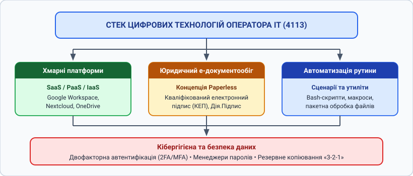

# Урок 5. Цифрові технології та цифрові засоби у професійній діяльності

<div class="how-to">

**Як працювати з уроком**

1. Ознайомтеся з сучасним арсеналом цифрових технологій: хмарні сервіси, електронний підпис (КЕП), автоматизація, кібергігієна та резервне копіювання.
2. Виконайте покрокове практичне завдання зі створення захищеного архіву документів із контролем цілісності за алгоритмом SHA-256.
3. Пройдіть підсумковий контрольний тест із 10 запитань для перевірки засвоєння матеріалу першого змістового модуля.

</div>

## Мета уроку

Оволодіти сучасними цифровими інструментами та технологіями, необхідними для високопродуктивної, юридично бездоганної та безпечної роботи оператора з обробки інформації та програмного забезпечення. На практиці ви:

- навчитеся використовувати базові інструменти цифровізації робочого простору (хмарні сховища, електронний документообіг, КЕП);
- засвоїте золоте правило резервного копіювання даних «3-2-1»;
- реалізуєте в командному рядку автоматизоване архіваціювання робочих документів за допомогою утиліти `tar`;
- застосуєте криптографічні хеш-суми `sha256sum` для контролю цілісності цифрових файлів та виявлення прихованих модифікацій.

## Що знадобиться

- Комп'ютер під керуванням ОС Linux або Windows із середовищем командного рядка Bash.
- Стандартні утиліти архівації та криптографічного контролю: `tar`, `gzip`, `sha256sum`.
- Будь-який сучасний вебоглядач для роботи з хмарними платформами та сервісами електронного підпису.

## Теорія

<div class="clip">


*Схема основних вузлів материнської плати<sup>[1]</sup>*

</div>

### Цифрова трансформація та професійний профіль оператора

**Цифрова трансформація (цифровізація)** — це фундаментальне переосмислення бізнес-процесів організації за допомогою сучасних цифрових технологій. Якщо раніше оператор здебільшого займався механічним набором тексту з паперових носіїв, то сьогодні кваліфікований фахівець професії 4113 є диспетчером цифрових потоків, оператором хмарних платформ і гарантом цілісності та безпеки корпоративних даних.

Ключовий стек цифрових технологій та інструментів оператора включає:

<div class="clip">



*Стек цифрових технологій оператора ІТ (4113)*

</div>

#### 1. Хмарні обчислення та сервіси спільної роботи
Хмарні технології виключають прив'язку фахівця до конкретного фізичного ПК. Оператор використовує моделі сервісів:
- **SaaS (Software as a Service):** готове програмне забезпечення у браузері без встановлення на ПК (Google Документи, Таблиці, презентації, хмарний сервіс Nextcloud, поштові системи).
- **PaaS (Platform as a Service):** хмарне середовище для розгортання власних застосунків і баз даних.
- **IaaS (Infrastructure as a Service):** оренда віртуальних серверів, процесорної потужності та дискового простору (AWS, DigitalOcean, Hetzner).

Спільна робота над документами дозволяє декільком операторам одночасно редагувати звіт, залишати коментарі та бачити історію версій без ризику втрати змін.

#### 2. Електронний документообіг та електронний підпис (КЕП)
Перехід до концепції **Paperless** («Офіс без паперу») став державним стандартом України. Паперові документи з мокрою печаткою повністю заміщуються електронними документами.
- **КЕП (Кваліфікований електронний підпис)** або **Дія.Підпис** має таку саму юридичну силу, як і власноручний підпис та печатка підприємства (згідно із Законом України «Про електронні довірчі послуги»).
- Електронний підпис створюється за допомогою алгоритмів асиметричного шифрування (відкритий та закритий ключ).
- Якщо після накладення підпису в документі буде змінено бодай один пробіл чи кому, підпис автоматично визнається недійсним. Це гарантує **юридичну невідмовність** (*non-repudiation*) та **цілісність**.

#### 3. Автоматизація рутинних операцій
Щоб не виконувати сотні однотипних механічних дій вручну, оператор використовує засоби автоматизації:
- **Bash-скрипти:** для щоденного перейменування, сортування та резервування тисяч файлів;
- **Офісні макроси:** для автоматичного зведення десятків таблиць в один підсумковий звіт;
- **Пакетні перетворювачі:** утиліти `pandoc` (для миттєвої конвертації між форматами docx, pdf, md, html), `imagemagick` (для стиснення та масштабування сотень зображень за один клік).

#### 4. Кібергігієна та надійне резервне копіювання
Втрата даних підприємства через вірус-вимагач або поломку диска призводить до катастрофічних наслідків. Оператор повинен суворо дотримуватися стандартів безпеки:
- **Двофакторна автентифікація (2FA/MFA):** вхід до корпоративних систем вимагає не лише пароля, а й одноразового коду з додатка-автентифікатора (Google Authenticator) або апаратного USB-ключа (YubiKey).
- **Менеджери паролів (KeePassXC, Bitwarden):** використання унікальних згенерованих паролів довжиною від 16 символів для кожного сервісу.
- **Золоте правило резервного копіювання «3-2-1»:**
  - Мати щонайменше **3** копії важливих даних;
  - Зберігати копії щонайменше на **2** різних фізичних носіях (наприклад, внутрішній SSD та зовнішній диск HDD / NAS);
  - Щонайменше **1** копію зберігати віддалено поза офісом (у хмарному сховищі або захищеному дата-центрі).

<div class="more-link">

**Хочете знати більше?** <span class="optional">Необов’язково</span>

Як комп'ютер миттєво перевіряє, чи не був файл змінений зловмисником? Для цього використовують **криптографічні хеш-функції** (наприклад, SHA-256). Хеш-функція перетворює файл будь-якого розміру (навіть фільм на 50 ГБ) у фіксований 64-символьний шістнадцятковий рядок — «цифровий відбиток» файлу. Якщо змінити хоча б один біт у вихідному файлі, весь хеш-рядок зміниться до невпізнаваності (так званий «лавинний ефект»). На основі хешів побудовані електронні підписи, блокчейн і сучасні системи контролю версій Git.

</div>

## Покроково

Виконаємо регламентну процедуру резервного копіювання корпоративного архіву документів із формуванням контрольних сум цілісності SHA-256.

### 1. Підготуйте робочий простір оператора та комплект документів

Створіть робочу папку для п'ятого уроку та підкаталог `contracts`, що імітує щоденний архів договорів:

```bash
mkdir -p ~/cpto_it_lab/lesson05/contracts
cd ~/cpto_it_lab/lesson05

cat << 'DOC1' > contracts/contract_001.txt
ДОГОВІР ПОСТАВКИ № 001
Постачальник: ТОВ "Цифрові Системи"
Замовник: КП "Інформаційний Центр"
Сума договору: 150000.00 грн (з ПДВ)
Дата підписання: 2026-11-16
DOC1

cat << 'DOC2' > contracts/act_acceptance_001.txt
АКТ ПРИЙМАННЯ-ПЕРЕДАЧІ ДО ДОГОВОРУ № 001
Роботи з налаштування серверного обладнання виконано в повному обсязі.
Претензій у сторін немає.
DOC2
```

### 2. Створіть стиснений архів за допомогою утиліти `tar`

Створіть архів формату `.tar.gz` із додаванням поточної системної дати до імені архіву:

```bash
BACKUP_NAME="backup_contracts_$(date +%Y%m%d).tar.gz"
tar -czvf "$BACKUP_NAME" contracts/
echo "Архів успішно створено: $BACKUP_NAME"
ls -lh "$BACKUP_NAME"
```

Прапорці команди: `-c` (create — створити), `-z` (gzip — стиснути), `-v` (verbose — показати список файлів), `-f` (file — записати у файл).

### 3. Згенеруйте контрольні суми SHA-256 для контролю цілісності

Створіть файл перевірки цілісності `checksums.sha256`:

```bash
sha256sum "$BACKUP_NAME" > checksums.sha256
cat checksums.sha256
```

Тепер перевіримо цілісність створеного архіву за допомогою штатної команди верифікації:

```bash
sha256sum -c checksums.sha256
```

Якщо система виводить повідомлення `OK` — дані збережені без жодних пошкоджень і повністю готові для відправки до хмарного сховища.

<div class="try">

**Спробуйте самі**

Перевірте роботу контролю цілісності, якщо файл було пошкоджено під час передачі мережею або модифіковано вірусом. Створіть копію архіву `corrupted_backup.tar.gz`, навмисно допишіть один зайвий символ у кінець файлу та виконайте перевірку контрольної суми:

```bash
cp "$BACKUP_NAME" corrupted_backup.tar.gz
echo "X" >> corrupted_backup.tar.gz
sed 's/'"$BACKUP_NAME"'/corrupted_backup.tar.gz/' checksums.sha256 > test_corrupted.sha256
sha256sum -c test_corrupted.sha256
```

<details>
<summary>Перевірити очікуваний результат і повний розв’язок</summary>

Утиліта `sha256sum` виявить невідповідність розрахованого хешу збереженому еталону та поверне чітке попередження про фальсифікацію або пошкодження:

```text
corrupted_backup.tar.gz: FAILED
sha256sum: WARNING: 1 computed checksum did NOT match
```

Завдяки алгоритму SHA-256 оператор миттєво бачить, що архів не можна розпаковувати чи вносити в базу даних, оскільки його цілісність скомпрометована. Це наочно демонструє дію сучасних цифрових засобів кіберзахисту.

</details>

</div>

## Підсумок

- Цифрові технології трансформували професію 4113 від простого набору тексту до керування захищеними інформаційними потоками в хмарних платформах (**SaaS/IaaS**).
- **Кваліфікований електронний підпис (КЕП)** має повну юридичну силу власноручного підпису та гарантує цілісність документа.
- Резервне копіювання за правилом **«3-2-1»** (3 копії, 2 носії, 1 віддалена копія) є обов'язковим щоденним регламентом захисту від аварій.
- Алгоритми хешування (**SHA-256**) створюють унікальний «цифровий відбиток» файлів і унеможливлюють непомітне спотворення інформації.

## Тест

<div class="test-box">

10 запитань за матеріалом уроку. На початку тесту вкажіть **прізвище, ім’я та групу**.

<!-- GOOGLE_FORM_START:lesson-05 -->
[Відкрити тест у новій вкладці](https://docs.google.com/forms/d/e/1FAIpQLSfr8sZNZGHlMl0gAbfdHioEqtb_15baBbFiMb0A0gh5rh4EXA/viewform)

<iframe src="https://docs.google.com/forms/d/e/1FAIpQLSfr8sZNZGHlMl0gAbfdHioEqtb_15baBbFiMb0A0gh5rh4EXA/viewform?embedded=true" loading="lazy" title="Тест lesson-05">Завантаження…</iframe>
<!-- GOOGLE_FORM_END:lesson-05 -->

</div>

## Додаткове завдання

<span class="optional">Необов’язково</span> Виконуйте для практичного закріплення навичок автоматизації щоденних задач.

**Базовий рівень.** Створіть скрипт `daily_backup.sh`, який автоматично знаходить у папці `contracts` усі файли, змінені за останні 24 години (команда `find contracts -mtime -1`), та формує з них компактний архів `daily_changes.tar.gz`.

**Проєктний рівень.** Опишіть правила кібергігієни для організації робочого місця оператора за трьома напрямами: 1) робота з паролями та автентифікацією (2FA); 2) правила безпечного завантаження та відкриття файлів з електронної пошти; 3) порядок дій у разі підозри на зараження комп'ютера шкідливим програмним забезпеченням.

## Джерела

1. [Motherboard_Components.svg](https://commons.wikimedia.org/wiki/File:Motherboard_Components.svg), Wikimedia Commons.
