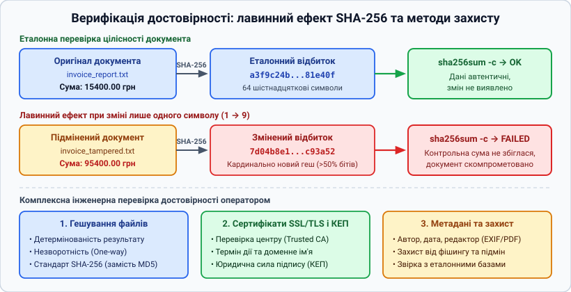

# Урок 6. Оцінювання якості та достовірності інформації

<div class="how-to">

**Як працювати з уроком**

1. Опрацюйте критерії якості інформації, ознайомтеся з загрозами спотворення даних та методами їх технічної верифікації.
2. Виконайте покрокове практичне завдання з обчислення контрольних сум файлів за алгоритмом SHA-256 та перевірки SSL-сертифікатів у терміналі.
3. Дайте відповіді на 10 запитань підсумкового тесту для перевірки знань.

</div>

## Мета уроку

Ви дізнаєтеся, за якими критеріями визначається якість інформації в автоматизованих системах, які небезпеки становлять недостовірні дані для підприємства та як оператор з обробки інформації та програмного забезпечення може технічно гарантувати автентичність файлів і документів. На практиці ви:

- навчитеся обчислювати криптографічні контрольні суми (геш-відбитки SHA-256) у командному рядку;
- дослідите «лавинний ефект» геш-функцій при зміні хоча б одного байта у документі;
- автоматизуєте перевірку цілісності файлових архівів за допомогою списків контрольних сум;
- перевірите справжність цифрового сертифіката безпеки віддаленого сервера.

## Що знадобиться

- Операційна система Linux (термінал Bash) або Windows 10/11 (термінал PowerShell).
- Стандартні утиліти командного рядка: `sha256sum` (у Linux) або `Get-FileHash` (у PowerShell), а також `openssl` або веббраузер (Firefox/Chrome).
- Простий текстовий редактор (Nano, Micro або VS Code / Блокнот).

## Теорія

### Що таке якість інформації та чому вона критична?

Для фахівця за професією **4113 «Оператор з обробки інформації та програмного забезпечення»** щоденна робота полягає у введенні, накопиченні, перевірці та передаванні цифрових даних. Якщо в систему потрапляють спотворені, застарілі або сфальсифіковані відомості, виникає ефект, відомий у комп'ютерних науках як **GIGO (Garbage In, Garbage Out — «Сміття на вході — сміття на виході»)**. Навіть найдосконаліша інформаційна система видасть помилковий результат, якщо оператор завантажить неякісні первинні дані.

Якість інформації — це ступінь її відповідності потребам користувачів і завданням, для розв'язання яких вона призначена.

---

### Ключові властивості та критерії якості інформації

| Критерій | Сутність критерію | Приклад у роботі оператора |
| :--- | :--- | :--- |
| **Достовірність (Accuracy)** | Відповідність реальному стану об'єкта або процесу, відсутність помилок і викривлень. | Серійний номер комп'ютера у накладній точно збігається з маркуванням на корпусі. |
| **Повнота (Completeness)** | Достатність обсягу відомостей для прийняття правильного рішення без додаткових пошуків. | Картка товару містить артикул, назву, кількість, ціну та дату надходження на склад. |
| **Своєчасність та актуальність (Timeliness)** | Здатність відображати поточну ситуацію в режимі реального часу. | Курси валют для розрахунку вартості замовлень оновлюються на початку кожного банківського дня. |
| **Релевантність (Relevance)** | Смислова відповідність інформації поточному інформаційному запиту користувача. | У звіті про продажі процесорів немає зайвих записів про закупівлю офісних меблів. |
| **Цілісність та захищеність (Integrity)** | Неможливість несанкціонованої модифікації або пошкодження даних під час передачі чи збереження. | Завантажений файл оновлення операційної системи не містить вірусних ін'єкцій та пошкоджених секторів. |
| **Зрозумілість і доступність (Accessibility)** | Подання інформації у стандартизованому, зручному для сприйняття форматі без надлишкової складності. | Звіт оформлено у стандартній таблиці LibreOffice Calc з чіткими назвами колонок. |

---

### Загрози спотворення інформації у цифровому середовищі

Оператор регулярно стикається з маніпулятивними та шкідливими інформаційними впливами:

1. **Дезінформація (Disinformation):** умисно сфабриковані неправдиві дані, створені для введення в оману (наприклад, підроблені банківські квитанції або фальшиві накази керівництва).
2. **Місінформація (Misinformation):** помилкові дані, які поширюються ненавмисно внаслідок збою обладнання чи неуважності працівника (наприклад, помилка в одну цифру в податковому коді ЄДРПОУ).
3. **Фішинг (Phishing) та підміна доменів (Typosquatting):** створення сайтів-двійників державних органів чи платіжних шлюзів (наприклад, `privat24-login.com` замість офіційного домену), мета яких — перехопити облікові записи оператора.
4. **Підміна файлів дистрибутивів (Supply Chain Attacks):** модифікація виконуваних файлів програм сторонніми зловмисниками шляхом перехоплення трафіку (Man-in-the-Middle) або злому дзеркал завантаження.

---

### Технічні методи верифікації достовірності та цілісності

Для перевірки інформації оператор застосовує не суб'єктивну оцінку («вірю/не вірю»), а чіткі інженерні та програмні методи:

#### 1. Криптографічний контроль цілісності (гешування)
**Геш-функція (Hash function)** — це математичний алгоритм, що перетворює довільний масив вхідних даних (будь то текстовий рядок з 5 літер чи ISO-образ вагою 4 гігабайти) у фіксований за довжиною рядок шістнадцяткових символів (геш-відбиток або контрольну суму).

Головні властивості стійкої геш-функції:
- **Детермінованість:** для однакового вхідного файлу результат гешування завжди строго однаковий на будь-якому комп'ютері.
- **Незворотність (One-way function):** за значенням гешу неможливо відновити вихідний файл.
- **Лавинний ефект (Avalanche effect):** зміна навіть одного єдиного біта у файлі розміром у кілька гігабайтів змінює понад 50% символів у підсумковому геші.

Сучасний надійний стандарт гешування — сімейство **SHA-2 (зокрема SHA-256)**, що генерує 256-бітний відбиток (рядок із 64 символів). Старіші алгоритми **MD5** та **SHA-1** вважаються криптографічно застарілими через виявлені математичні колізії, проте MD5 досі інколи застосовують для швидкої перевірки випадкових пошкоджень диска.

#### 2. Перевірка сертифікатів безпеки (SSL/TLS та цифрові підписи)
При завантаженні оновлень або роботі з хмарними інформаційними системами обов'язково перевіряється сертифікат віддаленого вузла:
- Хто видав сертифікат (чи є центр сертифікації акредитованим — Trusted Root CA);
- Термін дії сертифіката (Valid From / Valid To);
- Чи збігається доменне ім'я вузла із зазначеним у сертифікаті (Common Name або Subject Alternative Name).

#### 3. Верифікація метаданих первинних документів
Будь-який електронний документ (PDF, DOCX, зображення JPEG) містить службові метадані: автора, дату створення, версію програми-редактора, геомітки (EXIF) або історію редагувань. Зіставлення метаданих із заявленим змістом документа дозволяє миттєво виявити факт підробки дати видачі чи автора наказу.

<div class="clip">



*Рис. Верифікація достовірності: лавинний ефект SHA-256 та методи захисту*

</div>

<div class="more-link">

**Хочете знати більше?** <span class="optional">Необов’язково</span>

- **Кваліфікований електронний підпис (КЕП):** в Україні використання КЕП регулюється Законом «Про електронну ідентифікацію та електронні довірчі послуги». КЕП накладається за допомогою закритого криптографічного ключа, а перевіряється відкритим сертифікатом через державні сервіси (наприклад, [czo.gov.ua](https://czo.gov.ua)). Він гарантує не лише незмінність документа з моменту підписання, але й повну юридичну силу, еквівалентну власноручному підпису та мокрій печатці.
- **Публічна перевірка на VirusTotal:** вебсервіс [virustotal.com](https://www.virustotal.com) дозволяє перевірити файл або посилання за базами понад 70 провідних антивірусних лабораторій світу, а також звірити публічні геш-відбитки відомого шкідливого ПЗ.

</div>

---

## Покроково

Виконайте практичне дослідження контролю достовірності та цілісності файлів на робочій станції за допомогою терміналу Linux/PowerShell.

### 1. Створення тестового документа для верифікації

Створіть робочу директорію та згенеруйте первинний текстовий файл звіту оператора:

```bash
mkdir -p ~/info_verification && cd ~/info_verification
printf "Документ: Акт прийому комп'ютерної техніки №42
Дата: 2026-11-16
Відповідальний оператор: Петренко О.В.
Сума до сплати: 15400.00 грн
Статус: Затверджено без зауважень
" > invoice_report.txt
```

Перевірте наявність файлу та його вміст:
```bash
cat invoice_report.txt
```

### 2. Обчислення еталонної контрольної суми SHA-256

Обчисліть геш-суму документа за стандартом SHA-256 та збережіть результат у файл контрольних сум:

```bash
sha256sum invoice_report.txt > checksums.sha256
cat checksums.sha256
```

*(Якщо ви працюєте у Windows PowerShell, еквівалентна команда: `Get-FileHash -Algorithm SHA256 invoice_report.txt`)*.

Зверніть увагу: згенерований рядок містить рівно 64 шістнадцяткові символи, після яких зазначено назву файлу.

### 3. Перевірка лавинного ефекту (імітація зловмисної підміни або збою)

Створіть копію документа та внесіть у неї непомітну «шахрайську» зміну — замініть суму з `15400.00` на `95400.00`:

```bash
cp invoice_report.txt invoice_tampered.txt
sed -i "s/15400.00/95400.00/" invoice_tampered.txt
```

Порівняйте геші обох файлів:

```bash
sha256sum invoice_report.txt invoice_tampered.txt
```

Подивіться, як кардинально змінився весь 64-символьний рядок через зміну лише однієї цифри `1` на `9`. Жоден біт попереднього гешу не збігається. Це і є прояв **лавинного ефекту**.

### 4. Автоматична верифікація цілісності засобами утиліти `sha256sum`

Утиліта `sha256sum` підтримує прапорець `-c` (`--check`), який автоматично зчитує файл із контрольними сумами та перевіряє зазначені у ньому файли:

```bash
sha256sum -c checksums.sha256
```

У терміналі з'явиться підтвердження: `invoice_report.txt: OK`.

Тепер підмініть оригінальний файл сфальсифікованим і повторіть автоматичну перевірку:

```bash
cp invoice_tampered.txt invoice_report.txt
sha256sum -c checksums.sha256
```

<div class="try">

**Спробуйте самі**

Перевірте за допомогою терміналу сертифікат безпеки та надійність з'єднання до захищеного вебвузла за допомогою утиліти `openssl` (або перегляньте деталі сертифіката в замку адресної стрічки вашого браузера):

```bash
openssl s_client -connect czo.gov.ua:443 -servername czo.gov.ua < /dev/null 2>/dev/null | openssl x509 -noout -issuer -subject -dates
```

<details>
<summary>Перевірити очікуваний результат і повний розв’язок</summary>

Очікуваний вивід автоматичної перевірки підміненого файлу:

```text
invoice_report.txt: FAILED
sha256sum: WARNING: 1 computed checksum did NOT match
```

Очікуваний вивід утиліти `openssl` для перевірки сертифіката:

```text
issuer=C = US, O = Let's Encrypt, CN = R10 (або інший акредитований CA)
subject=CN = czo.gov.ua
notBefore=...
notAfter=...
```

Це свідчить про те, що:
1. Контрольна сума моментально сигналізує про будь-яке спотворення документа (помилка `FAILED`), захищаючи оператора від прийняття неправдивих даних.
2. Цифровий сертифікат має чіткий термін придатності (`notBefore` / `notAfter`), пов'язаний з конкретним доменним ім'ям `czo.gov.ua` та підписаний довіреним центром сертифікації (`issuer`).

Після виконання практичної роботи очистіть тимчасову директорію:
```bash
cd ~ && rm -rf ~/info_verification
```

</details>

</div>

## Підсумок

- Якість інформації визначається об'єктивними критеріями: достовірністю, повнотою, своєчасністю, релевантністю, доступністю та захищеністю.
- Помилкові чи сфабриковані дані на вході системи руйнують будь-який результат її роботи (принцип GIGO).
- Криптографічні геш-функції (наприклад, SHA-256) діють як унікальні цифрові відбитки файлів; лавинний ефект унеможливлює непомітну модифікацію навіть одного біта даних.
- Оператор зобов'язаний верифікувати походження програмного забезпечення та документів за контрольними сумами, цифровими підписами й SSL-сертифікатами.

## Тест

<div class="test-box">

10 запитань за матеріалом уроку. На початку тесту вкажіть **прізвище, ім’я та групу**.

<!-- GOOGLE_FORM_START:lesson-06 -->
[Відкрити тест у новій вкладці](https://docs.google.com/forms/d/e/1FAIpQLSdN-lxoEE2YqhK6cLyvDwNtih5aHE0jIYT9O-dYDEJH3lp4BQ/viewform)

<iframe src="https://docs.google.com/forms/d/e/1FAIpQLSdN-lxoEE2YqhK6cLyvDwNtih5aHE0jIYT9O-dYDEJH3lp4BQ/viewform?embedded=true" loading="lazy" title="Тест lesson-06">Завантаження…</iframe>
<!-- GOOGLE_FORM_END:lesson-06 -->

</div>

## Додаткове завдання

<span class="optional">Необов’язково</span> Для закріплення навичок оцінки якості інформації.

**Базовий рівень.** Знайдіть в інтернеті офіційну сторінку завантаження вільного офісного пакета LibreOffice ([libreoffice.org](https://www.libreoffice.org/download/download-libreoffice/)). Знайдіть біля кнопки завантаження інсталяційного файлу посилання «Info / Hash / SHA256» та випишіть еталонний геш-код SHA-256 для поточної версії програми.

**Проєктний рівень.** Розробіть для підприємства лаконічну інструкцію-пам'ятку (чек-лист) на 5 кроків під назвою: «Алгоритм дій оператора у разі отримання електронного листа з підозрілим вкладенням (рахунком або оновленням програми)».
