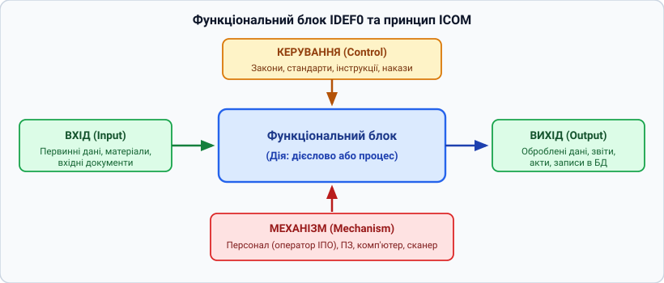
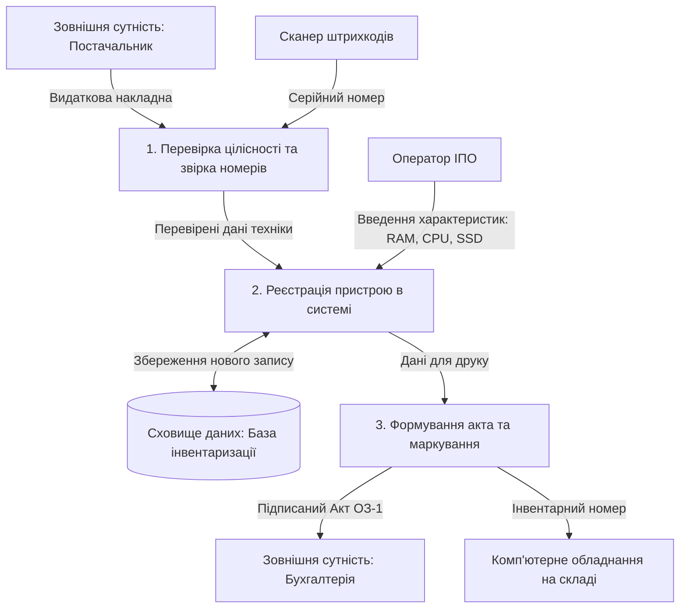
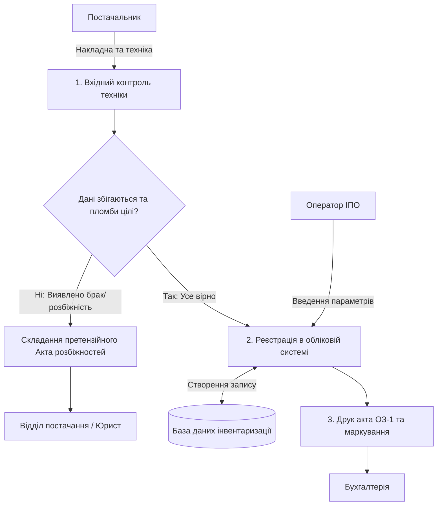

# Урок 7. Методи аналізу та моделювання інформаційних систем

**Як працювати з уроком**

1. Ознайомтеся з основами системного аналізу, класичними підходами до моделювання (структурний vs об'єктно-орієнтований) та стандартами IDEF0 і DFD.
2. Виконайте покрокове практичне завдання з побудови функціональної моделі процесу оператора за принципом ICOM та її візуалізації мовою Mermaid.
3. Дайте відповіді на 10 запитань підсумкового тесту для перевірки знань.

## Мета уроку

Ви дізнаєтеся, чому моделювання є обов'язковим фундаментом створення будь-якої інформаційної системи (ІС), як функціональні схеми допомагають порозумітися замовнику, розробнику та кінцевому оператору, а також навчитеся застосовувати ключові методи структурного аналізу. На практиці ви:

- проаналізуєте бізнес-процес оприбуткування комп'ютерного обладнання на підприємстві;
- розіб'єте складний процес на складові за стандартом функціонального моделювання IDEF0 та принципом ICOM (вхід, керування, вихід, механізм);
- побудуєте ієрархічну схему потоків даних (DFD) у нотації текстового моделювання Mermaid;
- оціните ризики та розробите альтернативну гілку обробки нештатної ситуації (виявлення браку).

## Що знадобиться

- Будь-який сучасний вебоглядач (Mozilla Firefox, Google Chrome, Chromium).
- Середовище відтворення схем Mermaid: Mermaid Live Editor ([mermaid.live](https://mermaid.live)), розширення для VS Code або вбудований переглядач Markdown.
- Текстовий редактор (Nano, VS Code, Geany або стандартний LibreOffice Writer).

## Теорія

*Модуль оперативної пам'яті DDR4[1]*

### Що таке аналіз і моделювання інформаційних систем?

**Інформаційна система (ІС)** — це складна сукупність апаратних засобів, програмного забезпечення, баз даних, регламентів та персоналу, призначена для збору, збереження, обробки й видачі інформації для прийняття рішень.

Спроба створити або модернізувати велику ІС без попереднього аналізу схожа на будівництво багатоповерхового будинку без креслень: конструкція неодмінно завалиться. 

**Модель** — це спрощене уявлення реального об'єкта, процесу чи системи, яке зберігає його найсуттєвіші характеристики для дослідження.

**Моделювання** — це процес побудови та вивчення моделей з метою розуміння структури системи, оптимізації її роботи та усунення помилок ще до написання програмного коду чи закупівлі серверів.

> **Правило вартості помилки (Ефект Боема):**  
> Виправлення помилки у вимогах на етапі моделювання коштує у 10–100 разів дешевше, ніж її виправлення на стадії промислової експлуатації готової системи оператором!

---

### Два головні підходи до моделювання ІС

У системному аналізі історично склалися дві потужні парадигми:

| Критерій порівняння | Структурний (функціональний) підхід | Об'єктно-орієнтований підхід (ООП) |
| :--- | :--- | :--- |
| **Головна увага** | Функціям (що саме робить система?) та потокам даних між ними. | Об'єктам (із ким і чим взаємодіє система?), їхньому стану та поведінці. |
| **Принцип декомпозиції** | Функціональна декомпозиція («зверху-вниз»): розбиття великої задачі на менші підфункції. | Об'єктна декомпозиція: виділення класів, їх властивостей (атрибутів) та операцій (методів). |
| **Розділення даних і логіки** | Дані та функції розділені (функції обробляють пасивні потоки даних). | Дані та функції інкапсульовані разом усередині об'єктів. |
| **Базові стандарти** | IDEF0, IDEF1X, DFD (діаграми потоків даних), діаграми переходів станів (STD). | UML (Unified Modeling Language — уніфікована мова моделювання). |
| **Де найбільш ефективний** | Аналіз бізнес-процесів підприємства, регламенти документообігу, проектування реляційних БД. | Проєктування складного програмного забезпечення, мікросервісів, інтерфейсів користувача. |

---

### Стандарт IDEF0 та принцип ICOM

Одним із найпоширеніших стандартів структурного моделювання бізнес-процесів є **IDEF0 (Integration Definition for Function Modeling)**.

В основі IDEF0 лежить поняття **функціонального блоку** (прямокутника), що відображає конкретну дію чи процес. До кожного блоку спрямовані 4 типи стрілок за мнемонічним правилом **ICOM**:

*Схема функціонального блоку IDEF0 за принципом ICOM*

1. **Вхід (Input — ліва грань):** Матеріали або дані, які трансформуються або споживаються процесом (наприклад, *вхідна паперова накладна*, *файли первинних даних*).
2. **Керування (Control — верхня грань):** Закони, регламенти, стандарти, накази директора чи інструкції, які регулюють виконання процесу, але самі процесом не змінюються.
3. **Вихід (Output — права грань):** Результат роботи процесу (наприклад, *запис у базі даних*, *підписаний акт приймання-передачі*, *сформований звіт*).
4. **Механізм (Mechanism — нижня грань):** Ресурси, люди або технічні засоби, які безпосередньо виконують роботу (наприклад, *оператор ІПО*, *комп'ютер*, *програма LibreOffice Calc*, *сканер*).

---

### Діаграми потоків даних (DFD)

**DFD (Data Flow Diagram)** фокусується на тому, як потоки інформації переміщуються між зовнішнім світом, процесами обробки та сховищами даних.

Основні елементи DFD:
1. **Зовнішня сутність (External Entity):** Джерело або приймач даних поза межами розглядуваної системи (наприклад, *Клієнт*, *Постачальник*, *Бухгалтерія*). Позначається прямокутником.
2. **Процес (Process):** Операція, що перетворює вхідні потоки даних на вихідні. Позначається округленим прямокутником або колом.
3. **Сховище даних (Data Store):** Місце, де дані накопичуються для тривалого зберігання (таблиця бази даних, картотека, файл на сервері). Позначається двома паралельними лініями.
4. **Потік даних (Data Flow):** Стрілка, що показує напрямок переміщення іменованого пакета інформації.

---

### Сучасні інструменти моделювання: Diagrams as Code

Традиційно діаграми малювали у графічних редакторах (Microsoft Visio, Draw.io). Проте сьогодні в ІТ-індустрії домінує підхід **Diagrams as Code (діаграми як код)**: опис структури у вигляді простого читабельного тексту за допомогою мов **PlantUML** або **Mermaid**.

Переваги такого підходу:
- Текстовий файл діаграми важить лічені кілобайти.
- Схеми можна зберігати в системах контролю версій Git і відстежувати історію кожної зміни.
- Діаграми миттєво візуалізуються на вебсторінках документації, GitHub, у редакторах Markdown та корпоративних базах знань.

**Хочете знати більше?** Необов’язково

- **BPMN 2.0 (Business Process Model and Notation):** сучасний світовий стандарт моделювання бізнес-процесів, орієнтований на виконання рушіями автоматизації (наприклад, Camunda BPM). На відміну від статичного IDEF0, BPMN чітко показує події (стартові, проміжні, кінцеві), шлюзи прийняття рішень (розгалуження) та доріжки відповідальності (Pools & Lanes).
- **CASE-засоби (Computer-Aided Software Engineering):** спеціалізовані програмні комплекси (наприклад, Enterprise Architect, Visual Paradigm), які вміють автоматично генерувати код програм та схеми SQL-баз даних на основі створених аналітиком візуальних моделей.

---

## Покроково

Виконайте практичне моделювання бізнес-процесу «Оприбуткування та введення в експлуатацію комп'ютерної техніки» для робочого місця оператора ІПО.

### 1. Системний аналіз та побудова специфікації ICOM

Оператор комп'ютерного набору та обліку отримує партію нових системних блоків від постачальника. Проаналізуйте складові процесу за правилом ICOM:

- **Вхідні дані (Inputs):** Паперова видаткова накладна постачальника, заводські гарантійні талони та маркувальні бирки із серійними номерами.
- **Керуючі фактори (Controls):** Посадова інструкція оператора ІПО №14, Положення про матеріальну відповідальність, Наказ директора про оновлення комп'ютерного парку.
- **Виконавчі механізми (Mechanisms):** Оператор з обробки інформації, персональний комп'ютер оператора, бездротовий сканер штрихкодів, система обліку складу (ERP Odoo / 1C).
- **Вихідні результати (Outputs):** Зареєстрована електронна картка основного засобу в базі даних, роздрукований «Акт введення в експлуатацію ф. ОЗ-1», присвоєний внутрішній інвентарний номер.

Складіть таблицю інтерфейсів процесу:

| Елемент ICOM | Назва об'єкта / документа | Тип носія |
| :--- | :--- | :--- |
| **Input** | Видаткова накладна | Паперовий документ |
| **Input** | Серійні номери пристроїв | Штрихкод на корпусі |
| **Control** | Посадова інструкція оператора | Внутрішній регламент |
| **Control** | Правила бухгалтерського обліку | Законодавчий стандарт |
| **Mechanism** | Оператор ІПО (таб. №4113) | Персонал |
| **Mechanism** | Сканер штрихкодів USB | Апаратний засіб |
| **Mechanism** | База даних обліку (PostgreSQL) | Програмний засіб |
| **Output** | Електронний запис про прихід | Запис у таблиці БД |
| **Output** | Акт введення в експлуатацію | Друкований документ |

### 2. Функціональна декомпозиція процесу на підзадачі

Розбийте глобальний процес на 3 послідовні підфункції (кроки декомпозиції):
1. **Підфункція 1 (A1):** Фізичний огляд та звірка серійних номерів техніки із супровідними документами.
2. **Підфункція 2 (A2):** Внесення технічних характеристик та присвоєння інвентарного номера в інформаційній системі.
3. **Підфункція 3 (A3):** Друк фіскального акта та нанесення маркувальної наліпки на системний блок.

### 3. Побудова діаграми потоку даних мовою Mermaid

Опишіть логіку переміщення інформації за допомогою текстового коду Mermaid:

**Спробуйте самі**

Додайте до створеної діаграми блок обробки нештатної ситуації (розгалуження): якщо під час першого кроку виявлено пошкодження пломби або невідповідність серійного номера, процес має перейти до блоку «Складання претензійного акта розбіжностей» і повідомити Відділ постачання замість внесення в базу даних.

Перевірити очікуваний результат і повний розв’язок

Оновлений код діаграми Mermaid із врахуванням виявлення браку:

Аналіз отриманої моделі:
- Введення умови розгалуження (`Check`) запобігає проникненню недостовірних даних у виробничу базу даних підприємства (дотримання правила GIGO).
- Завдяки візуальній схемі навіть новий працівник на посаді оператора чітко бачить межі своєї відповідальності та сценарій дій при нештатній ситуації.

## Підсумок

- Моделювання — обов'язковий етап створення та супроводу ІС; виправлення помилок на етапі моделі коштує у десятки разів дешевше за переробку готової системи.
- Структурний підхід орієнтований на функції та потоки даних, тоді як об'єктний — на сутності (об'єкти), їх стан і методи.
- Стандарт IDEF0 формалізує будь-яку дію за правилом ICOM: Input (вхід), Control (керування), Output (вихід), Mechanism (механізм).
- Концепція Diagrams as Code (Mermaid, PlantUML) дає змогу швидко документувати інформаційні системи безпосередньо у вигляді текстового коду.

## Тест

10 запитань за матеріалом уроку. На початку тесту вкажіть **прізвище, ім’я та групу**.

🔗 <!-- GOOGLE_FORM_URL:lesson-07 --> *(Посилання на Google Форму буде додано після масового імпорту тесту)*

## Додаткове завдання

Необов’язково Для закріплення навичок системного моделювання.

**Базовий рівень.** Відкрийте вебсервіс [mermaid.live](https://mermaid.live), вставте код практичної діаграми з уроку та протестуйте зміну теми оформлення (Theme: Dark / Forest / Neutral). Збережіть згенеровану схему на свій комп'ютер у форматі PNG або SVG.

**Проєктний рівень.** Складіть опис за принципом ICOM (вхідні дані, керуючі регламенти, механізми, вихідний результат) для щоденного робочого процесу: «Формування щоденного резервного копіювання файлового сервера оператором».

## Джерела

1. [DDR4_DIMM_4GB_-2133_IMGP5813_smial_wp.jpg](https://commons.wikimedia.org/wiki/File:DDR4_DIMM_4GB_-2133_IMGP5813_smial_wp.jpg), Wikimedia Commons.
