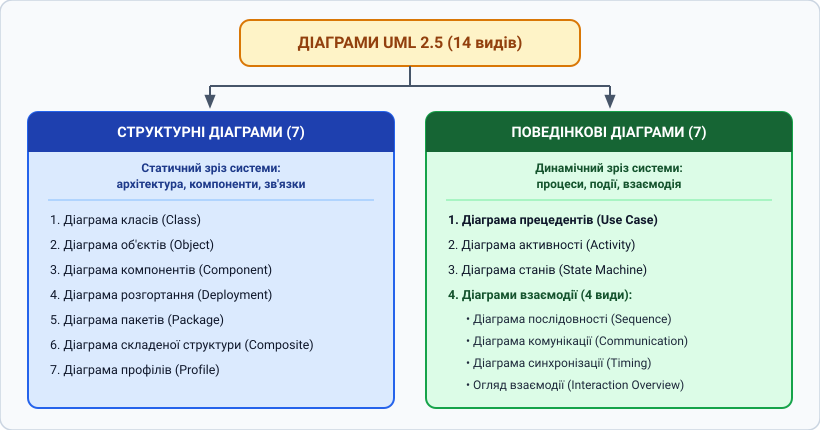
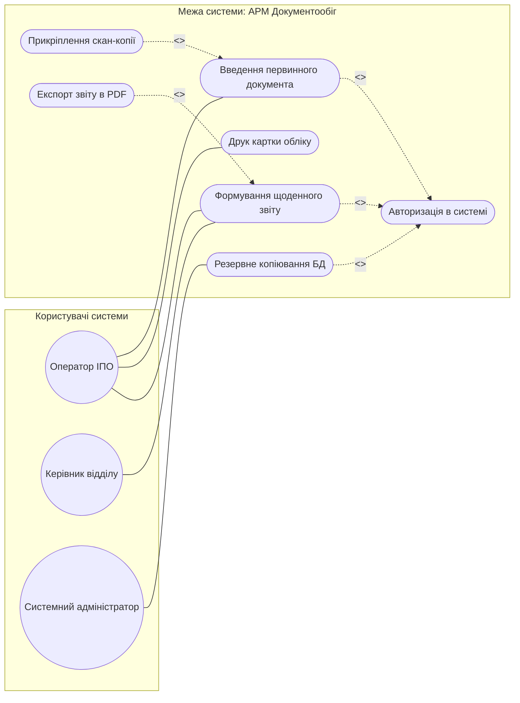
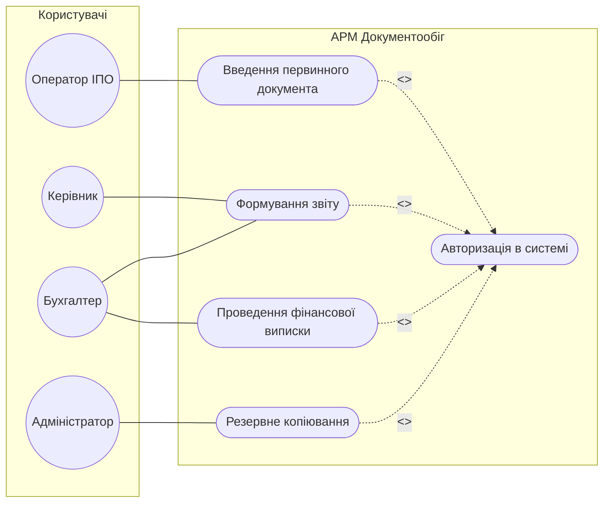

# Урок 8. Мова моделювання UML: призначення та види діаграм

**Як працювати з уроком**

1. Ознайомтеся з історією створення UML, авторами стандарту та повною класифікацією 14 видів діаграм (структурні та поведінкові).
2. Засвойте правила побудови діаграми прецедентів (Use Case Diagram), значення акторів, зв'язків `<<include>>` та `<<extend>>`.
3. Виконайте практичне проєктування взаємодії оператора з автоматизованою системою мовою Mermaid та пройдіть тест.

## Мета уроку

Ви дізнаєтеся, що таке уніфікована мова моделювання UML (Unified Modeling Language), чому вона стала міжнародним стандартом візуального проєктування програмного забезпечення, які 14 типів діаграм існують у стандарті UML 2.5 та як читати вимоги до робочого місця користувача. На практиці ви:

- навчитеся розрізняти структурні (статичні) та поведінкові (динамічні) діаграми;
- визначите акторів, межі системи та варіанти використання для робочого місця оператора ІПО;
- правильно застосуєте відношення включення (`<<include>>`) та розширення (`<<extend>>`);
- побудуєте професійну діаграму прецедентів мовою розмітки Mermaid.

## Що знадобиться

- Будь-який сучасний вебоглядач (Firefox, Chrome, Chromium).
- Середовище відтворення схем Mermaid Live Editor ([mermaid.live](https://mermaid.live)) або розширення для VS Code.
- Текстовий редактор для збереження проєктного коду.

## Теорія

### Що таке UML та як він виник?

**UML (Unified Modeling Language — уніфікована мова моделювання)** — це графічна мова моделювання загального призначення, що використовується для візуалізації, специфікації, проєктування та документування артефактів складних програмних і апаратних систем.

До середини 1990-х років в комп'ютерній індустрії панував «хаос методів»: кожен видатний інженер використовував власні графічні позначки. У 1994–1996 роках троє провідних американських вчених-інформатиків — **Граді Буч (Grady Booch)**, **Джеймс Рамбо (James Rumbaugh)** та **Івар Якобсон (Ivar Jacobson)**, яких в ІТ-світі з повагою називають **«трьома аміго»** (Three Amigos), об'єднали свої розробки в компанії Rational Software.

У 1997 році створену ними мову UML було передано міжнародному консорціуму **OMG (Object Management Group)**, який перетворив її на загальносвітовий відкритий стандарт (ISO/IEC 19501 та ISO/IEC 19505). Сучасний стандарт **UML 2.5** налічує рівно **14 видів діаграм**.

---

### Класифікація діаграм UML 2.5

Усі 14 діаграм UML поділяються на дві фундаментальні категорії:

*Класифікація 14 видів діаграм стандарту UML 2.5*

| Категорія | Назва діаграми | Призначення у практиці ІТ |
| :--- | :--- | :--- |
| **Структурна** | **Діаграма класів (Class Diagram)** | Головна діаграма ООП; показує класи, їх атрибути, методи та зв'язки (асоціація, агрегація, успадкування). |
| **Структурна** | **Діаграма об'єктів (Object Diagram)** | Знімок стану системи в конкретний момент часу з реальними значеннями змінних. |
| **Структурна** | **Діаграма розгортання (Deployment Diagram)** | Відображає фізичне розміщення серверів, клієнтських комп'ютерів, маршрутизаторів і мережевих зв'язків. |
| **Структурна** | **Діаграма компонентів (Component Diagram)** | Показує програмні модулі, бібліотеки (DLL/JAR) та їхні інтерфейси. |
| **Поведінкова** | **Діаграма прецедентів (Use Case Diagram)** | Відображає вимоги користувача: хто є користувачами (актори) і які завдання вони вирішують за допомогою системи. |
| **Поведінкова** | **Діаграма послідовності (Sequence Diagram)** | Показує хронологічний обмін повідомленнями між об'єктами вздовж лінії часу («лінії життя»). |
| **Поведінкова** | **Діаграма активності (Activity Diagram)** | Аналог блок-схеми алгоритму: розгалуження, паралельні потоки (fork/join) та операції. |
| **Поведінкова** | **Діаграма станів (State Machine Diagram)** | Життєвий цикл одного об'єкта: у яких станах він перебуває і під дією яких подій переходить між ними. |

---

### Діаграма прецедентів (Use Case Diagram)

Для оператора з обробки інформації та програмного забезпечення найважливішою є **діаграма прецедентів (варіантів використання)**, адже саме вона визначає інтерфейс та функціональні обов'язки кожного працівника в інформаційній системі.

#### Базові елементи діаграми:
1. **Актор (Actor):** Зовнішня по відношенню до системи сутність, яка взаємодіє з нею. Актором може бути людина певної посади (*Оператор ІПО*, *Бухгалтер*, *Адміністратор*) або зовнішня комп'ютерна система чи сервер (*Банківський шлюз*, *Поштовий сервер*). На діаграмі зображується піктограмою «чоловічка».
2. **Прецедент (Use Case / Варіант використання):** Конкретна функція, дія або послуга, яку система надає актору для досягнення певної мети. Зображується овалом, усередині якого пишеться назва у формі дієслова (*«Зареєструвати накладну»*, *«Сформувати виписку»*).
3. **Межа системи (System Boundary):** Прямокутна рамка навколо прецедентів, яка показує, що саме реалізується в межах програми, а що перебуває ззовні.

#### Відношення між елементами:
- **Асоціація (Association):** Звичайна суцільна лінія, яка показує, що актор бере участь у виконанні даного прецеденту.
- **Включення (`<<include>>`):** Пунктирна стрілка, яка вказує, що один прецедент **завжди й обов'язково** виконує дії іншого.  
  *Приклад:* Прецедент «Оформити замовлення» обов'язково включає (`<<include>>`) прецедент «Авторизуватися в системі». Без авторизації оформити замовлення технічно неможливо.
- **Розширення (`<<extend>>`):** Пунктирна стрілка, яка вказує, що базовий прецедент **за певних умов** (опціонально) може бути доповнений іншою функцією в точці розширення (Extension Point).  
  *Приклад:* Прецедент «Переглянути звіт» може розширюватися (`<<extend>>`) прецедентом «Експортувати звіт у формат PDF». Експорт виконується лише тоді, коли користувач за бажанням натисне відповідну кнопку.
- **Узагальнення (Генералізація):** Стрілка з порожнім трикутним наконечником. Показує успадкування: наприклад, «Старший оператор» є нащадком «Оператора» і успадковує всі його права плюс має додаткові прецеденти.

**Хочете знати більше?** Необов’язково

- **Діаграма розгортання (Deployment Diagram) для системного адміністратора:** показує апаратні вузли (Nodes) — фізичні сервери, робочі станції, сховища SAN — та програмні артефакти (файли WAR, EXE, контейнери Docker), розгорнуті на них. Ця діаграма є головним документом під час монтажу серверного обладнання та налаштування локальної мережі підприємства.
- **PlantUML vs Mermaid:** обидва інструменти реалізують підхід Diagrams as Code. Mermaid відмінно інтегрований у Markdown і браузери (працює на клієнтському JavaScript без серверів), тоді як PlantUML має потужнішу підтримку розширених стереотипів UML та кольорових тем, проте вимагає встановлення Java та утиліти Graphviz.

---

## Покроково

Виконайте проєктування моделі прецедентів для підсистеми «Автоматизоване робоче місце (АРМ) оператора з обробки інформації».

### 1. Визначення акторів та їхніх повноважень

На підприємстві виділено три ролі користувачів системи документообігу:
- **Оператор ІПО:** здійснює первинне введення даних, сканування документів, друк карток.
- **Керівник відділу:** погоджує внесені документи, переглядає аналітичні зведення.
- **Системний адміністратор:** керує обліковими записами, виконує резервне копіювання бази даних.

### 2. Складання переліку прецедентів

Основні дії в системі:
1. `UC_Auth`: Авторизація за логіном і паролем (або КЕП).
2. `UC_Enter`: Введення первинного документа в базу даних.
3. `UC_Scan`: Прикріплення скан-копії документа (опціонально, за потреби).
4. `UC_Print`: Друк картки обліку.
5. `UC_Report`: Формування аналітичного звіту за зміну.
6. `UC_ExportPDF`: Експорт сформованого звіту у файл PDF.
7. `UC_Backup`: Створення резервної копії бази даних.

### 3. Аналіз зв'язків між прецедентами

- Будь-яка робота користувача вимагає входу: прецеденти `UC_Enter` та `UC_Report` обов'язково включають `UC_Auth` через зв'язок `<<include>>`.
- Прецедент `UC_Scan` є необов'язковим: паперовий документ може не мати зображення, тому `UC_Scan` розширює `UC_Enter` через зв'язок `<<extend>>`.
- Прецедент `UC_ExportPDF` розширює `UC_Report` через зв'язок `<<extend>>` (звіт можна просто переглянути на екрані, а експортувати лише за необхідності).

### 4. Побудова діаграми прецедентів мовою Mermaid

Запишіть код діаграми у нотації Mermaid:

**Спробуйте самі**

Додайте на діаграму нового актора — **«Бухгалтер»**, який має доступ до прецеденту «Формування щоденного звіту», а також може виконувати спеціальний прецедент «Проведення фінансової виписки» (який також вимагає обов'язкової «Авторизації в системі» через `<<include>>`).

Перевірити очікуваний результат і повний розв’язок

Оновлений опис діаграми мовою Mermaid:

Завдяки побудованій діаграмі прецедентів:
1. Чітко видно матрицю доступу ролей (хто до яких дій має право).
2. Зафіксовано централізований механізм безпеки (усі ключові операції обов'язково проходять перевірку автентичності через `<<include>> Auth`).

## Підсумок

- Мова моделювання UML — це загальносвітовий стандарт (OMG), що налічує 14 видів діаграм, поділених на структурні та поведінкові.
- Структурні діаграми показують будову системи (класи, компоненти, сервери розгортання), а поведінкові — динаміку та процеси.
- Діаграма прецедентів (Use Case Diagram) моделює функціональні вимоги до системи з точки зору кінцевих користувачів (акторів).
- Зв'язок `<<include>>` позначає безумовне обов'язкове виконання підфункції, а `<<extend>>` — умовне опціональне розширення.

## Тест

10 запитань за матеріалом уроку. На початку тесту вкажіть **прізвище, ім’я та групу**.

<!-- GOOGLE_FORM_START:lesson-08 -->
[Відкрити тест у новій вкладці](https://docs.google.com/forms/d/e/1FAIpQLSc20-r6IIY8IKc6wli0Wgsc98ya8SJUxn83Qi7n6a-oq-6OCQ/viewform)

<iframe src="https://docs.google.com/forms/d/e/1FAIpQLSc20-r6IIY8IKc6wli0Wgsc98ya8SJUxn83Qi7n6a-oq-6OCQ/viewform?embedded=true" loading="lazy" title="Тест lesson-08">Завантаження…</iframe>
<!-- GOOGLE_FORM_END:lesson-08 -->

## Додаткове завдання

Необов’язково Для закріплення матеріалу про мову UML.

**Базовий рівень.** Відкрийте вебсервіс [mermaid.live](https://mermaid.live), вставте код розробленої діаграми прецедентів та експортуйте готову діаграму у векторний формат SVG для вставки в технічну інструкцію оператора.

**Проєктний рівень.** Складіть текстовий опис прецеденту (Use Case Specification) для дії «Введення первинного документа в базу даних». Опишіть: Назву прецеденту, Головного актора, Передумову (Precondition), Основний сценарій з 4 кроків та Постумову (Postcondition).
