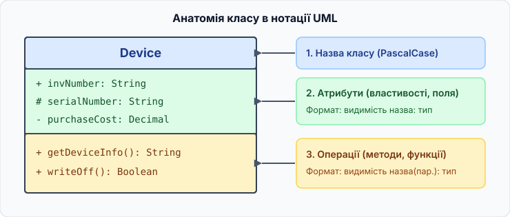
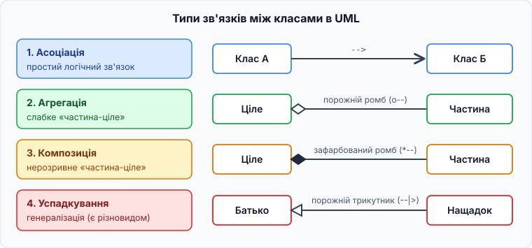
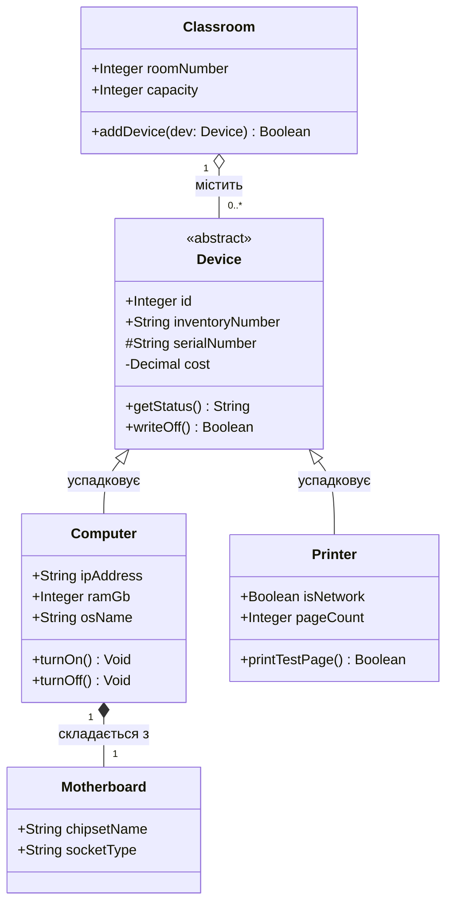
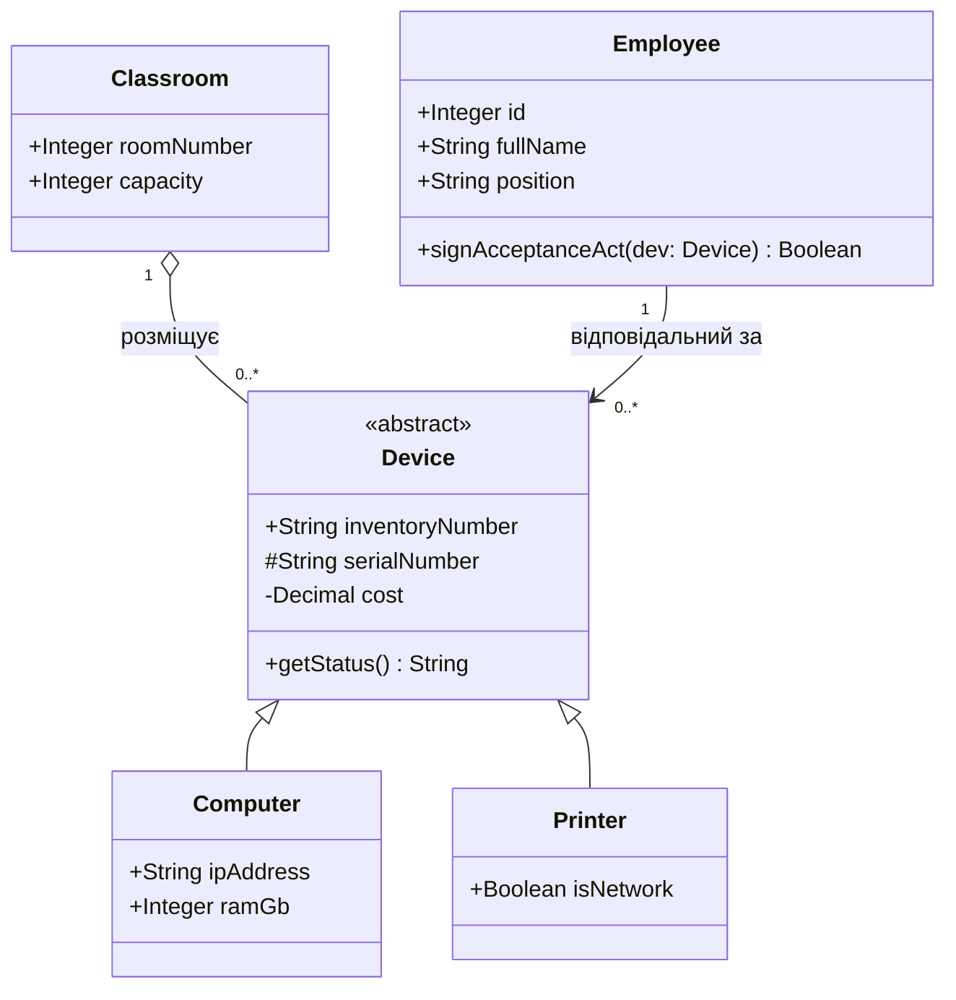

# Урок 9. Структурне моделювання: діаграма класів

**Як працювати з уроком**

1. Ознайомтеся з внутрішньою трисекційною структурою класу в UML та символами модифікаторів видимості (`+`, `-`, `#`, `~`).
2. Засвойте типи зв'язків між класами: асоціація, агрегація, композиція, успадкування (генералізація) та правила запису кратності.
3. Побудуйте практичну діаграму класів системи інвентаризації комп'ютерів мовою Mermaid та дайте відповіді на 10 запитань тесту.

## Мета уроку

Ви дізнаєтеся, чому діаграма класів (Class Diagram) є головною структурною моделлю в об'єктно-орієнтованому проєктуванні та основою для проектування баз даних, як правильно описувати поля й методи класів, чим відрізняється агрегація від композиції та як діаграма класів втілюється у програмний код. На практиці ви:

- спроєктуєте класи комп'ютерного обладнання з коректними типами даних та модифікаторами доступу;
- реалізуєте відношення генералізації (успадкування спільних властивостей базового класу);
- застосуєте відношення слабкої агрегації (приміщення та пристрої) і сильної композиції (системний блок та материнська плата);
- згенеруєте чистий код діаграми за допомогою синтаксису Mermaid `classDiagram`.

## Що знадобиться

- Сучасний веббраузер для перегляду та перевірки схем Mermaid (наприклад, [mermaid.live](https://mermaid.live)).
- Текстовий редактор (Nano, VS Code або LibreOffice Writer).
- Базові знання принципів об'єктно-орієнтованого програмування та будови комп'ютера.

## Теорія

*Багаторівнева архітектура операційної системи[1]*

### Що таке діаграма класів?

**Діаграма класів (Class Diagram)** — це статична структурна діаграма UML, яка описує структуру системи, демонструючи класи, їхні атрибути, операції (методи), а також зв'язки між ними.

У програмуванні та базах даних:
- **Клас (Class)** — це абстрактний шаблон, креслення або модель, яка описує структуру та поведінку майбутніх об'єктів.
- **Об'єкт (Object)** — це конкретний екземпляр класу, що існує в оперативній пам'яті комп'ютера або зафіксований у базі даних (наприклад, клас — `Комп'ютер`, а конкретний об'єкт — `Системний блок №104 у кабінеті 204`).

---

### Анатомія класу в нотації UML

На діаграмі клас зображується у вигляді прямокутника, розділеного горизонтальними лініями на **три секції**:

*Анатомія класу в нотації UML*

#### Модифікатори видимості (Visibility)
Символ перед назвою атрибута чи методу визначає рівень доступу до нього:

| Символ | Назва модифікатора | Область видимості |
| :---: | :--- | :--- |
| `+` | **Public (публічний)** | Елемент доступний будь-якому іншому класу та зовнішнім модулям системи. |
| `-` | **Private (приватний)** | Елемент доступний **лише** всередині методів самого цього класу (інкапсуляція). |
| `#` | **Protected (захищений)** | Елемент доступний всередині самого класу та у класах-нащадках, які успадкували цей клас. |
| `~` | **Package (пакетний)** | Елемент доступний лише класам, розташованим у тому самому програмному пакеті/модулі. |

---

### Типи зв'язків між класами

Класи в інформаційній системі рідко існують ізольовано. Між ними виникають такі взаємозв'язки:

*Типи зв'язків між класами в UML*

| Тип зв'язку | Графічне позначення | Позначення в Mermaid | Зміст і приклад у комп'ютерній системі |
| :--- | :---: | :---: | :--- |
| **Асоціація (Association)** | Суцільна лінія зі стрілкою або без | `-->` або `--` | Звичайний логічний зв'язок. *Приклад:* Оператор використовує комп'ютер для введення даних. |
| **Агрегація (Aggregation)** | Лінія з **порожнім ромбом** на боці цілого | `o--` | Слабкий зв'язок «частина-ціле». Компонент може існувати без цілого. *Приклад:* Аудиторія та Комп'ютери. Якщо аудиторію розформувати, комп'ютери залишаються і їх можна перенести в іншу лабораторію. |
| **Композиція (Composition)** | Лінія з **зафарбованим чорним ромбом** на боці цілого | `*--` | Жорсткий нерозривний зв'язок «частина-ціле». Частина знищується разом із цілим. *Приклад:* Комп'ютер і Материнська плата. Материнська плата є невіддільною складовою даного інвентарного об'єкта; при ліквідації системного блоку об'єкт перестає існувати. |
| **Генералізація (Успадкування)** | Лінія з **порожнім трикутним наконечником** на боці батька | `--\|>` | Відношення «є різновидом» (is-a). Клас-нащадок успадковує всі поля та методи предка. *Приклад:* Ноутбук є різновидом Комп'ютера (`Laptop --\|> Computer`). |
| **Залежність (Dependency)** | Пунктирна лінія зі стрілкою | `..>` | Тимчасове використання («uses»). Один клас використовує інший, наприклад, як параметр функції друку. |

---

### Кратність зв'язків (Multiplicity)

Кратність визначає, скільки екземплярів одного класу може бути пов'язано з одним екземпляром іншого класу:
- `1` — рівно один екземпляр (наприклад, у комп'ютера може бути рівно 1 блок живлення).
- `0..1` — нуль або один (опціонально; наприклад, за комп'ютером закріплено 0 або 1 сканер).
- `*` або `0..*` — нуль або довільна кількість (багато).
- `1..*` — один або багато (хоча б один обов'язково; наприклад, у відділі має працювати щонайменше 1 співробітник).

---

### Зв'язок діаграми класів із базами даних

Для оператора важливо розуміти, як діаграма класів перетворюється на реляційну базу даних (PostgreSQL/MariaDB):
- Кожен **клас** стає окремою **таблицею** (`CREATE TABLE`);
- **Атрибути** класу стають **колонками** таблиці;
- Зв'язок кратності `1` до `*` перетворюється на **зовнішній ключ (FOREIGN KEY)** у дочірній таблиці.

**Хочете знати більше?** Необов’язково

- **Абстрактні класи та інтерфейси:** якщо клас слугує лише концептуальним шаблоном і не може мати власних екземплярів (наприклад, загальний абстрактний клас `Device`, оскільки в реальності ми купуємо не «пристрій взагалі», а конкретний `Монітор` чи `Принтер`), його назву пишуть *курсивом* або позначають модифікатором `{abstract}`. Інтерфейси позначаються стереотипом `<<interface>>` і містять лише заголовки методів без реалізації.
- **ORM (Object-Relational Mapping):** технологія в сучасних мовах програмування (Python SQLAlchemy, Django ORM, PHP Doctrine), яка автоматично створює SQL-таблиці та здійснює запити до БД на основі написаних програмістом UML-подібних класів.

---

## Покроково

Спроєктуйте діаграму класів інформаційної підсистеми «Облік комп'ютерної техніки в лабораторіях навчального закладу».

### 1. Визначення базового класу та спільних характеристик

Створіть абстрактний клас `Device` (Пристрій), що інкапсулює спільні атрибути для будь-якої техніки:
- `+id: Integer` (первинний ключ)
- `+inventoryNumber: String` (інвентарний номер)
- `#serialNumber: String` (заводський номер)
- `-cost: Decimal` (балансова вартість)
- `+getStatus(): String`
- `+writeOff(): Boolean`

### 2. Створення класів-нащадків через генералізацію

Виділіть конкретні типи пристроїв, що успадковують `Device`:
1. `Computer`: додає поля `+ipAddress: String`, `+ramGb: Integer`, `+osName: String` та методи `+turnOn(): Void`, `+turnOff(): Void`.
2. `Printer`: додає поля `+isNetwork: Boolean`, `+pageCount: Integer` та метод `+printTestPage(): Boolean`.

Обидва класи успадковують властивості `Device` через відношення генералізації (`--|>`).

### 3. Моделювання приміщення (агрегація) та компонентів (композиція)

- **Клас `Classroom` (Аудиторія):** містить атрибути `+roomNumber: Integer`, `+capacity: Integer`. Зв'язок з `Device` є **агрегацією** (`o--`), оскільки техніка закріплена за кабінетом, але при розформуванні кабінету техніка залишається неушкодженою і передається на склад.
- **Клас `Motherboard` (Материнська плата):** клас `Computer` складається з `Motherboard` через відношення **композиції** (`*--`), оскільки плата змонтована всередині системного блоку і є його фізичною невіддільною складовою частиною.

### 4. Опис моделі синтаксисом Mermaid `classDiagram`

Запишіть код діаграми:

**Спробуйте самі**

Додайте до діаграми новий клас **`Employee` (Працівник / Матеріально відповідальна особа)** з атрибутами `+id: Integer`, `+fullName: String`, `+position: String`. Пов'яжіть клас `Employee` асоціацією з класом `Device`: за одним працівником може бути закріплено від 0 до багатьох пристроїв (`0..*`), а кожен пристрій закріплений рівно за одним працівником (`1`).

Перевірити очікуваний результат і повний розв’язок

Оновлений код діаграми Mermaid:

Результат:
1. Завдяки асоціації `Employee "1" --> "0..*" Device` база даних отримає поле зовнішнього ключа `employee_id` у таблиці пристроїв.
2. Така схема повністю виключає неоднозначність: кожен системний блок чи принтер однозначно має відповідального співробітника та закріплену аудиторію.

## Підсумок

- Діаграма класів описує статичну архітектуру системи: класи, їх внутрішній вміст (атрибути, методи) та взаємозв'язки.
- Клас має три секції: ім'я, атрибути та методи; символи `+`, `-`, `#`, `~` визначають рівні інкапсуляції (видимості).
- Відношення генералізації (`--|>`) реалізує успадкування спільних властивостей від батьківського класу.
- Агрегація (`o--`) моделює слабкий зв'язок «частина-ціле», а композиція (`*--`) — нерозривний зв'язок зі спільним життєвим циклом.

## Тест

10 запитань за матеріалом уроку. На початку тесту вкажіть **прізвище, ім’я та групу**.

<!-- GOOGLE_FORM_START:lesson-09 -->
[Відкрити тест у новій вкладці](https://docs.google.com/forms/d/e/1FAIpQLSdt7c8qeUFYfzE2tXDpXwyhNx4WHG_mREAmJm1nSIM8h6EhGg/viewform)

<iframe src="https://docs.google.com/forms/d/e/1FAIpQLSdt7c8qeUFYfzE2tXDpXwyhNx4WHG_mREAmJm1nSIM8h6EhGg/viewform?embedded=true" loading="lazy" title="Тест lesson-09">Завантаження…</iframe>
<!-- GOOGLE_FORM_END:lesson-09 -->

## Додаткове завдання

Необов’язково Для закріплення навичок структурного проєктування.

**Базовий рівень.** Зобразіть за допомогою синтаксису Mermaid простий клас `UserAccount` (Обліковий запис користувача) з атрибутами `login`, `email`, приватним атрибутом `passwordHash` та публічними методами `checkPassword()` та `updateEmail()`.

**Проєктний рівень.** Напишіть SQL-інструкцію `CREATE TABLE` для створення таблиці реляційної бази даних, яка б точно відповідала класу `Computer` з практичної роботи уроку (з полями `id`, `inventory_number`, `ip_address`, `ram_gb`, `os_name`).

## Джерела

1. [Linux_architecture.svg](https://commons.wikimedia.org/wiki/File:Linux_architecture.svg), Wikimedia Commons.
