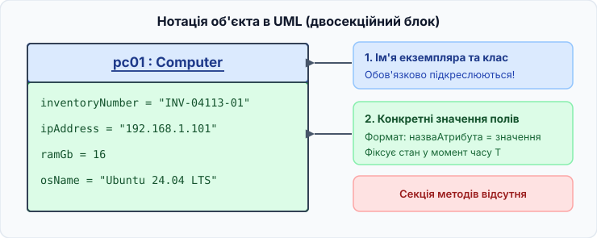
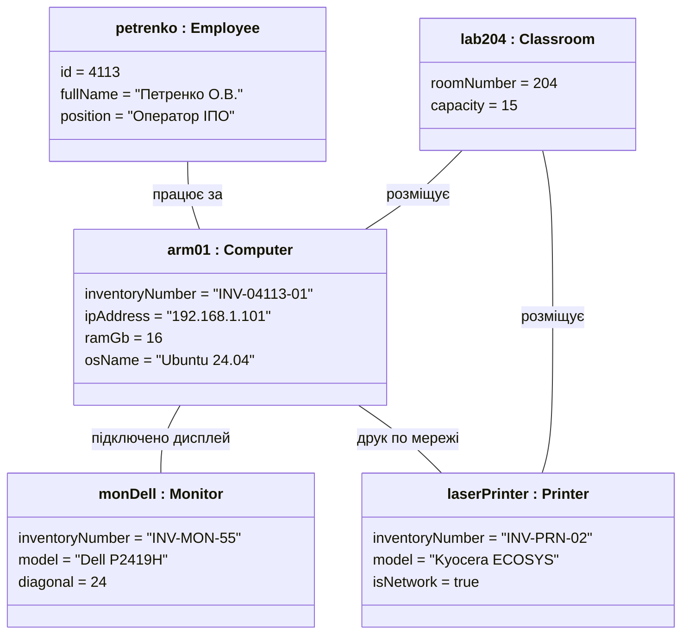
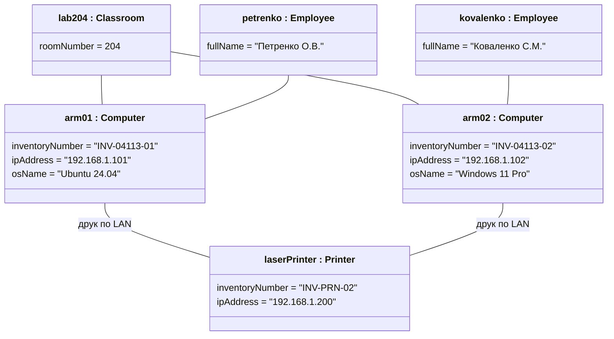

# Урок 10. Діаграма об'єктів

<div class="how-to">

**Як працювати з уроком**

1. Зрозумійте різницю між діаграмою класів (статичний шаблон) та діаграмою об'єктів (миттєвий знімок стану системи в конкретний момент часу).
2. Опануйте синтаксис запису екземплярів об'єктів, підкреслення їхніх імен, значень атрибутів та лінків між ними.
3. Побудуйте практичну діаграму об'єктів для автоматизованого робочого місця оператора мовою Mermaid та пройдіть тест.

</div>

## Мета уроку

Ви дізнаєтеся, що таке діаграма об'єктів (Object Diagram) в UML, чому її називають «знімком стану» (snapshot) системи, як вона допомагає верифікувати коректність діаграми класів, що таке лінк (Link) і чому на ньому відсутня кратність. На практиці ви:

- навчитеся трансформувати абстрактні класи у конкретні об'єкти з фактичними даними;
- зафіксуєте конфігурацію комп'ютерного обладнання лабораторії №204 у вигляді діаграми об'єктів;
- відобразите реальні лінки між робочою станцією, монітором, принтером та відповідальним оператором;
- зіставите діаграму об'єктів із сучасним форматом обміну даними JSON.

## Що знадобиться

- Вебоглядач для перегляду та генерації діаграм (Mermaid Live Editor [mermaid.live](https://mermaid.live)).
- Текстовий редактор (Nano, VS Code, Geany або LibreOffice Writer).
- Діаграма класів, розроблена на Уроці 9.

## Теорія

### Що таке діаграма об'єктів та концепція «знімка стану»?

**Діаграма об'єктів (Object Diagram)** — це структурна діаграма UML, яка відображає повний або частковий знімок (snapshot) екземплярів системи у конкретний дискретний момент часу.

Якщо провести аналогію з повсякденним життям:
- **Діаграма класів** — це технічне креслення будинку або принципова схема материнської плати. Креслення показує загальні правила: які бувають кімнати, які дроти куди підключаються. Воно існує поза часом.
- **Діаграма об'єктів** — це реальна фотографія збудованого будинку або робочої комп'ютерної аудиторії в понеділок о 10:00. На фотографії видно конкретних людей за конкретними столами, конкретний колір стін і точну кількість паперу в лотку принтера в цю секунду.

---

### Порівняння: Діаграма класів vs Діаграма об'єктів

| Критерій | Діаграма класів (Class Diagram) | Діаграма об'єктів (Object Diagram) |
| :--- | :--- | :--- |
| **Рівень абстракції** | Абстрактний рівень: опис загальних типів і правил. | Конкретний рівень: опис фактичних екземплярів даних. |
| **Часовий вимір** | Існує поза часом (статична будова системи). | Фіксує конкретний дискретний момент часу $T$. |
| **Атрибути** | Вказується ім'я та тип поля (`ipAddress: String`). | Вказується фактичне значення (`ipAddress = "192.168.1.101"`). |
| **Методи (операції)** | Обов'язково зазначаються у нижній секції. | **Не відображаються**, оскільки поведінка є спільною для всіх екземплярів класу. |
| **Зв'язки** | Асоціації з позначенням кратності (`1`, `*`, `0..1`). | **Лінки (Links)** між конкретними об'єктами без кратності. |

---

### Правила нотації об'єктів в UML

Об'єкт зображується прямокутником, розділеним на **дві секції**:

<div class="clip">



*Нотація об'єкта в UML (двосекційний блок)*

</div>

#### Правила іменування об'єкта (Верхня секція):
В UML ім'я об'єкта **завжди підкреслюється суцільною лінією**, щоб візуально відрізнити його від класу!

1. **Повний запис (Іменований екземпляр з класом):**  
   `<u>ім'яЕкземпляра : НазваКласу</u>` (наприклад, `<u>arm01 : Computer</u>`, `<u>petrenko : Employee</u>`).
2. **Анонімний екземпляр:**  
   `<u>: НазваКласу</u>` (коли унікальне ім'я об'єкта не має значення, наприклад: `<u>: NetworkSwitch</u>`).
3. **Об'єкт без зазначення класу:**  
   `<u>ім'яЕкземпляра</u>` (використовується рідко, коли тип ще не визначений аналітиком).

#### Секція атрибутів (Нижня секція):
Відображаються лише ті атрибути, значення яких важливі для поточного аналізу. Атрибути записуються у форматі `ім'я = значення`. Методи в об'єкті **не записуються**, адже операції визначені у класі і не змінюються від екземпляра до екземпляра.

---

### Лінки (Links) — екземпляри асоціацій

Зв'язок між об'єктами називається **лінком (Link)**.

Головні правила лінків:
- Лінк зображується простою суцільною лінією.
- На лінку **ніколи не вказується кратність** (ніяких `*` чи `1..*`). Якщо робоча станція `pc01` підключена до принтера `printer01`, це один конкретний фізичний або логічний факт зв'язку.
- Біля лінка може вказуватися ім'я ролі (наприклад, `працює за`, `підключений до`).

---

### Навіщо діаграма об'єктів оператору та інженеру?

1. **Тестування та верифікація моделі класів:**  
   Аналітик або оператор створює діаграму класів, а потім моделює реальний практичний приклад у вигляді об'єктів. Якщо в реальному житті за одним комп'ютером можуть позмінно працювати двоє операторів, а на діаграмі класів випадково вказано кратність `1` замість `1..*`, побудова діаграми об'єктів миттєво виявить цю помилку.
2. **Паспортизація та інвентаризація обладнання:**  
   Діаграма об'єктів фіксує точну схему робочого місця: який системний блок зв'язаний з яким монітором, ДБЖ, мережевою розеткою та яким співробітником.
3. **Фіксація збоїв (Post-Mortem аналіз):**  
   При виникненні аварії оператор фіксує точний зріз даних системи в журналі інцидентів (значення буферів, стан портів і служб).

<div class="more-link">

**Хочете знати більше?** <span class="optional">Необов’язково</span>

- **Діаграма об'єктів та формат JSON (JavaScript Object Notation):** будь-який об'єкт UML природно представляється структурою JSON. Наприклад, об'єкт `pc01: Computer` транслюється у запис:
  ```json
  {
    "inventoryNumber": "INV-04113-01",
    "ipAddress": "192.168.1.101",
    "ramGb": 16,
    "osName": "Ubuntu 24.04 LTS"
  }
  ```
  Саме в такому форматі сучасні вебсервіси, NoSQL-бази даних (MongoDB) та хмарні системи обмінюються даними з автоматизованими робочими місцями операторів.
- **Діаграма складеної структури (Composite Structure Diagram):** спеціальний вид структурної діаграми UML, що показує внутрішню будову класифікатора включно з його портами (Ports) та конекторами (Connectors), деталізуючи фізичні роз'єми підключення.

</div>

---

## Покроково

Виконайте практичну побудову діаграми об'єктів для фіксації робочого місця оператора (АРМ-01) у лабораторії комп'ютерних технологій №204.

### 1. Визначення екземплярів об'єктів та їхніх значень

На основі моделі класів з Уроку 9 сформуйте конкретні екземпляри:

1. **Об'єкт аудиторії:**  
   `lab204 : Classroom`  
   `roomNumber = 204`  
   `capacity = 15`
2. **Об'єкт комп'ютера (робочої станції):**  
   `arm01 : Computer`  
   `inventoryNumber = "INV-04113-01"`  
   `ipAddress = "192.168.1.101"`  
   `ramGb = 16`  
   `osName = "Ubuntu 24.04 LTS"`
3. **Об'єкт монітора:**  
   `monDell : Monitor`  
   `inventoryNumber = "INV-MON-55"`  
   `model = "Dell P2419H"`  
   `diagonal = 24`
4. **Об'єкт оператора:**  
   `petrenko : Employee`  
   `id = 4113`  
   `fullName = "Петренко О.В."`  
   `position = "Оператор ІПО"`
5. **Об'єкт мережевого принтера:**  
   `laserPrinter : Printer`  
   `inventoryNumber = "INV-PRN-02"`  
   `model = "Kyocera ECOSYS"`  
   `isNetwork = true`

### 2. Встановлення лінків між об'єктами

- Комп'ютер `arm01` розміщений у приміщенні `lab204`.
- Монітор `monDell` розміщений у приміщенні `lab204` та фізично підключений відеокабелем до `arm01`.
- Оператор `petrenko` закріплений за робочим місцем `arm01`.
- Робоча станція `arm01` надсилає завдання на спільний мережевий принтер `laserPrinter`, який також розташований у `lab204`.

### 3. Опис діаграми об'єктів мовою Mermaid

Запишіть код діаграми об'єктів за допомогою блоків Mermaid:



<div class="try">

**Спробуйте самі**

Додайте на діаграму другий комп'ютер **`arm02 : Computer`** (з інвентарним номером `"INV-04113-02"`, IP-адресою `"192.168.1.102"` та ОС `"Windows 11 Pro"`), на якому працює оператор **`kovalenko : Employee`** («Коваленко С.М.»). Покажіть, що комп'ютер `arm02` також розташований у кабінеті `lab204` і підключений до того ж самого мережевого принтера `laserPrinter`.

<details>
<summary>Перевірити очікуваний результат і повний розв’язок</summary>

Оновлений код діаграми Mermaid:



Висновки з побудованої діаграми об'єктів:
1. Діаграма наочно підтверджує спільне використання ресурсів: один фізичний екземпляр принтера `laserPrinter` обслуговує запити від двох різних робочих станцій.
2. Відсутність діапазонів кратності (жодних зірочок) підкреслює, що ми досліджуємо фактичний фізичний стан конкретної локальної мережі в аудиторії №204.

</details>

</div>

## Підсумок

- Діаграма об'єктів — це миттєвий знімок (snapshot) екземплярів системи у конкретний дискретний момент часу.
- На відміну від діаграми класів, діаграма об'єктів оперує конкретними значеннями даних, а методи в ній не відображаються.
- Імена об'єктів в UML обов'язково підкреслюються у форматі `ім'яОб'єкта : НазваКласу`.
- Зв'язки між об'єктами називаються лінками (Links); вони не містять позначень кратності.

## Тест

<div class="test-box">

10 запитань за матеріалом уроку. На початку тесту вкажіть **прізвище, ім’я та групу**.

🔗 <!-- GOOGLE_FORM_URL:lesson-10 --> *(Посилання на Google Форму буде додано після масового імпорту тесту)*

</div>

## Додаткове завдання

<span class="optional">Необов’язково</span> Для закріплення навичок моделювання об'єктів.

**Базовий рівень.** Запишіть у нотації UML правильне позначення анонімного об'єкта класу `NetworkSwitch` (Мережевий комутатор) та вкажіть два його конкретні атрибути зі значеннями (наприклад, кількість портів та IP-адресу керування).

**Проєктний рівень.** Напишіть файл у форматі JSON (`arm_snapshot.json`), який точно повторює структуру та значення об'єктів `arm01: Computer`, підключеного до нього монітора `monDell` та закріпленого працівника `petrenko` з практичної частини уроку.
