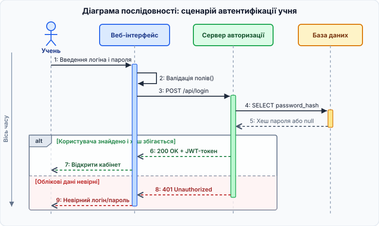

# Урок 11. Динамічне моделювання: діаграма послідовності

<div class="how-to">

**Як працювати з уроком**

1. Ознайомтеся з теоретичним матеріалом: вивчіть призначення діаграми послідовності UML, її ключові графічні елементи (лінії життя, смуги активності, типи повідомлень та комбіновані фрагменти).
2. Виконайте покрокове практичне завдання: складіть код діаграми послідовності для процесу автентифікації користувача з використанням текстового синтаксису Mermaid.
3. Закріпіть навички в блоці «Спробуйте самі» та складіть контрольний тест із 10 запитань.

</div>

## Мета уроку

Ви дізнаєтеся, як моделювати динамічну поведінку інформаційних систем у часі, як взаємодіють між собою клієнтські додатки, серверні служби та бази даних під час виконання конкретних операцій. На практиці ви:

- навчитеся читати та проєктувати діаграми послідовності (UML Sequence Diagrams);
- розрізнятимете синхронні, асинхронні повідомлення та сигнали повернення керування;
- застосовуватимете комбіновані фрагменти (`alt`, `opt`, `loop`) для опису умов і циклів;
- створите працюючу діаграму послідовності для веб-сценарію автентифікації та обробки помилок доступу.

## Що знадобиться

- Сучасний веб-браузер (Google Chrome, Mozilla Firefox або Chromium);
- Онлайн-середовище візуалізації Mermaid Live Editor ([mermaid.live](https://mermaid.live)) або текстовий редактор із підтримкою Markdown/Mermaid (VS Code, VSCodium);
- Текстовий редактор для збереження вихідних файлів моделей.

## Теорія

### Концепція динамічного моделювання

У попередніх уроках ви ознайомилися зі статичними моделями: діаграми класів та об'єктів фіксують анатомічну будову програмної системи — сутності, їхні атрибути, методи та взаємні зв'язки. Проте статична схема не дає відповіді на запитання: *в якому саме порядку виконуються дії*, *хто ініціює запит* та *як система реагує на події в реальному часі*.

Для відповіді на ці запитання використовується **динамічне моделювання**. Воно описує поведінку системи (Behavioral Modeling) під час її функціонування. Одним із найпоширеніших і найважливіших інструментів динамічного моделювання в уніфікованій мові UML є **діаграма послідовності (Sequence Diagram)**.

**Діаграма послідовності** відображає взаємодію об'єктів у часі, фіксуючи точну хронологічну послідовність обміну повідомленнями між ними під час виконання певного варіанта використання (Use Case) або сценарію.

Головна особливість діаграми послідовності — наявність двох вимірів:
- **горизонтальний вимір** — представляє взаємодіючі об'єкти, компоненти або користувачів (акторів);
- **вертикальний вимір** — представляє неперервну вісь часу, що розгортається згори донизу.

### Базові графічні елементи діаграми послідовності

Кожна діаграма послідовності будується за допомогою суворо стандартизованих елементів:

1. **Актор (Actor)** — зовнішня сутність (користувач-людина або зовнішня система), що ініціює процес. Позначається піктограмою «фігурка людини».
2. **Учасник / Об'єкт (Participant / Object)** — структурний елемент або модуль системи (наприклад, веб-інтерфейс, сервіс безпеки, сервер СУБД). Позначається прямокутником з підкресленим ім'ям `ім'я:Клас` або просто `:Клас`.
3. **Лінія життя (Lifeline)** — вертикальна пунктирна лінія, яка опускається вниз від центру кожного учасника. Вона показує тривалість існування об'єкта під час виконання сценарію.
4. **Смуга активності / фокус керування (Activation Bar / Focus of Control)** — тонкий вертикальний прямокутник, накладений на лінію життя. Він показує проміжок часу, протягом якого об'єкт безпосередньо виконує операцію (зайнятий обчисленнями) або очікує результату від викликаного підпроцесу.
5. **Знищення об'єкта (Destruction)** — великий хрестик (`X`) у нижній точці лінії життя, що вказує на вивантаження об'єкта з оперативної пам'яті або його видалення.

### Типи повідомлень між об'єктами

Повідомлення (Messages) передають інформацію або команди від одного об'єкта до іншого та позначаються горизонтальними стрілками:

| Тип повідомлення | Графічне позначення в UML | Семантика (принцип дії) | Приклад у системі |
| :--- | :--- | :--- | :--- |
| **Синхронне повідомлення (Synchronous Message)** | Суцільна горизонтальна лінія із зафарбованим трикутним наконечником (`—▶`) | Викликач відправляє запит і **блокує своє виконання**, чекаючи на відповідь адресата | Виклик функції `checkPassword()`, класичний HTTP POST-запит |
| **Асинхронне повідомлення (Asynchronous Message)** | Суцільна горизонтальна лінія з відкритим одинарним наконечником (`—>`) | Викликач надсилає команду і **відразу продовжує роботу**, не очікуючи підтвердження | Відправка листа на e-mail, запис події в системний журнал (log) |
| **Відповідь / повернення (Reply / Return Message)** | Пунктирна горизонтальна лінія з відкритим наконечником (`< - -`) | Повернення даних або керування після завершення синхронного виклику | Сервер повертає токен доступу або статус `200 OK` |
| **Внутрішній виклик (Self-call)** | Загнута стрілка, яка починається і закінчується на лінії життя того самого об'єкта | Об'єкт виконує власну внутрішню процедуру без звернення до інших компонентів | Валідація формату введеного e-mail усередині форми |
| **Створення об'єкта (`Create`)** | Пунктирна або суцільна стрілка зі словом `<<create>>`, спрямована на заголовок нового об'єкта | Створення нового екземпляра сутності в пам'яті | Ініціалізація нової сесії користувача |

### Комбіновані фрагменти (Interaction Fragments)

У реальних бізнес-процесах логіка рідко буває суто лінійною. Для відображення умовних переходів, циклів та паралельних дій стандарт UML версій 2.x використовує **комбіновані фрагменти** — прямокутні рамки з міткою (оператором) у верхньому лівому кутку:

- **`alt` (Alternatives)** — моделює умовну конструкцію `if-then-else`. Рамка ділиться пунктирною горизонтальною лінією на взаємовиключні гілки. Кожна гілка має умову в квадратних дужках (охоронна умова, Guard), наприклад `[пароль вірний]` та `[інакше]`.
- **`opt` (Option)** — моделює одиничну умову `if` (без `else`). Блок виконується тільки тоді, коли охоронна умова є істинною (наприклад, `[користувач обрав «Запам'ятати мене»]`).
- **`loop` (Loop)** — позначає циклічне повторення групи повідомлень (наприклад, перевірка черги замовлень або введення пароля до 3 спроб).
- **`par` (Parallel)** — позначає кілька дій, які виконуються одночасно різними підсистемами (наприклад, одночасне списання коштів та резервування товару на складі).

<div class="more-link">

**Хочете знати більше?** <span class="optional">Необов’язково</span>

Діаграми послідовності є стандартом де-факто в інженерії програмного забезпечення для опису мережевих протоколів та архітектури веб-сервісів (REST API, gRPC, WebSocket). Наприклад, процес захищеного підключення через TLS/HTTPS або триетапне рукостискання протоколу TCP (`SYN -> SYN-ACK -> ACK`) в офіційній технічній документації консорціуму IETF зображуються саме у формі діаграм послідовності. Для автоматичної генерації таких схем із тексту розробники найчастіше використовують інструменти **PlantUML** та **Mermaid**.

</div>

## Покроково

Уявімо завдання оператора інформаційних систем: необхідно задокументувати сценарій авторизації учня в системі дистанційного навчання (СДН) навчального закладу. Сценарій передбачає перевірку облікових даних у базі даних та два варіанти розвитку подій: успішний вхід із видачею токена доступу або відхилення з кодом помилки.

### 1. Визначення учасників сценарію

Для даного процесу взаємодіють чотири сутності:
- **Учень (`Student`)** — актор, який ініціює процес через браузер;
- **Веб-інтерфейс (`UI`)** — форма входу в браузері клієнта;
- **Сервер авторизації (`AuthService`)** — бекенд-служба перевірки прав;
- **База даних (`Database`)** — реляційна СУБД, де зберігаються хеші паролів.

### 2. Складання текстового опису діаграми в синтаксисі Mermaid

Текстовий формат Mermaid дозволяє зберігати діаграми безпосередньо у вихідному коді Markdown без використання важких графічних редакторів:

```text
sequenceDiagram
    autonumber
    actor U as Учень
    participant W as Веб-інтерфейс
    participant S as Сервер авторизації
    participant DB as База даних

    U->>W: Введення логіна та пароля
    W->>W: Валідація заповнення полів()
    W->>S: POST /api/login (credentials)
    activate S
    S->>DB: SELECT password_hash FROM users WHERE login = ?
    activate DB
    DB-->>S: Результат (хеш пароля або null)
    deactivate DB

    alt Користувача знайдено і хеш збігається
        S->>S: Генерація JWT-токена()
        S-->>W: 200 OK + JWT-токен доступу
        W-->>U: Перенаправлення в особистий кабінет
    else Облікові дані невірні
        S-->>W: 401 Unauthorized (Помилка входу)
        deactivate S
        W-->>U: Повідомлення: «Невірний логін або пароль»
    end
```

<div class="clip">



*Діаграма послідовності процесу автентифікації учня*

</div>

### 3. Аналіз побудованої схеми

- Директива `autonumber` автоматично нумерує кроки обміну повідомленнями (1, 2, 3...), що суттєво спрощує комунікацію під час тестування системи.
- Стрілка `->>` позначає синхронне повідомлення (запит), а пунктирна стрілка `-->>` — повернення результату (відповідь).
- Команди `activate` та `deactivate` формують візуальну смугу активності для сервера авторизації та СУБД.
- Конструкція `alt ... else ... end` чітко розмежовує успішний сценарій та сценарій обробки помилки.

### 4. Візуалізація схеми в онлайн-середовищі

1. Відкрийте браузер і перейдіть на сайт [mermaid.live](https://mermaid.live).
2. Очистіть ліву панель редактора та вставте наведений вище код Mermaid.
3. Перевірте, як візуалізується діаграма у правій панелі: переконайтеся у наявності актора, ліній життя, смуг активності та рамки альтернативи `alt`.

<div class="try">

**Спробуйте самі**

Доповніть текстову модель діаграми послідовності захистом від атак методом перебору (Brute-Force). Якщо користувач ввів невірний пароль понад 3 рази:
1. Сервер авторизації повинен виконати синхронний запит до бази даних: `UPDATE users SET is_locked = true WHERE login = ?`.
2. База даних підтверджує оновлення статусу (`UPDATE OK`).
3. Сервер авторизації надсилає системному адміністратору безпеки асинхронне сповіщення про інцидент (`Повідомлення про спробу злому`).
4. Веб-інтерфейс виводить учневі повідомлення: «Обліковий запис тимчасово заблоковано на 15 хвилин».

<details>
<summary>Перевірити очікуваний результат і повний розв’язок</summary>

Оновлений блок `else` комбінованого фрагмента `alt` матиме такий вигляд:

```text
    else Облікові дані невірні (понад 3 спроби)
        S->>DB: UPDATE users SET is_locked = true WHERE login = ?
        activate DB
        DB-->>S: Підтвердження блокування (OK)
        deactivate DB
        S-)Admin: Асинхронне сповіщення про інцидент безпеки
        S-->>W: 423 Locked (Акаунт заблоковано)
        deactivate S
        W-->>U: Повідомлення: «Акаунт заблоковано на 15 хв»
```

Зверніть увагу: сповіщення адміністратора позначено оператором `-)`, оскільки сервер безпеки відправляє лист або сигнал у чергу повідомлень асинхронно, не змушуючи користувача чекати завершення відправки пошти.

</details>

</div>

## Підсумок

- **Діаграма послідовності (Sequence Diagram)** моделює динамічну поведінку системи та показує точний часовий порядок передачі повідомлень між об'єктами.
- Горизонтальна вісь визначає взаємодіючі об'єкти (учасників), а вертикальна пунктирна лінія життя розгортає час згори донизу.
- Стрілки діаграми чітко розрізняють **синхронні запити** (із блокуванням викликача), **асинхронні повідомлення** (без очікування відповіді) та **повернення результатів**.
- За допомогою комбінованих фрагментів (`alt`, `opt`, `loop`) на діаграмі фіксуються розгалуження, обробка помилок та повторення операцій.

## Тест

<div class="test-box">

10 запитань за матеріалом уроку. На початку тесту вкажіть **прізвище, ім’я та групу**.

<!-- GOOGLE_FORM_START:lesson-11 -->
[Відкрити тест у новій вкладці](https://docs.google.com/forms/d/e/1FAIpQLSf-ipZf4NYX1TTnvh9rciIfSDPmAL9qtstklogJE101eLE82Q/viewform)

<iframe src="https://docs.google.com/forms/d/e/1FAIpQLSf-ipZf4NYX1TTnvh9rciIfSDPmAL9qtstklogJE101eLE82Q/viewform?embedded=true" loading="lazy" title="Тест lesson-11">Завантаження…</iframe>
<!-- GOOGLE_FORM_END:lesson-11 -->

</div>

## Додаткове завдання

<span class="optional">Необов’язково</span> Виконуйте для поглиблення інженерних навичок моделювання інформаційних систем.

**Базовий рівень.** Складіть у зошиті або в текстовому редакторі покроковий словесний сценарій для операції завантаження учнем домашнього завдання на навчальний портал. Виділіть три об'єкти: Браузер учня, Веб-сервер файлів, База метаданих. Вкажіть, які повідомлення є синхронними, а які — поверненням статусу.

**Проєктний рівень.** Опишіть мовою Mermaid діаграму послідовності для процесу «Замовлення книги в електронному каталозі бібліотеки». Включіть фрагмент `alt`: книга є в наявності (успішне бронювання зі зміною статусу на `Резерв`) або книга зайнята (пропозиція стати в чергу очікування).
