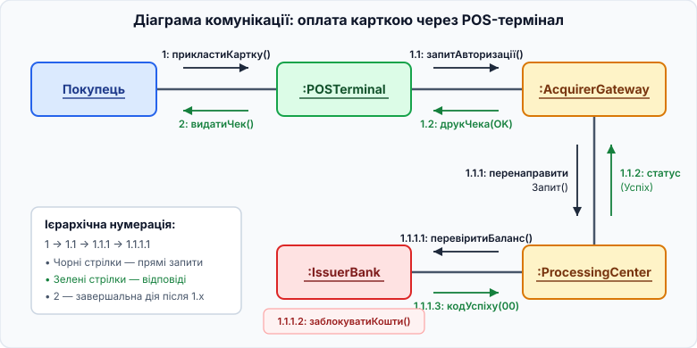

# Урок 12. Діаграма співробітництва (комунікації)

<div class="how-to">

**Як працювати з уроком**

1. Ознайомтеся з теоретичним матеріалом: з'ясуйте призначення діаграми комунікації (співробітництва), її топологічну специфіку та правила нумерації повідомлень.
2. Виконайте покрокове практичне завдання: побудуйте архітектурну модель взаємодії об'єктів для процесу безконтактної оплати замовлення.
3. Закріпіть отримані навички у блоці «Спробуйте самі» та складіть контрольний тест із 10 запитань.

</div>

## Мета уроку

Ви навчитеся описувати взаємодію компонентів інформаційної системи з акцентом на структурні зв'язки між ними, аналізувати топологію потоків даних та створювати діаграми комунікації для бізнес-процесів. На практиці ви:

- навчитеся читати та проєктувати діаграми співробітництва/комунікації (UML Communication Diagrams);
- опануєте стандартну десяткову ієрархічну нумерацію повідомлень (1, 1.1, 1.2, 2);
- навчитеся моделювати умови та ітеративні дії на лініях зв'язку;
- побудуєте структурну діаграму комунікації платіжного банківського термінала.

## Що знадобиться

- Сучасний браузер (Google Chrome, Mozilla Firefox або Chromium);
- Графічний редактор діаграм **diagrams.net** ([draw.io](https://app.diagrams.net)) або текстовий генератор діаграм **PlantUML**;
- Будь-який текстовий редактор або зошит для проєктування початкових схем.

## Теорія

### Термінологія та місце серед діаграм UML

У ранніх версіях мови моделювання (UML 1.x) цей тип діаграм мав назву **діаграма співробітництва (Collaboration Diagram)**. Починаючи з версії UML 2.0, розробники стандарту уточнили термінологію, і діаграма отримала офіційну назву **діаграма комунікації (Communication Diagram)**. В україномовній технічній літературі та освітніх програмах обидва терміни вживаються як абсолютні синоніми.

Як і діаграма послідовності, діаграма комунікації належить до сімейства **діаграм взаємодії (Interaction Diagrams)**. Вони є семантично еквівалентними (ізоморфними): будь-яку діаграму послідовності можна точно перетворити на діаграму комунікації, і навпаки.

Проте між ними є принципова різниця у візуальному акценті:
- **Діаграма послідовності** фокусується на **часі** (хронологічному порядку подій), де вісь часу спрямована зверху вниз, але топологія з'єднань між об'єктами залишається неявною.
- **Діаграма комунікації** фокусується на **просторі та структурі** — вона наочно показує топологію зв'язків між взаємодіючими об'єктами (хто з ким безпосередньо з'єднаний і скільки повідомлень проходить через кожен канал).

### Базові елементи діаграми комунікації

Діаграма комунікації будується з таких ключових компонентів:

1. **Екземпляри об'єктів (Objects)** — прямокутники, всередині яких записується ідентифікатор об'єкта та назва класу через двокрапку. За правилами UML назви екземплярів обов'язково підкреслюються:
   - `термінал : POSTerminal` — конкретний іменований екземпляр класу;
   - `:БанківськийШлюз` — анонімний екземпляр (вказується лише тип/клас);
   - `користувач : Клієнт` або піктограма актора (фігурка людини).
2. **Зв'язки (Links)** — суцільні лінії, що з'єднують взаємодіючі об'єкти. Зв'язок на діаграмі комунікації є конкретним екземпляром асоціації між класами: він показує, що між двома об'єктами існує фізичний або логічний канал зв'язку (наприклад, мережевий сокет, HTTP-з'єднання або посилання на пам'ять).

3. **Повідомлення (Messages)** — стрілка із зазначенням напрямку виклику, розташована безпосередньо вздовж лінії зв'язку. Поруч зі стрілкою записується номер і назва повідомлення: `1: назваМетоду(параметри)`.

### Правила нумерації повідомлень

Оскільки на діаграмі комунікації відсутня вертикальна лінія часу, хронологія передачі сигналів визначається **числовими індексами** за принципом ієрархічної десяткової нумерації:

- **Повідомлення верхнього рівня (головні операції):** нумеруються простими цілими числами: `1: ...`, `2: ...`, `3: ...`.
- **Вкладені підповідомлення (виклики всередині операції):** додають десяткову крапку. Наприклад, якщо об'єкт А на кроці `1` викликав метод об'єкта Б, а той для виконання завдання звернувся до об'єктів В і Г, повідомлення нумеруються як `1.1: ...` та `1.2: ...`.
- **Глибша вкладеність:** позначається наступними рівнями, наприклад `1.1.1: ...`.
- **Повернення керування (наступна головна дія):** коли всі підповідомлення кроку `1` завершені, система переходить до кроку `2: ...`.

#### Додаткові модифікатори синтаксису повідомлень:

- **Охоронна умова (Guard):** записується в квадратних дужках перед викликом: `[залишок >= сума] 1.3: списатиКошти()`. Повідомлення надсилається лише за умови істинності виразу.
- **Ітерація (повторення):** позначається зірочкою `*`. Наприклад, `*[для кожного товару] 1.1: підрахуватиВартість()`.
- **Паралельні потоки:** позначаються літерами алфавіту після номера. Наприклад, кроки `1.2a: записУЛог()` та `1.2b: відправкаSMS()` виконуються одночасно різними потоками.

### Порівняння: Sequence Diagram чи Communication Diagram?

| Характеристика | Діаграма послідовності (Sequence) | Діаграма комунікації (Communication) |
| :--- | :--- | :--- |
| **Основний фокус** | Часова шкала та послідовність кроків | Мережева структура зв'язків та ролей |
| **Вісь часу** | Явна вертикальна вісь зверху вниз | Неявна (задається нумерацією повідомлень) |
| **Складність сприйняття** | Легко читати для довгих лінійних алгоритмів | Легко оцінити ступінь зв'язності (кубло зв'язків) |
| **Смуги активності** | Присутні на лініях життя | Відсутні |
| **Компактність** | Займає багато місця по горизонталі при багатьох об'єктах | Компактна, об'єкти розміщуються вільно на площині |

<div class="more-link">

**Хочете знати більше?** <span class="optional">Необов’язково</span>

Діаграми комунікації надзвичайно корисні на етапі рефакторингу програмного забезпечення та перевірки архітектурних антипатернів. Якщо на діаграмі комунікації один центральний об'єкт має з'єднання з 10-15 іншими класами і надсилає їм десятки повідомлень, а решта об'єктів між собою не спілкуються, це явна ознака антипатерну **«Божественний об'єкт» (God Object)**. Така діаграма відразу сигналізує системному аналітику про порушення модульності системи.

</div>

## Покроково

Розглянемо практичну задачу: побудувати діаграму комунікації для процесу оплати покупки за допомогою банківської картки через платіжний термінал супермаркету.

### 1. Визначення взаємодіючих сутностей

У процесі беруть участь:
1. `Покупець` (актор);
2. `:POSTerminal` (фізичний POS-термінал на касі);
3. `:AcquirerGateway` (платіжний шлюз банку-еквайєра, який обслуговує супермаркет);
4. `:ProcessingCenter` (міжнародна платіжна система: Visa / Mastercard);
5. `:IssuerBank` (банк-емітент, який випустив картку покупця та зберігає його гроші).

### 2. Визначення каналів зв'язку (Links)

З'єднаємо сутності відповідно до реальних фізичних та логічних інтерфейсів:
- Покупець $\leftrightarrow$ `:POSTerminal` (інтерфейс NFC / контактний чип);
- `:POSTerminal` $\leftrightarrow$ `:AcquirerGateway` (захищене інтернет-з'єднання);
- `:AcquirerGateway` $\leftrightarrow$ `:ProcessingCenter` (спеціалізована банківська мережа);
- `:ProcessingCenter` $\leftrightarrow$ `:IssuerBank` (міжбанківський протокол обміну).

### 3. Формування послідовності та нумерації повідомлень

Розподілимо повідомлення вздовж створених зв'язків:
- `1: прикластиКартку(сума)` (від Покупця до `:POSTerminal`);
- `1.1: відправитиЗапитАвторизації(картка, сума)` (від `:POSTerminal` до `:AcquirerGateway`);
- `1.1.1: перенаправитиЗапит(картка, сума)` (від `:AcquirerGateway` до `:ProcessingCenter`);
- `1.1.1.1: перевіритиБаланс(рахунок, сума)` (від `:ProcessingCenter` до `:IssuerBank`);
- `1.1.1.2: [баланс достатній] заблокуватиКошти(сума)` (внутрішня дія або повернення від `:IssuerBank`);
- `1.1.1.3: підтвердженняТранзакції(код 00 - Успіх)` (від `:IssuerBank` назад до `:ProcessingCenter`);
- `1.1.2: статусОплати(Успіх)` (від `:ProcessingCenter` до `:AcquirerGateway`);
- `1.2: друкЧека(кодУспіху)` (від `:AcquirerGateway` до `:POSTerminal`);
- `2: видатиЧек(паперовийЧек)` (від `:POSTerminal` до Покупця).

### 4. Опис моделі у текстовому форматі PlantUML

Для створення діаграм комунікації можна скористатися графічним інструментом draw.io або текстовим описом PlantUML:

```plantuml
@startuml
skinparam handwritten false

actor "Покупець" as customer
rectangle ":POSTerminal" as pos
rectangle ":AcquirerGateway" as gateway
rectangle ":ProcessingCenter" as proc
rectangle ":IssuerBank" as bank

customer -- pos
pos -- gateway
gateway -- proc
proc -- bank

customer -> pos : 1: прикластиКартку(сума)
2: забратиЧек()
pos -> gateway : 1.1: запитАвторизації(картка, сума)
gateway -> proc : 1.1.1: маршрутизувати(дані)
proc -> bank : 1.1.1.1: перевіритиБаланс()
bank -> proc : 1.1.1.2: кодПідтвердження(00)
proc -> gateway : 1.1.2: статусАвторизації(Успіх)
gateway -> pos : 1.2: авторизовано(OK)
pos -> customer : 1.3: сигнал_успіху()
@enduml
```

<div class="clip">



*Діаграма комунікації процесу оплати карткою через POS-термінал*

</div>

<div class="try">

**Спробуйте самі**

Доповніть діаграму комунікації новим вузлом: сервісом **Програмного реєстратора розрахункових операцій (`:ПРРО`)**, який формує електронний чек і фіскалізує операцію на сервері Державної податкової служби України. 

Введіть канал зв'язку між `:POSTerminal` та `:ПРРО` та додайте повідомлення:
- Після кроку `1.2` (коли термінал отримав успішний статус авторизації від банку), термінал надсилає запит: `1.3: зареєструватиЧек(сума, товари)` до `:ПРРО`.
- Сервіс `:ПРРО` повертає терміналу фіскальний номер і QR-код чека: `1.3.1: фіскальнийЧек(фіскальнийНомер, qrUrl)`.

<details>
<summary>Перевірити очікуваний результат і повний розв’язок</summary>

На схемі додається новий прямокутник `:ПРРО`, з'єднаний зв'язком із `:POSTerminal`.

На лінії зв'язку розміщуються повідомлення:
1. `1.3: зареєструватиЧек(сума, товари)` — стрілка спрямована від `:POSTerminal` до `:ПРРО`.
2. `1.3.1: фіскальнийЧек(фіскальнийНомер, qrUrl)` — стрілка спрямована від `:ПРРО` назад до `:POSTerminal`.
3. Потім крок `2: друкЧека(фіскальнийНомер, qrКод)` друкує об'єднаний чек для покупця.

Це показує повну картину фінансового документообігу: платіжний контур (банк) та фіскальний контур (податкова служба) взаємодіють через касовий термінал, зберігаючи чітку послідовність дій без зміни архітектури зв'язків.

</details>

</div>

## Підсумок

- **Діаграма співробітництва (комунікації)** фокусується на структурній топології об'єктів та каналах зв'язку між ними.
- Вона є семантично еквівалентною діаграмі послідовності, проте компактніше демонструє щільність зв'язків і підходить для виявлення перевантажених вузлів.
- Хронологічний порядок повідомлень визначається **десятковою нумерацією** (`1`, `1.1`, `1.2`), де кількість крапок позначає рівень вкладеності виклику.
- На лініях зв'язку підтримуються **охоронні умови** (`[умова]`), **ітерації** (`*`) та **паралельні гілки** (`1.1a`, `1.1b`).

## Тест

<div class="test-box">

10 запитань за матеріалом уроку. На початку тесту вкажіть **прізвище, ім’я та групу**.

🔗 <!-- GOOGLE_FORM_URL:lesson-12 --> *(Посилання на Google Форму буде додано після масового імпорту тесту)*

</div>

## Додаткове завдання

<span class="optional">Необов’язково</span> Виконуйте для закріплення практичних навичок моделювання інформаційних систем.

**Базовий рівень.** Зобразіть на аркуші паперу або у графічному редакторі просту діаграму комунікації процесу замовлення піци через веб-сайт. Використайте 3 об'єкти: `:Користувач`, `:ВебСайт`, `:МенеджерДоставки`. Нанесіть 4 пронумеровані повідомлення (створення замовлення, сповіщення менеджера, підтвердження клієнту).

**Проєктний рівень.** Спроєктуйте в інструменті draw.io діаграму комунікації для системи друку документів у комп'ютерному класі: `РобочаСтанціяУчня`, `СерверДруку`, `МережевийПринтер`. Врахуйте перевірку черги друку та сповіщення учня про закінчення паперу за допомогою охоронної умови `[папір відсутній]`.
