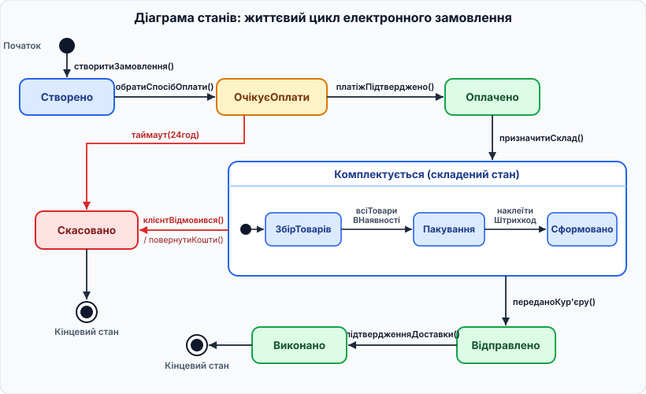

# Урок 13. Діаграма станів

<div class="how-to">

**Як працювати з уроком**

1. Ознайомтеся з теоретичним матеріалом: вивчіть концепцію скінченних автоматів, базові графічні позначення діаграми станів UML (стани, псевдостани, анатомію переходів, події та дії).
2. Виконайте покрокове практичне завдання: складіть код діаграми станів у стандарті `stateDiagram-v2` для життєвого циклу електронного замовлення інтернет-магазину.
3. Закріпіть навички в блоці «Спробуйте самі» та складіть контрольний тест із 10 запитань.

</div>

## Мета уроку

Ви навчитеся моделювати життєвий цикл складних цифрових об'єктів, сутностей баз даних та мережевих служб за допомогою математичної моделі скінченного автомата. На практиці ви:

- навчитеся читати та самостійно розробляти діаграми станів UML (State Machine Diagrams);
- засвоїте правила формального запису переходів: `Подія [Умова] / Дія`;
- навчитеся використовувати вкладені (складені) стани для структуризації складної логіки;
- побудуєте перевірену модель статусів замовлення від моменту створення до видачі покупцеві або скасування.

## Що знадобиться

- Сучасний веб-браузер (Google Chrome, Mozilla Firefox або Chromium);
- Онлайн-середовище візуалізації Mermaid Live Editor ([mermaid.live](https://mermaid.live)) або редактор **diagrams.net** ([draw.io](https://app.diagrams.net));
- Будь-який текстовий редактор (VS Code, Kate, nano або Notepad).

## Теорія

### Концепція скінченних автоматів і призначення діаграми станів

У попередніх уроках ви моделювали сценарії взаємодії багатьох компонентів системи за допомогою діаграм послідовності та комунікації. Проте в будь-якій інформаційній системі існують ключові об'єкти (наприклад, *документ*, *замовлення*, *банківський рахунок*, *мережеве з'єднання*), поведінка яких докорінно залежить від їхнього поточного внутрішнього статусу.

Наприклад: не можна відправити покупцеві замовлення, якщо воно ще не укомплектоване; не можна зняти гроші з рахунку, якщо він заблокований банком.

Для моделювання життєвого циклу таких об'єктів використовується **діаграма станів (State Machine Diagram)**, яка базується на математичному апараті **скінченних автоматів (Finite State Machine, FSM)**.

Головна відмінність діаграми станів:
- Вона зосереджена на **одному конкретному об'єкті** або сутності.
- Вона відображає **всі можливі стани**, у яких цей об'єкт може перебувати від моменту народження до знищення, та **всі допустимі правила переходу** між цими станами під впливом зовнішніх подій.

### Базові графічні елементи

Стандарт UML визначає чіткі позначення для кожного вузла діаграми:

1. **Початковий стан (Initial Pseudostate)** — зафарбоване суцільне чорне коло (`●`). Символізує створення або ініціалізацію об'єкта. З початкового стану може виходити лише одна стрілка, яка вказує на перший робочий стан об'єкта.
2. **Стан (State)** — прямокутник із закругленими кутами, всередині якого вказується назва стану (наприклад, `Чернетка`, `В обробці`, `Доставлено`). Стан характеризує період часу, протягом якого об'єкт задовольняє певну умову, очікує на зовнішню подію або виконує внутрішню дію.
3. **Кінцевий стан (Final State)** — зафарбоване чорне коло всередині зовнішнього кільця («бичаче око»). Позначає остаточне завершення життєвого циклу об'єкта та видалення його з пам'яті чи архівацію.
4. **Перехід (Transition)** — спрямована стрілка від одного стану до іншого, що позначає зміну стану під впливом події.
5. **Вузол вибору (Choice Pseudostate)** — ромб, який використовується для розгалуження переходу на взаємовиключні напрямки залежно від значення охоронних умов.

### Анатомія переходу: події, умови та дії

Стрілка переходу супроводжується текстовим рядком суворого синтаксису:

$$\text{Подія (Параметри) [Охоронна\_умова] / Дія}$$

Розглянемо кожен компонент:
- **Подія (Event / Trigger):** стимул із зовнішнього світу або від іншої підсистеми, який спонукає об'єкт змінити стан. Приклади: `натиснутоКнопкуОплати`, `таймаутСесії(30хв)`, `отриманоПлатіж`. Якщо подія надійшла, але об'єкт перебуває в стані, де такий перехід не передбачений, подія просто ігнорується.
- **Охоронна умова (Guard):** булевий вираз у квадратних дужках `[ ... ]`. Перехід відбувається **лише тоді**, коли ця умова істинна (`true`). Якщо умова хибна, об'єкт залишається в поточному стані. Приклад: `[залишок >= сума]`.
- **Дія (Action):** короткочасна атомарна операція, яка обов'язково виконується системою безпосередньо в момент переходу (позначається після косої риски `/`). Приклад: `/ надіслатиSMS()`, `/ списатиКошти()`.

### Внутрішні дії стану

Усередині прямокутника стану можна зазначати дії, які відбуваються в різні моменти перебування об'єкта в ньому:

| Префікс операції | Коли виконується | Приклад |
| :--- | :--- | :--- |
| **`entry /`** | Одноразово в момент **входу** в цей стан | `entry / надіслатиЛистКлієнту()` |
| **`do /`** | Безперервно протягом усього часу **перебування** в стані | `do / очікуванняВідповідіСервера()` |
| **`exit /`** | Одноразово в момент **виходу** з цього стану | `exit / закритиМережевеЗ'єднання()` |

### Складені (вкладені) стани

Коли логіка стає складною, окремі стани групують у **складений стан (Composite State)**. Наприклад, великий стан `В процесі доставки` може містити внутрішній початковий стан та підстани `Скомплектовано на складі` $\rightarrow$ `Передано кур'єру` $\rightarrow$ `Прибуло у відділення`. Якщо на рівні всього складеного стану надходить подія `Скасування клієнтом`, система переходить у стан `Скасовано` незалежно від того, на якій внутрішній підстадії перебував процес.

<div class="more-link">

**Хочете знати більше?** <span class="optional">Необов’язково</span>

У теорії комп'ютерних наук концепція скінченних автоматів лежить в основі роботи мережевих стеків ОС. Класичний протокол передачі даних **TCP (Transmission Control Protocol)** описується строгою діаграмою станів з 11 станів: `CLOSED`, `LISTEN`, `SYN_SENT`, `SYN_RCVD`, `ESTABLISHED`, `FIN_WAIT_1`, `CLOSE_WAIT`, `FIN_WAIT_2`, `LAST_ACK`, `TIME_WAIT`, `CLOSING`. Команда оператора `netstat -an` або `ss -tan` у терміналі Linux відображає поточні стани сокетів саме за цією UML-моделлю.

</div>

## Покроково

Спроєктуємо повну модель статусів для сутності «Замовлення» (Order) в інтернет-магазині комп'ютерних комплектуючих.

### 1. Визначення переліку допустимих станів

Об'єкт замовлення може перебувати в таких станах:
1. `Нове (Created)` — замовлення створено користувачем у кошику;
2. `Очікує оплати (AwaitingPayment)` — сформовано рахунок для оплати через інтернет-банкінг;
3. `Оплачено (Paid)` — кошти успішно списано з картки;
4. `Комплектується (Processing)` — працівники складу пакують комп'ютерні деталі;
5. `Відправлено (Shipped)` — посилку передано поштовій службі;
6. `Виконано (Delivered)` — товар отримано клієнтом (кінцевий успішний стан);
7. `Скасовано (Cancelled)` — замовлення анульовано через відмову або несплату (кінцевий неуспішний стан).

### 2. Формування логіки переходів між станами

- `●` $\rightarrow$ `Нове`: подія `оформитиЗамовлення()`.
- `Нове` $\rightarrow$ `Очікує оплати`: дія `/ виставитиРахунок()`.
- `Очікує оплати` $\rightarrow$ `Оплачено`: подія `платіжОтримано`.
- `Очікує оплати` $\rightarrow$ `Скасовано`: подія `таймаутОплати(24год)`.
- `Оплачено` $\rightarrow$ `Комплектується`: дія `entry / друкНакладної()`.
- `Комплектується` $\rightarrow$ `Відправлено`: подія `посилкуПереданоПошті`.
- `Відправлено` $\rightarrow$ `Виконано`: подія `посилкуОтриманоПокупцем` $\rightarrow$ `◉`.
- `Комплектується` $\rightarrow$ `Скасовано`: подія `клієнтСкасувавЗамовлення` / дія `повернутиКошти()`.

### 3. Запис діаграми мовою Mermaid (stateDiagram-v2)

Створимо текстову специфікацію діаграми станів:

```text
stateDiagram-v2
    [*] --> Створено : створитиЗамовлення()

    Створено --> ОчікуєОплати : обратиСпосібОплати()
    
    ОчікуєОплати --> Оплачено : платіжПідтверджено()
    ОчікуєОплати --> Скасовано : таймаут(24год)

    Оплачено --> Комплектується : призначитиСклад()
    
    state Комплектується {
        [*] --> ЗбірТоварів
        ЗбірТоварів --> Пакування : всіТовариВНаявності
        Пакування --> Сформовано : наклеїтиШтрихкод
    }

    Комплектується --> Відправлено : переданоКур'єру()
    Комплектується --> Скасовано : клієнтВідмовився() / повернутиКошти()

    Відправлено --> Виконано : підтвердженняДоставки()
    
    Виконано --> [*]
    Скасовано --> [*]
```

<div class="clip">



*Діаграма станів життєвого циклу електронного замовлення з вкладеними підстанами*

</div>

### 4. Візуалізація та перевірка графу переходів

1. Скопіюйте код діаграми у [mermaid.live](https://mermaid.live).
2. Перевірте зв'язність графу: чи немає «глухих кутів» (станів, з яких немає виходу, але вони не є кінцевими) та «станів-сиріт» (до яких неможливо потрапити з початкового вузла).
3. Зверніть увагу на складений стан `Комплектується`, що наочно структурує внутрішні кроки роботи складу.

<div class="try">

**Спробуйте самі**

Доповніть діаграму станів механізмом **повернення товару протягом 14 днів** відповідно до Закону України «Про захист прав споживачів»:
1. Зі стану `Виконано` за подією `заяваНаПовернення [термін <= 14 днів]` замовлення повинно перейти в новий стан `ПоверненняНаСклад`.
2. У стані `ПоверненняНаСклад` проводиться експертиза товару:
   - Якщо `[товарНеУшкоджено]`, замовлення переходить у кінцевий стан `АнульованоКоштиПовернуто` з дією `/ повернутиКоштиКлієнту()`.
   - Якщо `[пошкодженоПломби]`, замовлення повертається назад у стан `Виконано` з дією `/ надіслатиАктВідмови()`.

<details>
<summary>Перевірити очікуваний результат і повний розв’язок</summary>

У синтаксисі Mermaid доповнення виглядатиме так:

```text
    Виконано --> ПоверненняНаСклад : заяваНаПовернення [термін <= 14 днів]
    
    ПоверненняНаСклад --> Анульовано : експертиза [товарЦілий] / повернутиКошти()
    ПоверненняНаСклад --> Виконано : експертиза [пошкоджено] / актВідмови()

    Анульовано --> [*]
```

Завдяки цьому модель повністю покриває юридичні та бізнес-правила повернення якісного товару, унеможливлюючи несанкціоноване списання коштів компанії без акта експертизи.

</details>

</div>

## Підсумок

- **Діаграма станів (State Machine Diagram)** моделює повний життєвий цикл **одного об'єкта** або процесу через скінченну множину його станів і переходів.
- Початковий псевдостан позначається зафарбованим колом (`●`), стан — прямокутником із закругленими кутами, а кінцевий стан — колом із обідком («бичаче око»).
- Стрілка переходу має формальну структуру: **Подія [Охоронна_умова] / Дія**. Перехід спрацьовує лише тоді, коли подія надійшла, а умова є істинною.
- Усередині стану можуть виконуватися дії входу (`entry`), безперервної діяльності (`do`) та виходу (`exit`), а складні процеси зручно групувати у вкладені підстани.

## Тест

<div class="test-box">

10 запитань за матеріалом уроку. На початку тесту вкажіть **прізвище, ім’я та групу**.

<!-- GOOGLE_FORM_START:lesson-13 -->
[Відкрити тест у новій вкладці](https://docs.google.com/forms/d/e/1FAIpQLSfgp3cdAy7YPztWxmWKGTRgSOXa5mTyE0LF2_2uVysj5NMxxA/viewform)

<iframe src="https://docs.google.com/forms/d/e/1FAIpQLSfgp3cdAy7YPztWxmWKGTRgSOXa5mTyE0LF2_2uVysj5NMxxA/viewform?embedded=true" loading="lazy" title="Тест lesson-13">Завантаження…</iframe>
<!-- GOOGLE_FORM_END:lesson-13 -->

</div>

## Додаткове завдання

<span class="optional">Необов’язково</span> Виконуйте для практичного закріплення навичок проєктування скінченних автоматів.

**Базовий рівень.** Намалюйте в зошиті або в текстовому редакторі діаграму станів для звичайної світлофорної системи пішохідного переходу: `Червоний`, `Зелений`, `Зелений миготливий`. Вкажіть події-таймери (наприклад, `після(30с)`).

**Проєктний рівень.** Створіть за допомогою Mermaid діаграму станів для облікового запису користувача системи електронного журналу коледжу: `Неактивований (Новий)`, `Активний`, `Тимчасово заблокований (3 невірні спроби пароля)`, `Заблокований адміністратором`, `Архівований (після випуску учня)`. Вкажіть дії розблокування та умови переходів.
