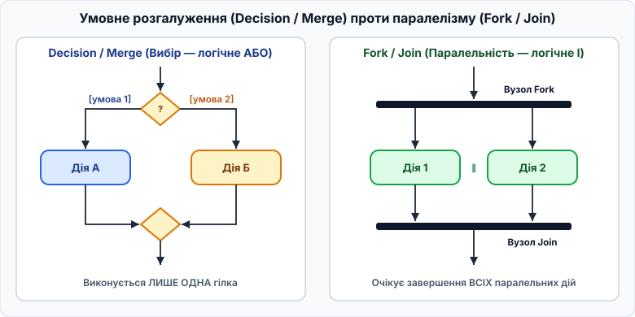
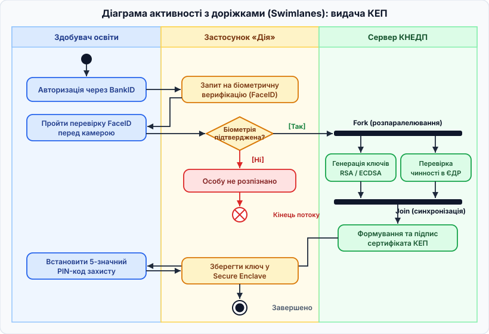

# Урок 14. Діаграма активності

<div class="how-to">

**Як працювати з уроком**

1. Ознайомтеся з теоретичним матеріалом: дізнайтеся про призначення діаграми активності UML, її переваги над звичайними блок-схемами, вузли паралелізму (Fork/Join) та доріжки відповідальності (Swimlanes).
2. Виконайте покрокове практичне завдання: побудуйте комплексну модель бізнес-процесу випуску електронного цифрового підпису з паралельними діями.
3. Закріпіть знання у блоці «Спробуйте самі» та складіть контрольний тест із 10 запитань.

</div>

## Мета уроку

Ви навчитеся моделювати алгоритми, робочі процеси (Workflows) та бізнес-процеси інформаційних систем, враховуючи паралельне виконання дій та зону відповідальності різних підрозділів і комп'ютерних служб. На практиці ви:

- опануєте графічну нотацію діаграм активності (UML Activity Diagrams);
- навчитеся коректно використовувати вузли розгалуження (Decision), злиття (Merge), розпаралелювання (Fork) та синхронізації (Join);
- структуруватимете складні бізнес-процеси за допомогою доріжок відповідальності (Swimlanes);
- спроєктуєте модель цифрового процесу видачі Кваліфікованого електронного підпису (КЕП).

## Що знадобиться

- Сучасний браузер (Google Chrome, Mozilla Firefox або Chromium);
- Онлайн-середовище побудови графічних схем diagrams.net ([draw.io](https://app.diagrams.net)) або Mermaid Live Editor ([mermaid.live](https://mermaid.live));
- Текстовий редактор для ведення нотаток та опису логіки потоків.

## Теорія

### Призначення діаграми активності та відмінність від блок-схем

У повсякденній роботі оператора комп'ютерних систем часто виникає потреба зафіксувати точний порядок кроків виконання певної задачі: наприклад, регламент резервного копіювання, реєстрацію користувача, обробку онлайн-замовлення чи нарахування стипендії.

Традиційно для цього використовували звичайні блок-схеми алгоритмів. Проте класичні блок-схеми мають суттєвий недолік: вони розраховані на суто послідовне виконання однієї програми одним процесором і не здатні адекватно описати сучасні розподілені системи.

**Діаграма активності (Activity Diagram)** — це високорівнева об'єктно-орієнтована діаграма мови UML, призначена для моделювання поведінки системи через потоки робіт (Workflows), бізнес-процеси та паралельні алгоритми.

Головні переваги діаграми активності над блок-схемами:
1. **Підтримка паралелізму:** дозволяє описати дії, які відбуваються одночасно на різних серверах або різними співробітниками.
2. **Доріжки відповідальності (Swimlanes):** наочно закріплюють кожну дію за конкретною роллю, відділом чи комп'ютерною службою.
3. **Об'єктні потоки (Object Flows):** показують не лише керування, а й рух конкретних документів, файлів або записів бази даних.

### Базові графічні елементи діаграми активності

1. **Початковий вузол (Initial Node)** — суцільне чорне коло (`●`). Позначає точку старту процесу.
2. **Дія / активність (Action / Activity)** — прямокутник із закругленими кутами. Описує конкретний неподільний крок обробки (наприклад, `Ввести логін`, `Згенерувати пару ключів`, `Надіслати фіскальний чек`).
3. **Потік керування (Control Flow)** — суцільна стрілка між діями, яка показує передачу черги виконання.
4. **Кінцевий вузол активності (Activity Final Node)** — зафарбований чорний кружок усередині тонкого кола («бичаче око»). Його досягнення **повністю припиняє всі процеси** на всій діаграмі.
5. **Вузол завершення потоку (Flow Final Node)** — коло з діагональним хрестиком усередині (`⊗`). Завершує лише одну конкретну гілку процесу, не зупиняючи інші паралельні гілки.

### Розгалуження проти паралелізму: Decision/Merge та Fork/Join

Початківці часто плутають умовні розгалуження та паралельні потоки. У UML для них існують суворо стандартизовані різні символи:

| Елемент | Графічний вигляд | Входи / Виходи | Семантика роботи |
| :--- | :--- | :--- | :--- |
| **Вузол прийняття рішень (Decision Node)** | Ромб | 1 вхід, 2 або більше виходів | Логічне **АБО (OR)**. Вибирається **лише одна** гілка, охоронна умова `[guard]` якої є істинною |
| **Вузол злиття (Merge Node)** | Ромб | 2 або більше входів, 1 вихід | Об'єднує альтернативні гілки назад в один потік без очікування |
| **Вузол розпаралелювання (Fork Node)** | Товста темна смуга | 1 вхід, 2 або більше виходів | Логічне **І (AND)**. Вхідний потік розділяється на декілька, які виконуються **одночасно** |
| **Вузол синхронізації (Join Node)** | Товста темна смуга | 2 або більше входів, 1 вихід | Точка рандеву (бар'єр). Вихідний потік активується **лише після завершення ВСІХ** вхідних дій |

<div class="clip">



*Порівняння вузлів умовного розгалуження Decision/Merge та паралельного виконання Fork/Join*

</div>

### Доріжки розподілу відповідальності (Swimlanes / Partitions)

Для того щоб зрозуміти, хто саме виконує ту чи іншу дію, площину діаграми ділять на вертикальні або горизонтальні смуги — **доріжки (Swimlanes)**. 

Кожна доріжка підписується назвою виконавця:
- Назва посади або користувача (`Учень`, `Касир`, `Системний адміністратор`);
- Підрозділ підприємства (`Відділ кадрів`, `Бухгалтерія`, `Склад`);
- Програмно-апаратний модуль (`Клієнтський браузер`, `Бекенд API`, `Сервер СУБД`).

Стрілки переходів вільно перетинають межі доріжок, наочно показуючи передачу естафети виконання між різними суб'єктами бізнес-процесу.

<div class="more-link">

**Хочете знати більше?** <span class="optional">Необов’язково</span>

Діаграма активності UML стала прабатьком міжнародного промислового стандарту моделювання бізнес-процесів **BPMN 2.0 (Business Process Model and Notation)**. Якщо діаграма активності застосовується в першу чергу системними архітекторами та програмістами для проєктування програмної логіки, то нотація BPMN 2.0 використовується бізнес-аналітиками та керівниками підприємств для автоматизації документообігу в сучасних CRM та ERP-системах.

</div>

## Покроково

Спроєктуємо діаграму активності для бізнес-процесу «Отримання Кваліфікованого електронного підпису (КЕП / Дія.Підпис) для студента коледжу».

### 1. Визначення доріжок відповідальності (Swimlanes)

Розділимо процес на три доріжки:
1. **Здобувач освіти (Користувач)** — ініціює запит, вводить дані, проходить біометрію.
2. **Мобільний застосунок / Портал («Дія»)** — інтерфейс взаємодії, зчитування біометрії обличчя.
3. **Кваліфікований надавач електронних довірчих послуг (КНЕДП)** — криптографічний сервер, що перевіряє реєстри та генерує сертифікат.

### 2. Формування послідовності дій та паралельних операцій

1. Початковий вузол `●` у доріжці «Користувач».
2. Дія: `Авторизуватися через BankID`.
3. Дія («Дія»): `Запросити перевірку FaceID`.
4. Дія («Користувач»): `Виконати рухи обличчям перед камерою`.
5. Вузол Decision: перевірка відповідності біометрії фотографії в демографічному реєстрі.
   - `[не збігається]` $\rightarrow$ `Повідомити про помилку біометрії` $\rightarrow$ вузол завершення потоку `⊗`.
   - `[успішно]` $\rightarrow$ перехід до доріжки «КНЕДП».
6. Вузол **Fork (розпаралелювання)** на боці КНЕДП:
   - Гілка 1: `Згенерувати криптографічну пару ключів (Private/Public Key)`;
   - Гілка 2: `Сформувати електронний запит до реєстру довірчих послуг`.
7. Вузол **Join (синхронізація)**: коли обидва криптографічні завдання завершені, потік об'єднується.
8. Дія: `Підписати сертифікат кореневим ключем КНЕДП`.
9. Дія («Користувач»): `Встановити захисний 5-значний PIN-код до КЕП`.
10. Дія («Дія»): `Зберегти зашифрований контейнер ключа в Secure Enclave смартфона`.
11. Кінцевий вузол `◉`.

### 3. Запис діаграми мовою Mermaid (flowchart з підграфами)

У синтаксисі Mermaid доріжки моделюються за допомогою блоків `subgraph`:

```text
flowchart TD
    subgraph User [Здобувач освіти]
        start([● Початок]) --> A1[Авторизація через BankID]
        A3[Пройти перевірку FaceID перед камерою]
        A7[Встановити 5-значний PIN-код]
    end

    subgraph App [Застосунок Дія]
        A1 --> A2[Запит на біометричну верифікацію]
        A2 --> A3
        A3 --> D1{Біометрія\nпідтверджена?}
        D1 -- Ні --> E1[Повідомити: Особу не розпізнано]
        E1 --> F1((X Кінець))
        A8[Зберегти ключ у Secure Enclave] --> final([◉ Завершено])
    end

    subgraph CA [Сервер КНЕДП]
        D1 -- Так --> Fork1[==== ВУЗОЛ FORK: Розпаралелювання ====]
        Fork1 --> B1[Генерація пари ключів RSA/ECDSA]
        Fork1 --> B2[Перевірка чинності в ЄДР]
        B1 --> Join1[==== ВУЗОЛ JOIN: Синхронізація ====]
        B2 --> Join1
        Join1 --> B3[Формування кваліфікованого сертифіката]
        B3 --> A7
    end

    A7 --> A8
```

<div class="clip">



*Діаграма активності з доріжками відповідальності (Swimlanes) для процесу отримання КЕП*

</div>

### 4. Візуалізація та верифікація схеми

1. Скопіюйте код діаграми у [mermaid.live](https://mermaid.live).
2. Переконайтеся, що потоки чітко розмежовані за трьома доріжками, а між `Fork` та `Join` виконуються саме паралельні незалежні операції.

<div class="try">

**Спробуйте самі**

Доповніть діаграму активності обробкою повторних спроб розпізнавання обличчя:
- Якщо біометрію не підтверджено (`[Ні]`), замість миттєвого завершення направте потік на дію `Збільшити лічильник невдалих спроб`.
- Додайте ромб перевірки: `Спроб < 3?`.
- Якщо `[Так]`, поверніть стрілку назад на дію `Пройти перевірку FaceID перед камерою`.
- Якщо `[Ні]`, виведіть повідомлення про тимчасове блокування послуги на 24 години та завершіть процес у вузлі `Flow Final`.

<details>
<summary>Перевірити очікуваний результат і повний розв’язок</summary>

Оновлений блок у застосунку «Дія» матиме такий вигляд:

```text
        D1 -- Ні --> A_Retry[Збільшити лічильник спроб]
        A_Retry --> D_Limit{Спроб < 3?}
        D_Limit -- Так --> A3
        D_Limit -- Ні --> E_Block[Повідомлення: Перевищено ліміт спроб. Блокування на 24 год]
        E_Block --> F1((X Кінець))
```

Така зміна робить інформаційну систему стійкою до випадкових помилок освітлення чи поганого ракурсу камери користувача, одночасно захищаючи сервіс від автоматизованого підбору біометричних даних шахраями.

</details>

</div>

## Підсумок

- **Діаграма активності (Activity Diagram)** відображає логіку бізнес-процесів, послідовність операцій та паралельні потоки робіт.
- На відміну від блок-схем, діаграма активності підтримує **доріжки розподілу відповідальності (Swimlanes)**, які закріплюють кожну дію за людиною, відділом чи комп'ютерним модулем.
- Вузол прийняття рішень (**Decision**, ромб) реалізує вибір однієї гілки (OR), а вузол розпаралелювання (**Fork**, темна риска) запускає кілька дій одночасно (AND).
- Вузол синхронізації (**Join**) діє як бар'єр: він очікує повного завершення **всіх** вхідних паралельних дій перед тим, як передати керування далі.

## Тест

<div class="test-box">

10 запитань за матеріалом уроку. На початку тесту вкажіть **прізвище, ім’я та групу**.

🔗 <!-- GOOGLE_FORM_URL:lesson-14 --> *(Посилання на Google Форму буде додано після масового імпорту тесту)*

</div>

## Додаткове завдання

<span class="optional">Необов’язково</span> Виконуйте для поглиблення інженерних знань з аналізу бізнес-процесів.

**Базовий рівень.** Намалюйте схему дій для щоденного регламенту оператора комп'ютерного класу: `Ввімкнути живлення шафи комутатора`, `Запустити головний сервер`, `Перевірити доступність локальної мережі (ping)`. Вкажіть вузол прийняття рішення (мережа доступна / відсутній лінк).

**Проєктний рівень.** Спроєктуйте в інструменті draw.io діаграму активності з двома доріжками («Бухгалтерія», «Склад») для процесу списання несправного монітора: виявлення дефекту, складання дефектного акта, паралельне зняття з балансу в бухгалтерській програмі та фізична передача на утилізацію, синхронізація у вузлі Join для підписання підсумкового звіту.
