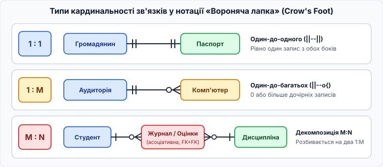
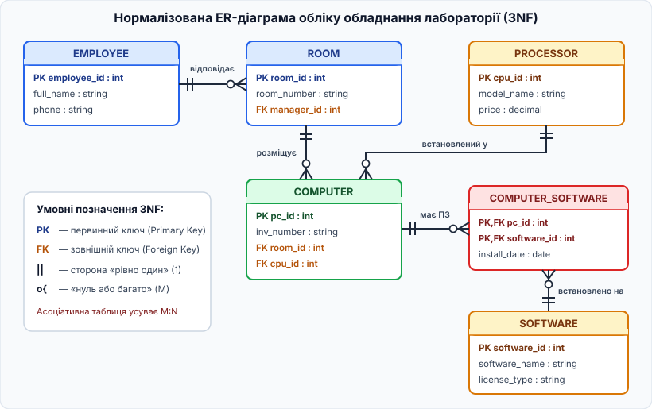

# Урок 15. Моделювання даних: діаграма «сутність-зв'язок», нормалізація

<div class="how-to">

**Як працювати з уроком**

1. Ознайомтеся з теоретичним матеріалом: вивчіть концепцію ER-моделювання (сутності, атрибути, первинні та зовнішні ключі, кардинальність) та три базові нормальні форми реляційних баз даних (1NF, 2NF, 3NF).
2. Виконайте покрокове практичне завдання: проведіть послідовну нормалізацію «сирої» таблиці інвентаризації комп'ютерного обладнання та складіть ER-діаграму в нотації «вороняча лапка» (Crow's Foot) у Mermaid.
3. Закріпіть навички в блоці «Спробуйте самі» та складіть контрольний тест із 10 запитань.

</div>

## Мета уроку

Ви навчитеся трансформувати хаотичні неструктуровані таблиці в надійні реляційні структури, проектувати схеми баз даних за допомогою ER-діаграм, усувати надлишковість даних та запобігати аномаліям оновлення, вставки й видалення. На практиці ви:

- навчитеся створювати та читати діаграми «сутність-зв'язок» (Entity-Relationship Diagrams, ERD);
- правильно визначатимете первинні (PK) та зовнішні (FK) ключі;
- налаштовуватимете кардинальність зв'язків: `1:1`, `1:M`, `M:N`;
- послідовно приведете до 1NF, 2NF та 3NF відомість обліку комп'ютерного обладнання навчальної лабораторії.

## Що знадобиться

- Сучасний веб-браузер (Google Chrome, Mozilla Firefox або Chromium);
- Онлайн-редактор схем Mermaid Live Editor ([mermaid.live](https://mermaid.live)) або **diagrams.net** ([draw.io](https://app.diagrams.net));
- Табличний процесор (LibreOffice Calc) або простий текстовий редактор.

## Теорія

### Концепція інфологічного моделювання та модель Чена

Будь-яка сучасна інформаційна система (сайт дистанційного навчання, CRM підприємства, бухгалтерська програма) спирається на базу даних. Якщо структура бази спроєктована неправильно, система працюватиме повільно, накопичуватиме помилки та дублікати, а частина даних може бути незворотно втрачена під час видалення записів.

Для грамотного проєктування структури сховища використовують **концептуальне (інфологічне) моделювання**. Його стандартом є **модель «сутність-зв'язок» (Entity-Relationship Model, ER-модель)**, запропонована в 1976 році Пітером Ченом (Peter Chen).

Базові поняття ER-моделі:
1. **Сутність (Entity)** — об'єкт або концепція реального світу, інформацію про яку зберігає система. Сутність є шаблоном для набору однотипних екземплярів. Наприклад: `Студент`, `Комп'ютер`, `Аудиторія`, `Викладач`. У діаграмах позначається прямокутником.
2. **Атрибут (Attribute)** — іменована характеристика або властивість сутності (наприклад, для сутності `Комп'ютер` атрибутами є `інвентарний_номер`, `обсяг_ОЗП`, `модель_процесора`).
3. **Первинний ключ (Primary Key, PK)** — атрибут або мінімальний набір атрибутів, значення якого є суворо унікальним для кожного екземпляра сутності. Не може містити значення `NULL`. Приклади: унікальний `ID`, серійний номер, індивідуальний податковий номер (ІПН).
4. **Зовнішній ключ (Foreign Key, FK)** — атрибут дочірньої таблиці, який посилається на первинний ключ батьківської таблиці, забезпечуючи посилальну цілісність зв'язку.

### Кардинальність (кратність) зв'язків

Зв'язок (Relationship) відображає взаємодію між сутностями. За кількістю екземплярів, що можуть брати участь у зв'язку, виділяють три базові типи кардинальності:

- **Один-до-одного (`1:1`):** кожному екземпляру першої сутності відповідає не більше одного екземпляра другої.  
  *Приклад:* `Громадянин` $\leftrightarrow$ `Паспорт` (у одного громадянина один чинний внутрішній паспорт, і паспорт належить лише одній людині).
- **Один-до-багатьох (`1:M`):** одному екземпляру батьківської сутності відповідає багато екземплярів дочірньої, але дочірній екземпляр належить лише одному батьківському.  
  *Приклад:* `Аудиторія` $\rightarrow$ `Комп'ютери` (в одній комп'ютерній лабораторії стоїть 15 комп'ютерів, але кожен окремий системний блок фізично розташований лише в одному кабінеті).
- **Багато-до-багатьох (`M:N`):** одному екземпляру першої сутності відповідає багато екземплярів другої, і навпаки.  
  *Приклад:* `Студенти` $\leftrightarrow$ `Навчальні_дисципліни` (один студент вивчає багато дисциплін, і кожну дисципліну вивчає багато студентів).

> [!IMPORTANT]
> У реляційних базах даних зв'язок `M:N` **неможливо реалізувати напряму**. Він завжди розбивається на два зв'язки типу `1:M` за допомогою створення **третьої проміжної (асоціативної) таблиці**, яка містить зовнішні ключі обох батьківських таблиць (наприклад, таблиця `Оцінки / Журнал`).

### Нотація «Вороняча лапка» (Crow's Foot)

У сучасних засобах CASE-моделювання класичні ромби Пітера Чена замінені компактною інженерною нотацією **Crow's Foot**:

- Лінія з двома поперечними рисочками (`||--||`): зв'язок **«рівно один до одного»** (обов'язковий).
- Лінія з кружечком і розгалуженням (`||--o{`): зв'язок **«один до багатьох»** (дочірніх записів може бути нуль або більше).
- Лінія з рисочкою та розгалуженням (`||--|{`): зв'язок **«один до багатьох»** (обов'язково хоча б один дочірній запис).

<div class="clip">



*Типи кардинальності зв'язків 1:1, 1:M та декомпозиція M:N у нотації Crow's Foot*

</div>

### Теорія нормалізації: усунення аномалій

Якщо зберегти всю інформацію коледжу в одній великій таблиці Excel (плоска таблиця), виникає **надлишковість даних** (дублювання) та небезпечні аномалії:
- **Аномалія модифікації:** зміна кабінету викладача вимагає ручного виправлення сотень рядків розкладу; якщо хоч один рядок забули — дані стають суперечливими.
- **Аномалія вставки:** неможливо внести дані про новий комп'ютер, якщо він ще не закріплений за аудиторією або не має встановленого ПЗ.
- **Аномалія видалення:** якщо списати останній комп'ютер з кабінету, випадково видалиться інформація про сам кабінет та його завідувача.

Щоб уникнути цих проблем, застосовують **нормалізацію** (розроблену автором реляційної моделі Едгаром Коддом) — формальний алгоритм декомпозиції однієї таблиці на кілька пов'язаних таблиць.

#### Перша нормальна форма (1NF)
Таблиця перебуває в 1NF, якщо:
1. Усі значення в кожній комірці є **атомарними (неподільними)**. Заборонено записувати переліки значень через кому (наприклад, в поле `програми` записувати `«LibreOffice, VS Code, GIMP»`).
2. Кожен рядок є унікальним (визначено первинний ключ).
3. Відсутні повторювані групи стовпців (`телефон_1`, `телефон_2`, `телефон_3`).

#### Друга нормальна форма (2NF)
Таблиця перебуває в 2NF, якщо:
1. Вона вже перебуває в 1NF.
2. Усі неключові атрибути **повністю функціонально залежать від усього первинного ключа** (відсутня часткова залежність від частини складеного ключа).

> [!NOTE]
> Якщо первинний ключ таблиці є **простим** (складається лише з одного стовпця, наприклад `id`), таблиця автоматично перебуває в 2NF, як тільки досягнуто 1NF! Вимоги 2NF актуальні лише для таблиць зі складеними ключами (з кількох колонок).

#### Третя нормальна форма (3NF)
Таблиця перебуває в 3NF, якщо:
1. Вона вже перебуває в 2NF.
2. Відсутні **транзитивні залежності**: жоден неключовий атрибут не повинен залежати від іншого неключового атрибута.

*Золоте правило 3NF:* Кожен неключовий атрибут повинен залежати **від ключа, тільки від повного ключа і ні від чого іншого, крім ключа**.

<div class="more-link">

**Хочете знати більше?** <span class="optional">Необов’язково</span>

Існують вищі нормальні форми: нормальна форма Бойса-Кодда (BCNF), 4NF та 5NF, які розглядають рідкісні випадки багатозначних залежностей. Проте в практичній інженерній діяльності оператора баз даних та веброзробника приведення схеми до 3NF є стандартом якості, що забезпечує максимальну надійність сховища даних без втрати швидкодії виконання SQL-запитів `JOIN`.

</div>

## Покроково

Розглянемо практичне завдання оператора: нормалізувати початкову «сиру» таблицю інвентаризації комп'ютерного обладнання лабораторії № 204.

Початкова ненормалізована таблиця (UNF):

| Інв_номер_ПК | Аудиторія | Завідувач | Телефон_завідувача | Встановлене_ПЗ | Процесор | Ціна_процесора |
| :--- | :--- | :--- | :--- | :--- | :--- | :--- |
| ПК-101 | 204 | Коваль В. І. | 050-111-22-33 | Windows 10, LibreOffice | Core i5-10400 | 4500 грн |
| ПК-102 | 204 | Коваль В. І. | 050-111-22-33 | Windows 10, GIMP, VS Code | Core i5-10400 | 4500 грн |

### 1. Приведення до 1NF (Усунення неатомарності)

Стовпець `Встановлене_ПЗ` містить неподільні списки через кому. Винесемо перелік програм: тепер кожен рядок містить одну назву програми.  
Складеним первинним ключем стає комбінація: `(Інв_номер_ПК, Назва_ПЗ)`.

### 2. Приведення до 2NF (Усунення часткових залежностей)

Аналізуємо залежності від складеного ключа `(Інв_номер_ПК, Назва_ПЗ)`:
- Атрибути `Аудиторія`, `Завідувач`, `Процесор` залежать **лише від комп'ютера** (`Інв_номер_ПК`), а не від встановленої програми! Це порушення 2NF.
- Відокремлюємо облік комп'ютерів від факту встановлення програм:
  1. Таблиця `Computers` (PK: `pc_id`, атрибути: `room_number`, `manager_name`, `phone`, `cpu_model`, `cpu_price`).
  2. Таблиця `Installed_Software` (PK: `(pc_id, software_id)`).
  3. Довідник `Software` (PK: `software_id`, `software_name`, `version`).

### 3. Приведення до 3NF (Усунення транзитивних залежностей)

У таблиці `Computers` перевіряємо неключові стовпці:
- `Телефон_завідувача` залежить від `Завідувача`, а не безпосередньо від номера комп'ютера! (Транзитивна залежність: `pc_id` $\rightarrow$ `manager` $\rightarrow$ `phone`).
- `Ціна_процесора` залежить від `Моделі_процесора`, а не від самого комп'ютера! (Транзитивна залежність: `pc_id` $\rightarrow$ `cpu_model` $\rightarrow$ `cpu_price`).

Виносимо ці атрибути в окремі довідники:
1. `Rooms` (PK: `room_id`, `room_number`, FK: `manager_id`)
2. `Employees` (PK: `employee_id`, `full_name`, `phone`)
3. `Processors` (PK: `cpu_id`, `model_name`, `price`)
4. `Computers` (PK: `pc_id`, `inv_number`, FK: `room_id`, FK: `cpu_id`)

Тепер усі таблиці перебувають у 3NF: жодних дублювань прізвищ чи цін немає.

### 4. Складання підсумкової ER-діаграми мовою Mermaid (нотація Crow's Foot)

```text
erDiagram
    EMPLOYEE ||--o{ ROOM : "відповідає за"
    ROOM ||--o{ COMPUTER : "розміщує"
    PROCESSOR ||--o{ COMPUTER : "встановлений у"
    COMPUTER ||--o{ COMPUTER_SOFTWARE : "має інстальоване"
    SOFTWARE ||--o{ COMPUTER_SOFTWARE : "встановлено на"

    EMPLOYEE {
        int employee_id PK
        string full_name
        string phone
    }

    ROOM {
        int room_id PK
        string room_number
        int manager_id FK
    }

    PROCESSOR {
        int cpu_id PK
        string model_name
        decimal price
    }

    COMPUTER {
        int pc_id PK
        string inv_number
        int room_id FK
        int cpu_id FK
    }

    SOFTWARE {
        int software_id PK
        string software_name
        string license_type
    }

    COMPUTER_SOFTWARE {
        int pc_id PK,FK
        int software_id PK,FK
        date install_date
    }
```

<div class="clip">



*Нормалізована ER-діаграма обліку комп'ютерного обладнання лабораторії у 3NF*

</div>

<div class="try">

**Спробуйте самі**

Доповніть схему обліку сутністю **«Мережевий адаптер (NetworkAdapter)»**:
- Один комп'ютер може мати декілька мережевих інтерфейсів (наприклад, вбудовану гігабітну карту Ethernet та бездротовий модуль Wi-Fi).
- Кожен мережевий адаптер характеризується атрибутами: `adapter_id` (PK), `mac_address` (унікальна апаратна адреса), `ip_address`, `speed_mbps` та зовнішнім ключем `pc_id` (FK).
- Визначте кардинальність зв'язку між `COMPUTER` та `NETWORK_ADAPTER` і перевірте, чи не порушено вимоги 3NF.

<details>
<summary>Перевірити очікуваний результат і повний розв’язок</summary>

Зв'язок між `COMPUTER` та `NETWORK_ADAPTER` має кардинальність **Один-до-багатьох (`1:M`)**, оскільки один системний блок містить один або кілька адаптерів, але конкретна мережева плата фізично встановлена лише в один ПК.

У Mermaid запис зв'язку та структури таблиці матиме такий вигляд:

```text
    COMPUTER ||--o{ NETWORK_ADAPTER : "містить"

    NETWORK_ADAPTER {
        int adapter_id PK
        string mac_address
        string ip_address
        int speed_mbps
        int pc_id FK
    }
```

Вимоги 3NF повністю дотримані:
1. Значення полів атомарні (1NF).
2. Ключ простий (`adapter_id`), тому немає часткових залежностей (2NF).
3. `mac_address`, `ip_address` та швидкість залежать виключно від конкретного адаптера, транзитивні залежності відсутні (3NF).

</details>

</div>

## Підсумок

- **ER-діаграма (Entity-Relationship Diagram)** — це концептуальний інструмент моделювання структури даних через сутності, їхні властивості (атрибути) та взаємні зв'язки.
- Ключові елементи реляційної схеми: **первинний ключ (PK)** для однозначної ідентифікації рядка та **зовнішній ключ (FK)** для зв'язування таблиць.
- Зв'язок типу **«багато-до-багатьох» (`M:N`)** у реляційних СУБД завжди реалізується через окрему проміжну (асоціативну) таблицю зі зв'язками `1:M`.
- **Нормалізація** рятує бази даних від дублювання та аномалій: **1NF** гарантує атомарність даних у комірках, **2NF** усуває часткові залежності від складених ключів, а **3NF** прибирає транзитивні залежності між неключовими стовпцями.

## Тест

<div class="test-box">

10 запитань за матеріалом уроку. На початку тесту вкажіть **прізвище, ім’я та групу**.

🔗 <!-- GOOGLE_FORM_URL:lesson-15 --> *(Посилання на Google Форму буде додано після масового імпорту тесту)*

</div>

## Додаткове завдання

<span class="optional">Необов’язково</span> Виконуйте для закріплення навичок проєктування надійних баз даних.

**Базовий рівень.** Знайдіть порушення 1NF у стовпці: `ПІБ_студента | Дисципліни: «Інформатика, Фізика, Математика»`. Запишіть у зошиті, як правильно перетворити цей рядок на першу нормальну форму.

**Проєктний рівень.** Створіть в онлайн-редакторі Mermaid ER-діаграму для системи обліку бібліотеки коледжу: сутності `Студент`, `Книга`, `Видача_книги` (із зазначенням дати видачі та повернення). Налаштуйте первинні та зовнішні ключі, вкажіть кардинальність «один-до-багатьох» через асоціативну сутність `Видача_книги`.
