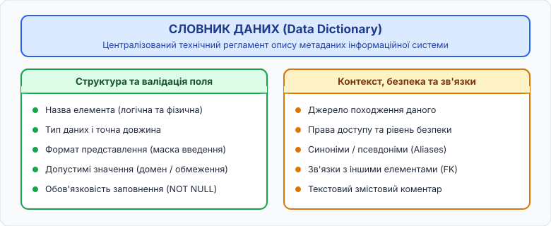
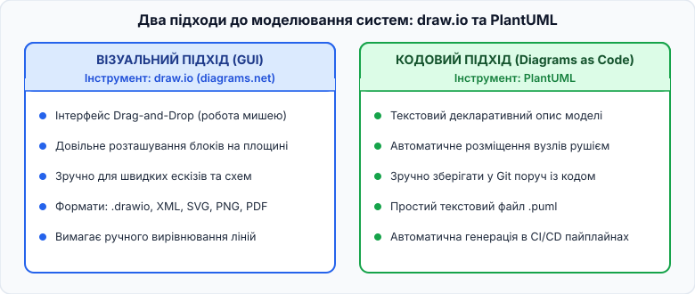
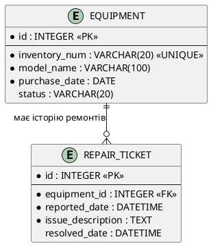
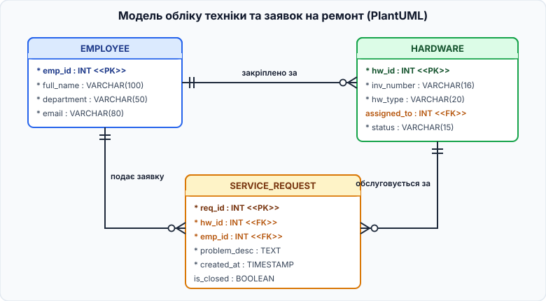

# Урок 16. Словник даних. Інструменти моделювання (draw.io, PlantUML)

<div class="how-to">

**Як працювати з уроком**

1. Ознайомтеся з теоретичними основами побудови словника даних та відмінностями між візуальним (draw.io) і текстовим (PlantUML) моделюванням.
2. Виконайте покрокове практичне завдання зі складання словника даних та опису зв'язків сутностей за допомогою мови PlantUML.
3. Дайте відповіді на 10 запитань підсумкового тесту для перевірки засвоєння матеріалу.

</div>

## Мета уроку

Опанувати методику стандартизації інформації за допомогою словника даних та навчитися документувати структуру інформаційних систем із використанням сучасних інструментів моделювання. На практиці ви:

- спроєктуєте структурований словник даних для підсистеми обліку комп'ютерної техніки та ремонтних заявок;
- формалізуєте типи даних, формати зберігання, первинні ключі та обмеження домену;
- створите декларативну діаграму сутностей і класів мовою PlantUML за концепцією «Diagrams as Code»;
- експортуєте отриману векторну модель та перевірите її відповідність словнику даних.

## Що знадобиться

- Веб-браузер (Google Chrome, Mozilla Firefox або Chromium).
- Текстовий редактор (VS Code, Kate, Notepad++ або вбудований редактор ОС).
- Онлайн-середовище **PlantUML Web Server** (або локальна утиліта `plantuml`) та редактор діаграм **draw.io** (app.diagrams.net).

## Теорія

Під час розробки, впровадження та щоденної експлуатації інформаційних систем критично важливо, щоб усі учасники процесу — системні аналітики, розробники, адміністратори баз даних та оператори з обробки інформації — однаково розуміли зміст кожного інформаційного поля. Якщо в одного фахівця статус замовлення записується числом `1`, у другого текстом `"Active"`, а в третього `"В роботі"`, виникає семантичний конфлікт, що призводить до збоїв у звітах та втрати даних.

### 1. Поняття та призначення словника даних

**Словник даних (Data Dictionary)** — це централізоване сховище метаданих (даних про дані), яке містить формалізований, однозначний та детальний опис усіх елементів даних, структур, потоків і сховищ інформаційної системи.

<div class="clip">



*Структура метаданих словника даних (Data Dictionary)*

</div>

Для оператора з обробки інформації та програмного забезпечення словник даних виконує роль головного технічного регламенту:
- визначає правила валідації первинних документів перед їх введенням у систему;
- запобігає дублюванню інформації за різними назвами;
- забезпечує коректність виконання операцій імпорту, експорту та міграції баз даних.

### 2. Структура елемента словника даних

Кожен запис у словнику даних містить набір стандартизованих атрибутів:

| Атрибут словника | Призначення | Приклад значення |
| :--- | :--- | :--- |
| **Фізична назва** | Ідентифікатор поля у базі даних (англійською, snake_case) | `serial_number` |
| **Логічна назва** | Зрозуміла назва елемента в інтерфейсі користувача | Серійний номер пристрою |
| **Тип даних** | Базовий тип у СУБД / мові програмування | `VARCHAR(50)` |
| **Обов'язковість** | Чи може поле залишатися порожнім | `Обов'язкове (NOT NULL)` |
| **Формат / Маска** | Шаблон введення для контролю оператором | `SN-XXXX-YYYY` |
| **Домен значень** | Діапазон або фіксований перелік допустимих значень | Тільки латинські літери та цифри |
| **Ключовий статус** | Роль у структурі (первинний / зовнішній ключ) | `Унікальний (UNIQUE)` |
| **Опис** | Семантичний зміст та бізнес-правила обробки | Заводський номер на шильдику пристрою |

### 3. Інструменти моделювання: draw.io проти PlantUML

Для перенесення словника даних у наочні структурні діаграми використовують спеціалізоване програмне забезпечення. Сьогодні в ІТ-індустрії домінують два взаємодоповнюючі підходи:

<div class="clip">



*Порівняння візуального підходу (draw.io) та кодового підходу Diagrams as Code (PlantUML)*

</div>

#### Особливості draw.io (diagrams.net):
- Працює як у браузері, так і у вигляді автономної програми (desktop-версія без доступу до інтернету).
- Містить готові бібліотеки графічних примітивів: UML (класи, прецеденти, послідовності), ER-діаграми (сутність-зв'язок), мережеві топології Cisco/AWS, схеми алгоритмів.
- Дозволяє вбудовувати векторні схеми безпосередньо у файли PNG та PDF із можливістю повторного відкриття та редагування структури.

#### Особливості PlantUML:
- Базується на філософії **«Diagrams as Code»** (Діаграми як код): структура системи описується зрозумілим текстом, а рушій Graphviz автоматично обчислює координати вузлів і з'єднувальних стрілок.
- Запобігає витрачанню часу на ручне вирівнювання блоків і піксельну підгонку.
- При зміні структури таблиці в тексті діаграма перебудовується автоматично.

### 4. Синтаксис PlantUML для моделювання структур даних

PlantUML використовує лаконічний синтаксис. Діаграма завжди огортається тегами `@startuml` та `@enduml`. Для опису таблиць або сутностей використовують ключове слово `entity` або `class`:



У синтаксисі зв'язків:
- `||--o{` позначає кардинальність зв'язку: один пристрій може мати нуль або багато ремонтних заявок (1:N);
- Символ `*` позначає обов'язкове поле (NOT NULL);
- `<<PK>>` і `<<FK>>` вказують відповідно на первинний (Primary Key) та зовнішній (Foreign Key) ключі.

<div class="more-link">

**Хочете знати більше?** <span class="optional">Необов’язково</span>

У промислових проєктах словники даних часто генеруються автоматично з файлів міграцій або коду ORM (Object-Relational Mapping). Наприклад, утиліта `schemacrawler` може підключитися до працюючої бази PostgreSQL або MySQL і автоматично згенерувати повний словник даних у форматі Markdown разом із готовими діаграмами PlantUML. Це гарантує, що документація ніколи не застаріє відносно реальної бази даних.

</div>

## Покроково

### 1. Проєктування словника даних для модуля обліку техніки

Складемо технічну специфікацію словника даних для трьох сутностей: `EMPLOYEE` (Співробітник), `HARDWARE` (Комп'ютерна одиниця) та `SERVICE_REQUEST` (Заявка на сервіс).

Створіть таблицю словника даних для ключової сутності `HARDWARE`:

| Поле | Фізичний тип | Обов'язкове | Домен / Обмеження | Опис |
| :--- | :--- | :--- | :--- | :--- |
| `hw_id` | `INT AUTO_INCREMENT` | Так (PK) | > 0 | Первинний сурогатний ключ |
| `inv_number` | `VARCHAR(16)` | Так (UNIQUE) | Формат: `INV-[0-9]{5}` | Інвентарний номер бухгалтерії |
| `hw_type` | `VARCHAR(20)` | Так | `['PC', 'LAPTOP', 'PRINTER', 'MONITOR']` | Тип апаратної одиниці |
| `assigned_to`| `INT` | Ні (FK) | Посилається на `EMPLOYEE.emp_id` | Відповідальна матеріальна особа |
| `status` | `VARCHAR(15)` | Так | `['ACTIVE', 'IN_REPAIR', 'DECOMMISSIONED']` | Поточний експлуатаційний статус |

### 2. Створення текстового опису моделі в PlantUML

Створіть файл із назвою `system_model.puml` у текстовому редакторі та внесіть декларативний опис моделі, що зв'язує користувачів, обладнання та заявки:

```text
@startuml
title Модуль обліку техніки та заявок на ремонт

entity "EMPLOYEE" as emp {
  * emp_id : INT <<PK>>
  --
  * full_name : VARCHAR(100)
  * department : VARCHAR(50)
  * email : VARCHAR(80)
}

entity "HARDWARE" as hw {
  * hw_id : INT <<PK>>
  --
  * inv_number : VARCHAR(16) <<UNIQUE>>
  * hw_type : VARCHAR(20)
    assigned_to : INT <<FK>>
  * status : VARCHAR(15)
}

entity "SERVICE_REQUEST" as req {
  * req_id : INT <<PK>>
  --
  * hw_id : INT <<FK>>
  * emp_id : INT <<FK>>
  * problem_desc : TEXT
  * created_at : TIMESTAMP
    is_closed : BOOLEAN
}

emp ||--o{ hw : "закріплено за"
hw ||--o{ req : "обслуговується за"
emp ||--o{ req : "подає заявку"

@enduml
```

<div class="clip">



*Візуалізація моделі обліку техніки та ремонтних заявок з PlantUML*

</div>

### 3. Візуалізація моделі та перевірка зв'язків

1. Відкрийте браузер і перейдіть на публічний сервер [PlantText](https://www.planttext.com/) або офіційний [PlantUML Web Server](http://www.plantuml.com/plantuml/).
2. Вставте код з файлу `system_model.puml` у ліве поле редактора.
3. Переконайтеся, що рушій без помилок побудував три зв'язані блоки та коректно розставив маркери кардинальності.
4. Збережіть діаграму у векторному форматі `SVG` або `PNG`.

<div class="try">

**Спробуйте самі**

Додайте до схеми четверту сутність — `MAINTENANCE_LOG` (Журнал виконаних робіт), яка фіксуватиме кожну технічну дію спеціаліста над заявкою:
- `log_id : INT <<PK>>`
- `req_id : INT <<FK>>` (зв'язок із заявкою)
- `technician_name : VARCHAR(80)` (ПІБ інженера або оператора)
- `action_taken : TEXT` (опис виконаної роботи: заміна кулера, чистка від пилу, встановлення ОС)
- `logged_at : TIMESTAMP`

Оновіть PlantUML-код зв'язком: одна заявка `SERVICE_REQUEST` може мати один або більше записів у `MAINTENANCE_LOG`.

<details>
<summary>Перевірити очікуваний результат і повний розв’язок</summary>

Повний блок коду для додавання до `system_model.puml`:

```plantuml
entity "MAINTENANCE_LOG" as log {
  * log_id : INT <<PK>>
  --
  * req_id : INT <<FK>>
  * technician_name : VARCHAR(80)
  * action_taken : TEXT
  * logged_at : TIMESTAMP
}

req ||--|{ log : "має записи в журналі"
```

Символ `||--|{` вказує на відношення «один до одного або багатьох» (1:1..*), тобто якщо заявка була прийнята в роботу, вона повинна мати щонайменше одну зафіксовану дію майстра.

</details>

</div>

## Підсумок

- **Словник даних** є фундаментом інформаційної системи, який усуває неоднозначності в назвах полів, типах даних, одиницях вимірювання та бізнес-правилах.
- **Метадані** у словнику регламентують правила обов'язковості (`NOT NULL`), унікальності (`UNIQUE`), формати введення та обмеження доменів значень.
- **draw.io** є зручним графічним редактором для швидкого ручного компонування діаграм за допомогою миші та готових бібліотек фігур.
- **PlantUML** реалізує парадигму «Diagrams as Code», дозволяючи швидко створювати структурні схеми через простий текст, версіонувати їх у Git та генерувати діаграми автоматично.

## Тест

<div class="test-box">

10 запитань за матеріалом уроку. На початку тесту вкажіть **прізвище, ім’я та групу**.

<!-- GOOGLE_FORM_START:lesson-16 -->
[Відкрити тест у новій вкладці](https://docs.google.com/forms/d/e/1FAIpQLSfc8Bzm7KyQPfbisnBZUbBiiYPKm2eVuesKqv98zoucfnPzzA/viewform)

<iframe src="https://docs.google.com/forms/d/e/1FAIpQLSfc8Bzm7KyQPfbisnBZUbBiiYPKm2eVuesKqv98zoucfnPzzA/viewform?embedded=true" loading="lazy" title="Тест lesson-16">Завантаження…</iframe>
<!-- GOOGLE_FORM_END:lesson-16 -->

</div>

## Додаткове завдання

<span class="optional">Необов’язково</span>

**Базовий рівень.** Відкрийте веб-редактор [draw.io](https://app.diagrams.net/). Оберіть шаблон «Entity Relation» і вручну намалюйте схему сутностей `HARDWARE` та `EMPLOYEE`, з'єднавши їх зв'язком із позначенням кардинальності. Експортуйте результат у файл `hardware_schema.png`.

**Проєктний рівень.** Опишіть мовою PlantUML словник даних та діаграму класів для системи онлайн-бібліотеки коледжу, що містить сутності `BOOK` (Книга), `READER` (Читач) та `LOAN` (Факт видачі книги з датою повернення). Передбачте перевірку обмеження терміну користування (не більше 14 днів).
