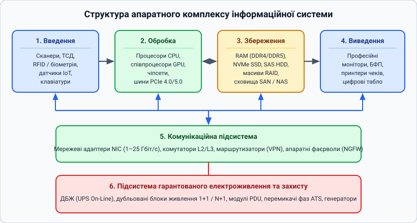

# Урок 17. Комплекси обладнання інформаційних систем: загальна будова та принципи роботи

<div class="how-to">

**Як працювати з уроком**

1. Ознайомтеся з архітектурою апаратних комплексів інформаційних систем, функціональними підсистемами та принципами відмовостійкості.
2. Виконайте покрокове практичне завдання з аудиту апаратної конфігурації вузла ІС за допомогою інструментів командного рядка.
3. Дайте відповіді на 10 запитань підсумкового тесту для закріплення знань.

</div>

## Мета уроку

Зрозуміти фундаментальну структуру та принципи взаємодії апаратних компонентів сучасних інформаційних систем. На практиці ви:

- навчитеся класифікувати компоненти апаратного комплексу за їх функціональним призначенням;
- опануєте принципи резервування (Hot-Swap, N+1) та масштабування вузлів системи;
- проведете програмний аудит процесора, оперативної пам'яті, сховищ даних та мережевих адаптерів засобами термінала;
- складете технічний апаратний паспорт автоматизованого робочого місця (АРМ) оператора.

## Що знадобиться

- Комп'ютер із встановленою ОС Linux (Debian, Ubuntu, Linux Mint) або середовище командного рядка (WSL у Windows).
- Системні діагностичні утиліти: `lscpu`, `free`, `lsblk`, `lspci`, `lshw`.

## Теорія

Ефективність будь-якої інформаційної системи (ІС) визначається не лише якістю програмного забезпечення, а й надійністю та збалансованістю її матеріальної бази.

**Апаратний комплекс інформаційної системи (Hardware Complex)** — це сукупність взаємопов'язаних технічних засобів (обчислювальних машин, мережевих пристроїв, накопичувачів, засобів зв'язку, периферійного обладнання та систем гарантованого живлення), призначених для автоматизованого збору, обробки, накопичення, зберігання, захисту та видачі даних.

<div class="clip">



*Структура апаратного комплексу інформаційної системи*

</div>

### 1. Функціональні підсистеми апаратного комплексу

Кожен елемент апаратного комплексу виконує чітко регламентовану функцію:

1. **Підсистема введення та первинного збору:**
   - Перетворює фізичні сигнали або інформацію з первинних носіїв у цифровий вигляд.
   - Сюди належать: клавіатури, оптичні сканери документів, термінали збору даних (ТСД), зчитувачі штрих-кодів і QR-кодів, RFID/NFC-рідери для складської логістики та контролю доступу, біометричні сенсори, датчики промислового інтернету речей (IoT).

2. **Підсистема обчислення та обробки:**
   - Ядро апаратної системи, що виконує машинний код операційної системи та прикладних програм.
   - Включає центральні процесори (CPU архітектур x86-64 та ARM), графічні співпроцесори (GPU) для відеомонтажу чи нейромереж, материнські плати з високошвидкісними шинами PCI Express (PCIe 4.0/5.0).

3. **Підсистема пам'яті та довготривалого збереження:**
   - Забезпечує миттєвий доступ до оброблюваних даних (оперативна пам'ять RAM стандарту DDR4/DDR5) та довгострокове енергонезалежне зберігання.
   - Включає твердотільні накопичувачі NVMe M.2/U.2, магнітні диски SAS/SATA HDD корпоративного класу, апаратні RAID-контролери, що об'єднують фізичні диски у відмовостійкі масиви (RAID 1, 5, 10), а також мережеві сховища даних (NAS і SAN).

4. **Підсистема виведення та представлення:**
   - Надає результати обробки оператору або клієнту: професійні монітори, принтери чеків і термотрансферні принтери для маркування товарів, багатофункціональні пристрої (БФП), цифрові табло та аудіовізуальні системи.

5. **Комунікаційна підсистема:**
   - Об'єднує робочі станції, сервери та периферію в єдиний інформаційний простір.
   - Включає мережеві інтерфейсні адаптери (NIC зі швидкістю 1, 10 або 25 Гбіт/с), керовані комутатори рівнів L2/L3, маршрутизатори з апаратним шифруванням каналів зв'язку (VPN) та апаратні брандмауери (NGFW).

6. **Підсистема гарантованого електроживлення та захисту:**
   - Забезпечує якісне живлення без стрибків напруги.
   - Включає джерела безперебійного живлення (ДБЖ / UPS) класу On-Line з подвійним перетворенням енергії, резервні серверні блоки живлення за схемою 1+1 або 2+1, модулі розподілу живлення (PDU) та генератори резервного живлення.

### 2. Ключові принципи функціонування апаратних комплексів

На відміну від домашнього комп'ютера, обладнання корпоративних інформаційних систем проєктується на основі спеціальних інженерних принципів:

- **Принцип модульності та уніфікації:** усі вузли мають стандартні форм-фактори та інтерфейси, що дозволяє замінювати несправні блоки без заміни всього комплексу.
- **Принцип відмовостійкості (Fault Tolerance) та резервування:**
  - *Резервування за формулою N+1:* якщо для нормальної роботи сервера потрібно 2 блоки живлення, встановлюється 3 блоки (N = 2, +1 резервний). При виході з ладу будь-якого одного блока навантаження миттєво підхоплюють решта.
  - *Технологія «гарячої заміни» (Hot-Swap):* можливість безпечного вилучення та встановлення несправного жорсткого диска, блока живлення або вентилятора охолодження прямо під час роботи сервера, без вимкнення операційної системи та зупинки сервісів.
- **Принцип масштабованості (Scalability):**
  - *Вертикальне масштабування (Scale-Up):* нарощування потужності одного вузла (додавання додаткових планок RAM, встановлення другого CPU, заміна дисків на більш місткі).
  - *Горизонтальне масштабування (Scale-Out):* додавання нових однотипних обчислювальних вузлів (серверів) у загальний кластер із балансуванням навантаження між ними.
- **Принцип апаратного позасмугового моніторингу (Out-of-Band Management):**
  - Використання виділеного апаратного мікроконтролера (Baseboard Management Controller — BMC) за стандартами **IPMI**, **HP iLO** або **Dell iDRAC**.
  - Дозволяє системному адміністратору або оператору віддалено увімкнути живлення сервера, переглянути температури компонентів, оновити BIOS або перевстановити ОС через мережу, навіть коли основний сервер повністю вимкнений чи завис.

<div class="more-link">

**Хочете знати більше?** <span class="optional">Необов’язково</span>

У сучасних інформаційних центрах пам'ять серверів оснащується технологією **ECC (Error-Correcting Code)**. Через космічні промені та електромагнітні наведення в мікросхемах пам'яті іноді виникає явище «bit-flip» (мимовільна зміна біта з 0 на 1). Звичайна пам'ять на домашньому ПК у такому випадку спричиняє «синій екран» (BSoD), тоді як ECC-пам'ять виявляє та миттєво виправляє поодинокі бітові помилки апаратно, не зупиняючи обробку фінансових транзакцій чи баз даних.

</div>

## Покроково

### 1. Дослідження обчислювальної підсистеми вузла

Відкрийте термінал Linux та виконайте системну команду опитування процесора:

```bash
lscpu
```

Зверніть увагу на ключові параметри та зафіксуйте їх:
- `Architecture` (Архітектура: наприклад, `x86_64`);
- `CPU(s)` (Загальна кількість логічних потоків);
- `Thread(s) per core` (Кількість потоків на одне фізичне ядро: 2 означає підтримку Hyper-Threading/SMT);
- `Model name` (Точна модель процесора та базова тактова частота);
- `L1d, L1i, L2, L3 cache` (Обсяг кеш-пам'яті різних рівнів).

### 2. Інвентаризація підсистеми оперативної пам'яті

Виконайте команду для перевірки загального та вільного обсягу RAM:

```bash
free -h
```

Для детального перегляду характеристик модулів пам'яті (кількість встановлених планок, тип DDR, тактова частота в МГц) виконайте опитування таблиць DMI через права суперкористувача (якщо доступні):

```bash
sudo dmidecode --type memory | grep -E "Size:|Type:|Speed:|Manufacturer:"
```

*(Якщо команда виконується у навчальному контейнері або без прав root, інформацію про RAM можна переглянути у файлі `cat /proc/meminfo | head -n 5`).*

### 3. Перевірка підсистеми збереження та накопичувачів

Для перегляду фізичних дисків, їх типів та розміщених розділів виконайте команду `lsblk`:

```bash
lsblk -o NAME,FSTYPE,SIZE,TYPE,ROTA,MOUNTPOINT
```

Параметр `ROTA` (Rotational device) є показовим:
- Якщо `ROTA = 1` — це механічний жорсткий диск (HDD), шпиндель якого обертається.
- Якщо `ROTA = 0` — це твердотільний накопичувач (SSD або NVMe), що не має рухомих механічних деталей.

<div class="try">

**Спробуйте самі**

Перевірте комунікаційну підсистему вашого комп'ютера. Знайдіть у списку PCI-пристроїв мережевий контролер за допомогою команди:

```bash
lspci | grep -i -E "ethernet|network"
```

Визначте виробника та модель мережевої карти (наприклад, Intel I219-V Gigabit Ethernet або Realtek RTL8111).
Складіть на основі отриманих даних таблицю апаратного паспорта робочої станції.

<details>
<summary>Перевірити очікуваний результат і повний розв’язок</summary>

Зразок заповненого апаратного паспорта вузла ІС:

| Компонент / Підсистема | Характеристика вузла | Значення / Модель |
| :--- | :--- | :--- |
| **Процесор (CPU)** | Модель, ядра/потоки | Intel Core i5-12400 (6 ядер / 12 потоків, 2.5–4.4 GHz) |
| **Кеш CPU** | Обсяг L3 кешу | 18 MB Intel Smart Cache |
| **Оперативна пам'ять (RAM)** | Обсяг та режим | 16 GB DDR4-3200 (2 планки по 8 GB, Dual-Channel) |
| **Накопичувач (SSD)** | Інтерфейс та місткість | 512 GB M.2 NVMe PCIe 4.0 (`ROTA = 0`) |
| **Мережева карта (NIC)** | Модель та пропускна здатність | Intel I219-V Gigabit Ethernet (1000 Mbps) |
| **Тип охолодження / БЖ** | Потужність та сертифікат | БЖ 450W 80 PLUS Bronze |

Команда `lspci | grep -i ethernet` повертає рядок виду:
`00:1f.6 Ethernet connection (2) I219-V (rev 00)`, що підтверджує наявність гігабітного контролера від компанії Intel.

</details>

</div>

## Підсумок

- **Апаратний комплекс ІС** складається з 6 базових підсистем: введення, обробки, пам'яті/збереження, виведення, мережевих комунікацій та гарантованого електроживлення.
- Серверні комплекси проєктуються з дотриманням принципів **модульності**, **відмовостійкості (N+1)**, **масштабованості** та **гарячої заміни (Hot-Swap)** несправних вузлів.
- Системи позасмугового керування (**IPMI/iLO/iDRAC**) забезпечують віддалене адміністрування та діагностику апаратного стану сервера незалежно від стану операційної системи.
- Утиліти командного рядка Linux (`lscpu`, `free -h`, `lsblk`, `lspci`) дозволяють оператору швидко зібрати точну інформацію про специфікацію будь-якого вузла ІС.

## Тест

<div class="test-box">

10 запитань за матеріалом уроку. На початку тесту вкажіть **прізвище, ім’я та групу**.

<!-- GOOGLE_FORM_START:lesson-17 -->
[Відкрити тест у новій вкладці](https://docs.google.com/forms/d/e/1FAIpQLSdeBQxqzndX5F0gsxrjGD5fZkGM9WHDbb81HPwqHE9UI4aUYQ/viewform)

<iframe src="https://docs.google.com/forms/d/e/1FAIpQLSdeBQxqzndX5F0gsxrjGD5fZkGM9WHDbb81HPwqHE9UI4aUYQ/viewform?embedded=true" loading="lazy" title="Тест lesson-17">Завантаження…</iframe>
<!-- GOOGLE_FORM_END:lesson-17 -->

</div>

## Додаткове завдання

<span class="optional">Необов’язково</span>

**Базовий рівень.** Запустіть у терміналі утиліту `uname -a` та `df -h`. Визначте поточну версію ядра операційної системи та відсоток заповненості кореневого розділу диска `/`.

**Проєктний рівень.** Опишіть апаратну схему забезпечення відмовостійкості сервера бази даних для великого інтернет-магазину. Вкажіть, які саме компоненти повинні дублюватися за схемою N+1 або 2N, та обґрунтуйте вибір типу джерела безперебійного живлення (UPS On-Line з подвійним перетворенням).
