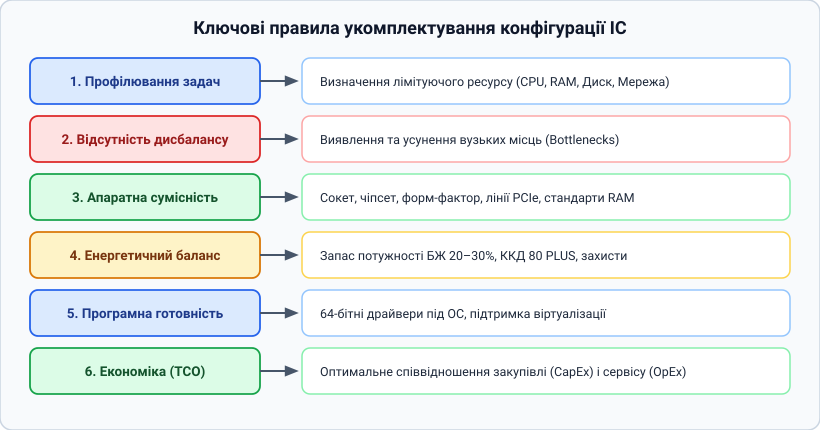
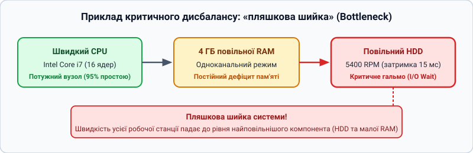
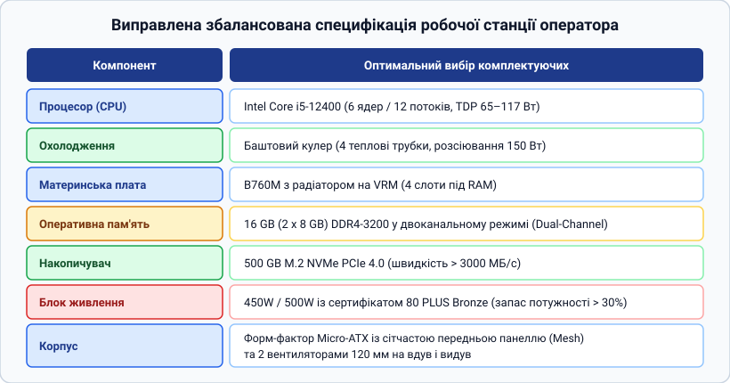

# Урок 18. Правила створення та укомплектування конфігурацій інформаційних систем

**Як працювати з уроком**

1. Ознайомтеся з базовими правилами підбору компонентів, усуненням «пляшкових шийок» (bottlenecks) та методикою розрахунку енергетичного бюджету.
2. Виконайте покрокове практичне завдання з аудиту незбалансованої конфігурації та розрахунку потужності блока живлення.
3. Дайте відповіді на 10 запитань підсумкового тесту для перевірки готовності.

## Мета уроку

Опанувати інженерні та економічні принципи створення збалансованих конфігурацій інформаційних систем. На практиці ви:

- навчитеся визначати профіль навантаження інформаційної системи (CPU-bound, RAM-bound, I/O-bound);
- засвоїте правила перевірки фізичної, електричної та програмної сумісності комплектуючих;
- навчитеся виявляти та усувати апаратні дисбаланси («вузькі місця» системи);
- розрахуєте сумарний енергетичний бюджет ПК та підберете блок живлення з необхідним сертифікатом енергоефективності.

## Що знадобиться

- Табличний процесор (LibreOffice Calc або онлайн-таблиці) для складання специфікації.
- Онлайн-калькулятор потужності (OuterVision Power Supply Calculator, be quiet! Calculator або еквівалентний довідник потужностей компонентів).

## Теорія

Створення конфігурації комп'ютерного обладнання для інформаційної системи — це інженерне завдання, в якому кожен компонент повинен відповідати характеру поставлених бізнес-задач. Поширена помилка недосвідчених фахівців — вкласти більшу частину бюджету в надпотужний процесор, зекономивши на оперативній пам'яті, дисках або блоці живлення. Результатом стає повільна та нестабільна робота системи.

**Конфігурація інформаційної системи** — це узгоджена сукупність апаратних компонентів (Hardware) та базового системного програмного забезпечення (Software), оптимізована під виконання заданого типу навантажень із мінімальною сукупною вартістю володіння.

*Ключові правила укомплектування конфігурації інформаційної системи*

### 1. Профілювання робочого навантаження (Workload Profiling)

Перед підбором комплектуючих оператор повинен визначити, який саме апаратний ресурс буде найбільше навантажений під час щоденної роботи:

- **CPU-bound (обчислювальне навантаження):** задачі компіляції коду, математичного аналізу великих масивів чисел, 3D-рендерингу. Вимагають максимальної кількості швидких процесорних ядер та високого обсягу кешу L3.
- **Memory-bound (навантаження на пам'ять):** сервери баз даних у пам'яті (In-Memory DB), обробка великих таблиць у пам'яті, віртуалізація. Вимагають значного обсягу RAM (від 32–64 ГБ і вище) з максимальною швидкістю та обов'язковим багатоканальним режимом.
- **I/O-bound (дискове навантаження):** транзакційні СУБД (1С/BAS, PostgreSQL), робота з великими архівами документів, медіамонтаж 4K-відео. Вимагають високошвидкісних NVMe-накопичувачів із високими показниками IOPS (операцій вводу-виводу за секунду) та високим ресурсом надійності (TBW).
- **Network-bound (мережеве навантаження):** сервери роздачі файлів, шлюзи безпеки, проксі-сервери. Вимагають швидкісних мережевих плат 2.5/10 Гбіт/с та продуктивних шин зв'язку.

### 2. Принцип збалансованості та усунення «пляшкових шийок» (Bottlenecks)

**Пляшкова шийка (Bottleneck)** — це компонент системи з найнижчою пропускною здатністю, який штучно обмежує продуктивність решти значно дорожчих і потужніших деталей.

*Приклад критичного дисбалансу — пляшкова шийка системи*

Якщо операційна система та база даних встановлені на старий магнітний диск (HDD зі швидкістю доступу 12–15 мілісекунд), потужний 16-ядерний процесор 95% часу буде простоювати у стані очікування відповіді від накопичувача (`I/O Wait`). У збалансованій системі швидкість накопичувача (NVMe SSD із затримкою 0.05 мс) та обсяг оперативної пам'яті дозволяють процесору працювати без вимушених пауз.

### 3. Правила перевірки фізичної та апаратної сумісності

При комплектуванні обов'язково контролюють такі вузли сумісності:

| Вузол сполучення | Критерії перевірки сумісності |
| :--- | :--- |
| **CPU ↔ Материнська плата** | Збіг фізичного роз'єму (сокет: LGA1700, AM4, AM5), підтримка покоління процесора чіпсетом (B660, B650 тощо) та сумісність версії прошивки BIOS/UEFI |
| **RAM ↔ Плата / CPU** | Покоління пам'яті (DDR4 чи DDR5 фізично несумісні через різний ключ слота), максимальна підтримувана частота та кількість слотів (2 або 4) |
| **Кулер ↔ CPU / Корпус** | Кріплення під конкретний сокет, розрахункове тепловиділення розсіювання (TDP кулера має перевищувати TDP процесора мінімум на 25–30%), висота кулера в мм щодо ширини корпусу |
| **Відеокарта ↔ Корпус / БЖ** | Довжина відеокарти (мм) щодо внутрішнього простору шасі, кількість та тип кабелів додаткового живлення PCIe (8-pin або новий 12VHPWR) |
| **Накопичувач ↔ Плата** | Підтримка протоколу роз'єму M.2 (NVMe PCIe чи SATA M.2), версія шини (PCIe 3.0 / 4.0 / 5.0) та форм-фактор плати (2280, 2242) |

### 4. Розрахунок енергетичного бюджету та вибір блока живлення (PSU)

Блок живлення забезпечує перетворення змінної напруги побутової електромережі (220 В, 50 Гц) у стабільні постійні напруги: **+12V** (основна лінія для CPU та GPU), **+5V** та **+3.3V** (для системної плати, SSD та портів введення).

Правило розрахунку потужності блока живлення:

$$\text{Потужність БЖ (Вт)} = (\text{TDP}_{\text{CPU}} + \text{TDP}_{\text{GPU}} + P_{\text{інше}}) \times 1.3$$

Де:
- $P_{\text{інше}}$ — споживання системної плати, вентиляторів, планок пам'яті та дисків (зазвичай приймається як 50–70 Вт);
- Множник **$1.3$** забезпечує **30% запас потужності**. Блок живлення працює в зоні максимального ККД (40–60% від номіналу), менше нагрівається, вентилятор обертається на мінімальних обертах, а компоненти не деградують від перевантажень.

#### Сертифікація енергоефективності 80 PLUS:
Стандарт гарантує, що не менше 80% спожитої з розетки енергії перетворюється на корисну потужність комп'ютера, а не розсіюється у вигляді паразитного тепла:
- **80 PLUS Standard (White):** ККД $\ge 80\%$;
- **80 PLUS Bronze:** ККД $\ge 85\%$ (рекомендований мінімум для офісних станцій);
- **80 PLUS Gold:** ККД $\ge 90\%$ (стандарт для продуктивних робочих та серверних станцій);
- **80 PLUS Platinum / Titanium:** ККД $92–96\%$ (для високонавантажених серверів і ЦОД).

**Хочете знати більше?** Необов’язково

**Концепція TCO (Total Cost of Ownership — Сукупна вартість володіння):**
При закупівлі парку з 50 комп'ютерів дешевший на 15% комп'ютер із низькоякісним блоком живлення без сертифіката 80 PLUS за 3 роки щоденної експлуатації споживає електроенергії на суму, що перевищує початкову «економію», а також збільшує витрати на кондиціонування офісу через надмірне виділення тепла. Грамотний фахівець завжди враховує життєвий цикл техніки: `TCO = Вартість придбання (CapEx) + Вартість експлуатації (OpEx)`.

## Покроково

### 1. Аудит запропонованої незбалансованої конфігурації

Проаналізуємо специфікацію комп'ютера, яку недосвідчений замовник зібрав для оператора з обробки інформації (робота з СУБД PostgreSQL та великими масивами даних):

| Компонент | Обрана деталь | Зауваження аудитора |
| :--- | :--- | :--- |
| **Процесор** | Intel Core i7-13700K (16 ядер, TDP до 253 Вт) | Надлишково дорогий та гарячий для типових операторських задач |
| **Кулер CPU** | Боксовий кулер Intel (алюмінієвий радіатор, розсіювання до 65 Вт) | **Критична помилка:** процесор під навантаженням миттєво сягне 100°C і перейде в тротлінг |
| **Материнська плата**| H610M (бюджетний чіпсет без радіаторів на VRM) | Перегрів ланцюгів живлення під процесором 253 Вт |
| **RAM** | 1 планка 8 GB DDR4-2666 MHz | **Пляшкова шийка:** одноканальний режим ріже швидкість обміну даними навпіл |
| **Накопичувач** | HDD 1 TB Seagate Barracuda 5400 RPM | **Головна пляшкова шийка:** катастрофічно повільне завантаження ОС та запитів |
| **Блок живлення** | NoName 400W (без сертифіката 80 PLUS) | Ризик виходу з ладу та пошкодження комплектуючих через стрибок напруги |

### 2. Розрахунок енергетичного бюджету збалансованої станції

Складемо збалансовану альтернативу на базі сучасного 6-ядерного процесора Intel Core i5-12400:
1. `TDP CPU`: Intel Core i5-12400 = 65 Вт (максимум до 117 Вт у піковому навантаженні).
2. `Відеоядро`: Інтегроване Intel UHD Graphics 730 (живиться від процесорного сокета).
3. `Системна плата, 2 планки RAM, NVMe SSD, кулер, порти USB`: 60 Вт.
4. `Пікове сумарне споживання`: $117 + 60 = 177$ Вт.
5. `Розрахунок рекомендованої потужності БЖ`: $177 \times 1.3 \approx 230$ Вт.
6. `Вибір моделі`: стандартні якісні брендові блоки живлення починаються від 400–450 Вт. Блок живлення потужністю **450 Вт із сертифікатом 80 PLUS Bronze** працюватиме за навантаження ~40%, забезпечуючи безшумність, мінімальний нагрів та запас під будь-яку модернізацію.

### 3. Формування виправленої специфікації

Створіть у табличному процесорі виправлену технічну специфікацію робочої станції оператора:

*Виправлена збалансована специфікація робочої станції оператора*

**Спробуйте самі**

Замовник вирішив додати до цієї робочої станції дискретну відеокарту рівня **NVIDIA GeForce RTX 3060 (TDP 170 Вт)** для роботи з 3D-моделями та рендерингом.
1. Розрахуйте нове пікове енергоспоживання системи: $\text{CPU (117 Вт)} + \text{GPU (170 Вт)} + \text{Система (60 Вт)}$.
2. Застосуйте коефіцієнт надійності $1.3$.
3. Визначте мінімальну необхідну потужність блока живлення та оберіть відповідний сертифікат 80 PLUS.

Перевірити очікуваний результат і повний розв’язок

Розрахунок:
1. Пікове споживання: $117 + 170 + 60 = 347$ Вт.
2. З урахуванням коефіцієнта запасу 30%: $347 \times 1.3 = 451.1$ Вт.
3. Оптимальний вибір блока живлення: якісна модель номіналом **550 Вт або 600 Вт** із сертифікатом **80 PLUS Bronze або Gold**.
Такий запас гарантує захист від раптових короткочасних сплесків струму (Power Spikes), які характерні для відеокарт сімейства RTX, та забезпечить тиху роботу вентилятора БЖ.

## Підсумок

- **Правило профілювання** вимагає підбирати конфігурацію під конкретний лімітуючий фактор задачі (CPU-bound, RAM-bound або I/O-bound).
- **Усунення «пляшкових шийок»** — головне завдання оператора при конфігуруванні: навіть найпотужніший процесор блокується повільним HDD або одноканальним режимом пам'яті.
- Комплектуючі обов'язково перевіряються на **фізичну сумісність** (сокет, версія PCIe, форм-фактор корпусу) та **електричну сумісність** (потужність ліній +12V, роз'єми живлення).
- Блок живлення обирається з **запасом потужності 20–30%** та офіційною сертифікацією не нижче **80 PLUS Bronze**, що мінімізує сукупну вартість володіння (TCO).

## Тест

10 запитань за матеріалом уроку. На початку тесту вкажіть **прізвище, ім’я та групу**.

🔗 <!-- GOOGLE_FORM_URL:lesson-18 --> *(Посилання на Google Форму буде додано після масового імпорту тесту)*

## Додаткове завдання

Необов’язково

**Базовий рівень.** Знайдіть у технічній документації материнської плати специфікацію сокета AM5. З'ясуйте, чи підтримує ця платформа модулі оперативної пам'яті стандарту DDR4.

**Проєктний рівень.** Розрахуйте показник сукупної вартості володіння (TCO) для офісу з 20 комп'ютерів протягом 3 років роботи: порівняйте варіант дешевого БЖ (ККД 70%, споживання з розетки 180 Вт) та сертифікованого БЖ 80 PLUS Gold (ККД 90%, споживання з розетки 140 Вт) за умови роботи 8 годин на день за чинним комерційним тарифом на електроенергію.
