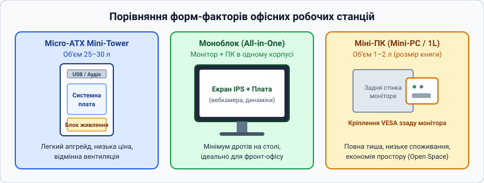
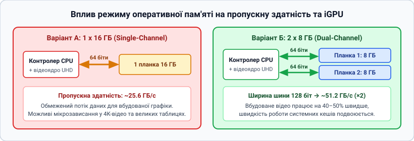

# Урок 19. Конфігурації робочих станцій для офісних задач

<div class="how-to">

**Як працювати з уроком**

1. Дослідіть специфіку навантажень автоматизованого робочого місця (АРМ) офісного працівника та критерії вибору комплектуючих.
2. Виконайте покрокове завдання зі складання кошторису офісної станції та аналізу ефективності двоканального режиму пам'яті.
3. Пройдіть підсумковий тест на 10 запитань для перевірки здобутих знань.

</div>

## Мета уроку

Опанувати методику проєктування та підбору комплектуючих для офісних автоматизованих робочих місць (АРМ) оператора з обробки інформації та програмного забезпечення. На практиці ви:

- навчитеся підбирати збалансовану конфігурацію ПК для офісних, облікових та аналітичних задач;
- порівняєте різні форм-фактори офісних ПК (Mini-PC, Micro-ATX, моноблок, тонкий клієнт);
- обґрунтуєте відмову від дискретної відеокарти на користь енергоефективного інтегрованого відеоядра;
- розрахуєте вигоду від двоканального режиму оперативної пам'яті та врахуєте вимоги ергономіки робочого місця.

## Що знадобиться

- Табличний процесор (LibreOffice Calc) або онлайн-каталог комп'ютерної техніки.
- Чекліст вимог санітарних норм та ергономіки до робочого місця оператора комп'ютерного набору (ДСанПіН).

## Теорія

В організаціях, банках, державних установах та на підприємствах найбільшу частку парку обчислювальної техніки становлять **робочі станції для офісних задач** (АРМ — автоматизовані робочі місця). Головні вимоги до таких систем — висока надійність, низький рівень шуму, енергоефективність, компактність та доступна ціна при закупівлі й обслуговуванні.

<div class="clip">


*Профіль типових навантажень офісного оператора*

</div>

### 1. Оптимальний вибір компонентів офісного АРМ

Для виконання офісних задач конфігурація повинна бути швидкою у повсякденних операціях запуску програм, але без переплати за надлишкові функції:

1. **Центральний процесор (CPU):**
   - Сучасні 4- або 6-ядерні процесори (наприклад, **Intel Core i3-12100 / i5-12400** або **AMD Ryzen 5 4600G / 5600G**).
   - Обов'язкова наявність продуктивного інтегрованого графічного ядра (**Intel UHD Graphics 730/770** або **AMD Radeon Graphics Vega**).
   - *Чому не потрібна дискретна відеокарта?* Офісні програми, відеоконференції у роздільній здатності 1080p та навіть два підключені монітори відмінно обслуговуються вбудованим відеоядром. Відмова від окремої відеокарти знижує ціну комп'ютера на 35–50%, споживання енергії на 70–100 Вт та усуває зайве джерело шуму і тепла.

2. **Оперативна пам'ять (RAM):**
   - **16 ГБ (2 планки по 8 ГБ)** — сучасний стандарт для багатозадачної офісної роботи.
   - 8 ГБ сьогодні є мінімумом, що працює на межі: операційна система Windows 11 забирає близько 3.5–4 ГБ, вбудована відеокарта динамічно виділяє з оперативної пам'яті ще 1–2 ГБ під відеобуфер (VRAM), а браузер з кількома десятками вкладок миттєво вичерпує залишок, змушуючи систему скидати дані у повільний файл підкачки (`pagefile.sys` або `swap`).
   - Обов'язковий **двоканальний режим (Dual-Channel)**: дві планки по 8 ГБ замість однієї на 16 ГБ подвоюють пропускну здатність шини пам'яті, що прискорює вбудовану графіку на 30–60%!

3. **Підсистема накопичувачів (SSD):**
   - Твердотільний накопичувач **M.2 NVMe (PCIe 3.0 або 4.0) обсягом 500–512 ГБ** зі швидкістю читання від 2500–3500 МБ/с.
   - Механічні жорсткі диски (HDD) категорично не рекомендуються як системні диски: завантаження ОС на HDD займає 1.5–2 хвилини проти 10–12 секунд на NVMe SSD, а відкриття великих звітів супроводжується «зависанням» інтерфейсу. Документи та архіви в сучасних корпоративних мережах зберігаються на централізованих серверах або мережевих сховищах (NAS), тому місткості SSD 512 ГБ цілком достатньо.

4. **Блок живлення (PSU) та охолодження:**
   - Надійна модель потужністю **350–450 Вт** із сертифікатом **80 PLUS Bronze**. Типове реальне споживання офісного ПК становить лише 50–90 Вт, тому блок працює практично безшумно.
   - Тихий кулер баштового або низькопрофільного типу з 92/120 мм вентилятором.

### 2. Форм-фактори офісних робочих станцій

Залежно від організації робочого простору кабінету оператора використовують різні типи корпусів:

| Форм-фактор | Переваги | Обмеження | Оптимальна сфера використання |
| :--- | :--- | :--- | :--- |
| **Micro-ATX Mini-Tower** | Максимальна ремонтопридатність, дешеві стандартні комплектуючі, відмінна вентиляція | Займає місце під столом або на столі | Універсальне стаціонарне робоче місце оператора |
| **Міні-ПК (Mini-PC / 1L)** | Розмір із невелику книгу, кріплення VESA на задню панель монітора, повна тиша | Зовнішній блок живлення, обмежені можливості апгрейду | Сучасні відкриті офіси (Open Space), робочі зони ресепшн |
| **Моноблок (All-in-One)** | Комп'ютер і монітор в одному корпусі, мінімум дротів на столі | Складний дорогий ремонт, неможливо замінити монітор окремо від ПК | Кабінети керівників, банківські відділення, фронт-офіс |
| **Тонкий клієнт (Thin Client)** | Мінімальна ціна, енергоспоживання 15–25 Вт, відсутність дисків (ОС завантажується з мережі) | Працює лише як термінал до сервера (RDP/VDI), не підходить для автономної роботи | Центри обробки дзвінків (Call-центри), каси, термінали складів |

<div class="clip">



*Порівняння форм-факторів офісних робочих станцій*

</div>

### 3. Ергономіка монітора та периферія для збереження здоров'я

Оператор з обробки інформації проводить за монітором 6–8 годин щодня. Економія на засобах відображення призводить до погіршення зору та швидкої втоми працівника:

- **Матриця монітора:** тільки **IPS** (In-Plane Switching) із кутами огляду 178°. Застарілі матриці TN мають викривлення кольорів при найменшому нахилі голови.
- **Діагональ і роздільна здатність:** 23.8" або 27" з роздільною здатністю **Full HD (1920x1080)** або **2K QHD (2560x1440)**.
- **Захист очей:** обов'язкова підтримка технології **Flicker-Free** (відсутність мерехтіння підсвічування на низькій яскравості) та апаратного фільтра синього спектра (**Low Blue Light**).
- **Підставка з ергономічним регулюванням (HAS):** можливість налаштувати висоту екрана так, щоб верхня межа монітора знаходилася на рівні очей оператора.
- **Цифрове підключення:** використання портів **DisplayPort** або **HDMI**. Аналоговий інтерфейс VGA (D-Sub) дає розмитість тексту та двоїння ліній на РК-екранах.

<div class="more-link">

**Хочете знати більше?** <span class="optional">Необов’язково</span>

**Чому тонкі клієнти (Thin Clients) вигідні для великих корпорацій?**
Якщо на підприємстві працює 200 операторів, адміністрування 200 окремих комп'ютерів із локальними операційними системами вимагає великого штату техніків. При переході на концепцію **VDI (Virtual Desktop Infrastructure)** оператори працюють на крихітних безвентиляторних тонких клієнтах, які лише підключаються до віртуальних машин у серверній. Оновлення ПЗ, встановлення антивірусів та резервне копіювання бази виконується централізовано на сервері за кілька хвилин для всіх 200 користувачів одночасно.

</div>

## Покроково

### 1. Формування вимог до АРМ оператора

Складемо технічне завдання на комплектування робочого місця оператора комп'ютерного набору відділу кадрів:
- Основні програми: LibreOffice (Writer, Calc), веб-система документообігу, браузер Chrome, поштовий клієнт.
- Вимоги до робочого простору: невеликий робочий стіл, бажано мінімум кабелів та відсутність шуму.
- Бюджетний орієнтир: до 20 000 – 22 000 грн за системний блок та монітор.

### 2. Складання специфікації комплектуючих

Складемо специфікацію збалансованого системного блока у форматі Micro-ATX або Mini-PC:

| Компонент | Точна модель / Специфікація | Орієнтовна ціна | Технічне обґрунтування |
| :--- | :--- | :--- | :--- |
| **Процесор** | Intel Core i3-12100 (4 ядра / 8 потоків, до 4.3 GHz, iGPU UHD 730) | ~4 200 грн | Висока однопотокова продуктивність для офісних програм та чудове вбудоване відео |
| **Охолодження** | DeepCool / ID-COOLING баштового типу (92 мм PWM, TDP 100 Вт) | ~600 грн | Працює практично безшумно при офісному навантаженні (~500–800 об/хв) |
| **Материнська плата**| H610M / B760M (сокет LGA1700, 2 слоти DDR4, роз'єм M.2 NVMe, виходи HDMI + DP) | ~3 100 грн | Надійна база з цифровими відеовиходами для підключення сучасного монітора |
| **Оперативна пам'ять** | 16 GB (комплект 2 x 8 GB) DDR4-3200 MHz CL16 | ~1 600 грн | Двоканальний режим Dual-Channel для максимальної швидкості відеоядра та плавності ОС |
| **Накопичувач** | 500 GB Kingston / Crucial M.2 NVMe PCIe 4.0 (швидкість > 3000 МБ/с) | ~1 700 грн | Миттєве завантаження ОС за 10 с, відсутність кабелів у корпусі |
| **Блок живлення** | 400W–450W Chieftec / be quiet! з сертифікатом 80 PLUS Bronze | ~1 800 грн | Надійні конденсатори, повний комплекс захистів (OVP, SCP, OPP), ККД > 85% |
| **Корпус** | Компактний корпус Micro-ATX із вбудованим тихим витяжним вентилятором | ~1 200 грн | Естетичний вигляд, USB 3.0 на передній панелі для флешок оператора |
| **Разом за ПК** | — | **~14 200 грн** | **Повністю збалансована конфігурація без переплат** |
| **Монітор** | 23.8" IPS Full HD (1920x1080, 75–100 Гц, Flicker-Free, регулювання висоти) | ~4 800 грн | Збереження зору оператора, цифрові входи HDMI / DisplayPort |
| **Периферія** | Комплект клавіатура + миша (Logitech / Genius) дротові USB + гарнітура | ~900 грн | Безвідмовність, відсутність потреби міняти батарейки в офісі |
| **Загальний бюджет** | **Повний комплект робочого місця** | **~19 900 грн** | **Вкладено в межі виділеного ліміту** |

### 3. Дослідження впливу двоканального режиму пам'яті

Порівняємо швидкодію інтегрованої графіки при різних схемах встановлення пам'яті:

<div class="clip">



*Порівняння одноканального та двоканального режимів оперативної пам'яті*

</div>

<div class="try">

**Спробуйте самі**

Перевірте у вашій системі, скільки оперативної пам'яті виділено під вбудований або дискретний відеоадаптер.
У терміналі Linux виконайте команду:

```bash
lspci -v -s $(lspci | grep -i vga | cut -d " " -f 1) | grep -i "memory at"
```

Або перегляньте загальний розподіл пам'яті ядра через `dmesg | grep -i -E "agp|vram|drm" | head -n 5`.
Який обсяг фізичної пам'яті доступний системі з урахуванням апаратних резервів? Зафіксуйте результат.

<details>
<summary>Перевірити очікуваний результат і повний розв’язок</summary>

Очікуваний результат:
У системах з інтегрованою графікою (Intel UHD або AMD Radeon Graphics) частина системної оперативної пам'яті резервується апаратно BIOS/UEFI при старті ПК (зазвичай від 512 МБ до 2048 МБ під потреби фреймбуфера та текстур).

Тому при встановлених 16 ГБ утиліта `free -h` покаже в рядку `Mem: total` приблизно `15Gi` або `15.4Gi`. Решта пам'яті закріплена за відеоядром.

Саме тому конфігурація з **8 ГБ (з яких залишається лише ~6.5 ГБ)** вважається компромісною, а конфігурація з **16 ГБ у Dual-Channel** гарантує швидку багатозадачну роботу без використання повільного файлу підкачки на диску.

</details>

</div>

## Підсумок

- Офісна робоча станція проєктується на базі **4- або 6-ядерних процесорів з інтегрованим відеоядром**, що виключає витрати на дискретну відеокарту.
- Золотим стандартом пам'яті для офісу є **16 ГБ (2 x 8 ГБ) у двоканальному режимі (Dual-Channel)**, що подвоює пропускну здатність шини та прискорює вбудовану графіку.
- Накопичувач **M.2 NVMe SSD місткістю 500 ГБ** забезпечує миттєве завантаження ОС і програм та повністю замінив застарілі магнітні диски HDD усередині ПК.
- Комфорт та здоров'я оператора визначаються **монітором з IPS-матрицею**, підтримкою **Flicker-Free** та підставкою з регулюванням висоти, підключеним через **DisplayPort або HDMI**.

## Тест

<div class="test-box">

10 запитань за матеріалом уроку. На початку тесту вкажіть **прізвище, ім’я та групу**.

<!-- GOOGLE_FORM_START:lesson-19 -->
[Відкрити тест у новій вкладці](https://docs.google.com/forms/d/e/1FAIpQLSfP0p5kIY2R-j9VmZdLsy06A0byvsX50mrUR6o_CMFpJDbtxA/viewform)

<iframe src="https://docs.google.com/forms/d/e/1FAIpQLSfP0p5kIY2R-j9VmZdLsy06A0byvsX50mrUR6o_CMFpJDbtxA/viewform?embedded=true" loading="lazy" title="Тест lesson-19">Завантаження…</iframe>
<!-- GOOGLE_FORM_END:lesson-19 -->

</div>

## Додаткове завдання

<span class="optional">Необов’язково</span>

**Базовий рівень.** Знайдіть у продажу характеристику неттопа (Mini-PC) на базі процесора AMD Ryzen 5 5500U або Intel Core i3-1215U. Перевірте, чи передбачено в ньому кріплення стандарту VESA для встановлення на задню стінку монітора.

**Проєктний рівень.** Складіть порівняльну таблицю вартості закупівлі та енергоспоживання для 10 офісних робочих місць у двох варіантах: 1) Класичні системні блоки Micro-ATX (споживання 85 Вт кожен); 2) Тонкі клієнти з підключенням до термінального сервера (споживання клієнта 20 Вт + сервер 350 Вт). Зробіть висновок про доцільність впровадження тонких клієнтів.
