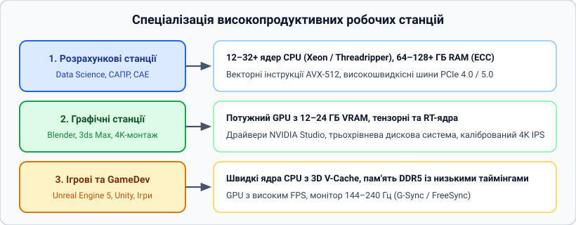
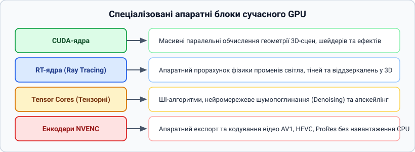

# Урок 20. Конфігурації для розрахункових і графічних робіт, ігрових станцій

<div class="how-to">

**Як працювати з уроком**

1. Ознайомтеся з архітектурними особливостями високопродуктивних ПК, спеціалізованими апаратними блоками GPU та багаторівневими дисковими сховищами.
2. Виконайте покрокове завдання з проєктування трьохрівневої підсистеми дисків та розрахунку потужності блока живлення стандарту ATX 3.0.
3. Дайте відповіді на 10 запитань контрольного тесту для закріплення теми.

</div>

## Мета уроку

Опанувати правила формування конфігурацій високопродуктивних робочих станцій для математичного моделювання, 2D/3D графіки, відеомонтажу та розробки ігор. На практиці ви:

- навчитеся підбирати багатоядерні процесори та оперативну пам'ять із корекцією помилок (ECC);
- розберетеся у структурі ядер сучасних відеокарт (CUDA, Tensor, RT Cores) та виборі спеціалізованих драйверів (Studio vs Game Ready);
- спроєктуєте трьохрівневу підсистему накопичувачів (OS + Scratch Disk + Archive);
- розрахуєте тепловий бюджет, конфігурацію охолодження та вимоги до живлення за стандартом ATX 3.0.

## Що знадобиться

- Довідкові матеріали та системні вимоги професійного програмного забезпечення (Blender, DaVinci Resolve, AutoCAD, Unreal Engine 5).
- Табличний процесор (LibreOffice Calc) або калькулятор для обчислення енергетичного бюджету.

## Теорія

Високопродуктивні комп'ютерні системи кардинально відрізняються від офісних станцій: вони працюють під безперервним 100% навантаженням протягом багатьох годин або діб (наприклад, під час рендерингу 3D-сцени чи компіляції ігрового рушія). Будь-який перегрів або нестача швидкості диска призводить до зриву виробничих дедлайнів.

<div class="clip">



*Спеціалізація високопродуктивних робочих станцій*

</div>

### 1. Розрахункові станції (Data Science, САПР, комп'ютерне моделювання)

Цільове призначення: інженерні розрахунки у системах автоматизованого проєктування (AutoCAD, SolidWorks), статистична обробка масивів даних (Big Data), машинне навчання та математичний аналіз:

- **Процесор (CPU):** від 8–16 ядер (AMD Ryzen 9, Intel Core i7/i9) до професійних платформ HEDT (High-End Desktop) на базі AMD Ryzen Threadripper або Intel Xeon із підтримкою до 24–64 обчислювальних ядер та 4–8 каналів пам'яті. Важлива апаратна підтримка розширених векторних інструкцій (**AVX-512**).
- **Оперативна пам'ять (RAM):** від 32 до 128 ГБ і більше. На професійних материнських платах обов'язково застосовують модулі з технологією **ECC (корекція помилок)**. Якщо багатоденний інженерний розрахунок міцності моста зіб'ється на 99% через випадковий спонтанний перекид біта в пам'яті (bit-flip), підприємство зазнає великих збитків. ECC виявляє та усуває такі помилки миттєво «на льоту».
- **Швидкісна дискова шина:** накопичувачі стандарту **PCIe 4.0 / PCIe 5.0 NVMe** зі швидкістю передачі 7000–12000 МБ/с.

### 2. Станції для 2D/3D графіки, анімації та відеомонтажу

У графічних станціях головним обчислювальним рушієм виступає дискретна відеокарта (GPU):

<div class="clip">



*Спеціалізовані апаратні блоки сучасного графічного процесора (GPU)*

</div>

- **Відеопам'ять (VRAM):** обсяг пам'яті відеокарти має вирішальне значення. Для 3D-рендеру сцен у Blender або монтажу 4K/8K відео у DaVinci Resolve критично мати від **12 до 24 ГБ VRAM**. Якщо сцена не вміщується у відеопам'ять, рендер або взагалі завершується аварійною помилкою «Out of Memory», або переходить у системну RAM через шину PCIe, що сповільнює швидкість у 10–20 разів!
- **Вибір драйверів (NVIDIA Studio проти Game Ready):** для роботи з графікою слід встановлювати пакет **NVIDIA Studio Driver**. Він проходить сувору сертифікацію та багатогодинні тести на стабільність у програмах Adobe, Autodesk, Blender, DaVinci, виключаючи збої та вильоти під час фінального експорту проєктів.
- **Трьохрівнева підсистема зберігання (Tiered Storage Architecture):**
  1. *Системний накопичувач:* 500–1000 ГБ NVMe SSD під операційну систему та встановлені пакети програм.
  2. *Робочий диск (Scratch Disk):* швидкісний NVMe SSD 1–2 ТБ для зберігання вихідних медіафайлів поточного проєкту, кешу тимчасових текстур та проксі-файлів відеомонтажу.
  3. *Архівний накопичувач:* об'ємний магнітний диск HDD (4–16 ТБ) корпоративного класу або мережевий RAID-масив для резервного довготривалого зберігання завершених робіт.

### 3. Ігрові конфігурації та станції розробки ігор (GameDev)

Розробка на сучасних рушіях (Unreal Engine 5, Unity) поєднує вимоги графічних і розрахункових станцій:

- **Процесори зі збільшеним кешем (3D V-Cache):** наприклад, AMD Ryzen 7 7800X3D має колосальний обсяг кешу L3 (96 МБ), завдяки чому ігрові цикли та логіка рушія виконуються з мінімальними затримками звернення до системної пам'яті.
- **Монітори для геймінгу та дизайну:** якщо для роботи з кольором вирішальним є калібрування IPS/OLED з охопленням **100% sRGB / 98% DCI-P3**, то для розробки ігор та тестування важлива висока частота оновлення (**144–240 Гц**) та підтримка технологій змінної частоти кадрів (**NVIDIA G-Sync / AMD FreeSync**), які усувають неприємні горизонтальні розриви картинки (Tearing).

### 4. Охолодження та стандарт живлення ATX 3.0

Потужні компоненти споживають сотні ват енергії: топові процесори під час рендеру виділяють до 250–300 Вт тепла, а відеокарти рівня RTX 4080/4090 — від 320 до 450 Вт.

1. **Система охолодження:**
   - Використовують масивні двохсекційні суперкулери на 6–7 теплових трубках або системи рідинного охолодження (**СРО / AIO**) з розміром радіатора 280 мм або 360 мм.
   - Корпус повинен мати сітчасту передню панель (Mesh) та правильно організований повітряний потік із переважанням нагнітання (**позитивний тиск повітря**), що запобігає затягуванню пилу через технологічні щілини.

2. **Стандарт живлення ATX 3.0 та роз'єм 12VHPWR:**
   - Сучасні графічні чіпи у мікросекундні моменти можуть створювати короткочасні сплески споживання струму (Power Spikes), що перевищують номінал у 2 рази.
   - Блоки живлення нового стандарту **ATX 3.0** потужністю **750–1000+ Вт** офіційно розраховані на витримування 200% стрибків навантаження.
   - Вони оснащені спеціальним кабелем нового стандарту **12VHPWR (PCIe 5.0, 12+4 pin)**, що передає до 600 Вт потужності по одному дроту та має інформаційні лінії зв'язку між відеокартою і блоком живлення.

<div class="more-link">

**Хочете знати більше?** <span class="optional">Необов’язково</span>

**Чому професійні монітори калібрують за показником Delta E ($\Delta E$)?**
Показник $\Delta E$ (Дельта Е) вимірює математичну різницю між еталонним кольором та кольором, який реально відображає екран. Якщо монітор має $\Delta E < 2$, людське око не здатне помітити різницю між відображеним і реальним кольором. Для станцій поліграфії та кольорокорекції відео використовуються апаратні калібратори (колориметри на кшталт Calibrite / Spyder), які створюють індивідуальний профіль ICC монітора.

</div>

## Покроково

### 1. Аналіз технічних вимог до робочої станції для 3D та відео

Складемо вимоги до робочого місця комп'ютерного дизайнера та монтажера відео:
- ПЗ: Blender 3D (Cycles Render), DaVinci Resolve Studio (4K 60 fps монтаж та грейдинг кольору).
- Критичний ресурс: висока швидкість рендерингу на GPU, великий обсяг швидкої відеопам'яті, миттєвий доступ до відеофутажів без затримок читання.

### 2. Проєктування трьохрівневої дискової підсистеми

Розподілимо дискові накопичувачі за рівнями швидкості:

| Рівень диска | Призначення | Рекомендований тип та обсяг | Інтерфейс та швидкість |
| :--- | :--- | :--- | :--- |
| **Рівень 1 (OS)** | ОС Linux / Windows, пакети Blender, DaVinci | 500 GB NVMe SSD | PCIe 4.0 x4 (~3500 МБ/с) |
| **Рівень 2 (Scratch)**| Робочі файли монтажу, кеш рендеру, текстури | 2 TB NVMe SSD (High Endurance, TBW > 1200) | PCIe 4.0 x4 (~7000 МБ/с) |
| **Рівень 3 (Archive)**| Завершені відеоролики, сирі архіви з камер | 8 TB HDD 7200 RPM CMR або мережевий NAS | SATA III (~220 МБ/с) |

*Перевага розділення:* знос комірок від постійного перезапису гігабайтів кешу припадає лише на другий накопичувач (Scratch Disk), при цьому системний накопичувач з ОС залишається надійним і не засмічується.

### 3. Розрахунок енергоспоживання та підбір БЖ стандарту ATX 3.0

Обчислимо пікове енергоспоживання станції на базі процесора Intel Core i7-14700 та відеокарти NVIDIA GeForce RTX 4070 Ti Super:

1. `TDP CPU`: Intel Core i7-14700 = до 219 Вт у піковому навантаженні (PL2).
2. `TDP GPU`: GeForce RTX 4070 Ti Super = 285 Вт.
3. `Інші компоненти`: Материнська плата Z790, 4 планки RAM DDR5, 2x NVMe SSD, 1x HDD, 4 корпусні вентилятори, помпа рідинного охолодження = 80 Вт.
4. `Сумарне пікове навантаження`: $219 + 285 + 80 = 584$ Вт.
5. `Розрахунок потужності з коефіцієнтом запасу 1.3`:
   $$P_{\text{рек}} = 584 \times 1.3 \approx 759 \text{ Вт}$$
6. `Висновок щодо вибору БЖ`: обираємо блок живлення номіналом **850 Вт стандарту ATX 3.0** із сертифікатом **80 PLUS Gold** та прямим рідним роз'ємом живлення **12VHPWR**.

<div class="try">

**Спробуйте самі**

Перевірте можливості апаратного прискорення відеокарти у вашій системі Linux за допомогою термінальної команди:

```bash
glxinfo -B | grep -i -E "device|memory|accelerated|opengl version"
```

*(Якщо утиліта glxinfo відсутня, її можна замінити швидкою перевіркою `vulkaninfo --summary` або командою `nvidia-smi` для адаптерів NVIDIA).*

Знайдіть значення підтримуваної версії OpenGL / Vulkan та обсяг виділеної відеопам'яті. Зробіть висновок, до якого класу належить цей відеоадаптер (офісний інтегрований чи продуктивний графічний).

<details>
<summary>Перевірити очікуваний результат і повний розв’язок</summary>

Очікуваний результат виконання `glxinfo -B`:

```text
Device: NVIDIA GeForce RTX 4070 Ti SUPER/PCIe/SSE2 (0x2705)
Video memory: 16384MB
Unified memory: no
Accelerated: yes
OpenGL version string: 4.6.0 NVIDIA 550.54.14
```

Аналіз результату:
1. Виділена відеопам'ять (`Video memory`): 16384 MB (16 GB) високої швидкості GDDR6X.
2. `Unified memory: no` підтверджує наявність власної незалежної пам'яті VRAM, що не відбирає ресурси в системної RAM.
3. Повна підтримка OpenGL 4.6 та Vulkan свідчить про готовність станції до апаратного 3D-моделювання та рендерингу без обмежень.

</details>

</div>

## Підсумок

- **Розрахункові робочі станції** фокусуються на багатоядерних CPU, швидких векторних інструкціях (AVX-512) та пам'яті з апаратною корекцією помилок (**ECC**).
- **Графічні станції** спираються на продуктивність GPU з великим обсягом швидкої VRAM (12–24 ГБ), а також наявність **CUDA**, **тензорних** та **RT-ядер**.
- Стабільність роботи з медіаконтентом гарантує **трьохрівнева дискова система** (SSD для ОС + швидкісний Scratch Disk під кеш + місткий HDD під архів) та драйвери **NVIDIA Studio**.
- Для живлення високопродуктивних відеокарт застосовують блоки живлення нового стандарту **ATX 3.0** потужністю від 750–850 Вт з роз'ємом **12VHPWR**, стійкі до мікросекундних стрибків струму.

## Тест

<div class="test-box">

10 запитань за матеріалом уроку. На початку тесту вкажіть **прізвище, ім’я та групу**.

<!-- GOOGLE_FORM_START:lesson-20 -->
[Відкрити тест у новій вкладці](https://docs.google.com/forms/d/e/1FAIpQLScC3QVSUofkrGK3bJqa_AGzuHyJDQkPZfgVq2H0WwxnDJy4Jw/viewform)

<iframe src="https://docs.google.com/forms/d/e/1FAIpQLScC3QVSUofkrGK3bJqa_AGzuHyJDQkPZfgVq2H0WwxnDJy4Jw/viewform?embedded=true" loading="lazy" title="Тест lesson-20">Завантаження…</iframe>
<!-- GOOGLE_FORM_END:lesson-20 -->

</div>

## Додаткове завдання

<span class="optional">Необов’язково</span>

**Базовий рівень.** Знайдіть в інтернеті офіційні системні вимоги популярного графічного пакету **Blender 3D** (розділ «Requirements»). Запишіть мінімальний та рекомендований обсяг відеопам'яті (VRAM) для рендерингу складних сцен.

**Проєктний рівень.** Порівняйте системи повітряного охолодження (двосекційний баштовий кулер на 7 теплових трубок) та рідинного охолодження (СРО 360 мм) для процесора з тепловиділенням 250 Вт: вкажіть переваги та потенційні ризики кожного варіанта (вага кулера, надійність помпи, ризик протікання, шум вентиляторів).
