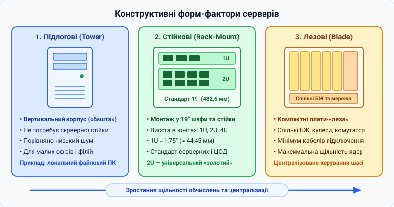

# Урок 21. Серверне обладнання: конструкція та види серверів

<div class="how-to">

**Як працювати з уроком**

1. Ознайомтеся з теоретичним матеріалом щодо конструктивних особливостей серверів, форм-факторів (Rack, Tower, Blade) та відмовостійких компонентів корпоративного рівня (ECC, Hot-Swap, Redundant PSU, IPMI/iLO).
2. Виконайте покрокове практичне завдання з аудиту апаратних компонентів сервера за допомогою системних утиліт командного рядка Linux.
3. Дайте відповіді на 10 запитань підсумкового тесту для перевірки засвоєння знань.

</div>

## Мета уроку

Зрозуміти фундаментальні відмінності сервера від персонального комп'ютера, вивчити конструктивні форм-фактори серверного обладнання та принципи апаратного резервування, що забезпечують безперервну роботу інформаційних систем у режимі 24/7/365. На практиці ви:

- навчитеся розпізнавати та класифікувати сервери за форм-фактором і функціональним призначенням;
- опануєте базові утиліти командного рядка для аудиту процесорів, оперативної пам'яті, дискових підсистем та блоків живлення;
- виконаєте перевірку підтримки технології корекції помилок пам'яті (ECC) та структури накопичувачів;
- складете підсумковий скрипт експрес-аудиту серверної апаратної конфігурації.

## Що знадобиться

- Робоча станція під керуванням ОС Linux (Ubuntu, Debian, Fedora або Linux Mint) або віртуальна машина з доступом до термінала;
- Пакет утиліт діагностики обладнання: `lshw`, `dmidecode`, `pciutils`, `util-linux`, `smartmontools`;
- Права суперкористувача (`sudo`) для читання системних таблиць DMI/SMBIOS.

## Теорія

<div class="clip">


*Топологія локальної мережі Ethernet<sup>[1]</sup>*

</div>

### Чим сервер відрізняється від персонального комп'ютера?

У повсякденній практиці оператора інформаційних систем часто виникає хибне уявлення, що сервер — це просто потужний настільний ПК. Насправді головна відмінність полягає не стільки в абсолютній швидкодії, скільки в **надійності, відмовостійкості та режимі експлуатації**:

1. **Режим роботи 24/7/365:** Сервер проєктується для безперервної роботи протягом багатьох років без вимикання та перезавантажень.
2. **Апаратне резервування (Redundancy):** Критичні компоненти (блоки живлення, вентилятори охолодження, мережеві інтерфейси, накопичувачі) дублюються. У разі виходу з ладу одного вузла інший миттєво бере навантаження на себе без зупинки роботи системи.
3. **Гаряча заміна (Hot-Swap / Hot-Plug):** Можливість заміни несправного накопичувача, блока живлення або кулера прямо під час роботи сервера, без вимикання живлення.
4. **Корекція помилок (ECC):** Використання спеціальної пам'яті, яка на апаратному рівні виправляє спонтанні бітові збої, викликані електромагнітними наведеннями чи радіацією.
5. **Віддалене керування поза смугою (Out-of-Band Management):** Наявність автономного службового мікрокомп'ютера (BMC), що дозволяє адміністратору підключатися до сервера, змінювати налаштування BIOS/UEFI, перевстановлювати ОС та вмикати живлення навіть тоді, коли головний процесор або ОС повністю зависли.

| Критерій | Звичайний персональний комп'ютер (ПК) | Сервер корпоративного рівня |
| :--- | :--- | :--- |
| **Призначення** | Індивідуальна робота одного користувача | Одночасне обслуговування сотень і тисяч клієнтів/запитів |
| **Режим експлуатації** | 8–12 годин на добу, періодичні вимкнення | 24 години на добу, 365 днів на рік без зупинок |
| **Блоки живлення** | 1 стандартний блок живлення (ATX) | 2 (або більше) блоки з гарячою заміною за схемою 1+1 чи N+1 |
| **Оперативна пам'ять** | Non-ECC DDR4/DDR5 (немає захисту від збоїв) | ECC Registered (RDIMM / LRDIMM) з апаратним захистом |
| **Дискова підсистема** | 1–2 споживчі SSD/HDD, без RAID | Масиви Hot-Swap SAS/NVMe під керуванням апаратного RAID-контролера |
| **Охолодження** | Тихі вентилятори, акцент на низький рівень шуму | Потужні високооборотні турбінні вентилятори з дублюванням (N+1) |
| **Керування** | Тільки локально (монітор + клавіатура) або через ОС | Автономний IPMI / BMC (iDRAC, iLO) із виділеним портом LAN |

---

### Конструктивні форм-фактори серверів

Серверне обладнання виготовляється в кількох стандартизованих форм-факторах, кожен з яких оптимізований під певні умови експлуатації та масштабування.

<div class="clip">



*Конструктивні форм-фактори серверів: підлогові (Tower), стійкові (Rack-Mount) та лезові (Blade)*

</div>

#### 1. Підлогові сервери (Tower)
Зовні схожі на великі системні блоки стандартних ПК (Midi-Tower або Big-Tower). 
- **Переваги:** не потребують спеціальної серверної стійки або шафи; мають порівняно низький рівень шуму, завдяки чому можуть розміщуватися безпосередньо в офісному приміщенні чи кабінеті бухгалтерії.
- **Сфера застосування:** малі підприємства, філії банків, аптеки, навчальні заклади (локальний файловий сервер або сервер 1С/BAS).

#### 2. Стійкові сервери (Rack-Mount)
Найбільш поширений форм-фактор у професійних інформаційних системах. Сервери монтуються горизонтально у спеціальні металеві 19-дюймові стійки або телекомунікаційні шафи на висувних рейках (телескопічних напрямних).
- **Одиниця виміру висоти — Юніт (Unit, U):**
  \(1\,\text{U} = 1{,}75\,\text{дюйма} \approx 44{,}45\,\text{мм}\)
  Ширина лицьової панелі сервера завжди стандартна — 19 дюймів (приблизно 482,6 мм).
- **Поширені розміри:**
  - **1U:** ультракомпактний сервер товщиною всього 4,4 см. Використовується для вебобслуговування, брандмауерів, DNS або шлюзів. Має обмежену кількість накопичувачів (до 4 шт. 3.5" або 8–10 шт. 2.5") та невеликі високооборотні кулери (40 мм), які створюють гучний шум.
  - **2U:** універсальний «золотий стандарт» для серверів баз даних і віртуалізації. Вміщує до 24 накопичувачів 2.5" або 12 дисків 3.5", підтримує повнорозмірні плати розширення PCIe та більші кулери (60–80 мм).
  - **4U і більше:** використовується для надпотужних систем обробки великих даних (Big Data), серверів зі встановленими графічними прискорювачами для штучного інтелекту (GPU-сервери) або сховищ даних великої місткості (Storage JBOD на 36–60 дисків).

#### 3. Лезові сервери (Blade Servers)
Модульні ультракомпактні комп'ютерні плати («леза»), позбавлені власних індивідуальних блоків живлення, важких вентиляторів і частини роз'ємів.
- Сервери-леза встановлюються у спільний масивний корпус — **Blade-шасі** (Blade Enclosure, висотою 6U–10U).
- Шасі містить централізований пул резервованих блоків живлення високої потужності, потужну систему охолодження, об'єднавчу плату (Midplane) та спільні комутаційні модулі мережі Ethernet та Fibre Channel.
- **Переваги:** колосальна щільність розміщення обчислювальних ядер на 1 метр площі, мінімум кабелів живлення та зв'язку, централізоване керування всіма серверами через єдиний модуль шасі.

---

### Апаратні компоненти сервера

#### 1. Серверні процесори (CPU)
У серверах застосовуються спеціалізовані лінійки процесорів: **Intel Xeon** (серії Silver, Gold, Platinum) та **AMD EPYC**.
- **Підтримка багатопроцесорності:** материнські плати серверів містять 2 або 4 процесорні сокети (конфігурації 2P/4P), з'єднані між собою високошвидкісними шинами (Intel UPI, AMD Infinity Fabric).
- **Кількість ядер та потоків:** сучасні процесори містять від 16 до 128 фізичних ядер на один чип.
- **Багатоканальна пам'ять:** до 8 або 12 каналів оперативної пам'яті на один сокет (на відміну від звичайних 2 каналів у ПК), що забезпечує гігантську пропускну здатність шини пам'яті (понад 300–400 ГБ/с).

#### 2. Оперативна пам'ять ECC (Error-Correcting Code)
Пам'ять серверів оснащена додатковими мікросхемами для розрахунку контрольних сум.
- **Принцип дії:** на кожні 64 біти даних записується 8 додаткових бітів коду Геммінга.
- Якщо через космічне випромінювання чи мікроколивання напруги один біт спотворюється (0 -> 1 або 1 -> 0), контролер пам'яті **на льоту знаходить і виправляє його** (Single-Bit Error Correction) без зависання системи й без появи критичного збою (Kernel Panic / BSOD).
- При виявленні подвійної помилки (Double-Bit Error) система безпечно зупиняє процес, захищаючи базу даних від прихованого спотворення структури.
- Застосовуються модулі **RDIMM (Registered DIMM)** із регістровим буфером адресних ліній та **LRDIMM (Load-Reduced DIMM)** для встановлення максимальних обсягів пам'яті (до кількох терабайтів на сервер).

#### 3. Дискова підсистема та апаратний RAID
Сервери обробляють безперервний потік читання/запису від багатьох клієнтів.
- **Інтерфейси дисків:** замість звичайного побутового SATA використовуються корпоративні інтерфейси **SAS (Serial Attached SCSI)** з пропускною здатністю 12 Гбіт/с, дубльованими портами підключення (Dual-Port) для захисту від обриву лінії та прямі шини **NVMe PCIe** (U.2/U.3, E1.S).
- **Апаратний RAID-контролер:** окрема плата розширення із власним спеціалізованим процесором (RoC — RAID-on-Chip) та кеш-пам'яттю обсягом 2–8 ГБ. Для захисту даних у кеші при раптовому знеструмленні використовується акумулятор (BBU) або суперконденсатор із флешпам'яттю (Flash-Backed Write Cache, FBWC).

#### 4. Модулі віддаленого керування (BMC / IPMI)
Кожен сучасний сервер містить незалежний системний мікроконтролер — **BMC (Baseboard Management Controller)**, який працює за стандартом **IPMI (Intelligent Platform Management Interface)** або сучасним RESTful-протоколом **Redfish**.
- Виробники постачають власні реалізації BMC: **iDRAC** (Dell), **iLO** (HP Enterprise), **XClarity** (Lenovo), **IMM**, **ASMB**.
- BMC живиться від чергової лінії блока живлення (працює завжди, поки кабель під'єднано до розетки 220 В).
- Має власний окремий мережевий порт Ethernet (Dedicated Management Port) і власну IP-адресу.
- Надає вебінтерфейс та віртуальну KVM-консоль (клавіатура-відео-миша): адміністратор може віддалено зайти в налаштування BIOS, підмонтувати ISO-образ зі свого комп'ютера, увімкнути чи вимкнути живлення сервера, навіть якщо на сервері взагалі немає встановленої операційної системи.

---

### Класифікація серверів за функціональним призначенням

В інформаційних системах підприємств сервери розділяють за ролями, які вони виконують:

1. **Файловий сервер (File Server / NAS):** централізоване сховище документів і файлів користувачів із розмежуванням прав доступу (SMB/CIFS, NFS).
2. **Сервер баз даних (Database Server):** високонавантажений сервер (PostgreSQL, MySQL, MS SQL, Oracle), критичний до швидкодії оперативної пам'яті та дискових масивів (високий показник операцій вводу-виводу — IOPS).
3. **Вебсервер та сервер застосунків (Web / App Server):** хостинг корпоративних сайтів, API-сервісів та внутрішніх порталів (Nginx, Apache, Node.js).
4. **Сервер віртуалізації (Гіпервізор):** потужний сервер із великою кількістю ядер і ОЗП під керуванням спеціальної ОС (Proxmox VE, VMware ESXi, Microsoft Hyper-V), на якому одночасно працюють десятки ізольованих віртуальних машин.
5. **Контролер домену (Active Directory / LDAP):** сервер керування обліковими записами співробітників, політиками безпеки, паролями та доступом до ПК в організації.

<div class="more-link">

**Хочете знати більше?** <span class="optional">Необов’язково</span>

Сучасні стандарти керування серверами переходять від застарілого протоколу IPMI до відкритого стандарту **Redfish API**, розробленого консорціумом DMTF. Redfish використовує протокол HTTPS, формат JSON та принципи RESTful API, що дозволяє автоматизувати керування сотнями серверів за допомогою простих скриптів на Python, Ansible чи утиліти `curl` без відкриття повільних візуальних вебконсолей.

</div>

---

## Покроково

Як майбутньому оператору з обробки інформації вам необхідно вміти виконувати первинну діагностику та інвентаризацію серверного обладнання безпосередньо з термінала командного рядка.

### 1. Дослідіть процесорну підсистему сервера

Відкрийте термінал Linux та виконайте утиліту `lscpu`:

```bash
lscpu
```

Зверніть увагу на такі критичні параметри:
- `Socket(s):` — кількість фізичних процесорних роз'ємів на материнській платі (1, 2 або 4).
- `Core(s) per socket:` — кількість фізичних ядер в одному процесорі.
- `Thread(s) per core:` — кількість потоків на одне ядро (якщо 2 — активна технологія Hyper-Threading / SMT).
- `Model name:` — найменування моделі процесора (наприклад, Intel Xeon Gold 6248R або AMD EPYC 7742).
- `L3 cache:` — обсяг кеш-пам'яті третього рівня.

Фільтрація найважливішої інформації:

```bash
lscpu | grep -E "Model name|Socket|Thread|Core\(s\)|NUMA|CPU\(s\):"
```

### 2. Перевірте оперативну пам'ять та статус корекції помилок (ECC)

Загальний обсяг доступної та зайнятої пам'яті оцінюється командою:

```bash
free -h
```

Для детального аудиту фізичних планок пам'яті скористайтеся утилітою `dmidecode`, яка вичитує структуру DMI/SMBIOS материнської плати (потрібні права `sudo`):

```bash
sudo dmidecode -t memory | grep -E "Size:|Type:|Speed:|Error Correction Type:|Manufacturer:|Part Number:"
```

Якщо обладнання є серверним, у полі `Error Correction Type:` ви побачите значення `Multi-bit ECC` або `Single-bit ECC`. На звичайних домашніх ПК тут відображається `None`.

### 3. Перевірте блоки живлення та статус резервування

На серверних материнських платах DMI-таблиця фіксує характеристики та наявність блоків живлення (тип 39 у специфікації SMBIOS):

```bash
sudo dmidecode -t 39 | grep -E "Name:|Location:|Max Power Capacity:|Status:"
```

Якщо сервер має два блоки живлення, ви побачите інформацію про два окремі пристрої (`PSU 1` та `PSU 2`) із зазначенням статусу (наприклад, `Status: OK, Present`).

### 4. Виконайте аудит накопичувачів та структури розділів

Для перегляду всіх фізичних дисків та блокових пристроїв скористайтеся утилітою `lsblk`:

```bash
lsblk -o NAME,SIZE,TYPE,ROTA,MODEL,TRAN,MOUNTPOINT
```

Пояснення стовпців виводу:
- `ROTA`: ротаційний індикатор (1 — механічний жорсткий диск HDD, 0 — твердотільний накопичувач SSD / NVMe).
- `TRAN`: транспортний інтерфейс підключення (`sata`, `sas`, `nvme`, `usb`).
- `MODEL`: виробник та серія диска (наприклад, корпоративні серії Seagate Exos, WD Gold, Samsung PM9A3).

<div class="try">

**Спробуйте самі**

Створіть власний скрипт швидкого апаратного аудиту сервера під назвою `server_audit.sh`. Скрипт має автоматично виводити:
1. Загальну назву та модель сервера/материнської плати.
2. Кількість процесорних сокетів і модель CPU.
3. Загальний обсяг оперативної пам'яті та наявність підтримки ECC.
4. Кількість встановлених накопичувачів із зазначенням типу (SSD чи HDD).
5. Наявність резервних блоків живлення.

Надайте файлу права на виконання (`chmod +x server_audit.sh`) та запустіть його.

<details>
<summary>Перевірити очікуваний результат і повний розв’язок</summary>

Створіть файл скрипта за допомогою текстового редактора:

```bash
cat << 'SHELL_SCRIPT' > server_audit.sh
#!/bin/bash
# Скрипт первинного експрес-аудиту серверного обладнання
echo "=========================================================="
echo "         ЕКСПРЕС-АУДИТ СЕРВЕРНОЇ КОНФІГУРАЦІЇ             "
echo "=========================================================="

echo -e "
[1] МОДЕЛЬ СИСТЕМИ:"
sudo dmidecode -s system-manufacturer 2>/dev/null || echo "Невідомо"
sudo dmidecode -s system-product-name 2>/dev/null || echo "Невідомо"

echo -e "
[2] ПРОЦЕСОРНА ПІДСИСТЕМА:"
lscpu | grep "Model name:" | sed 's/Model name:[ 	]*/Модель CPU: /'
echo "Фізичних сокетів: $(lscpu | grep 'Socket(s):' | awk '{print $2}')"
echo "Загальна к-ть логічних ядер: $(nproc)"

echo -e "
[3] ОПЕРАТИВНА ПАМ'ЯТЬ:"
echo "Загальний обсяг ОЗП: $(free -h | awk '/^Mem:/ {print $2}')"
ECC_STATUS=$(sudo dmidecode -t memory 2>/dev/null | grep -m1 "Error Correction Type:" | awk -F: '{print $2}')
echo "Підтримка ECC: ${ECC_STATUS:-Не виявлено / Не підтримується}"

echo -e "
[4] ДИСКОВІ НАКОПИЧУВАЧІ:"
lsblk -d -o NAME,SIZE,ROTA,TRAN,MODEL | awk 'NR==1 {print; next} {
    type = ($3 == 1) ? "HDD" : "SSD";
    printf "%-8s %-8s %-6s %-8s %s
", $1, $2, type, $4, $5
}'

echo -e "
[5] БЛОКИ ЖИВЛЕННЯ:"
PSU_COUNT=$(sudo dmidecode -t 39 2>/dev/null | grep -c "System Power Supply")
if [ "$PSU_COUNT" -gt 0 ]; then
    echo "Виявлено блоків живлення: $PSU_COUNT (Резервування підтримується)"
else
    echo "Інформація про дубльовані PSU недоступна через SMBIOS (можливо, звичайний ПК)"
fi

echo -e "
=========================================================="
echo "                   АУДИТ ЗАВЕРШЕНО                        "
echo "=========================================================="
SHELL_SCRIPT

chmod +x server_audit.sh
./server_audit.sh
```

**Очікуваний результат виконання:**
Скрипт формує чіткий структурований звіт про апаратну платформу: відображає виробника сервера (наприклад, `Dell Inc. PowerEdge R740`), модель процесора, обсяг ОЗП зі статусом `Multi-bit ECC`, перелік дисків із розділенням на швидкісні SSD та ємнісні HDD, а також кількість блоків живлення.

</details>

</div>

---

## Підсумок

- **Сервер** — це спеціалізований комп'ютер корпоративного класу, спроєктований для цілодобової роботи (24/7/365) під високим навантаженням з обов'язковим апаратним резервуванням ключових вузлів.
- **Форм-фактори серверів** охоплюють настільні моделі (Tower), стійкові сервери стандарту 19 дюймів (Rack 1U/2U/4U) та ультращільні модульні системи (Blade).
- **Відмовостійкість сервера** забезпечується пам'яттю з корекцією помилок (ECC), дубльованими блоками живлення (1+1 Redundant PSU) з гарячою заміною, апаратними RAID-контролерами та резервованими вентиляторами.
- **Підсистеми віддаленого керування поза смугою (BMC / IPMI)** дозволяють адмініструвати, моніторити та відновлювати сервер навіть за відсутності встановленої операційної системи або її повного зависання.

---

## Тест

<div class="test-box">

10 запитань за матеріалом уроку. На початку тесту вкажіть **прізвище, ім’я та групу**.

<!-- GOOGLE_FORM_START:lesson-21 -->
[Відкрити тест у новій вкладці](https://docs.google.com/forms/d/e/1FAIpQLSccp9Pal1myjLaM0jzprVZba4k_DLRHpZ2yWDTzRvoof88YTw/viewform)

<iframe src="https://docs.google.com/forms/d/e/1FAIpQLSccp9Pal1myjLaM0jzprVZba4k_DLRHpZ2yWDTzRvoof88YTw/viewform?embedded=true" loading="lazy" title="Тест lesson-21">Завантаження…</iframe>
<!-- GOOGLE_FORM_END:lesson-21 -->

</div>

---

## Додаткове завдання

<span class="optional">Необов’язково</span> Виконуйте для поглибленого вивчення серверних технологій.

**Базовий рівень.** За допомогою документації виробника (наприклад, офіційних специфікацій Dell PowerEdge або HPE ProLiant) знайдіть технічний опис сервера форм-фактора 2U (наприклад, Dell PowerEdge R750). Випишіть у зошит: максимальну кількість підтримуваних процесорів, максимальний обсяг пам'яті ECC, кількість кошиків для накопичувачів 2.5" та потужність блоків живлення.

**Проєктний рівень.** Дослідіть документацію утиліти `ipmitool`. Знайдіть команди, за допомогою яких адміністратор може з командного рядка:
1. Перевірити поточну температуру ключових зон сервера (`sdr type temperature`).
2. Отримати статус блоків живлення (`sdr type "power supply"`).
3. Віддалено відправити команду м'якого перезавантаження живлення сервера (`chassis power reset`). Оформіть коротку довідкову пам'ятку оператора.

## Джерела

1. [Ethernet_LAN.svg](https://commons.wikimedia.org/wiki/File:Ethernet_LAN.svg), Wikimedia Commons.
