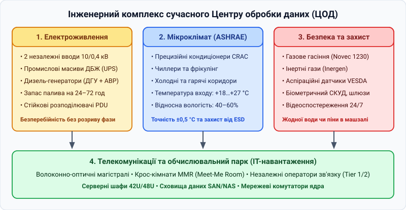

# Урок 22. Обчислювальні центри та центри обробки даних

<div class="how-to">

**Як працювати з уроком**

1. Ознайомтеся з архітектурою Центрів обробки даних (ЦОД), інженерними підсистемами гарантованого електроживлення, прецизійного охолодження та класифікацією надійності Tier I–IV (Uptime Institute).
2. Виконайте покрокове практичне завдання: розрахуйте тепловиділення серверної стійки, показник енергоефективності PUE та налаштуйте моніторинг температури обладнання.
3. Пройдіть контрольний тест на 10 запитань для перевірки засвоєних знань.

</div>

## Мета уроку

Отримати системне уявлення про структуру сучасного Центру обробки даних (Data Center), вивчити правила організації інженерних систем життєзабезпечення серверного парку, стандарти резервування та енергоефективності. На практиці ви:

- навчитеся розрізняти рівні надійності дата-центрів за міжнародною класифікацією Tier (Uptime Institute);
- опануєте розрахунок енергоспоживання, тепловиділення та індексу ефективності використання енергії (PUE);
- вивчите організацію зон ізоляції потоків повітря («холодних» та «гарячих» коридорів);
- напишете інструмент розрахунку базових параметрів інфраструктури серверної кімнати та проведете моніторинг апаратних термодатчиків.

## Що знадобиться

- ПК з операційною системою Linux або Windows із встановленим інтерпретатором Python 3;
- Пакет утиліт моніторингу температури та стану апаратних датчиків: `lm-sensors`, `smartmontools`;
- Калькулятор або табличний процесор (LibreOffice Calc) для інженерних розрахунків.

## Теорія

<div class="clip">


*Кабельне підключення мережі Ethernet<sup>[1]</sup>*

</div>

### Від обчислювальних центрів (ОЦ) до сучасних ЦОД

В історії розвитку інформаційних технологій концепція концентрації обчислювальних ресурсів пройшла два ключові етапи:
- **Обчислювальні центри (ОЦ) XX століття:** масивні зали з великими електронно-обчислювальними машинами (ЕОМ, мейнфреймами), що обслуговували наукові інститути або промислові міністерства. Доступ здійснювався через перфокарти, магнітні стрічки або текстові термінали.
- **Центри обробки даних (ЦОД / Data Center):** сучасні високотехнологічні комплекси споруд, призначені для централізованого розміщення тисяч серверів, сховищ даних (SAN/NAS) та мережевого обладнання, підключених до швидкісних каналів інтернету із цілодобовою гарантією безперебійної роботи.

Сьогодні ЦОД є фундаментом глобальної цифрової інфраструктури: вони забезпечують функціонування державних реєстрів («Дія»), банківського сектору, систем хмарних обчислень (Cloud), соціальних мереж та штучного інтелекту.

---

### Інженерна інфраструктура Центру обробки даних

Сервери потребують ідеальних умов для безвідмовної експлуатації. Життєзабезпечення дата-центру покладається на чотири взаємопов'язані інженерні системи:

<div class="clip">



*Інженерний комплекс сучасного Центру обробки даних: електроживлення, мікроклімат, безпека та телекомунікації*

</div>

#### 1. Система гарантованого та безперебійного електропостачання
Зникнення електроенергії навіть на 1 секунду веде до аварійного перезавантаження тисяч серверів і спотворення баз даних. Електропостачання організовується за трьохетапною схемою:
1. **Основне живлення:** два незалежні підземні кабельні вводи від різних районних трансформаторних підстанцій.
2. **Джерела безперебійного живлення (ДБЖ / UPS):** масивні промислові онлайнові системи подвійного перетворення енергії (Online Double Conversion) з акумуляторними батареями (свинцево-кислотні AGM/VRLA або сучасні літій-залізо-фосфатні LiFePO4). Вони миттєво підтримують живлення без розриву синусоїди на час від 10 до 30 хвилин.
3. **Дизель-генераторні установки (ДГУ):** важкі промислові генератори з автоматичним введенням резерву (АВР / ATS). При зникненні напруги в міській мережі ДГУ автоматично запускається, виходить на робочі оберти за 15–45 секунд і приймає на себе повне навантаження всього ЦОД. Запас палива в підземних сховищах розраховується на 24–72 години автономної роботи з можливістю дозаправлення на ходу.
4. **Блоки розподілу живлення (PDU — Power Distribution Units):** інтелектуальні стійкові подовжувачі з датчиками вимірювання струму на кожну розетку та функцією віддаленого вмикання/вимикання портів через SNMP або вебінтерфейс.

#### 2. Прецизійне кондиціонування та холодопостачання
Кожен спожитий сервером ват електроенергії майже повністю перетворюється на тепло. Звичайні побутові кондиціонери не здатні працювати безперервно взимку і не контролюють вологість.
- **Прецизійні кондиціонери (CRAC — Computer Room Air Conditioner):** промислові кліматичні шафи, що підтримують температуру з точністю до $\pm 0{,}5\,^\circ\text{C}$ та вологість із точністю до $\pm 2\%$.
- **Поділ на холодні та гарячі коридори (Hot/Cold Aisle Containment):**
  - Серверні стійки встановлюються паралельними рядами лицьовими панелями одна до одної — це **холодний коридор**.
  - З-під фальшпідлоги або через повітроводи нагнітається охолоджене повітря ($+20\dots+22\,^\circ\text{C}$).
  - Серверні вентилятори затягують холодне повітря спереду, охолоджують процесори та викидають нагріте повітря ($+35\dots+45\,^\circ\text{C}$) назад у **гарячий коридор**.
  - Коридор герметично закривається скляними дверима та прозорим дахом, щоб гаряче повітря не змішувалося з холодним і прямувало безпосередньо у витяжку кондиціонера. Це підвищує ефективність охолодження на 30–40%.
- **Стандарти мікроклімату (ASHRAE):** рекомендована температура на вході в сервер — від $18\,^\circ\text{C}$ до $27\,^\circ\text{C}$, відносна вологість — від $40\%$ до $60\%$ (сухе повітря створює ризик електростатичного розряду ESD, а вологе понад $70\%$ — ризик конденсації вологи на мікросхемах).

#### 3. Комплексна безпека та пожежогасіння
- **Газове пожежогасіння:** гасіння серверного обладнання водою, піною або порошком категорично заборонено, оскільки це призводить до миттєвого короткого замикання та незворотного знищення електроніки. Використовуються чисті газові вогнегасні речовини (хладон **Novec 1230**, FK-5-1-12 або суміш інертних газів **Inergen**). Газ за 10 секунд витісняє кисень або хімічно зв'язує радикали горіння, полум'я гасне, а апаратура продовжує працювати без жодних пошкоджень і корозії.
- **Системи надраннього виявлення диму (VESDA):** аспіраційні установки безперервно всмоктують повітря з приміщення крізь тонкі трубки й аналізують його лазерним детектором, виявляючи найменший факт тління ізоляції за години до появи відкритого вогню.
- **Фізична безпека:** багаторівневий периметр, шлюзові тамбури з контролем ваги, біометричні зчитувачі вен долоні або сітківки ока, відеоспостереження без сліпих зон.

---

### Класифікація надійності ЦОД (стандарт Uptime Institute — Tier I–IV)

Міжнародна організація **Uptime Institute** розробила глобальну 4-рівневу систему оцінювання відмовостійкості дата-центрів.

| Рівень (Tier) | Назва та концепція | Схема резервування | Доступність (Uptime) | Максимальний простій на рік | Особливості обслуговування |
| :--- | :--- | :--- | :--- | :--- | :--- |
| **Tier I** | Базовий (*Basic*) | \\(N\\) (без резерву) | **99,671%** | До 28,8 годин | Для ремонту або техобслуговування потрібна повна зупинка ЦОД |
| **Tier II** | З надлишковими компонентами (*Redundant Component*) | \\(N+1\\) | **99,741%** | До 22,0 годин | Резервні генератори й охолодження; один тракт живлення, можливі планові зупинки |
| **Tier III** | З можливістю паралельного обслуговування (*Concurrently Maintainable*) | \\(N+1\\) (2 тракти розподілу) | **99,982%** | До 1,6 години (96 хв) | Будь-який вузол (ДБЖ, генератор, траса) ремонтується **без зупинки** серверів |
| **Tier IV** | Відмовостійкий (*Fault Tolerant*) | \\(2(N+1)\\) або \\(2N\\) | **99,995%** | До 0,4 години (26 хв) | Повне подвоєння систем; витримує будь-яку аварію без втрати працездатності IT |

Формула розрахунку часу річного простою:
$$\text{Простій (годин)} = 8760 \times (1 - \text{Uptime})$$

---

### Енергоефективність: коефіцієнт PUE (Power Usage Effectiveness)

Утримання ЦОД тягне за собою колосальні витрати на електроенергію. Для оцінки економічності розраховують коефіцієнт **PUE**:

$$\text{PUE} = \frac{P_{\text{total}}}{P_{\text{IT}}}$$

де:
- \\(P_{\text{total}}\\) — загальна потужність, спожита всім дата-центром (сервери + кондиціонери + ДБЖ + трансформатори + освітлення);
- \\(P_{\text{IT}}\\) — корисна потужність, спожита безпосередньо IT-обладнанням (серверами, дисковими масивами, комутаторами).

Оцінка значення PUE:
- \\(\text{PUE} = 1{,}0\\) — ідеальний фізичний максимум (усі 100% енергії йдуть суто на сервери);
- \\(\text{PUE} = 1{,}15\dots 1{,}25\\) — передові хмарні мега-ЦОД (Google, Microsoft) з використанням фрікулінгу;
- \\(\text{PUE} = 1{,}5\dots 1{,}7\\) — хороший сучасний комерційний дата-центр;
- \\(\text{PUE} > 2{,}0\\) — неефективна серверна (більше половини енергії спалюється кондиціонерами та втрачається в ДБЖ).

---

### Моделі використання інфраструктури ЦОД

Клієнти та підприємства можуть взаємодіяти з ЦОД у кількох форматах:
1. **Colocation (Колокейшн):** клієнт привозить власні фізичні сервери та орендує в дата-центрі стійко-місця (юніти або цілі закриті шафи 42U/48U), гарантоване електроживлення, холод та порти інтернет-зв'язку.
2. **Dedicated Server (Оренда виділеного сервера):** оренда готового фізичного сервера, що належить ЦОД. Клієнт має повний апаратний контроль над залізом.
3. **Хмарні сервіси (IaaS / VPS / VDS):** оренда віртуальних машин та гнучких пулів пам'яті/процесорів у великій хмарі ЦОД без прив'язки до конкретного заліза.

<div class="more-link">

**Хочете знати більше?** <span class="optional">Необов’язково</span>

Для скорочення енерговитрат сучасні північні дата-центри широко впроваджують технологію **фрікулінгу (Free Cooling)** — охолодження забортним вуличним повітрям без увімкнення компресорів холодильних машин протягом 6–9 місяців на рік. Деякі компанії будують підводні дата-центри (проєкт Microsoft Natick) або використовують надлишкове тепло серверів для обігріву житлових мікрорайонів і басейнів у містах Скандинавії.

</div>

---

## Покроково

Як оператор інформаційних систем, ви маєте вміти здійснювати розрахунки параметрів навантаження на інженерні системи стійки та контролювати температурні режими серверів.

### 1. Розрахуйте теплове та електричне навантаження на стійку

У стандартну стійку 42U планується встановити:
- 10 серверів форм-фактора 1U (номінальне споживання 350 Вт кожен);
- 5 серверів баз даних 2U (номінальне споживання 600 Вт кожен);
- 2 мережеві комутатори ядра (по 150 Вт).

Розрахуємо сумарну споживану електричну потужність:
$$P_{\text{IT}} = (10 \times 350) + (5 \times 600) + (2 \times 150) = 3500 + 3000 + 300 = 6800\,\text{Вт} = 6{,}8\,\text{кВт}$$

З урахуванням коефіцієнта запасу 20% для пускових струмів та пікових навантажень:
$$P_{\text{UPS}} = 6{,}8 \times 1{,}2 = 8{,}16\,\text{кВт}$$
Отже, для цієї стійки потрібен ввід ДБЖ потужністю не менше **10 кВА / 9 кВт**.

Оскільки майже 100% електричної енергії перетворюється на тепло, розрахуємо тепловиділення в міжнародних одиницях теплової потужності (БТЕ/год — British Thermal Units per hour, \\(1\,\text{Вт} \approx 3{,}412\,\text{BTU/hr}\\)):
$$Q = 6800\,\text{Вт} \times 3{,}412 \approx 23\,201{,}6\,\text{BTU/hr}$$
Кондиціонер для цієї стійки має відводити не менше **24 000 BTU/hr (приблизно 7 кВт холодопродуктивності)**.

### 2. Моніторинг теплового стану сервера за допомогою термінала Linux

Встановіть пакет опитування сенсорів материнської плати та процесора:

```bash
sudo apt update && sudo apt install -y lm-sensors smartmontools
```

Виконайте первинну ініціалізацію та автовиявлення датчиків:

```bash
sudo sensors-detect --auto
```

Зчитайте поточні показники температури процесорних ядер та вентиляторів:

```bash
sensors
```

Зверніть увагу на поля:
- `Package id 0:` — сумарна температура кристала процесора (норма під навантаженням: $+40\dots+70\,^\circ\text{C}$).
- `high = ...`, `crit = ...` — порогові аварійні значення, за яких починається тротлінг або аварійне вимикання.

### 3. Перевірте температуру накопичувачів через утиліту S.M.A.R.T.

Для серверних жорстких дисків та SSD температура вище $+45\dots+50\,^\circ\text{C}$ суттєво скорочує ресурс роботи. Перевірте диск `/dev/sda`:

```bash
sudo smartctl -A /dev/sda | grep -i temperature
```

Або загальний статус здоров'я накопичувача:

```bash
sudo smartctl -H /dev/sda
```

<div class="try">

**Спробуйте самі**

Створіть на Python консольну утиліту `dc_analyzer.py`, яка:
1. Запитує у користувача загальну кількість кіловат-годин (кВт·год), спожитих усім дата-центром за місяць ($E_{\text{total}}$).
2. Запитує кількість кВт·год, спожитих виключно серверами ($E_{\text{IT}}$).
3. Розраховує коефіцієнт PUE.
4. Виводить вердикт щодо ефективності ЦОД (відмінна / помірна / низька).
5. Розраховує вартість «змарнованої» на супутні потреби енергії при тарифі 4,50 грн за кВт·год.

<details>
<summary>Перевірити очікуваний результат і повний розв’язок</summary>

Створіть файл скрипта:

```bash
cat << 'PYTHON_SCRIPT' > dc_analyzer.py
#!/usr/bin/env python3
# Калькулятор енергоефективності ЦОД (PUE)

def main():
    print("==================================================")
    print("   АНАЛІЗАТОР ЕНЕРГОЕФЕКТИВНОСТІ ДАТА-ЦЕНТРУ      ")
    print("==================================================")
    
    try:
        e_total = float(input("Введіть загальне споживання ЦОД за місяць (кВт·год): "))
        e_it = float(input("Введіть споживання IT-обладнання (сервери, СЗД) (кВт·год): "))
    except ValueError:
        print("Помилка: введіть коректні числові значення.")
        return

    if e_it <= 0 or e_total < e_it:
        print("Помилка: IT-споживання не може перевищувати загальне або дорівнювати нулю.")
        return

    pue = e_total / e_it
    wasted_kwh = e_total - e_it
    tariff = 4.50  # грн за 1 кВт·год
    wasted_cost = wasted_kwh * tariff

    print("\n--- РЕЗУЛЬТАТИ АНАЛІЗУ ---")
    print(f"Коефіцієнт PUE: {pue:.3f}")
    
    if pue <= 1.25:
        verdict = "Зразкова енергоефективність (передовий зелений ЦОД)"
    elif pue <= 1.6:
        verdict = "Добра ефективність (сучасний комерційний ЦОД)"
    elif pue <= 2.0:
        verdict = "Задовільна ефективність (традиційна серверна, потрібна оптимізація)"
    else:
        verdict = "Критично низька ефективність (значні перевитрати на охолодження)"

    print(f"Оцінка ефективності: {verdict}")
    print(f"Енергія на охолодження та інфраструктуру: {wasted_kwh:,.1f} кВт·год")
    print(f"Витрати на супутні потреби за тарифом 4.50 грн: {wasted_cost:,.2f} грн/міс")
    print("==================================================")

if __name__ == "__main__":
    main()
PYTHON_SCRIPT

chmod +x dc_analyzer.py
python3 dc_analyzer.py
```

**Приклад розрахунку:**
Якщо ввести $E_{\text{total}} = 150000$ кВт·год та $E_{\text{IT}} = 100000$ кВт·год:
- $\text{PUE} = 150000 / 100000 = 1{,}500$
- Витрати на охолодження та втрати: $50000$ кВт·год
- Додаткові витрати: $225\,000{,}00$ грн/міс.

</details>

</div>

---

## Підсумок

- **Центр обробки даних (ЦОД)** — це спеціалізований інженерний комплекс, що забезпечує безперебійне живлення, мікроклімат, зв'язок та безпеку для розміщення серверного обладнання.
- **Інженерні системи ЦОД** включають промислові масиви ДБЖ (UPS), дизель-генератори (ДГУ), прецизійні кондиціонери з поділом на гарячі й холодні коридори та системи безпечного газового пожежогасіння (Novec 1230, інертні гази).
- **Класифікація Uptime Institute (Tier I–IV)** стандартизує надійність дата-центрів. Найбільш затребуваним стандартом для корпоративних систем є **Tier III** (доступність 99,982%, паралельне обслуговування без зупинки IT-навантаження).
- **Коефіцієнт PUE** визначає енергетичну ефективність: що ближче PUE до 1.0, то менше електроенергії марнується на охолодження та допоміжні потреби.

---

## Тест

<div class="test-box">

10 запитань за матеріалом уроку. На початку тесту вкажіть **прізвище, ім’я та групу**.

<!-- GOOGLE_FORM_START:lesson-22 -->
[Відкрити тест у новій вкладці](https://docs.google.com/forms/d/e/1FAIpQLScW5nVxpsi3Dp9eNgK3E0eBMRB7eQgn7N-xQ0Ff8qnHikjxmg/viewform)

<iframe src="https://docs.google.com/forms/d/e/1FAIpQLScW5nVxpsi3Dp9eNgK3E0eBMRB7eQgn7N-xQ0Ff8qnHikjxmg/viewform?embedded=true" loading="lazy" title="Тест lesson-22">Завантаження…</iframe>
<!-- GOOGLE_FORM_END:lesson-22 -->

</div>

---

## Додаткове завдання

<span class="optional">Необов’язково</span> Виконуйте для поглибленого ознайомлення з проєктуванням ЦОД.

**Базовий рівень.** Знайдіть у відкритих джерелах інформацію про один із відомих дата-центрів в Україні (наприклад, De Novo, Парковий або GigaCenter). З'ясуйте його заявлений рівень сертифікації Tier, загальну площу машзалів та кількість серверних стійок, яку він здатен вмістити.

**Проєктний рівень.** Складіть у LibreOffice Calc порівняльну таблицю енергетичних втрат двох дата-центрів однакової IT-потужності ($P_{\text{IT}} = 500\,\text{кВт}$), але з різними показниками ефективності: ЦОД «А» з $\text{PUE} = 1{,}25$ та ЦОД «Б» з $\text{PUE} = 1{,}85$. Розрахуйте річну різницю у витратах на електроенергію між ними в гривнях.

## Джерела

1. [Ethernet_Connection.jpg](https://commons.wikimedia.org/wiki/File:Ethernet_Connection.jpg), Wikimedia Commons.
