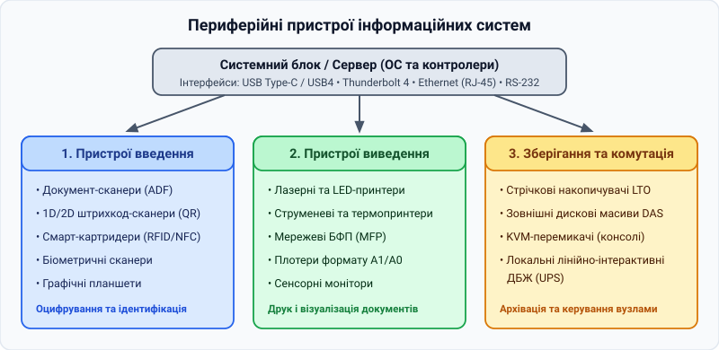
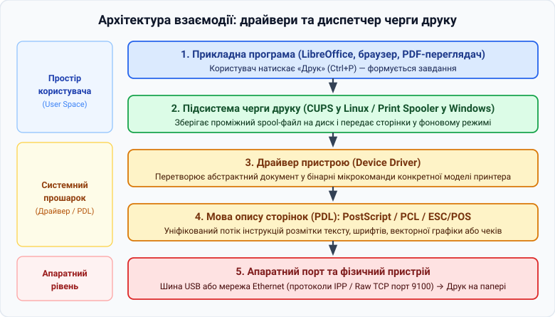

# Урок 23. Периферійне обладнання інформаційних систем

<div class="how-to">

**Як працювати з уроком**

1. Ознайомтеся з класифікацією сучасного периферійного обладнання, фізичними інтерфейсами підключення (USB Type-C, Thunderbolt, Ethernet), мовами керування друком (PCL, PostScript, ESC/P) та архітектурою служб друку (CUPS, Spooler).
2. Виконайте покрокове практичне завдання: дослідіть USB-шину, налаштуйте віртуальну чергу друку та напишіть скрипт діагностики й відновлення служби друку.
3. Закріпіть матеріал, склавши підсумковий тест на 10 запитань.

</div>

## Мета уроку

Опанувати принципи функціонування, підключення, конфігурування та діагностики сучасних периферійних пристроїв введення, виведення та збереження даних в інформаційних системах. На практиці ви:

- навчитеся проводити ідентифікацію зовнішнього обладнання через апаратні ідентифікатори Vendor ID / Product ID;
- дослідите роботу підсистем черги друку в операційних системах (демон CUPS / Print Spooler);
- навчитеся створювати та надсилати завдання на віртуальний принтер через інтерфейс командного рядка;
- опануєте методи усунення типових збоїв периферії (зависання завдань друку, втрата зв'язку з пристроєм, збої драйверів).

## Що знадобиться

- Комп'ютер під керуванням ОС Linux (Ubuntu/Debian) або емулятор термінала;
- Пакет утиліт роботи з USB та підсистемою друку: `usbutils` (`lsusb`), `cups`, `cups-client`, `cups-pdf`;
- Права адміністратора (`sudo`) для керування системними службами друку.

## Теорія

<div class="clip">


*Бездротовий маршрутизатор (Wi-Fi роутер)<sup>[1]</sup>*

</div>

### Класифікація периферійного обладнання

**Периферійне обладнання** — це сукупність зовнішніх апаратних пристроїв, які підключаються до системного блоку (або сервера) комп'ютерної системи для розширення її функціональних можливостей із введення, виведення, передачі або тривалого зберігання інформації.

<div class="clip">



*Класифікація периферійних пристроїв інформаційних систем*

</div>

#### 1. Пристрої введення інформації
- **Документ-сканери з автоматичною подачею (ADF — Automatic Document Feeder):** високошвидкісні сканери для потокової оцифровки паперових архівів, здатні сканувати обидва боки аркуша за один прохід зі швидкістю 40–100 сторінок на хвилину.
- **Сканери штрихкодів та 2D-кодів:**
  - *Лазерні або CCD-сканери:* зчитують лінійні одновимірні штрихкоди (EAN-13, Code 128) на складах і в торгових точках.
  - *Фотосканери (Image-сканери):* використовують мініатюрну цифрову матрицю для розпізнавання матричних двовимірних кодів (QR Code, DataMatrix, PDF417). Працюють як емулятори клавіатури (HID) або через віртуальний COM-порт (CDC-ACM).
- **Зчитувачі безконтактних карт (RFID / NFC / Mifare / EM-Marine):** застосовуються для швидкої авторизації оператора на робочому місці, доступу до захищеного друку на офісному БФП та фіксації робочого часу.
- **Біометричні сканери:** оптичні або ємнісні датчики відбитків пальців, сканери судин долоні.

#### 2. Пристрої виведення інформації
- **Принтери та Багатофункціональні пристрої (БФП / MFP):**
  - *Лазерні та світлодіодні (LED):* сухий порошковий тонер переноситься фотобарабаном під дією електростатики та запікається нагрівальним валом печі (*Fuser*). Ідеальні для текстового документообігу завдяки низькій собівартості сторінки та стійкості відбитків до вологи.
  - *Струменеві (Inkjet):* рідкі чорнила вистрілюються мікросоплами п'єзоелектричним або термоструменевим способом. Використовуються для повноколірного друку фотографій, маркетингових матеріалів і графіків.
  - *Термопринтери (Direct Thermal / Thermal Transfer):* використовують нагрівання спеціального термопаперу (чекові принтери на касах, створення накладних «Нової Пошти») або фарбувальної стрічки-ріббона (термотрансферний друк складських стійких етикеток).
- **Плотери (графопобудовники):** широкоформатні друкувальні системи (ширина рулону від 24 до 60 дюймів — формати A1, A0) для друку архітектурних креслень, географічних карт і топографічних схем.

#### 3. Спеціалізовані пристрої та резервне збереження
- **Стрічкові бібліотеки та накопичувачі LTO (Linear Tape-Open):** магнітна стрічка залишається світовим стандартом довгострокового холодного архівування даних. Картридж стандарту LTO-9 вміщує до 18 ТБ стиснених даних без електроживлення терміном до 30 років за собівартості значно нижчою, ніж у жорстких дисків.
- **KVM-перемикачі (Keyboard, Video, Mouse):** апаратні блоки комутації, що дозволяють оператору керувати двома, чотирма чи шістнадцятьма різними комп'ютерами або серверами, використовуючи лише один комплект монітора, клавіатури та миші.

---

### Фізичні та логічні інтерфейси підключення

Сучасні інформаційні системи перейшли від застарілих повільних портів до універсальних високошвидкісних шин:

| Інтерфейс | Фізичний роз'єм | Пропускна здатність | Особливості та використання |
| :--- | :--- | :--- | :--- |
| **USB 2.0** | Type-A, Type-B, Micro-USB | До 480 Мбіт/с (60 МБ/с) | Клавіатури, миші, сканери штрихкодів, чекові принтери |
| **USB 3.2 Gen 1/2** | Type-A, Type-C | 5–10 Гбіт/с | Швидкісні зовнішні SSD, документ-сканери, вебкамери 4K |
| **USB4 / Thunderbolt 4** | Type-C | До 40 Гбіт/с | Тунелювання шини PCIe, док-станції, кілька моніторів 4K через 1 кабель |
| **Ethernet (LAN)** | RJ-45 (8P8C) | 1 Гбіт/с / 100 Мбіт/с | Мережеві офісні БФП, автономні принтери, IP-камери |
| **RS-232 (COM)** | DB-9 (DE-9) | До 115,2 кбіт/с | Касові апарати (РРО), електронні ваги, промислові датчики |

**Переваги USB Type-C:**
- Симетричність (неможливо вставити «неправильним боком»).
- Підтримка технології **USB Power Delivery (USB-PD)**: передача живлення потужністю до 100–240 Вт (ноутбук живиться від монітора по тому ж кабелю).
- Підтримка альтернативних режимів (**Alt Mode**): передача відеосигналу DisplayPort / HDMI через лінії USB-C.

---

### Архітектура взаємодії: драйвери та диспетчери друку

Операційна система ніколи не звертається до складної мікроелектроніки периферійного пристрою напряму. Взаємодія відбувається через програмний прошарок:

<div class="clip">



*Архітектура взаємодії підсистеми друку: прикладна програма, черга друку, драйвер, PDL та апаратний порт*

</div>

1. **Драйвер пристрою (Device Driver):** спеціалізована системна програма, яка перетворює абстрактні команди операційної системи (наприклад, «намалюй лінію чорного кольору») у бінарний потік мікрокоманд конкретної моделі апаратури.
2. **Мови опису сторінок (PDL — Page Description Languages):**
   - **PostScript:** векторна мова опису сторінок фірми Adobe. Забезпечує бездоганну поліграфічну точність шрифтів та графіки.
   - **PCL (Printer Command Language):** стандарт корпорації Hewlett-Packard. Широко розповсюджений в офісній техніці, менш вимогливий до обсягу пам'яті принтера.
   - **ESC/P та ESC/POS:** стандарти фірми Epson для матричних і термопринтерів чеків.
3. **Диспетчер черги друку (Spooler / CUPS):**
   - Утилізація черги: коли користувач відправляє на друк документ на 200 сторінок, програма не повинна блокувати екран до завершення друку. Диспетчер друку створює проміжний файл черги (*spool file*) на накопичувачі та посторінково транслює його в принтер у фоновому режимі.
   - У середовищі Linux стандартом є **CUPS (Common Unix Printing System)**, що працює за мережевим протоколом **IPP (Internet Printing Protocol)**.

<div class="more-link">

**Хочете знати більше?** <span class="optional">Необов’язково</span>

Більшість сучасних принтерів підтримують технологію **бездрайверного друку** (Driverless Printing: стандарти Apple AirPrint, Mopria та IPP Everywhere). Вони використовують стандартизовані формати передачі сторінок (PDF або PWG-Raster), завдяки чому комп'ютери, смартфони та планшети можуть друкувати на будь-якому мережевому БФП без встановлення фірмового диска з драйверами.

</div>

---

## Покроково

Як оператор інформаційних систем, ви повинні вміти ідентифікувати підключену апаратуру на рівні шини USB, керувати чергою друку та розв'язувати проблеми завислих завдань.

### 1. Дослідіть USB-шину та визначте ідентифікатори пристроїв (VID/PID)

Підключіть будь-який периферійний пристрій (флешку, мишу чи принтер) та виконайте в терміналі:

```bash
lsusb
```

Ви побачите перелік підключених пристроїв такого формату:
`Bus 001 Device 004: ID 04a9:173e Canon, Inc. MF4400 Series`

Розшифруйте ідентифікатор `ID 04a9:173e`:
- `04a9` — **Vendor ID (VID)**: унікальний 16-бітний код виробника (у цьому випадку Canon).
- `173e` — **Product ID (PID)**: унікальний код конкретної моделі виробу.

Для перегляду топології шини у вигляді дерева скористайтеся ключем `-t`:

```bash
lsusb -t
```

### 2. Перевірте стан служби друку CUPS та підключених принтерів

Перевірте статус системного демона друку:

```bash
systemctl status cups --no-pager
```

Виведіть список усіх встановлених принтерів та дізнайтеся, який із них призначено за замовчуванням:

```bash
lpstat -p -d
```

### 3. Встановіть віртуальний PDF-принтер і відправте тестовий документ через CLI

Якщо фізичний принтер відсутній, для навчальних цілей та створення PDF-документів використовується віртуальний принтер `cups-pdf`:

```bash
sudo apt install -y cups-pdf
```

Створіть текстовий файл для друку:

```bash
echo -e "Звіт оператора комп'ютерної обробки\nДата: $(date)\nОбладнання протестовано успішно." > test_doc.txt
```

Відправте файл на друк через команду `lp`:

```bash
lp -d PDF test_doc.txt
```

Система видасть повідомлення із номером завдання в черзі: `request id is PDF-1`. Згенерований PDF-файл з'явиться в каталозі `~/PDF/`.

### 4. Діагностика черги та екстрене очищення завислих завдань

Перегляньте поточні документи, які очікують друку:

```bash
lpstat -o
```

Якщо аркуш паперу зам'яло, а в черзі накопичилося 50 документів, чергу друку необхідно очистити:
- Скасувати конкретне завдання: `cancel PDF-1`
- Екстрено очистити **всі** завдання на всіх принтерах:
  ```bash
  cancel -a -x
  ```

<div class="try">

**Спробуйте самі**

Створіть скрипт системного відновлення підсистеми друку під назвою `spooler_doctor.sh`. Скрипт має:
1. Перевіряти доступність служби `cups`. Якщо служба вимкнена або перебуває в стані збою — перезапускати її.
2. Відображати кількість завислих завдань у черзі друку.
3. Пропонувати оператору опцію екстреного очищення черги друку або виводити поточний стан пристроїв.

<details>
<summary>Перевірити очікуваний результат і повний розв’язок</summary>

Створіть файл скрипта:

```bash
cat << 'SHELL_SCRIPT' > spooler_doctor.sh
#!/bin/bash
# Скрипт швидкої реанімації та діагностики підсистеми друку CUPS

echo "=========================================================="
echo "      ДІАГНОСТИКА ТА ВІДНОВЛЕННЯ СЛУЖБИ ДРУКУ (CUPS)     "
echo "=========================================================="

# 1. Перевірка статусу служби
echo -n "[1] Перевірка статусу демона друку CUPS... "
if systemctl is-active --quiet cups; then
    echo "АКТИВНИЙ (OK)"
else
    echo "НЕ АКТИВНИЙ! Виконується перезапуск..."
    sudo systemctl restart cups
    sleep 2
    if systemctl is-active --quiet cups; then
        echo "Службу успішно перезапущено."
    else
        echo "ПОМИЛКА: Не вдалося запустити cups. Перевірте логи: journalctl -u cups"
        exit 1
    fi
fi

# 2. Аудит принтерів у системі
echo -e "\n[2] Встановлені принтери:"
lpstat -p 2>/dev/null || echo "Принтери не виявлені."
echo "Принтер за замовчуванням: $(lpstat -d 2>/dev/null | awk -F': ' '{print $2}')"

# 3. Аудит черги друку
QUEUE_COUNT=$(lpstat -o 2>/dev/null | wc -l)
echo -e "\n[3] Поточна черга друку:"
echo "Завдань у черзі: $QUEUE_COUNT"

if [ "$QUEUE_COUNT" -gt 0 ]; then
    echo "----------------------------------------------------------"
    lpstat -o
    echo "----------------------------------------------------------"
    echo -n "Бажаєте очистити всі завислі завдання? (y/N): "
    read -r ANSWER
    if [[ "$ANSWER" =~ ^[YyДд]$ ]]; then
        cancel -a -x 2>/dev/null
        echo "Чергу друку повністю очищено."
    fi
else
    echo "Черга друку чиста. Завислих документів немає."
fi

echo -e "\n=========================================================="
echo "                 ДІАГНОСТИКУ ЗАВЕРШЕНО                    "
echo "=========================================================="
SHELL_SCRIPT

chmod +x spooler_doctor.sh
./spooler_doctor.sh
```

**Очікуваний результат виконання:**
Скрипт перевіряє працездатність демона друку CUPS, виводить принтер за замовчуванням, інформує про кількість завдань у черзі друку та в разі виявлення заблокованих завдань дозволяє оператору очистити буфер друку одним натисканням.

</details>

</div>

---

## Підсумок

- **Периферійне обладнання** поділяється на пристрої введення (сканери, штрихкод-рідери, смарт-картридери), виведення (принтери, БФП, плотери) та спеціалізовані пристрої (магнітні стрічки LTO, KVM-перемикачі).
- **USB Type-C** є домінантним стандартом комунікації, який об'єднує швидкісну передачу даних (до 40 Гбіт/с у USB4), трансляцію відеосигналу та живлення пристроїв потужністю до 240 Вт (Power Delivery).
- **Драйвер пристрою** здійснює трансляцію команд ОС у машинну мову принтера (PCL, PostScript, ESC/POS).
- **Диспетчери друку (Spooler / CUPS)** забезпечують фонову буферизацію завдань на накопичувачі, що гарантує безперервну роботу користувача незалежно від фізичної швидкості друку пристрою.

---

## Тест

<div class="test-box">

10 запитань за матеріалом уроку. На початку тесту вкажіть **прізвище, ім’я та групу**.

<!-- GOOGLE_FORM_START:lesson-23 -->
[Відкрити тест у новій вкладці](https://docs.google.com/forms/d/e/1FAIpQLSeBfTpR8ytefCN-WOesfAPg-Ex-gGMw_urXk5w_LxA5BsWzFg/viewform)

<iframe src="https://docs.google.com/forms/d/e/1FAIpQLSeBfTpR8ytefCN-WOesfAPg-Ex-gGMw_urXk5w_LxA5BsWzFg/viewform?embedded=true" loading="lazy" title="Тест lesson-23">Завантаження…</iframe>
<!-- GOOGLE_FORM_END:lesson-23 -->

</div>

---

## Додаткове завдання

<span class="optional">Необов’язково</span> Виконуйте для розширення практичних навичок.

**Базовий рівень.** За допомогою команди `udevadm info -a -p $(udevadm info -q path -n /dev/input/mice)` або перегляду файлу `/proc/bus/input/devices` знайдіть інформацію про фізичну мишу та клавіатуру, підключені до вашого комп'ютера (назву виробника, інтерфейс та обробник подій).

**Проєктний рівень.** Дослідіть налаштування вебінтерфейсу сервера CUPS (за замовчуванням доступний у браузері за адресою `http://localhost:631`). Опишіть кроки, необхідні для того, щоб надати іншим комп'ютерам локальної мережі спільний мережевий доступ до вашого принтера (налаштування політики «Share printers connected to this system»).

## Джерела

1. [Wi-fi_router.jpg](https://commons.wikimedia.org/wiki/File:Wi-fi_router.jpg), Wikimedia Commons.
