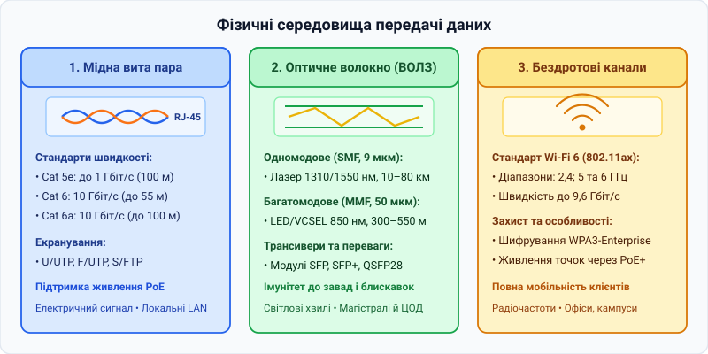
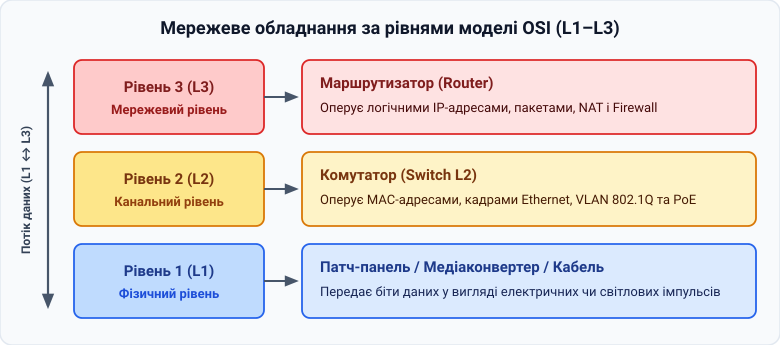

# Урок 24. Обладнання передачі та обміну даними

<div class="how-to">

**Як працювати з уроком**

1. Ознайомтеся з фізичними середовищами передачі даних (вита пара Cat 5e–Cat 6a, одномодове та багатомодове оптичне волокно, стандарти Wi-Fi 6), мережевим обладнанням за рівнями моделі OSI (комутатори L2, маршрутизатори L3, медіаконвертери) та технологією PoE.
2. Виконайте покрокове практичне завдання: дослідіть параметри мережевого адаптера, визначте MAC- і IP-адреси, таблицю ARP, проаналізуйте маршрут пакетів та активні мережеві сокети в терміналі.
3. Пройдіть підсумковий контрольний тест на 10 запитань.

</div>

## Мета уроку

Вивчити склад і призначення обладнання передачі даних в інформаційних системах, опанувати класифікацію мережевих пристроїв та кабельної інфраструктури, навчитися проводити первинну діагностику мережевого зв'язку за допомогою командного рядка. На практиці ви:

- навчитеся розрізняти категорії та типи екранування кабелів витої пари (UTP, FTP, STP) та волоконно-оптичних ліній зв'язку (SMF, MMF);
- зрозумієте принципи роботи та відмінності комутатора (Switch L2) від маршрутизатора (Router L3);
- вивчите технології віртуальних мереж (VLAN 802.1Q) та дистанційного живлення Power over Ethernet (PoE);
- створите комплексний діагностичний скрипт для перевірки мережевого з'єднання, шлюзу за замовчуванням та роздільної здатності імен DNS.

## Що знадобиться

- ПК або віртуальна машина під керуванням ОС Linux (або Windows з PowerShell);
- Набір системних мережевих утиліт: `iproute2` (`ip addr`, `ip route`, `ip neigh`), `iputils-ping`, `traceroute` (або `tracepath`), `net-tools`, `ethtool`;
- Базове розуміння стеків протоколів TCP/IP та моделі OSI.

## Теорія

### Середовища та лінії передачі даних

Будь-яка інформаційна система спирається на фізичну інфраструктуру транспортування цифрових сигналів — електромагнітних імпульсів, світлових хвиль або радіочастотних коливань.

<div class="clip">



*Фізичні середовища передачі даних: мідна вита пара, оптичне волокно та бездротові канали Wi-Fi*

</div>

#### 1. Симетричний мідний кабель (Вита пара)
Кабель складається з чотирьох скручених між собою пар ізольованих мідних провідників. Скручування суттєво зменшує взаємні електромагнітні наведення між парами та зовнішні перешкоди.
- **Стандарти та категорії:**
  - **Cat 5e:** смуга пропускання до 100 МГц; забезпечує швидкість до 1 Гбіт/с (1000BASE-T) на відстані до 100 метрів. Наймасовіший кабель для офісів.
  - **Cat 6:** смуга до 250 МГц; підтримує 10 Гбіт/с (10GBASE-T) на відстані до 55 метрів.
  - **Cat 6a:** смуга до 500 МГц; гарантує повноцінні 10 Гбіт/с на максимальній довжині до 100 метрів. Застосовується в серверних та ЦОД.
- **Типи захисного екранування (стандарт ISO/IEC 11801):**
  - **U/UTP (Unshielded):** неекранований кабель без металевих екранів (звичайний офісний патч-корд).
  - **F/UTP (Foiled):** спільний екран з алюмінієвої фольги навколо всіх чотирьох пар.
  - **S/FTP (Shielded/Foiled):** кожна пара індивідуально обгорнута фольгою, а зверху покрита спільним мідним лудженим обплетенням. Максимальний захист від промислових завад.
- **Комутація:** використовується 8-контактний роз'єм **8P8C (RJ-45)** за стандартними схемами кольорового розпінування **T568B** (найбільш поширена в Україні) або **T568A**. Сучасні порти оснащені технологією **Auto-MDIX**, яка автоматично визначає тип кабелю (прямий чи перехресний).

#### 2. Волоконно-оптичні лінії зв'язку (ВОЛЗ)
Сигнал передається у вигляді світлових спалахів через надчисте кварцове скло (діелектрик). Оптичний кабель повністю нечутливий до електромагнітних завад, високовольтних ліній передач і ударів блискавки, а перехопити з нього дані непомітно практично неможливо.
- **Одномодове волокно (SMF — Single-Mode Fiber):**
  - Діаметр серцевини всього $9\,\mu\text{m}$ (світло поширюється вздовж єдиної оптичної осі).
  - Джерело світла — інфрачервоний напівпровідниковий лазер (довжини хвиль 1310 нм або 1550 нм).
  - Дальність передачі без повторювачів — від 10 до 80 км і більше.
  - Жовтий колір оболонки кабелю. Використовується для міських і магістральних каналів зв'язку.
- **Багатомодове волокно (MMF — Multi-Mode Fiber):**
  - Більший діаметр серцевини — $50\,\mu\text{m}$ (OM3/OM4) або $62{,}5\,\mu\text{m}$ (OM1). Світлові промені відбиваються від стінок під різними кутами, що спричиняє міжмодову дисперсію.
  - Джерело світла — недорогі світлодіоди або VCSEL-лазери (850 нм).
  - Дальність передачі на швидкості 10 Гбіт/с обмежена 300–550 метрами.
  - Бірюзовий або помаранчевий колір оболонки. Застосовується для з'єднання серверних стійок усередині однієї будівлі ЦОД.
- **Оптичні роз'єми та трансивери:** комутація здійснюється через компактні оптичні роз'єми **LC**, **SC** та знімні модулі трансиверів **SFP** (1 Гбіт/с), **SFP+** (10 Гбіт/с) або **QSFP28** (100 Гбіт/с), які вставляються у відповідні шахти комутаторів.

---

### Мережеве обладнання за рівнями моделі OSI

Усі пристрої обміну даними класифікують відповідно до рівнів 7-рівневої моделі OSI (*Open Systems Interconnection*):

<div class="clip">



*Мережеве обладнання за рівнями моделі OSI: фізичний (L1), канальний (L2) та мережевий (L3)*

</div>

#### 1. Обладнання фізичного рівня (L1)
- **Патч-панель (Patch Panel):** блок із багатьма портами RJ-45 або оптичними розетками, куди монтуються стаціонарні кабелі від робочих місць. Дозволяє гнучко перекомутувати підключення коротенькими патч-кордами без пошкодження стаціонарної проводки.
- **Медіаконвертер:** пристрій, який перетворює електричний сигнал витої пари (мідь) у світловий сигнал оптичного волокна (і навпаки).

#### 2. Комутатори канального рівня (Switch L2)
Мережевий комутатор призначений для об'єднання комп'ютерів, серверів і принтерів у межах однієї локальної мережі (LAN).
- **Принцип роботи:** комутатор аналізує заголовки кадрів Ethernet, зчитує апаратну фізичну адресу відправника (**MAC-адресу**) і створює внутрішню динамічну таблицю комутації (**CAM / MAC-table**).
- На відміну від застарілих концентраторів (Hub), які тупо розсилали трафік на всі порти поспіль, створюючи колізії, комутатор передає кадр **виключно на той порт**, де підключено цільовий одержувач.
- **Функції керованих комутаторів (Managed Switches):**
  - **VLAN (Virtual Local Area Network, стандарт 802.1Q):** логічний поділ одного фізичного комутатора на ізольовані віртуальні сегменти (наприклад, окремо мережа бухгалтерії, окремо сервери, окремо гостьовий Wi-Fi). Трафік одного VLAN ізольований від іншого на канальному рівні.
  - **Агрегація каналів (Link Aggregation / LACP 802.3ad):** об'єднання 2 або 4 портів в один логічний канал для подвоєння швидкості та відмовостійкості зв'язку з сервером.
  - **Spanning Tree Protocol (STP / RSTP 802.1w):** алгоритм, що запобігає виникненню смертельних «комутаційних петель» (Broadcast Storm), автоматично блокуючи резервні надлишкові лінії зв'язку.

#### 3. Технологія дистанційного живлення Power over Ethernet (PoE)
Дозволяє передавати електричне живлення разом із цифровими даними по одному і тому ж кабелю витої пари:
- **802.3af (PoE):** потужність до 15,4 Вт (IP-телефони, прості датчики).
- **802.3at (PoE+):** потужність до 30 Вт (поворотні PTZ-камери спостереження, дводіапазонні точки доступу Wi-Fi).
- **802.3bt (PoE++ / Ultra PoE):** потужність до 60–90 Вт (інтелектуальні термінали, світлодіодне освітлення, тонкі клієнти).

#### 4. Маршрутизатори мережевого рівня (Router L3)
Маршрутизатор з'єднує між собою **різні комп'ютерні мережі** (наприклад, локальну мережу офісу з глобальною мережею інтернет).
- **Принцип дії:** маршрутизатор працює на мережевому рівні (L3) моделі OSI і приймає рішення про пересилання пакетів на основі логічних **IP-адрес** за допомогою своєї таблиці маршрутизації (*Routing Table*).
- **NAT / PAT (Network Address Translation):** механізм трансляції приватних сірих IP-адрес локальної мережі (наприклад, `192.168.1.0/24`) у єдину публічну білу IP-адресу інтернет-провайдера. Завдяки NAT сотні комп'ютерів офісу виходять в інтернет через одне підключення.
- **Міжмережевий екран (Firewall):** аналізує порти та протоколи (TCP, UDP, ICMP), блокує несанкціоновані спроби проникнення ззовні та здійснює фільтрацію небезпечного трафіку.

<div class="more-link">

**Хочете знати більше?** <span class="optional">Необов’язково</span>

У сучасних дата-центрах широко розповсюджені так звані **комутатори L3 (Layer 3 Switches / Мультисервісні комутатори)**. Вони поєднують блискавичну апаратну комутацію кадрів на базі спеціалізованих чипів ASIC зі здатністю виконувати маршрутизацію трафіку між різними VLAN зі швидкістю фізичних портів (Wire Speed, сотні гігабітів за секунду) без навантаження на класичний центральний процесор маршрутизатора.

</div>

---

## Покроково

У повсякденній роботі оператора виникають задачі швидкої локалізації мережевих проблем: чи підключено кабель, яку IP-адресу призначено комп'ютеру, чи відповідає локальний шлюз та чи працює служба розпізнавання імен DNS.

### 1. Дослідіть мережеві інтерфейси та параметри адресації

Відкрийте термінал Linux та виведіть список фізичних і віртуальних мережевих інтерфейсів:

```bash
ip link show
```

Зверніть увагу на прапорці стану:
- `state UP` — кабель підключено, фізичний лінк встановлено.
- `state DOWN` або `NO-CARRIER` — кабель від'єднано або комутатор вимкнено.
- `link/ether 00:1a:2b:3c:4d:5e` — апаратна фізична **MAC-адреса** мережевої карти.

Виведіть призначені IP-адреси та маски підмереж:

```bash
ip addr show
```

### 2. Визначте шлюз за замовчуванням (Default Gateway)

Шлюз за замовчуванням — це внутрішня IP-адреса маршрутизатора, на яку комп'ютер надсилає всі пакети, призначені для зовнішніх мереж:

```bash
ip route show
```

Рядок із позначкою `default via 192.168.1.1 dev eth0` показує IP-адресу вашого маршрутизатора.

### 3. Перевірте таблицю сусідів ARP

Таблиця ARP (Address Resolution Protocol) зберігає відповідність між IP-адресами та фізичними MAC-адресами пристроїв у вашому локальному сегменті:

```bash
ip neigh show
```

### 4. Комплексна діагностика з'єднання: від локального хоста до інтернету

Діагностика мережі завжди здійснюється поетапно (від низу до верху):
1. **Перевірка власного мережевого стека (Loopback):**
   ```bash
   ping -c 2 127.0.0.1
   ```
2. **Перевірка зв'язку з локальним шлюзом:**
   ```bash
   ping -c 2 192.168.1.1
   ```
   (Замініть `192.168.1.1` на вашу дійсну адресу шлюзу). Якщо шлюз відповідає — кабель, комутатор і внутрішня мережа справні.
3. **Перевірка зв'язку з публічним DNS-сервером за прямою IP-адресою:**
   ```bash
   ping -c 2 8.8.8.8
   ```
   Якщо шлюз відповідає, а `8.8.8.8` ні — проблема в інтернет-провайдера (обрив зовнішнього кабелю або закінчилися кошти на балансі).
4. **Перевірка роботи служби перетворення доменних імен (DNS):**
   ```bash
   ping -c 2 google.com
   ```
   Якщо за адресою `8.8.8.8` пакети проходять, а `google.com` видає помилку `Temporary failure in name resolution` — збилися налаштування DNS-серверів у системі.

<div class="try">

**Спробуйте самі**

Створіть скрипт автоматизованої діагностики мережевого стану під назвою `net_doctor.sh`. Скрипт повинен самостійно визначити активний інтерфейс, витягнути IP-адресу шлюзу, покроково протестувати всі 4 ланки зв'язку та видати оператору точний вердикт: де саме криється мережевий збій.

<details>
<summary>Перевірити очікуваний результат і повний розв’язок</summary>

Створіть файл скрипта:

```bash
cat << 'SHELL_SCRIPT' > net_doctor.sh
#!/bin/bash
# Скрипт покрокової діагностики мережевого зв'язку оператора

echo "=========================================================="
echo "          ЕКСПРЕС-ДІАГНОСТИКА МЕРЕЖЕВОГО З'ЄДНАННЯ        "
echo "=========================================================="

# 1. Пошук шлюзу за замовчуванням
GATEWAY=$(ip route | awk '/default/ {print $3}' | head -n 1)
ACTIVE_IFACE=$(ip route | awk '/default/ {print $5}' | head -n 1)

echo "Активний інтерфейс: ${ACTIVE_IFACE:-Не виявлено}"
echo "Локальна IP-адреса: $(ip -o -4 addr show "$ACTIVE_IFACE" 2>/dev/null | awk '{print $4}')"
echo "Шлюз за замовчуванням: ${GATEWAY:-Не призначено}"
echo "----------------------------------------------------------"

# Етап 1: Тест внутрішнього стека Loopback
echo -n "[1] Перевірка мережевого стека (127.0.0.1)... "
if ping -c 1 -W 1 127.0.0.1 >/dev/null 2>&1; then
    echo "OK"
else
    echo "ПОМИЛКА: Збій мережевого стека операційної системи!"
    exit 1
fi

# Етап 2: Перевірка зв'язку зі шлюзом
if [ -z "$GATEWAY" ]; then
    echo -e "\n[!] ВЕРДИКТ: Немає підключення до локальної мережі (DHCP не видав IP або висмикнуто кабель)!"
    exit 1
fi

echo -n "[2] Перевірка зв'язку з маршрутизатором ($GATEWAY)... "
if ping -c 2 -W 2 "$GATEWAY" >/dev/null 2>&1; then
    echo "OK (Локальна мережа активна)"
else
    echo "НЕМАЄ ВІДПОВІДІ!"
    echo -e "\n[!] ВЕРДИКТ: Збій локального підключення (перевірте патч-корд, комутатор або порт)."
    exit 1
fi

# Етап 3: Перевірка зовнішнього виходу в інтернет (IP-адреса Cloudflare 1.1.1.1)
echo -n "[3] Перевірка виходу в інтернет (1.1.1.1)... "
if ping -c 2 -W 2 1.1.1.1 >/dev/null 2>&1; then
    echo "OK (Інтернет-канал активний)"
else
    echo "НЕМАЄ ВІДПОВІДІ!"
    echo -e "\n[!] ВЕРДИКТ: Локальна мережа працює, але провайдер не надає доступ до інтернету."
    exit 1
fi

# Етап 4: Перевірка роздільної здатності імен DNS
echo -n "[4] Перевірка роботи DNS (google.com)... "
if ping -c 2 -W 2 google.com >/dev/null 2>&1; then
    echo "OK (DNS-сервери працюють справно)"
else
    echo "ПОМИЛКА РОЗПІЗНАВАННЯ ДОМЕНІВ!"
    echo -e "\n[!] ВЕРДИКТ: Інтернет є, але некоректно налаштовано сервери імен DNS (/etc/resolv.conf)."
    exit 1
fi

echo -e "\n=========================================================="
echo "      ВСІ МЕРЕЖЕВІ СЛУЖБИ ПРАЦЮЮТЬ БЕЗДОГАННО!            "
echo "=========================================================="
SHELL_SCRIPT

chmod +x net_doctor.sh
./net_doctor.sh
```

**Очікуваний результат:**
Скрипт покроково опитує вузли зв'язку. У разі несправності він негайно вказує точну причину: пошкодження патч-корду до комутатора, відсутність сигналу від провайдера чи некоректно прописані DNS-сервери.

</details>

</div>

---

## Підсумок

- **Кабельна інфраструктура** інформаційних систем базується на мідній витій парі категорій Cat 5e/Cat 6 (до 100 метрів) та волоконно-оптичних лініях зв'язку (одномодове SMF для дальніх відстаней, багатомодове MMF для міжстійкових з'єднань).
- **Комутатори канального рівня (L2)** передають дані на основі фізичних MAC-адрес пристроїв у межах однієї локальної мережі, виключаючи колізії пакетів.
- **Керовані комутатори** підтримують ізоляцію трафіку за допомогою віртуальних локальних мереж (VLAN 802.1Q) та живлення пристроїв по витій парі Power over Ethernet (PoE).
- **Маршрутизатори мережевого рівня (L3)** з'єднують різні підмережі за логічними IP-адресами, реалізують трансляцію приватних адрес NAT та захист через міжмережеві екрани.

---

## Тест

<div class="test-box">

10 запитань за матеріалом уроку. На початку тесту вкажіть **прізвище, ім’я та групу**.

🔗 <!-- GOOGLE_FORM_URL:lesson-24 --> *(Посилання на Google Форму буде додано після масового імпорту тесту)*

</div>

---

## Додаткове завдання

<span class="optional">Необов’язково</span> Виконуйте для закріплення навичок системного та мережевого адміністрування.

**Базовий рівень.** За допомогою команди `ss -tulpn` (або `netstat -tulpn`) визначте, якімережеві порти відриті на прослуховування у вашій операційній системі. Знайдіть у списку службу SSH (порт 22) або вебобслуговування (порти 80, 443), якщо вони активні.

**Проєктний рівень.** Дослідіть роботу утиліти `traceroute` (або `tracepath`). Виконайте трасування маршруту до доменного імені `ukr.net`. Порахуйте, через яку кількість транзитних маршрутизаторів (хопів) проходить пакет від вашого робочого місця до сервера кінцевого призначення, та зафіксуйте середню затримку на кожному кроці.
