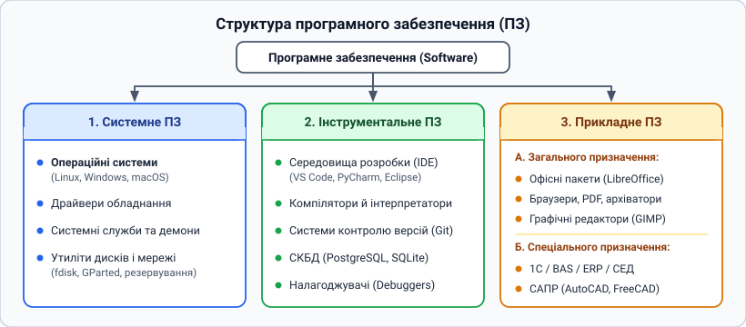
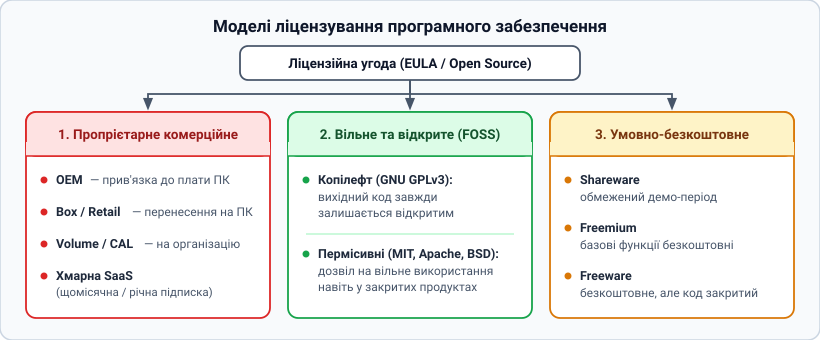

# Урок 25. Підбір і комплектування програмного забезпечення інформаційних систем

<div class="how-to">

**Як працювати з уроком**

1. Ознайомтеся з класифікацією програмного забезпечення (системне, інструментальне, прикладне), моделями ліцензування (OEM, Box, SaaS, ліцензії FOSS: GPL, MIT, Apache) та юридичними вимогами ліцензійної чистоти.
2. Виконайте покрокове практичне завдання: проведіть інвентаризацію встановлених у системі програм через термінал та напишіть скрипт автоматизованого розгортання базового робочого пакета вільного ПЗ.
3. Пройдіть підсумковий контрольний тест на 10 запитань.

</div>

## Мета уроку

Опанувати методологію професійного підбору, комплектування та ліцензійного аудиту програмного забезпечення інформаційної системи підприємства під конкретні виробничі завдання оператора з обробки інформації. На практиці ви:

- навчитеся класифікувати програмне забезпечення за функціональним призначенням і типом ліцензії;
- розберетеся у відмінностях комерційних ліцензій (OEM, Retail, Volume, SaaS) та вільного ПЗ з відкритим вихідним кодом (FOSS);
- опануєте інструменти командного рядка для аудиту та обліку встановленого програмного забезпечення;
- напишете скрипт автоматизованого розгортання еталонного робочого комплекту програм за допомогою пакетного менеджера.

## Що знадобиться

- ПК з операційною системою Linux (Ubuntu/Debian) або Windows 10/11 із командним рядком PowerShell;
- Системний пакетний менеджер: `apt` (у Linux) або `winget` (у Windows);
- Текстовий редактор для створення конфігураційних скриптів.

## Теорія

<div class="clip">


*Семирівнева мережева модель OSI<sup>[1]</sup>*

</div>

### Класифікація програмного забезпечення (ПЗ)

**Програмне забезпечення (Software)** — це сукупність програм, процедур, правил і супровідної документації, необхідних для функціонування апаратного комплексу комп'ютера та вирішення користувацьких завдань. За функціональною роллю ПЗ поділяється на три взаємопов'язані рівні:

<div class="clip">



*Структура програмного забезпечення*

</div>

#### 1. Системне програмне забезпечення
Забезпечує керування апаратурою, розподіл ресурсів (процесор, пам'ять, диски) та створює робоче середовище для прикладних програм:
- **Базові операційні системи:** клієнтські (Windows 11, Ubuntu Desktop) та серверні (Debian, Ubuntu Server, Windows Server, Red Hat Enterprise Linux).
- **Драйвери пристроїв:** спеціалізовані модулі для взаємодії ядра ОС із відеокартами, мережевими картами, сканерами та принтерами.
- **Службові системні утиліти:** програми розмітки дисків (`fdisk`, `gparted`), дефрагментатори, антивіруси, засоби створення резервних копій (Clonezilla, Timeshift).

#### 2. Інструментальне програмне забезпечення
Призначене для розробки, налагодження, компіляції та супроводу нових програмних продуктів:
- **Інтегровані середовища розробки (IDE):** VS Code, PyCharm, Eclipse.
- **Транслятори мов програмування:** компілятори (`gcc`, `clang`) та середовища виконання (`python3`, `nodejs`, `openjdk`).
- **Системи керування базами даних (СКБД):** PostgreSQL, MySQL, SQLite.

#### 3. Прикладне програмне забезпечення
Програми, за допомогою яких оператор безпосередньо виконує практичну виробничу роботу:
- **ПЗ загального призначення:**
  - *Офісні пакети:* LibreOffice (Writer, Calc, Impress), Microsoft 365, Google Workspace.
  - *Засоби перегляду та обробки документів:* PDF-рідери (Acrobat Reader, Evince), програми оптичного розпізнавання тексту (OCR: Tesseract).
  - *Архіватори:* 7-Zip, gzip, tar.
  - *Графічні редактори:* GIMP (растрова графіка), Inkscape (векторна графіка).
- **ПЗ спеціального (галузевого) призначення:**
  - Бухгалтерські системи та системи управління ресурсами підприємства (ERP / CRM): BAS Бухгалтерія, Odoo, SAP.
  - Системи електронного документообігу (СЕД): Document.Online, Megapolis.DocNet, «Вчасно».
  - Системи автоматизованого проєктування (САПР / CAD): AutoCAD, FreeCAD.

---

### Моделі ліцензування програмного забезпечення

Використання програм регулюється **ліцензійною угодою кінцевого користувача (EULA — End User License Agreement)** або умовами відкритих вільних ліцензій.

<div class="clip">



*Моделі ліцензування програмного забезпечення*

</div>

#### 1. Пропрієтарне комерційне ПЗ (Proprietary Software)
Вихідний код є комерційною таємницею розробника; користувач купує лише тимчасове чи постійне право користування скомпільованим бінарним файлом:
- **OEM (Original Equipment Manufacturer):** ліцензія, яка постачається разом із новим зібраним комп'ютером (наприклад, заводська Windows). Жорстко прив'язується до материнської плати і не може бути перенесена на інший системний блок. Найдешевша комерційна версія.
- **Retail / Box (FPP — Full Packaged Product):** повнофункціональна «коробкова» версія. Дозволяє перенесення з одного комп'ютера на інший (після видалення зі старого).
- **Корпоративні ліцензії (Volume Licensing / CAL):** пакетна закупівля ключів на організацію (від 5 ПК). Для серверних систем потрібні клієнтські ліцензії доступу — **CAL (Client Access License)** на кожного користувача чи пристрій.
- **Підписочна хмарна модель (SaaS — Software as a Service):** щомісячна або щорічна абонплата (наприклад, Adobe Creative Cloud, Microsoft 365, Canva Pro).

#### 2. Вільне та відкрите програмне забезпечення (FOSS / Open Source)
Надає користувачам чотири фундаментальні свободи: запускати програму для будь-яких цілей, вивчати її код, модифікувати та поширювати копії:
- **GNU GPL (General Public License, «копілефт»):** гарантує відкритість. Будь-яка програма, що містить хоча б рядок коду під ліцензією GPL, **зобов'язана** також розповсюджуватися виключно як вільне ПЗ із відкритим вихідним кодом (принцип спадкування свободи). Приклад: ядро Linux, пакет LibreOffice, редактор GIMP.
- **Пермісивні ліцензії (MIT, Apache 2.0, BSD):** максимально лояльні ліцензії. Дозволяють використовувати вихідний код у закритих комерційних розробках без відкриття модифікованого коду, вимагаючи лише збереження імені первинного автора.

#### 3. Юридичні ризики та ліцензійний аудит на підприємстві
Використання зламаного (піратського) ПЗ на робочих місцях тягне за собою:
- **Юридичну відповідальність:** стаття 176 Кримінального кодексу України (порушення авторського права і суміжних прав) передбачає штрафи в сотні тисяч гривень або конфіскацію комп'ютерної техніки всього підприємства.
- **Кіберзагрози:** «кряки» (*cracks*) і активатори у 95% випадків містять троянські закладки, шифрувальники-вимагачі (Ransomware) або майнери криптовалюти, що ставить під удар базу даних компанії.

---

### Принципи комплектування робочого місця оператора

Під час підбору програмного забезпечення системний фахівець та оператор керуються правилом **TCO (Total Cost of Ownership — сукупна вартість володіння)**:

$$\text{TCO} = \text{Вартість ліцензій} + \text{Витрати на впровадження} + \text{Витрати на оновлення та техпідтримку}$$

**Критерії вибору програм:**
1. **Апаратна сумісність:** відповідність системним вимогам (обсяг ОЗП, частота процесора, підтримка 64-розрядних інструкцій x86-64 або ARM64).
2. **Програмна взаємосумісність:** узгодженість версій системних бібліотек (.NET, Java, Python runtime) та форматів файлів (наприклад, безпроблемне відкриття стандартних файлів `.docx`, `.xlsx`, `.pdf` в офісному пакеті).
3. **Стандартизація («Золотий образ» / Golden Image):** створення однакового уніфікованого програмного оточення на всіх 20–50 робочих станціях операторів. Це в рази скорочує час технічного обслуговування.

**Базовий стандартний стек вільного ПЗ для робочої станції оператора:**
- Офіс: **LibreOffice** (повноцінна безкоштовна заміна Microsoft Office).
- Робота з графікою: **GIMP** (растр) та **Inkscape** (вектор).
- Архіватор: **7-Zip** (підтримка архівів 7z, ZIP, RAR, TAR).
- Інтернет: захищений веббраузер (**Firefox** або **Chromium**).
- Безпека та системна діагностика: **ClamAV**, системні утиліти моніторингу.

<div class="more-link">

**Хочете знати більше?** <span class="optional">Необов’язково</span>

У сучасних корпоративних мережах інвентаризація програмного забезпечення автоматизована. За допомогою відкритих агентських систем, таких як **GLPI** та **OCS Inventory NG**, адміністратор у режимі реального часу бачить на центральному сервері перелік усіх встановлених програм на кожному комп'ютері, закінчення терміну дії ліцензій та появу несанкціоновано встановлених користувачами комп'ютерних ігор.

</div>

---

## Покроково

Як оператор інформаційних систем, ви повинні вміти проводити аудит встановленого програмного забезпечення на робочій станції та автоматизувати встановлення необхідних прикладних пакетів.

### 1. Виконайте аудит встановлених програм у терміналі Linux

Для перегляду всіх встановлених у системі програм через менеджер пакетів `dpkg` виконайте:

```bash
dpkg -l | less
```

Кожен рядок починається зі статусу (наприклад, `ii` означає: пакет бажано встановити і він успішно встановлений).

Для пошуку конкретної прикладної програми (наприклад, офісного пакета чи графічного редактора) скористайтеся фільтром `grep`:

```bash
dpkg -l | grep -E "libreoffice|gimp|inkscape|firefox|7zip|vlc"
```

### 2. Перевірте ліцензійну інформацію та джерело встановленого пакета

Ви можете дізнатися версію, автора та супровідну ліцензійну інформацію про будь-який пакет утилітою `apt-cache show`:

```bash
apt-cache show libreoffice-writer | grep -E "Package:|Version:|Homepage:|Maintainer:"
```

Для перегляду офіційного авторського файлу авторських прав і ліцензії конкретного пакета:

```bash
head -n 25 /usr/share/doc/libreoffice-writer/copyright
```

Ви побачите інформацію про ліцензію **MPL (Mozilla Public License) / GNU LGPL**, що підтверджує 100% юридичну чистоту та безоплатність використання пакета для будь-яких комерційних організацій.

### 3. Автоматизація розгортання рекомендованого програмного стека

Замість ручного пошуку інсталяторів у браузері та клікання «Далі-Далі-Готово» професійні інформаційні системи розгортають програми за допомогою пакетного менеджера в пакетному режимі.

<div class="try">

**Спробуйте самі**

Створіть скрипт автоматизованого комплектування робочого місця оператора під назвою `deploy_operator_bundle.sh`. Скрипт має:
1. Оновлювати індекси сховищ пакетів.
2. В автоматичному режимі (без зайвих інтерактивних запитань) встановлювати рекомендований базовий стек вільного ПЗ:
   - Офісний пакет: `libreoffice`;
   - Растровий та векторний графічні редактори: `gimp`, `inkscape`;
   - Архіватори: `p7zip-full`, `unzip`;
   - Інструмент перегляду PDF та зображень: `evince`;
   - Системний монітор: `htop`.
3. Фіксувати успішність встановлення та формувати текстовий паспорт робочого місця `software_inventory.txt`.

<details>
<summary>Перевірити очікуваний результат і повний розв’язок</summary>

Створіть файл скрипта:

```bash
cat << 'SHELL_SCRIPT' > deploy_operator_bundle.sh
#!/bin/bash
# Скрипт автоматизованого розгортання та комплектування ПЗ робочої станції оператора

echo "=========================================================="
echo "    АВТОМАТИЗОВАНЕ РОЗГОРТАННЯ ПЗ ОПЕРАТОРА (FOSS BUNDLE) "
echo "=========================================================="

# Список необхідних програмних пакетів
SOFTWARE_PACKAGES=(
    "libreoffice"
    "libreoffice-l10n-uk"
    "gimp"
    "inkscape"
    "p7zip-full"
    "unzip"
    "evince"
    "htop"
    "curl"
)

echo "[1] Оновлення списків репозиторіїв системних пакетів..."
sudo apt update -y

echo -e "\n[2] Встановлення програмного стека..."
for pkg in "${SOFTWARE_PACKAGES[@]}"; do
    echo -n "Перевірка/встановлення пакета $pkg... "
    if dpkg -s "$pkg" >/dev/null 2>&1; then
        echo "ВЖЕ ВСТАНОВЛЕНО (Пропуск)"
    else
        echo "ВСТАНОВЛЮЄТЬСЯ..."
        sudo apt install -y "$pkg" >/dev/null 2>&1
        if [ $? -eq 0 ]; then
            echo "   -> Успішно встановлено: $pkg"
        else
            echo "   -> [!] Помилка встановлення: $pkg"
        fi
    fi
done

echo -e "\n[3] Генерація ліцензійного паспорта програмного забезпечення..."
REPORT_FILE="software_inventory.txt"

{
    echo "=========================================================="
    echo "       ПАСПОРТ ПРОГРАМНОГО ЗАБЕЗПЕЧЕННЯ РОБОЧОЇ СТАНЦІЇ   "
    echo "=========================================================="
    echo "Хост: $(hostname)"
    echo "Операційна система: $(uname -s -r -m)"
    echo "Дата інвентаризації: $(date)"
    echo "Відповідальний оператор: $USER"
    echo "----------------------------------------------------------"
    echo "ПАКЕТ                  ВЕРСІЯ               СТАТУС"
    echo "----------------------------------------------------------"
    for pkg in "${SOFTWARE_PACKAGES[@]}"; do
        VERSION=$(dpkg-query -W -f='${Version}' "$pkg" 2>/dev/null)
        if [ -n "$VERSION" ]; then
            printf "%-22s %-20s %s\n" "$pkg" "$VERSION" "Встановлено (FOSS)"
        else
            printf "%-22s %-20s %s\n" "$pkg" "Н/Д" "Відсутній"
        fi
    done
    echo "=========================================================="
} > "$REPORT_FILE"

echo "Паспорт успішно створено: $REPORT_FILE"
echo "----------------------------------------------------------"
cat "$REPORT_FILE"

echo -e "\n=========================================================="
echo "          КОМПЛЕКТУВАННЯ УСПІШНО ЗАВЕРШЕНО!               "
echo "=========================================================="
SHELL_SCRIPT

chmod +x deploy_operator_bundle.sh
./deploy_operator_bundle.sh
```

**Очікуваний результат виконання:**
Скрипт автоматично перевіряє наявність пакетів, встановлює відсутні програми без ручного втручання та формує охайний підсумковий документ `software_inventory.txt` із переліком найменувань, версій та ліцензійного статусу.

</details>

</div>

---

## Підсумок

- **Програмне забезпечення** поділяється на системне (ОС, драйвери, сервісні утиліти), інструментальне (середовища розробки, компілятори, СКБД) та прикладне (офісні пакети, браузери, графічні редактори, спеціалізовані облікові системи).
- **Ліцензування ПЗ** визначає юридичні межі використання. Комерційне ПЗ ліцензується як OEM (прив'язка до пристрою), Retail/Box (із правом перенесення), Volume (корпоративні пули) або SaaS (хмарна щомісячна підписка).
- **Вільне програмне забезпечення (FOSS)** під ліцензіями GPL, MIT або Apache є юридично безпечною, надійною та економічно вигідною альтернативою комерційним закритим продуктам для підприємств.
- **Стандартизація робочих місць** та використання консольних пакетних менеджерів (`apt`, `winget`) дозволяють автоматизувати розгортання, аудит та оновлення програмного парку без ручної праці.

---

## Тест

<div class="test-box">

10 запитань за матеріалом уроку. На початку тесту вкажіть **прізвище, ім’я та групу**.

<!-- GOOGLE_FORM_START:lesson-25 -->
[Відкрити тест у новій вкладці](https://docs.google.com/forms/d/e/1FAIpQLScqLQB2blWEgchpo6G3dItW1no5uyeBIsKyscSSQe96LQe1Mg/viewform)

<iframe src="https://docs.google.com/forms/d/e/1FAIpQLScqLQB2blWEgchpo6G3dItW1no5uyeBIsKyscSSQe96LQe1Mg/viewform?embedded=true" loading="lazy" title="Тест lesson-25">Завантаження…</iframe>
<!-- GOOGLE_FORM_END:lesson-25 -->

</div>

---

## Додаткове завдання

<span class="optional">Необов’язково</span> Виконуйте для поглибленого вивчення програмного менеджменту.

**Базовий рівень.** Дослідіть роботу менеджера пакетів Windows — `winget`. Знайдіть за допомогою командного рядка PowerShell (`winget search libreoffice`) точний ID пакета LibreOffice та перегляньте його метадані за допомогою команди `winget show TheDocumentFoundation.LibreOffice`.

**Проєктний рівень.** Складіть у текстовому процесорі порівняльну аналітичну таблицю вибору офісного пакета для невеликого підприємства на 15 робочих місць операторів: варіант «А» — комерційний пакет Microsoft 365 Business Standard (розрахуйте річну вартість підписки в гривнях) проти варіанта «Б» — вільний офісний пакет LibreOffice (0 грн за ліцензії). Сформулюйте висновок щодо економічного ефекту від впровадження вільного ПЗ.

## Джерела

1. [OSI_Model_v1.svg](https://commons.wikimedia.org/wiki/File:OSI_Model_v1.svg), Wikimedia Commons.
