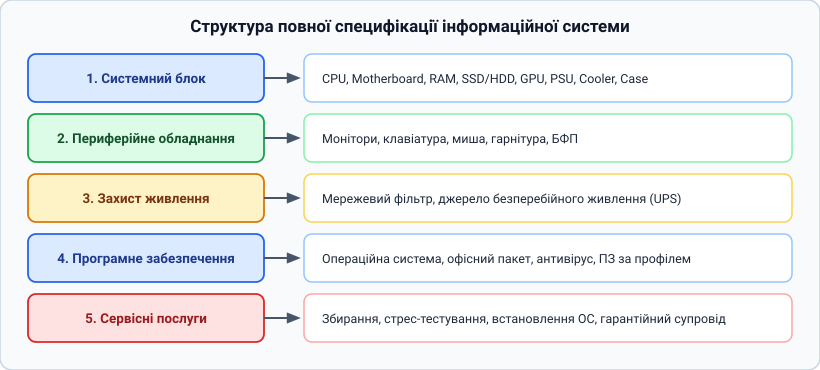
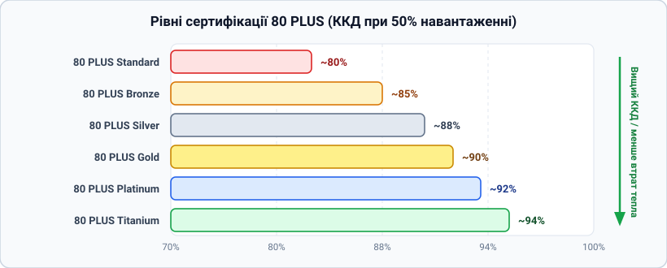

# Урок 26. Складання специфікації конфігурації інформаційної системи під замовлення

**Як працювати з уроком**

1. Ознайомтеся з теоретичним матеріалом: структурою технічної специфікації, правилами апаратної сумісності, розрахунком енергоспоживання та ліцензуванням ПЗ.
2. Виконайте покрокове практичне завдання: складіть у табличному процесорі LibreOffice Calc професійну специфікацію робочої станції під індивідуальні вимоги замовника.
3. Дайте відповіді на 10 запитань контрольного тесту для закріплення матеріалу.

## Мета уроку

Оволодіти методикою формування техніко-комерційної специфікації конфігурації інформаційної системи відповідно до вимог клієнта та стандартів ІТ-галузі. На практиці ви:

- проаналізуєте вхідне технічне завдання (ТЗ) користувача та визначите ключові апаратні пріоритети;
- перевірите взаємну сумісність компонентів (сокет процесора, стандарт пам’яті, інтерфейси накопичувачів, форм-фактор корпусу);
- розрахуєте необхідну потужність блока живлення та параметри джерела безперебійного живлення (ДБЖ);
- складете підсумкову калькуляцію вартості апаратного комплексу, периферії, ліцензійного ПЗ та послуг збирання у LibreOffice Calc.

## Що знадобиться

- Табличний процесор **LibreOffice Calc** (або інший табличний процесор) для розрахунку специфікацій, формульних обчислень і формування підсумкового кошторису.
- Сучасний веб-браузер для аналізу технічної документації виробників та актуальних цін на комплектуючі.

## Теорія

У професійній діяльності оператора з обробки інформації та програмного забезпечення одним із важливих завдань є підбір оптимальної конфігурації комп'ютерного обладнання під конкретні завдання користувача: від робочого місця бухгалтера чи діловода до потужної графічної станції або локального сервера підрозділу.

**Специфікація конфігурації інформаційної системи** — це офіційний документ (або деталізована таблиця), у якому зафіксовано повний перелік апаратних вузлів, периферійних пристроїв, ліцензійного програмного забезпечення та послуг із зазначенням їхніх точних найменувань, артикулів (SKU/Part Number), технічних характеристик, кількості, цін та загальної вартості.

*Структура повної специфікації інформаційної системи*

### 1. Етапи розробки специфікації

1. **Аналіз потреб замовника (Бриф/ТЗ):** з'ясування основного призначення системи (робота з текстом і базами даних, векторна/растрова графіка, САПР, віртуалізація), бюджетних меж та умов експлуатації (рівень шуму, габарити приміщення, температурний режим).
2. **Визначення архітектури та платформи:** вибір платформи процесора (Intel чи AMD), типу оперативної пам'яті (DDR4 чи DDR5), типу графічного адаптера (інтегрований чи дискретний).
3. **Контроль технічної сумісності (Compatibility Check):** верифікація фізичної та електричної взаємодії всіх вузлів.
4. **Формування кошторису:** зведення даних у таблицю, розрахунок проміжних підсумків, податків (ПДВ) та можливих знижок.
5. **Складання супровідної документації:** опис умов гарантії (12, 24 чи 36 місяців), сервісного обслуговування та термінів постачання.

### 2. Матриця контролю апаратної сумісності

Помилка у специфікації веде до неможливості збирання системи або її нестабільної роботи. Оператор зобов'язаний послідовно перевіряти такі параметри:

| Компоненти | Параметри сумісності | Типова помилка новачка |
| :--- | :--- | :--- |
| **Процесор + Материнська плата** | Процесорний роз'єм (Socket), підтримка чіпсетом покоління CPU, версія BIOS/UEFI. | Встановлення процесора сокета LGA1700 у плату із сокетом AM5 або відсутність оновлення BIOS під нове покоління. |
| **Материнська плата + ОЗП** | Тип пам'яті (DDR4 vs DDR5), форм-фактор (DIMM для ПК vs SO-DIMM для ноутбуків/неттопів), максимальна підтримувана частота та обсяг. | Спроба встановити модулі DDR5 у слоти материнської плати для DDR4 (різна геометрія ключа). |
| **Материнська плата + Накопичувачі** | Форм-фактор M.2 (довжина: 2280, 2242), підтримуваний протокол (NVMe PCIe 4.0/3.0 чи SATA M.2), кількість портів SATA III. | Купівля швидкісного NVMe SSD у слот, який підтримує виключно протокол SATA. |
| **Відеокарта + Корпус + БЖ** | Довжина відеокарти (мм) vs максимальний простір корпусу; кількість та тип роз'ємів живлення (PCIe 6+2 pin, 12VHPWR). | Відеокарта впирається в кошик для жорстких дисків або передні вентилятори корпусу. |
| **Процесорний кулер + Корпус + ОЗП** | Висота кулера (мм) vs допустима ширина корпусу; висота радіаторів планок ОЗП (кліренс кулера). | Кулер баштового типу заввишки 165 мм не дозволяє закрити бічну кришку корпусу з лімітом 155 мм. |

### 3. Розрахунок потужності блока живлення (PSU)

Блок живлення повинен забезпечувати стабільну напругу по лініях +12V, +5V та +3.3V без перегріву й осідань під піковим навантаженням. 

Формула розрахунку номінальної потужності БЖ:
$$P_{\text{БЖ}} = (TDP_{\text{CPU}} + TGP_{\text{GPU}} + P_{\text{інші}}) \times K_{\text{запасу}}$$

- $TDP_{\text{CPU}}$ — тепловий пакет процесора (з урахуванням короткочасного ліміту PL2/Boost).
- $TGP_{\text{GPU}}$ — енергоспоживання відеокарти (Total Graphics Power).
- $P_{\text{інші}}$ — енергоспоживання материнської плати, накопичувачів, вентиляторів та ОЗП (зазвичай закладається 50–70 Вт).
- $K_{\text{запасу}}$ — коефіцієнт надійності та довговічності, який становить **1,25 – 1,35** (запас у 25–35%).

Запас потужності необхідний для того, щоб блок живлення працював у зоні свого максимального ККД (40–60% навантаження), не вмикав максимальні оберти вентилятора та витримував мікросплески споживання без спрацьовування захисту OCP/OPP.

Обов'язковим стандартом якості є наявність сертифіката енергоефективності **80 PLUS** (Standard, Bronze, Silver, Gold, Platinum).

*Рівні сертифікації 80 PLUS (ККД при 50% навантаженні)*

### 4. Юридичні та ліцензійні аспекти програмного забезпечення

Під час складання комерційної специфікації необхідно враховувати тип ліцензування програмних продуктів:
- **OEM (Original Equipment Manufacturer):** ліцензія, яка постачається разом із новим обладнанням. Вона дешевша, проте жорстко прив'язується до материнської плати конкретного ПК без права перенесення на інший пристрій.
- **Retail / Box (FPP — Full Packaged Product):** коробкова або цифрова електронна ліцензія (ESD). Має вищу вартість, але дозволяє переносити ПЗ на інший комп'ютер у разі модернізації чи списання старого.
- **Вільне ПЗ (FOSS / Open Source):** дистрибутиви Linux (Ubuntu, Debian), офісні пакети (LibreOffice), растрові й векторні редактори (GIMP, Inkscape). Використання відкритого ПЗ дозволяє заощадити значну частину бюджету без порушення законодавства про авторські права.

**Хочете знати більше?** Необов’язково
Професійні системні інтегратори для автоматизованої перевірки сумісності використовують спеціалізовані сервіси, такі як **PCPartPicker**, а також офіційні листи сумісності компонентів від виробників материнських плат — **QVL (Qualified Vendor List)** для процесорів та модулів пам'яті. Розрахунок енергоспоживання можна перевірити за допомогою калькуляторів виробників блоків живлення (Outervision, Seasonic, be quiet!).

## Покроково

Практичне завдання: «Розробка техніко-комерційної специфікації автоматизованого робочого місця (АРМ) оператора комп'ютерної графіки та обробки даних».

Вхідні вимоги замовника:
- Надійний ПК для інтенсивної роботи з растровою та векторною графікою (GIMP, Inkscape, Figma), обробки баз даних та багатосторінкових видань у LibreOffice.
- Робота з двома моніторами 24" (Full HD, IPS).
- Наявність захисту від збоїв електромережі (ДБЖ з можливістю коректного збереження файлів при знеструмленні щонайменше 7–10 хв).
- Ліцензійна операційна система Windows 11 Pro або Linux, відкритий офісний пакет.

---

### 1. Створіть та налаштуйте структуру таблиці в LibreOffice Calc

1. Запустіть **LibreOffice Calc** та збережіть новий документ під назвою `specification_arm_workstation.ods`.
2. Оформіть шапку документа:
   - Клітинка `A1`: `СПЕЦИФІКАЦІЯ ОБЛАДНАННЯ ТА ПРОГРАМНОГО ЗАБЕЗПЕЧЕННЯ`.
   - Клітинка `A2`: `Замовник: ТОВ «ІнфоМедіа Центр» | Призначення: АРМ оператора графічного дизайну`.
3. Сформуйте стовпці таблиці (починаючи з рядка 4):
   - `A4`: **№ з/п**
   - `B4`: **Категорія**
   - `C4`: **Найменування та технічні параметри (SKU / Модель)**
   - `D4`: **Кількість**
   - `E4`: **Ціна за од., грн (без ПДВ)**
   - `F4`: **Сума, грн (без ПДВ)**
   - `G4`: **Технічне обґрунтування / Сумісність**

### 2. Складіть перелік компонентів системного блоку

Заповніть рядки апаратного комплекту, дотримуючись узгодженості вузлів:

1. **Процесор:** Intel Core i5-13400 (10 ядер / 16 потоків, до 4.6 GHz, TDP 65-148W, інтегроване відео Intel UHD 730).
2. **Охолодження CPU:** DeepCool AK400 (баштовий кулер, 4 теплові трубки, розсіювання до 220 Вт, висота 155 мм, сумісність LGA1700).
3. **Материнська плата:** ASUS PRIME B760M-A WIFI (Micro-ATX, сокет LGA1700, чіпсет B760, 4xDDR5, 2xM.2 PCIe 4.0, DisplayPort + 2xHDMI).
4. **Оперативна пам'ять:** Kingston FURY Beast DDR5-5600 32GB (Комплект 2x16GB, двоканальний режим, підтримка XMP/EXPO, низький профіль).
5. **Системний накопичувач:** Kingston KC3000 1TB M.2 2280 NVMe PCIe 4.0 x4 (Швидкість читання до 7000 МБ/с, запису до 6000 МБ/с, ресурс 800 TBW).
6. **Відеокарта:** NVIDIA GeForce RTX 3050 6GB GDDR6 (3xDisplayPort, 1xHDMI, низьке енергоспоживання 70W, без додаткового живлення або 1x8-pin — чудово підходить для прискорення графічних редакторів та роботи з двома моніторами).
7. **Блок живлення:** Chieftec Proton BDF-600S 600W (Сертифікат 80 PLUS Bronze, активний PFC, єдина лінія +12V на 50A, всі типи захисту UVP, OVP, SCP, OPP, OCP).
8. **Корпус:** DeepCool CC360 ARGB (Форм-фактор Micro-ATX, підтримка кулерів до 165 мм, відеокарт до 320 мм, сітчаста передня панель, в комплекті 3 вентилятори 120 мм).

### 3. Підберіть периферію, пристрої живлення та ПЗ

1. **Монітори:** 2 шт. 23.8" Philips 242E1GAJ (IPS-матриця, 1920x1080, яскравість 250 кд/м², роз'єми HDMI, DisplayPort, кути огляду 178°).
2. **Клавіатура та миша:** Комплект Logitech MK270 Wireless (надійний бездротовий зв'язок, захист від випадкового пролиття рідини).
3. **ДБЖ (UPS):** Eaton 5E 850VA USB (Лінійно-інтерактивний, потужність 850 ВА / 480 Вт, 4 розетки IEC з резервуванням, час роботи при навантаженні 150 Вт — близько 12 хв).
4. **Кабелі підключення:** 2x Кабель DisplayPort 1.4 (1.8 м) або HDMI 2.0 для підключення обох моніторів.
5. **Операційна система:** Microsoft Windows 11 Pro 64-bit Ukrainian OEM (або Ubuntu Linux LTS у разі безкоштовного розгортання).
6. **Офісне та графічне ПЗ:** Офісний пакет LibreOffice, GIMP, Inkscape (Вільні ліцензії GNU GPL / LGPL — вартість 0 грн).
7. **Послуги:** Комплексне збирання, укладання кабелів (кабель-менеджмент), налаштування BIOS/UEFI, 24-годинне стрес-тестування (AIDA64/MemTest86) та інсталяція ПЗ.

### 4. Налаштуйте автоматичні розрахунки в LibreOffice Calc

**Спробуйте самі**

1. У стовпці `F` введіть формулу для розрахунку суми по кожній позиції:
   `=D5*E5` (та розмножте її вниз маркером автозаповнення).
2. Оформіть підсумковий блок під таблицею:
   - Рядок **Разом без ПДВ**: застосуйте функцію `=SUM(F5:F20)`.
   - Рядок **ПДВ (20%)**: формулою розрахуйте суму податку `=F21*0.2` (де `F21` — комірка з підсумком без ПДВ).
   - Рядок **Загальна вартість до сплати з ПДВ**: формула `=F21+F22`.
3. Виділіть числовий діапазон цін і сум та встановіть для них грошовий формат (`₴` Гривня, 2 знаки після коми).
4. Перевірте, чи не перевищує активна потужність обраного комп'ютера з двома моніторами (розрахункове пікове навантаження близько 280 Вт) номінальну потужність ДБЖ (480 Вт).

Перевірити очікуваний результат і повний розв’язок

Орієнтовний вигляд зведеної специфікації та підсумкові показники розрахунку:

| № | Категорія | Найменування (SKU) | К-сть | Ціна без ПДВ, грн | Сума без ПДВ, грн | Примітка / Сумісність |
| :---: | :--- | :--- | :---: | :---: | :---: | :--- |
| 1 | CPU | Intel Core i5-13400 Tray | 1 | 7 500,00 | 7 500,00 | LGA1700, 10 ядер, TDP 65-148W |
| 2 | Cooler | DeepCool AK400 | 1 | 1 350,00 | 1 350,00 | Висота 155 мм, TDP 220W |
| 3 | MB | ASUS PRIME B760M-A WIFI | 1 | 4 800,00 | 4 800,00 | mATX, 4xDDR5, 2xPCIe 4.0 M.2 |
| 4 | RAM | Kingston DDR5-5600 32GB (2x16) | 1 | 4 200,00 | 4 200,00 | Двоканальний комплект, 1.25V |
| 5 | SSD | Kingston KC3000 1TB NVMe M.2 | 1 | 3 400,00 | 3 400,00 | PCIe 4.0, 7000/6000 MB/s |
| 6 | GPU | Palit RTX 3050 StormX 6GB | 1 | 7 100,00 | 7 100,00 | TGP 70W, DisplayPort + HDMI |
| 7 | PSU | Chieftec Proton BDF-600S 600W | 1 | 2 400,00 | 2 400,00 | 80+ Bronze, запас потужності 55% |
| 8 | Case | DeepCool CC360 ARGB | 1 | 1 950,00 | 1 950,00 | mATX, ліміт GPU 320мм, кулер 165мм |
| 9 | Monitor | Philips 242E1GAJ 23.8" IPS | 2 | 4 600,00 | 9 200,00 | Full HD, DP + HDMI, 144Hz |
| 10 | UPS | Eaton 5E 850VA USB (480W) | 1 | 3 100,00 | 3 100,00 | Лінійно-інтерактивний, захист АРМ |
| 11 | Периферія | Комплект Logitech MK270 | 1 | 1 100,00 | 1 100,00 | Бездротовий, USB-приймач |
| 12 | Кабелі | DisplayPort 1.4 Cable 1.8m | 2 | 250,00 | 500,00 | Для підключення двох моніторів |
| 13 | OS | MS Windows 11 Pro OEM 64-bit | 1 | 5 800,00 | 5 800,00 | Ліцензійна наклейка з кодом активації |
| 14 | ПЗ | Пакет LibreOffice + GIMP + Inkscape | 1 | 0,00 | 0,00 | Відкрита ліцензія FOSS |
| 15 | Послуги | Збирання ПК, тестування, налаштування | 1 | 1 500,00 | 1 500,00 | Комплексна послуга сервісного центру |

**Підсумковий розрахунок у LibreOffice Calc:**
- **Разом без ПДВ (комірка F20):** `=SUM(F5:F19)` = **53 900,00 грн**
- **ПДВ 20% (комірка F21):** `=F20*0.2` = **10 780,00 грн**
- **Загальна вартість із ПДВ (комірка F22):** `=F20+F21` = **64 680,00 грн**

**Аналіз перевірки сумісності та надійності:**
1. *Процесор і плата:* Сокет LGA1700 повністю збігається. Чіпсет B760 підтримує процесори 13-го покоління «з коробки».
2. *Габарити:* Висота кулера 155 мм менша за ліміт корпусу (165 мм). Довжина відеокарти (170 мм) значно менша за максимальні 320 мм.
3. *Енергоспоживання:* Пікове навантаження компонентів становить: CPU (148W) + GPU (70W) + Інші вузли (60W) = 278 Вт. Блок живлення на 600W забезпечує запас понад 50%, працюючи в оптимальному акустичному та тепловому режимі.
4. *ДБЖ:* Сумарне споживання системного блока (278 Вт) та двох моніторів (2x25 Вт = 50 Вт) у піку становить близько 328 Вт. ДБЖ номіналом 480 Вт забезпечує стабільну роботу з коефіцієнтом завантаження 68%, надаючи користувачеві близько 10–12 хвилин для коректного збереження проєктів та вимкнення ОС при зникненні напруги.

## Підсумок

- **Специфікація конфігурації ІС** — це структурований техніко-економічний документ, що регламентує склад апаратних засобів, периферії, програмного забезпечення та послуг згідно з ТЗ клієнта.
- Контроль апаратної сумісності передбачає перевірку взаємодії за сокетом процесора, поколінням оперативної пам'яті, інтерфейсами накопичувачів та фізичними габаритами компонентів усередині корпусу.
- Блок живлення повинен мати запас потужності не менше **25–30%** понад сумарний піковий TDP компонентів та сертифікацію не нижче **80 PLUS Bronze**.
- При підборі програмного забезпечення оператор поєднує пропрієтарні ліцензії (OEM/Retail) та вільні відкриті продукти (FOSS), оптимізуючи загальну вартість володіння системою (TCO).

## Тест

10 запитань за матеріалом уроку. На початку тесту вкажіть **прізвище, ім’я та групу**.

<!-- GOOGLE_FORM_START:lesson-26 -->
[Відкрити тест у новій вкладці](https://docs.google.com/forms/d/e/1FAIpQLSdtd0V4wxs7Gv-OYYpUFQEY4OGMjgisSXCRqxvzLRdRmKVGmQ/viewform)

<iframe src="https://docs.google.com/forms/d/e/1FAIpQLSdtd0V4wxs7Gv-OYYpUFQEY4OGMjgisSXCRqxvzLRdRmKVGmQ/viewform?embedded=true" loading="lazy" title="Тест lesson-26">Завантаження…</iframe>
<!-- GOOGLE_FORM_END:lesson-26 -->

## Додаткове завдання

Необов’язково Завдання для самостійної роботи та розвитку практичних навичок.

**Базовий рівень.** Додайте до створеної специфікації у LibreOffice Calc новий стовпець «Гарантійний термін (міс.)» та заповніть його для кожної позиції (від 12 до 60 місяців). За допомогою умовного форматування виділіть вузли, гарантія на які становить 36 місяців і більше.

**Проєктний рівень.** Складіть альтернативну конфігурацію «Бюджетна офісна станція» на базі платформи AMD (Socket AM4 або AM5) з інтегрованою графікою без дискретної відеокарти. Порівняйте різницю у вартості та енергоспоживанні порівняно з конфігурацією з уроку.
