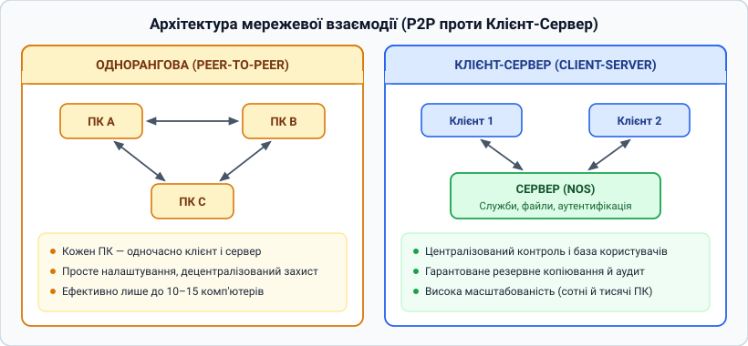

# Урок 27. Мережеві операційні системи: класифікація та особливості

<div class="how-to">

**Як працювати з уроком**

1. Ознайомтеся з теоретичним матеріалом: сутністю мережевих операційних систем (МОС), моделями клієнт-сервер та peer-to-peer, а також ключовими відмінностями серверних ОС від десктопних.
2. Виконайте покрокове практичне завдання: дослідіть системні характеристики та мережеві служби за допомогою сучасних термінальних утиліт (`hostnamectl`, `ip`, `ss`, `systemctl`).
3. Дайте відповіді на 10 запитань контрольного тесту для перевірки засвоєння знань.

</div>

## Мета уроку

Зрозуміти принципи побудови, класифікацію та специфіку функціонування мережевих операційних систем як фундаменту сучасної інформаційної інфраструктури. На практиці ви:

- навчитеся ідентифікувати архітектурний тип мережевої взаємодії (клієнт-серверна або однорангова мережа);
- порівняєте вимоги до надійності, ресурсів та багатозадачності серверних і користувацьких операційних систем;
- визначите призначення базових мережевих ролей (DNS, DHCP, Web, File Storage, Directory Services);
- перевірите мережеві інтерфейси, таблицю маршрутизації та активні прослуховувані мережеві порти в командному рядку.

## Що знадобиться

- Комп'ютер під керуванням ОС **Linux** (Debian, Ubuntu або сумісний дистрибутив) або **Windows** (PowerShell 5.1/7.x).
- Термінальне середовище з правами звичайного користувача та можливістю виклику `sudo`.

## Теорія

<div class="clip">


*Модель взаємодії клієнта та вебсервера<sup>[1]</sup>*

</div>

Будь-яка локальна чи глобальна комп'ютерна мережа складається не лише з фізичних кабелів, комутаторів та маршрутизаторів, а й з програмного середовища, яке керує передаванням даних, розподіляє доступ до файлів, захищає конфіденційну інформацію та обробляє запити сотень користувачів одночасно.

**Мережева операційна система (МОС / Network Operating System — NOS)** — це комплекс системного програмного забезпечення, призначений для управління спільними апаратними та інформаційними ресурсами комп'ютерної мережі, забезпечення безпечної багатокористувацької взаємодії, централізованого адміністрування та надання мережевих служб.

<div class="clip">



*Архітектура мережевої взаємодії (однорангова та клієнт-серверна моделі)*

</div>

### 1. Класифікація мережевих операційних систем за архітектурою

1. **Однорангові мережеві ОС (Peer-to-Peer / P2P):**
   - Усі вузли мережі (робочі станції) мають однаковий статус. Будь-який комп'ютер може надавати доступ до своїх папок або принтера сусідам і водночас користуватися ресурсами інших ПК.
   - *Приклади:* робочі групи Windows (Workgroups), BitTorrent-мережі, вбудований мережевий доступ у стандартних десктопних ОС Windows 10/11 або Ubuntu Desktop.
   - *Переваги:* не вимагають дорогого виділеного обладнання та високої кваліфікації системного адміністратора.
   - *Недоліки:* кожне робоче місце адмініструється окремо; падіння швидкодії робочої станції під час доступу інших користувачів; хаос у правах доступу при масштабуванні понад 10–15 пристроїв.

2. **Мережеві ОС із виділеним сервером (Архітектура «Клієнт-Сервер»):**
   - Мережеві ролі суворо розподілені: один або кілька потужних комп'ютерів (серверів) працюють виключно на обслуговування запитів клієнтських комп'ютерів.
   - *Приклади:* Windows Server (2019, 2022, 2025), дистрибутиви Linux (Debian, Ubuntu Server, Rocky Linux, Red Hat Enterprise Linux).
   - *Переваги:* централізована база користувачів (каталоги Active Directory або LDAP), гарантоване резервне копіювання, суворий аудит подій безпеки, висока стабільність та масштабованість для тисяч робочих місць.

### 2. Ключові відмінності серверної ОС від клієнтської (десктопної)

| Критерій | Клієнтська ОС (Desktop OS) | Серверна ОС (Server OS) |
| :--- | :--- | :--- |
| **Головний пріоритет планувальника** | Швидкий відгук користувацького інтерфейсу (UI/GUI), реакція на клацання миші та клавіатури | Максимальна пропускна здатність фонових служб, служб баз даних і мережевого стека |
| **Графічна підсистема (GUI)** | Обов'язкова, з розвиненими візуальними ефектами, анімаціями та мультимедіа | Необов'язкова. Найчастіше працює в режимі **Headless** (без монітора й відеокарти, керування через SSH або термінал) |
| **Підтримка апаратного забезпечення** | Зазвичай 1 процесор (до 16-24 ядер), до 128-192 ГБ пам'яті без корекції помилок | Підтримка кількох процесорів (мультисокетні плати), терабайтів пам'яті **ECC RAM**, апаратних RAID-контролерів |
| **Режим роботи** | Періодичний (ввімкнення на робочий день, перехід у режим сну, часті перезавантаження) | Безперервний **24/7/365** (Uptime вимірюється місяцями й роками без перезавантаження) |
| **Мережеві підключення** | Ліміт на кількість одночасних вхідних мережевих сесій (наприклад, не більше 20 у клієнтській Windows) | Розрахована на одночасну обробку десятків тисяч паралельних TCP/IP-з'єднань |
| **Оновлення системи** | Автоматично пропонуються користувачеві, можуть ініціювати примусове перезавантаження | Суворо контролюються адміністратором, ядро Linux може оновлюватися «на льоту» (Livepatch) без зупинки служб |

### 3. Класифікація серверних ОС за функціональними ролями

Сучасна мережева ОС може бути сконфігурована під одну або кілька критичних інфраструктурних ролей:

1. **Сервери базових мережевих служб:**
   - **DHCP (Dynamic Host Configuration Protocol):** автоматичне призначення IP-адрес, масок підмереж, шлюзів та DNS-серверів клієнтським пристроям.
   - **DNS (Domain Name System):** перетворення зрозумілих людині доменних імен (наприклад, `cpto.edu.ua`) на числові IP-адреси (`195.12.34.56`).
   - **NTP (Network Time Protocol):** синхронізація системного годинника всіх пристроїв мережі з точністю до мілісекунд (критично для роботи журналів безпеки та шифрування).

2. **Сервери аутентифікації та служб каталогів:**
   - **Active Directory Domain Services (AD DS)** у Windows Server або **FreeIPA / OpenLDAP** у Linux — створення єдиного домену організації з централізованим керуванням паролями, груповими політиками (GPO) та правами доступу.

3. **Файлові сервери та сховища даних:**
   - Організація спільного доступу до документів за протоколами **SMB/CIFS** (для мереж Windows/Linux) та **NFS** (Network File System для Unix/Linux), а також протоколами блокового доступу iSCSI.

4. **Веб-сервери та сервери додатків:**
   - Розміщення корпоративних порталів, CRM-систем та API за допомогою веб-серверів **NGINX**, **Apache**, **Traefik**, а також контейнерних середовищ **Docker** та **Kubernetes**.

<div class="more-link">

**Хочете знати більше?** <span class="optional">Необов’язково</span>
Окрім загальних мережевих ОС, існують високоспеціалізовані дистрибутиви:
- Мережеві системи для роутерів і маршрутизаторів: **MikroTik RouterOS**, **OpenWrt**, **pfSense** / **OPNsense** (на базі FreeBSD).
- ОС для мережевих сховищ даних (NAS): **TrueNAS CORE/SCALE** (на базі FreeBSD/Debian), що використовують наднадійну файлову систему **ZFS** з миттєвими знімками (snapshots) та контролем цілісності даних.
- Гіпервізори 1-го типу (Bare-Metal): **Proxmox VE**, **VMware ESXi**, де ядро ОС слугує лише платформою для запуску десятків ізольованих віртуальних машин.

</div>

## Покроково

Практичне завдання: «Дослідження системних характеристик та активних мережевих служб мережевої ОС за допомогою CLI-утиліт».

---

### 1. Визначте параметри системи та версію ядра

Відкрийте термінал Linux та виконайте системну команду діагностики:

```bash
hostnamectl
```

Зверніть увагу на параметри:
- `Operating System` — точна назва дистрибутива та версія.
- `Kernel` — версія ядра Linux (архітектура `x86_64` або `aarch64`).
- `Architecture` — розрядність процесорної архітектури.

*(У Windows PowerShell альтернативна команда: `systeminfo` або `Get-ComputerInfo`).*

### 2. Дослідіть активні мережеві адаптери та IP-адреси

У сучасних дистрибутивах Linux для роботи з мережею використовується утиліта `ip` (з пакета `iproute2`), яка прийшла на зміну застарілій команді `ifconfig`:

```bash
ip -c address show
```

Параметр `-c` вмикає зручне кольорове виділення. Проаналізуйте виведення:
1. Знайдіть петльовий інтерфейс **`lo`** (Loopback): адреса `127.0.0.1/8` — внутрішній зв'язок операційної системи із самою собою.
2. Знайдіть фізичний або віртуальний інтерфейс Ethernet (зазвичай має назву **`eth0`**, **`enp0s3`**, **`ens33`** або **`wlan0`** для Wi-Fi).
3. Зверніть увагу на стан інтерфейсу (`state UP`) та отриману IP-адресу з маскою (наприклад, `192.168.1.45/24`).

### 3. Перевірте маршрути за замовчуванням (Default Gateway)

Щоб дізнатися, через який пристрій операційна система надсилає мережевий трафік у зовнішній світ та інтернет:

```bash
ip route show
```

Рядок, що починається зі слова **`default via`**, вказує IP-адресу головного маршрутизатора (шлюзу) вашої мережі.

### 4. Проскануйте активні мережеві сокети та відкриті порти

Сучасна мережева утиліта **`ss`** (*Socket Statistics*) дозволяє дізнатися, які порти відкрито операційною системою для очікування вхідних з'єднань від клієнтів:

<div class="try">

**Спробуйте самі**

Виконайте команду аналізу сокетів із ключами фільтрації:

```bash
ss -tulpn
```

Розшифровка ключів команди `ss`:
- `-t` — показувати протоколи TCP;
- `-u` — показувати протоколи UDP;
- `-l` — відображати лише сокети в стані очікування (**LISTEN**);
- `-p` — виводити назву процесу та його PID (потрібні права root / `sudo`);
- `-n` — відображати порти числами, а не назвами служб (наприклад, `:22`, а не `:ssh`).

Спробуйте також відфільтрувати лише TCP-порти:

```bash
ss -tln
```

<details>
<summary>Перевірити очікуваний результат і повний розв’язок</summary>

Приклад типового виведення команди `ss -tulpn` на серверній машині:

```text
Netid  State   Recv-Q  Send-Q   Local Address:Port   Peer Address:Port  Process
tcp    LISTEN  0       128            0.0.0.0:22          0.0.0.0:*      users:(("sshd",pid=782,fd=3))
tcp    LISTEN  0       4096     127.0.0.53%lo:53          0.0.0.0:*      users:(("systemd-resolve",pid=512,fd=13))
tcp    LISTEN  0       511            0.0.0.0:80          0.0.0.0:*      users:(("nginx",pid=1120,fd=6))
udp    UNCONN  0       0        127.0.0.53%lo:53          0.0.0.0:*      users:(("systemd-resolve",pid=512,fd=12))
```

**Аналіз результату:**
1. **Порт 22 (`0.0.0.0:22`):** Служба `sshd` (OpenSSH Server). Працює по протоколу TCP у стані `LISTEN`. Адреса `0.0.0.0` означає, що сервер приймає запити віддаленого підключення на всіх наявних мережевих інтерфейсах.
2. **Порт 53 (`127.0.0.53:53`):** Служба `systemd-resolved`. Локальний кешуючий DNS-сервер, який слухає лише внутрішній інтерфейс `lo` для обробки запитів додатків комп'ютера.
3. **Порт 80 (`0.0.0.0:80`):** Служба веб-сервера `nginx`. Готова приймати вхідні HTTP-з'єднання від користувачів з інтернету чи локальної мережі.

*(У середовищі Windows PowerShell аналогічний моніторинг відкритих портів виконується командою: `Get-NetTCPConnection -State Listen | Select-Object LocalAddress, LocalPort, OwningProcess`)*.

</details>

</div>

### 5. Перевірте стан та автозавантаження мережевої служби

Перевірте статус локального DNS-резолвера за допомогою менеджера системних служб `systemctl`:

```bash
systemctl status systemd-resolved --no-pager
```

Знайдіть у виведенні рядок:
- `Active: active (running)` — свідчить про те, що служба працює без збоїв.
- `Loaded: ...; enabled;` — служба додана в автозавантаження при запуску сервера.

## Підсумок

- **Мережева операційна система (МОС)** координує мережеву взаємодію комп'ютерів, забезпечує спільне використання ресурсів та централізований захист даних.
- За структурою розрізняють прості **однорангові мережі (P2P)** та надійні, масштабовані **мережі з виділеним сервером (клієнт-сервер)**.
- Серверні ОС відрізняються від клієнтських пріоритетом фонових процесів, оптимізацією під багатозадачність, підтримкою багатопроцесорних конфігурацій, пам'яті **ECC RAM** та можливістю стабільної роботи без графічного інтерфейсу (Headless).
- Для діагностики стану мережевої ОС оператор використовує швидкі утиліти командного рядка: `ip address`, `ip route`, `ss` та менеджер служб `systemctl`.

## Тест

<div class="test-box">

10 запитань за матеріалом уроку. На початку тесту вкажіть **прізвище, ім’я та групу**.

<!-- GOOGLE_FORM_START:lesson-27 -->
[Відкрити тест у новій вкладці](https://docs.google.com/forms/d/e/1FAIpQLScZjmvkA89FU7aLDDcx0mgGjZ15kpvKaSD47USlLtWqXhSicA/viewform)

<iframe src="https://docs.google.com/forms/d/e/1FAIpQLScZjmvkA89FU7aLDDcx0mgGjZ15kpvKaSD47USlLtWqXhSicA/viewform?embedded=true" loading="lazy" title="Тест lesson-27">Завантаження…</iframe>
<!-- GOOGLE_FORM_END:lesson-27 -->

</div>

## Додаткове завдання

<span class="optional">Необов’язково</span> Завдання для самостійного виконання та поглиблення знань.

**Базовий рівень.** За допомогою команди `ping -c 4 8.8.8.8` перевірте зв'язок із публічним сервером Google за IP-адресою, а потім командою `ping -c 4 google.com` перевірте коректність роботи DNS-служби з перетворення доменного імені на IP.

**Проєктний рівень.** Дослідіть спеціалізований дистрибутив для мережевих сховищ **TrueNAS SCALE** або роутерну ОС **OpenWrt**: з'ясуйте, на базі якого ядра вони створені, які мінімальні апаратні вимоги висувають та який протокол спільного доступу до файлів є для них основним.

## Джерела

1. [Client-server-model.svg](https://commons.wikimedia.org/wiki/File:Client-server-model.svg), Wikimedia Commons.
