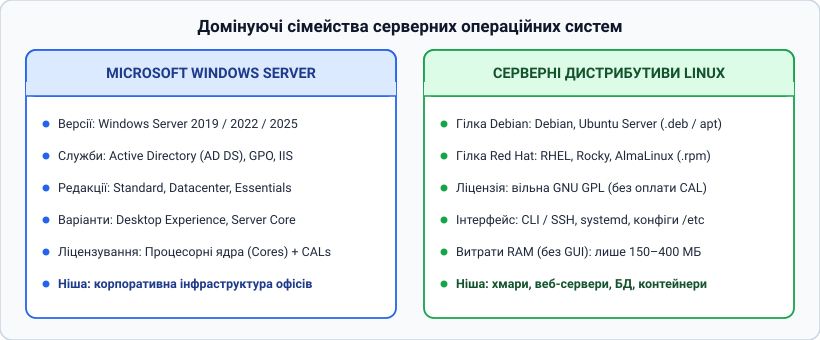

# Урок 28. Серверні операційні системи сімейств Windows та Linux

<div class="how-to">

**Як працювати з уроком**

1. Ознайомтеся з теоретичним матеріалом: редакціями й ліцензуванням Windows Server, сімействами дистрибутивів Linux (Debian/Ubuntu, RHEL), їхніми перевагами та сферами застосування.
2. Виконайте покрокове практичне завдання: порівняйте адміністративні команди керування службами, процесами й дисками у командних оболонках PowerShell та Bash.
3. Дайте відповіді на 10 запитань контрольного тесту для закріплення вивченого матеріалу.

</div>

## Мета уроку

Оволодіти порівняльним аналізом серверних операційних систем двох домінуючих сімейств — комерційного Microsoft Windows Server та вільного Linux, навчитися підбирати платформу під виробничі завдання та зіставляти базові інструменти адміністрування. На практиці ви:

- проаналізуєте відмінності між редакціями Windows Server (Standard, Datacenter, Server Core) та схемою ліцензування ядер і клієнтських ліцензій CAL;
- розглянете екосистему серверних дистрибутивів Linux (Debian, Ubuntu Server, Rocky/AlmaLinux/RHEL);
- побудуєте порівняльну матрицю сукупної вартості володіння (TCO), системних вимог і сфер ефективності кожної системи;
- виконаєте еквівалентні команди адміністрування служб, процесів та системних ресурсів у Bash і PowerShell.

## Що знадобиться

- Комп'ютер з ОС **Linux** (Bash) або **Windows** (PowerShell).
- Табличний редактор (LibreOffice Calc) або текстовий процесор для оформлення довідкової матриці оператора.

## Теорія

У сучасній цифровій індустрії серверний сегмент поділений між двома основними платформами: **Microsoft Windows Server** та різноманітними дистрибутивами **GNU/Linux**. Кожна з них займає свою нішу завдяки унікальним архітектурним особливостям, моделям ліцензування та інструментам керування.

<div class="clip">



*Домінуючі сімейства серверних операційних систем: Windows Server та Linux*

</div>

### 1. Серверні операційні системи сімейства Windows Server

Windows Server — пропрієтарна серверна платформа від Microsoft. Її головна сила — безшовна інтеграція з робочими станціями користувачів Windows, підтримка корпоративних баз даних MS SQL Server та централізоване керування правами через службу каталогів.

#### Ключові технології та ролі
- **Active Directory Domain Services (AD DS):** основа корпоративної мережі. Зберігає облікові записи користувачів, груп і комп'ютерів, реалізує єдину точку входу (Single Sign-On — SSO) за протоколом Kerberos.
- **Group Policy Objects (GPO):** механізм групових політик, який дозволяє адміністратору централізовано налаштувати параметри безпеки, робочі столи, права доступу та інсталяцію ПЗ на тисячах комп'ютерів одночасно.
- **Hyper-V:** вбудований апаратний гіпервізор 1-го типу для створення та запуску віртуальних машин.
- **IIS (Internet Information Services):** веб-сервер для розміщення корпоративних сайтів і додатків на базі технологій ASP.NET.

#### Редакції та варіанти розгортання
- **Windows Server Standard:** призначена для середовищ із низькою щільністю віртуалізації (дозволяє запускати до двох віртуальних машин на одній ліцензії).
- **Windows Server Datacenter:** орієнтована на центри обробки даних та високонавантажену віртуалізацію (надає право запуску необмеженої кількості віртуальних машин, підтримує програмно-визначені сховища *Storage Spaces Direct* та екрановані віртуальні машини).
- **Windows Server Essentials:** спрощена версія для невеликих підприємств (до 25 користувачів і 50 пристроїв) без потреби придбання додаткових ліцензій CAL.

**Варіанти інтерфейсу під час встановлення:**
1. **Server with Desktop Experience:** повний графічний інтерфейс користувача (GUI). Зручний для початківців, але споживає 2–4 ГБ пам'яті лише на роботу оболонки та вимагає частіших перезавантажень під час оновлення компонентів.
2. **Server Core:** рекомендований режим без графічного робочого столу. Система завантажується у вікно командного рядка. Керування здійснюється за допомогою скриптів **PowerShell**, веб-консолі **Windows Admin Center** або віддалено з комп'ютера адміністратора через RSAT (*Remote Server Administration Tools*). Споживає мінімум ресурсів і має значно вищий рівень безпеки.

#### Модель ліцензування Windows Server
Ліцензування є комбінованим і складається з двох компонентів:
1. **Ліцензія на процесорні ядра (Core-based):** ліцензуються всі фізичні ядра сервера (мінімум 16 ядер на один фізичний сервер).
2. **Клієнтські ліцензії доступу (CAL — Client Access License):** кожен користувач (**User CAL**) або пристрій (**Device CAL**), що звертається до служб сервера (файлові папки, друк, аутентифікація в домені), повинен мати окремо придбану ліцензію доступу.

---

### 2. Серверні операційні системи сімейства Linux

Linux — родина відкритих, Unix-подібних операційних систем на базі монолітного ядра Linux. Вони є основою світового інтернету, хмарних провайдерів (AWS, Google Cloud, Microsoft Azure) та контейнерних платформ (Docker, Kubernetes).

#### Головні гілки серверних дистрибутивів
1. **Гілка Debian / Ubuntu Server:**
   - Формат пакунків: **`.deb`**, інструменти керування: `dpkg` та менеджер репозиторіїв **`apt`**.
   - **Debian GNU/Linux:** дистрибутив із найвищим рівнем стабільності. Програмні пакети проходять багатомісячне тестування, що робить його еталоном надійності для критичних вузлів.
   - **Ubuntu Server:** дистрибутив від компанії Canonical. Версії з довготривалою підтримкою **LTS (Long Term Support)** виходять кожні 2 роки та підтримуються оновленнями безпеки щонайменше 5 років (до 10 років із підпискою Ubuntu Pro). Найпопулярніша ОС для хмарних інстансів.

2. **Гілка Red Hat Enterprise Linux (RHEL) та сумісні клони:**
   - Формат пакунків: **`.rpm`**, інструменти: **`dnf`** (раніше `yum`) та `rpm`.
   - **RHEL:** корпоративний стандарт для банківського сектора, телекому та великих підприємств із платною цілодобовою підтримкою від компанії Red Hat / IBM.
   - **Rocky Linux та AlmaLinux:** повністю безкоштовні дистрибутиви з відкритим кодом, створені як 100% сумісна альтернатива RHEL після зміни моделі розвитку CentOS.
   - Посилена безпека: з коробки налаштована підсистема примусового контролю доступу **SELinux** (*Security-Enhanced Linux*), розроблена спільно з АНБ США.

#### Переваги Linux Server
- **Фінансова доступність:** відсутність вартості ліцензій на процесорні ядра та повної відсутності плати за ліцензії клієнтського доступу (CAL).
- **Ефективність використання заліза:** у режимі без GUI операційна система споживає лише 150–300 МБ оперативної пам'яті, що дозволяє запускати десятки серверів на одному фізичному хості.
- **Стабільність та Uptime:** Linux здатний працювати роками без перезавантаження; оновлення ядра можуть застосовуватися без зупинки системи за технологіями livepatching.
- **Повна прозорість і скриптинг:** текстові конфігураційні файли (розташовані в каталозі `/etc`), потужні інтерпретатори командного рядка (Bash) та уніфікований менеджер служб **systemd**.

---

### 3. Порівняльна матриця: Windows Server проти Linux Server

| Характеристика | Windows Server | Linux Server (Ubuntu / Debian / RHEL) |
| :--- | :--- | :--- |
| **Ліцензійна модель** | Пропрієтарна (оплата за ядра CPU + ліцензії CAL на клієнтів) | Вільна відкрита (GNU GPL, ліцензії безкоштовні; платна лише техпідтримка) |
| **Основна сфера переваги** | Домени підприємств, контролери AD DS, служби GPO, сервери MS SQL, середовища .NET | Веб-сервери (NGINX/Apache), бази даних PostgreSQL/MariaDB, хмари, Docker, Kubernetes, файлові сховища NFS |
| **Інтерфейс керування** | Desktop Experience (GUI), PowerShell, Windows Admin Center, RSAT | Текстова консоль (CLI), SSH-доступ, системи конфігурації (Ansible, Puppet) |
| **Споживання пам'яті (Idle)** | 1.8 – 3.5 ГБ (з GUI); 800 МБ – 1.2 ГБ (Server Core) | 150 – 400 МБ (базовий сервер без графіки) |
| **Конфігураційні параметри** | Реєстр Windows (Registry), оснастки MMC, WMI/CIM | Прості текстові конфігураційні файли у `/etc` |

<div class="more-link">

**Хочете знати більше?** <span class="optional">Необов’язково</span>
Сучасний світ ІТ активно зближує обидві платформи:
- Компанія Microsoft випустила кросплатформну версію оболонки **PowerShell Core (pwsh)**, яка працює в середовищі Linux та macOS.
- Усередині Windows реалізовано підсистему **WSL 2 (Windows Subsystem for Linux)**, що дозволяє запускати справжнє ядро Linux паралельно з Windows.
- Для централізованого керування серверами Linux у великих мережах використовується вільний аналог Active Directory — **FreeIPA** (LDAP + Kerberos + DNS + PKI).

</div>

## Покроково

Практичне завдання: «Зіставлення адміністративних команд керування операційними системами Windows (PowerShell) та Linux (Bash)».

Оператор повинен вміти однаково впевнено адмініструвати як Windows Server, так і Linux Server. Проаналізуйте та протестуйте еквівалентні команди.

---

### 1. Моніторинг системних процесів та завантаження пам'яті

- **У терміналі Linux (Bash):**
  Виведіть перелік процесів, відсортованих за використанням оперативної пам'яті:
  ```bash
  ps aux --sort=-%mem | head -n 10
  ```
  *(Або запустіть інтерактивний диспетчер завдань командою `top` чи `htop`)*.

- **У консолі Windows (PowerShell):**
  Виведіть перші 10 процесів із найбільшим використанням робочого набору пам'яті (Working Set — WS):
  ```powershell
  Get-Process | Sort-Object WS -Descending | Select-Object -First 10
  ```

### 2. Керування системними службами (сервісами/демонами)

Перевірте статус мережевої служби або брандмауера:

- **У Linux (Bash):**
  ```bash
  systemctl status cron --no-pager
  ```
  *(Для зупинки, запуску або перезапуску використовуються: `sudo systemctl stop <служба>`, `start`, `restart`).*

- **У Windows (PowerShell):**
  ```powershell
  Get-Service -Name Spooler
  ```
  *(Для керування: `Stop-Service -Name Spooler`, `Start-Service -Name Spooler`, `Restart-Service`).*

### 3. Діагностика вільного простору на дискових накопичувачах

- **У Linux (Bash):**
  Виведіть інформацію про змонтовані розділи у зручних одиницях (ГБ/МБ):
  ```bash
  df -h
  ```

- **У Windows (PowerShell):**
  Отримайте перелік логічних томів та обсяг вільного місця:
  ```powershell
  Get-Volume
  ```
  *(Або компактний перелік дисків: `Get-PSDrive -PSProvider FileSystem`).*

### 4. Інспектування стану міжмережевого екрана (Firewall)

<div class="try">

**Спробуйте самі**

Перевірте активність захисного брандмауера у вашій системі:

- Якщо ви працюєте в **Linux (Ubuntu/Debian)**:
  ```bash
  sudo ufw status verbose
  ```
  *(Якщо ufw не активний, перегляньте правила за допомогою `sudo iptables -L -n -v` або `sudo nft list ruleset`).*

- Якщо ви працюєте у **Windows (PowerShell)**:
  ```powershell
  Get-NetFirewallProfile | Select-Object Name, Enabled, DefaultInboundAction, DefaultOutboundAction
  ```

Складіть у зошиті або електронному документі таблицю відповідностей цих команд.

<details>
<summary>Перевірити очікуваний результат і повний розв’язок</summary>

**Зведена довідкова таблиця еквівалентних команд адміністратора:**

| Адміністративне завдання | Linux (Bash / systemd) | Windows (PowerShell) |
| :--- | :--- | :--- |
| **Список процесів** | `ps aux` або `top` | `Get-Process` (аліас `gps`) |
| **Завершення процесу за PID** | `kill -9 <PID>` | `Stop-Process -Id <PID> -Force` |
| **Список служб** | `systemctl list-units --type=service` | `Get-Service` (аліас `gsv`) |
| **Перезапуск служби** | `sudo systemctl restart <service>` | `Restart-Service -Name <service>` |
| **Перевірка дискового простору**| `df -h` | `Get-Volume` |
| **Мережеві налаштування** | `ip address show` (або `ip a`) | `Get-NetIPAddress` (або `ipconfig`) |
| **Перевірка сокетів / портів** | `ss -tulpn` | `Get-NetTCPConnection -State Listen` |
| **Стан брандмауера** | `sudo ufw status` | `Get-NetFirewallProfile` |
| **Оновлення списку пакетів/ОС** | `sudo apt update && sudo apt upgrade` | `Install-Module PSWindowsUpdate; Get-WindowsUpdate` |

**Ключова архітектурна відмінність конвеєрів:**
- У **Linux Bash** команди взаємодіють через неструктурований потік тексту (рядки символів), який фільтрується утилітами `grep`, `awk`, `sed`, `cut`.
- У **Windows PowerShell** команди передають між собою повноцінні .NET-об'єкти з типізованими полями й методами (наприклад, об'єкт процесу має числове поле `CPU`, поле `Id`, текстове поле `ProcessName`), що дозволяє проводити сортування та фільтрацію командою `Where-Object` без текстового парсингу.

</details>

</div>

## Підсумок

- **Windows Server** — провідна корпоративна ОС для побудови централізованих офісних інфраструктур, контролерів домену **Active Directory** та розгортання групових політик (GPO).
- Ліцензування Windows Server базується на кількості фізичних ядер процесора плюс обов'язкових клієнтських ліцензіях доступу (**CAL**) для користувачів або пристроїв.
- **Linux Server** (Ubuntu Server, Debian, RHEL/Rocky) є стандартом для веб-хостингу, баз даних і контейнеризації завдяки відсутності плати за ліцензії, високому ККД та стабільній роботі без графічного інтерфейсу.
- Сучасний оператор використовує споріднені підходи в адмініструванні: команди `systemctl`, `ss`, `df` у Linux та командлети `Get-Service`, `Get-NetTCPConnection`, `Get-Volume` у Windows PowerShell.

## Тест

<div class="test-box">

10 запитань за матеріалом уроку. На початку тесту вкажіть **прізвище, ім’я та групу**.

🔗 <!-- GOOGLE_FORM_URL:lesson-28 --> *(Посилання на Google Форму буде додано після масового імпорту тесту)*

</div>

## Додаткове завдання

<span class="optional">Необов’язково</span> Завдання для самостійної роботи та дослідження.

**Базовий рівень.** Знайдіть та опишіть 3 головні відмінності між варіантами інсталяції Windows Server «Desktop Experience» та «Server Core». За якими показниками (обсяг диска, використання ОЗП, частота оновлень) варіант Server Core має перевагу?

**Проєктний рівень.** Розрахуйте орієнтовний бюджет вартості ліцензійного ПЗ для офісу компанії на 50 співробітників за двома сценаріями:
1. Використання сервера на базі Windows Server 2022 Standard (16 ядер) + 50 ліцензій User CAL.
2. Використання сервера на базі вільного Linux Ubuntu Server LTS + поштовий сервер iRedMail + хмарне сховище Nextcloud.
