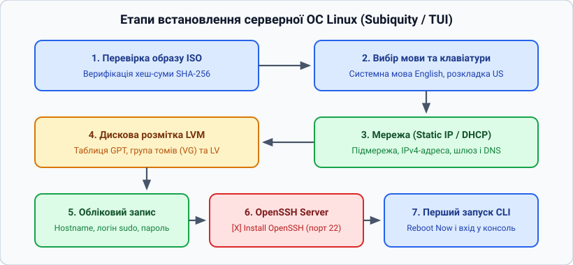
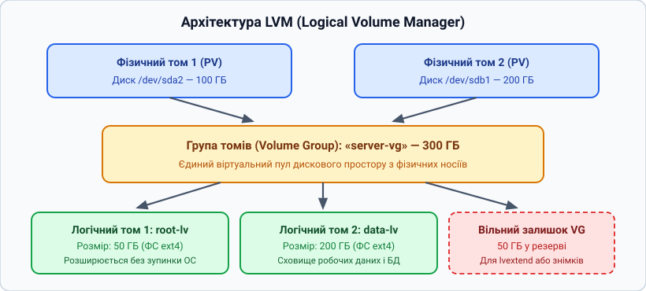

# Урок 29. Встановлення серверної ОС Linux (Debian, Ubuntu Server)

<div class="how-to">

**Як працювати з уроком**

1. Ознайомтеся з теоретичним матеріалом: верифікацією образів ISO за допомогою SHA-256, структурою розмітки накопичувачів, перевагами логічних томів LVM та кроками текстового інсталятора.
2. Виконайте покрокове практичне завдання: розгорніть віртуальну машину та виконайте встановлення Ubuntu Server / Debian з налаштуванням статичної IP-адреси, LVM-сховища та служби OpenSSH.
3. Пройдіть контрольний тест із 10 запитань для перевірки готовності до інсталяції серверних систем.

</div>

## Мета уроку

Оволодіти практичними навичками підготовки, розмітки дискових накопичувачів та встановлення серверних операційних систем сімейства Linux без графічного інтерфейсу (Headless). На практиці ви:

- перевірите цілісність інсталяційного ISO-образу за допомогою криптографічної хеш-суми SHA-256;
- сконфігуруєте параметри віртуальної машини під вимоги серверного дистрибутива;
- налаштуєте параметри мережі зі статичною конфігурацією IPv4 в текстовому майстрі встановлення;
- спроєктуєте дискову розмітку на базі таблиці GPT та менеджера логічних томів **LVM**;
- створите захищений обліковий запис системного адміністратора з правами `sudo` та інтегруєте службу **OpenSSH**.

## Що знадобиться

- Програма віртуалізації: **Oracle VM VirtualBox**, **VMware Workstation Player** або гипервізор **QEMU/KVM**.
- Офіційний інсталяційний образ **Ubuntu Server LTS** (22.04 LTS або 24.04 LTS) чи **Debian GNU/Linux** (12 Bookworm).
- Термінал хостової операційної системи (Linux, macOS або Windows PowerShell) для підготовки та перевірки хеш-сум.

## Теорія

Встановлення серверної операційної системи принципово відрізняється від інсталяції звичайного домашнього десктопу. Сервер не має розважальних програм, ігор або важкого графічного робочого столу. Інсталяція відбувається через спеціальний текстовий інтерфейс псевдографіки (TUI — Text User Interface), у якому всі дії виконуються за допомогою клавіш зі стрілками, `Tab`, `Space` та `Enter`.

<div class="clip">



*Етапи встановлення серверної ОС Linux (Subiquity / TUI)*

</div>

### 1. Верифікація завантаженого образу (SHA-256 Checksum)

Перед записом образу на завантажувальну флешку чи підключенням до віртуальної машини обов'язково здійснюють перевірку його цілісності. Помилка навіть в один біт (через збій мережі під час завантаження) призведе до зависання інсталяції посеред процесу розпакування пакетів або створення пошкоджених файлових систем.

Офіційні сайти розробників завжди публікують файл із контрольними хеш-сумами (наприклад, `SHA256SUMS`).

Команда розрахунку контрольної суми в Linux/macOS:
```bash
sha256sum ubuntu-24.04-live-server-amd64.iso
```
*(У Windows PowerShell: `Get-FileHash -Algorithm SHA256 .\ubuntu-24.04-live-server-amd64.iso`).*

Отриманий 64-значний шістнадцятковий рядок повинен точно збігатися з офіційним значенням на сайті розробника дистрибутива.

---

### 2. Структура розмітки диска та технологія LVM

Для серверів стандартом є використання сучасної таблиці розділів **GPT (GUID Partition Table)**, яка не має обмежень у 2 ТБ, притаманних застарілій схемі MBR, та підтримує до 128 первинних розділів.

#### Чому серверам потрібен LVM (Logical Volume Manager)?
У традиційній схемі жорсткий диск розбивається на фіксовані розділи (`/dev/sda1`, `/dev/sda2`). Якщо кореневий розділ розміром 20 ГБ переповниться системними логами чи базою даних, розширити його вкрай важко — доведеться зупиняти сервер, завантажуватися з Live-CD і вручну зсувати межі секторів із ризиком втрати даних.

**LVM додає рівень віртуалізації дискового простору:**
1. **Physical Volumes (PV — Фізичні томи):** реальні жорсткі диски чи розділи (`/dev/sda2`, `/dev/sdb1`), які ініціалізуються для використання в LVM.
2. **Volume Group (VG — Група томів):** об'єднання одного або кількох PV в єдиний спільний «пул» дискового простору (наприклад, група `ubuntu-vg`).
3. **Logical Volumes (LV — Логічні томи):** гнучкі «віртуальні розділи», нарізані з групи томів (наприклад, `lv-root`, `lv-var`), які форматуються у файлову систему (`ext4` або `xfs`).

<div class="clip">



*Архітектура LVM (Logical Volume Manager)*

</div>

**Переваги LVM для адміністратора:**
- Збільшення обсягу розділу прямо під час роботи сервера однією командою (`lvextend -r`).
- Можливість підключити новий фізичний диск до сервера і просто додати його до існуючої групи томів VG (`vgextend`).
- Підтримка миттєвих знімків (*Snapshots*) стану файлової системи перед оновленням або тестуванням ПЗ.

---

### 3. Текстовий інсталятор (Ubuntu Subiquity / Debian Installer)

Сучасний офіційний інсталятор Ubuntu Server називається **Subiquity**. Навігація в ньому здійснюється клавішами:
- `Стрілки вгору/вниз` — вибір пункту меню;
- `Tab` / `Shift+Tab` — перехід між блоками кнопок і списками;
- `Пробіл` — встановлення або зняття відмітки (чекбокса `[X]`);
- `Enter` — підтвердження вибору та натискання кнопок «Done», «Continue».

#### Основні кроки налаштування інсталятора
1. **Welcome / Language:** мовою установки обирають **English** (рекомендовано для серверів, щоб повідомлення про помилки та логи записувалися стандартною латиницею, що полегшує діагностику).
2. **Keyboard configuration:** англійська розкладка встановлюється як основна, українська може бути додана як альтернативна.
3. **Network connections:**
   - За замовчуванням система намагається отримати параметри через DHCP.
   - Для сервера **обов'язково** рекомендується налаштувати статичну адресу (Manual): вказати підмережу в CIDR-нотації (наприклад, `192.168.1.0/24`), IP-адресу (`192.168.1.100`), шлюз (`192.168.1.1`) та адреси DNS-серверів (`1.1.1.1, 8.8.8.8`).
4. **Configure proxy & Mirror:** у разі прямого підключення поле проксі залишають порожнім; адреса дзеркала архівів зазвичай автоматично підбирає найближчий географічний сервер (наприклад, `http://ua.archive.ubuntu.com/ubuntu`).
5. **Guided storage configuration:**
   - Обирають диск для інсталяції та відмічають пункт **Use this disk as an LVM group**.
6. **Profile setup:**
   - Вказують ім'я сервера (**Your server's name** — hostname), наприклад `srv-cpto-01`.
   - Ім'я адміністратора та логін (наприклад, `admin-it` або `operator`).
   - Надійний пароль (не менше 8-12 символів із цифрами та знаками).
7. **SSH Setup:**
   - Обов'язково активувати відмітку **[X] Install OpenSSH server**. Без цього ви не зможете підключитися до сервера віддалено через мережу після завершення інсталяції!

<div class="more-link">

**Хочете знати більше?** <span class="optional">Необов’язково</span>
У великих дата-центрах та хмарах сервери ніколи не встановлюють вручну через клавіатуру. Для масового автоматичного розгортання сотень серверів використовують технологію **Cloud-Init** та **Autoinstall**. Інсталятор зчитує один конфігураційний YAML-файл `user-data`, у якому заздалегідь прописані всі розділи, мережеві IP, користувачі, SSH-ключі та пакети, розгортаючи готову ОС за 2–3 хвилини без участі людини.

</div>

## Покроково

Практичне завдання: «Встановлення серверної ОС Ubuntu Server у віртуальній машині VirtualBox з конфігурацією LVM та SSH».

---

### 1. Перевірте цілісність ISO-образу

Відкрийте термінал на своєму ПК та обчисліть хеш завантаженого файлу образу:

```bash
sha256sum ubuntu-24.04-live-server-amd64.iso
```

Зіставте перші та останні символи виведеного хешу з даними офіційного релізу.

### 2. Створіть та налаштуйте віртуальну машину

1. Відкрийте **VirtualBox** та натисніть кнопку **Створити** (*New*):
   - **Ім'я:** `Ubuntu-Server-Lab`
   - **Тип:** `Linux` | **Версія:** `Ubuntu (64-bit)`
   - **ISO Image:** вкажіть шлях до завантаженого файлу образу.
   - Відзначте чекбокс *Пропустити автоматичну установку* (*Skip Unattended Installation*), щоб пройти всі етапи майстра власноруч.
2. Виділіть апаратні ресурси:
   - **Оперативна пам'ять (RAM):** 2048 МБ (2 ГБ).
   - **Процесори (CPU):** 2 vCPU.
   - **Віртуальний жорсткий диск:** 25–30 ГБ (VDI, динамічний).
3. Перейдіть у розділ **Налаштування** → **Мережа** (*Network*):
   - Оберіть тип підключення **Мережевий міст** (*Bridged Adapter*), щоб віртуальний сервер отримав власну повноцінну IP-адресу у вашій фізичній локальній мережі (або залишіть **NAT** із прокиданням порту 2222 -> 22).

### 3. Пройдіть початкові етапи інсталятора

1. Запустіть віртуальну машину. У завантажувальному меню GRUB оберіть пункт `Try or Install Ubuntu Server` і натисніть `Enter`.
2. Оберіть мову системи: `English` -> натисніть `Enter`.
3. Якщо інсталятор запропонує оновитися до нової версії (*Update to the new installer*), оберіть `Continue without updating` (для стабільності процесу).
4. Розкладка клавіатури: залиште `Layout: English (US)`, перейдіть кнопкою `Tab` на `Done` і натисніть `Enter`.
5. Тип установки: оберіть стандартний `Ubuntu Server` (не мінімальний).

### 4. Налаштуйте статичну мережу та дисковий простір з LVM

1. На кроці **Network connections**:
   - Перейдіть стрілками до мережевого адаптера (наприклад, `enp0s3`), натисніть `Enter` або `Пробіл`, виберіть `Edit IPv4`.
   - Перемкніть режим з `Automatic (DHCP)` на `Manual`.
   - Вкажіть параметри вашої мережі (приклад: `Subnet: 192.168.1.0/24`, `Address: 192.168.1.150`, `Gateway: 192.168.1.1`, `Name servers: 1.1.1.1, 8.8.8.8`).
   - Збережіть налаштування та оберіть `Done`.
2. Проксі та дзеркало: залиште за замовчуванням, натискаючи `Done`.
3. На кроці **Guided storage configuration**:
   - Переконайтеся, що відмічено пункт `[X] Use this disk as an LVM group`.
   - Підтвердіть розмітку, обравши `Done`, і у вікні підтвердження залиште вибір `Continue` (попередження про форматування диска).

### 5. Створіть адміністратора та увімкніть OpenSSH

<div class="try">

**Спробуйте самі**

1. На екрані **Profile setup** заповніть форми:
   - `Your name`: `Student Admin`
   - `Your server's name`: `srv-ubuntu-lab`
   - `Pick a username`: `operator`
   - `Choose a password`: надійний пароль (наприклад, `CptoPass2024!`)
   - `Confirm your password`: повтор пароля.
   - Оберіть `Done`.
2. На екрані **SSH Setup**:
   - Клавішею `Пробіл` обов'язково поставте позначку **`[X] Install OpenSSH server`**.
   - Оберіть `Done`.
3. На екрані **Featured Server Snaps** нічого не відмічайте, оберіть `Done`.
4. Зачекайте завершення встановлення ядра та пакетів безпеки. Коли кнопка внизу зміниться на **`Reboot Now`**, натисніть `Enter`.
5. Після запиту `Please remove the installation medium, then press Enter` натисніть `Enter`.

Після перезавантаження увійдіть у консоль під створеним логіном `operator` та введіть пароль.

Перевірте результат інсталяції та розмітку дисків LVM командою:

```bash
lsblk
```

<details>
<summary>Перевірити очікуваний результат і повний розв’язок</summary>

У терміналі після успішного входу з'явиться вітальне повідомлення Ubuntu Server з інформацією про використання системи.

Приклад виведення команди `lsblk`:

```text
NAME                      MAJ:MIN RM  SIZE RO TYPE MOUNTPOINTS
sda                         8:0    0   25G  0 disk 
|-sda1                      8:1    0    1G  0 part /boot/efi
|-sda2                      8:2    0    2G  0 part /boot
`-sda3                      8:3    0   22G  0 part 
  `-ubuntu--vg-ubuntu--lv 253:0    0   11G  0 lvm  /
```

**Аналіз змонтованої структури:**
1. **`/boot/efi` (`sda1`):** Завантажувальний розділ ESP розміром 1 ГБ для взаємодії з UEFI.
2. **`/boot` (`sda2`):** Окремий розділ для зберігання файлів ядра Linux (vmlinuz) та образу initramfs.
3. **`sda3`:** Фізичний том LVM (PV), включений до складу групи томів `ubuntu-vg`.
4. **`ubuntu--vg-ubuntu--lv`:** Логічний том (LV), змонтований у корінь файлової системи (`/`). 
   *Зверніть увагу:* інсталятор Ubuntu за замовчуванням виділяє під корінь лише частину обсягу групи томів (тут 11 ГБ з 22 ГБ). Це зроблено навмисно: вільне місце в групі залишається адміністратору для створення окремих томів або легкого розширення кореня командою `sudo lvextend -l +100%FREE /dev/ubuntu-vg/ubuntu-lv && sudo resize2fs /dev/ubuntu-vg/ubuntu-lv`!

Перевірка активності OpenSSH:
```bash
sudo systemctl status ssh
```
У виведенні повинен бути статус: `Active: active (running)`.

</details>

</div>

## Підсумок

- Інсталяція серверної ОС починається з обов'язкової верифікації цілісності ISO-образу за допомогою хеш-функції **SHA-256**.
- Сервери зазвичай встановлюють через текстовий майстер (TUI), де робота ведеться клавішами навігації без графічної оболонки.
- Використання **LVM (Logical Volume Manager)** є стандартом для промислових серверів, оскільки дозволяє динамічно масштабувати дискові розділи без зупинки системи.
- Призначення статичної мережевої IP-адреси та активація компонента **OpenSSH Server** під час інсталяції є критичними умовами для подальшого віддаленого адміністрування.

## Тест

<div class="test-box">

10 запитань за матеріалом уроку. На початку тесту вкажіть **прізвище, ім’я та групу**.

<!-- GOOGLE_FORM_START:lesson-29 -->
[Відкрити тест у новій вкладці](https://docs.google.com/forms/d/e/1FAIpQLSeU6d7crtYFPIRT-KP768JGxu5FkpT82GeVZZpwYsLiE8hHeg/viewform)

<iframe src="https://docs.google.com/forms/d/e/1FAIpQLSeU6d7crtYFPIRT-KP768JGxu5FkpT82GeVZZpwYsLiE8hHeg/viewform?embedded=true" loading="lazy" title="Тест lesson-29">Завантаження…</iframe>
<!-- GOOGLE_FORM_END:lesson-29 -->

</div>

## Додаткове завдання

<span class="optional">Необов’язково</span> Завдання для самостійної роботи та підвищення кваліфікації.

**Базовий рівень.** Увійшовши на встановлений сервер, виконайте команду `sudo lvextend -l +100%FREE /dev/ubuntu-vg/ubuntu-lv` та `sudo resize2fs /dev/ubuntu-vg/ubuntu-lv`. За допомогою `df -h /` переконайтеся, що кореневий розділ зайняв весь невикористаний обсяг віртуального диска.

**Проєктний рівень.** Дослідіть офіційну документацію щодо механізму **Autoinstall** у Ubuntu Server: створіть текстовий файл `user-data` з мінімальною конфігурацією користувача та SSH-ключа для повністю автоматичного розгортання ОС без участі оператора.
