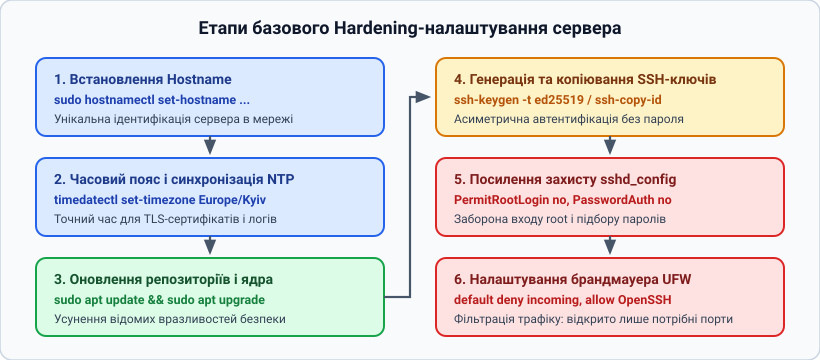
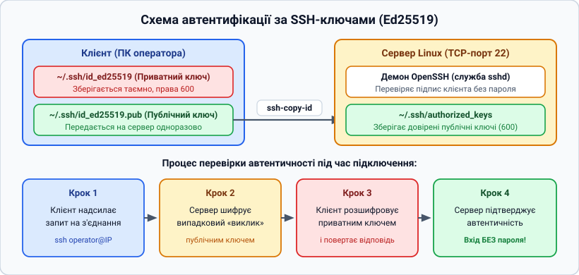

# Урок 30. Первинне налаштування сервера, віддалене керування через SSH

<div class="how-to">

**Як працювати з уроком**

1. Ознайомтеся з теоретичним матеріалом: базовим налаштуванням нового сервера (hostname, часовий пояс, NTP, оновлення), принципами протоколу SSH та автентифікацією за асиметричними ключами.
2. Виконайте покрокове практичне завдання: згенеруйте пару ключів Ed25519, скопіюйте публічний ключ на сервер, вимкніть парольний доступ у `sshd_config` та активуйте фаєрвол UFW.
3. Дайте відповіді на 10 запитань контрольного тесту для закріплення навичок адміністрування.

</div>

## Мета уроку

Оволодіти практичними стандартами початкового налаштування й посилення безпеки (hardening) нового сервера Linux, а також навчитися керувати системою віддалено за допомогою криптографічного протоколу SSH. На практиці ви:

- налаштуєте мережеве ім'я вузла (hostname), системний часовий пояс та синхронізацію точного часу (NTP);
- виконаєте повне оновлення програмних пакунків та закриєте вразливості безпеки;
- згенеруєте пару асиметричних криптографічних ключів сучасного алгоритму **Ed25519**;
- налаштуєте безпарольний вхід за ключем за допомогою утиліти `ssh-copy-id`;
- посилите захист демона **OpenSSH** у конфігураційному файлі `sshd_config`;
- налаштуєте правила міжмережевого екрана **UFW** для захисту сервера від несанкціонованого сканування.

## Що знадобиться

- Сервер під керуванням Linux (Debian або Ubuntu Server, налаштований у попередньому уроці) із працюючою службою OpenSSH.
- Клієнтський комп'ютер оператора під керуванням Linux, macOS або Windows 10/11 (із додатком Windows Terminal / PowerShell, де встановлено стандартний клієнт `ssh`).

## Теорія

Після завершення встановлення операційної системи сервер ще не готовий до запуску робочих додатків чи передачі в експлуатацію. Він перебуває в базовому стані: час може бути не синхронізований, ім'я хоста може конфліктувати в мережі, встановлені пакунки можуть містити виявлені за останні дні вразливості, а віддалений доступ за паролем є легкою здобиччю для автоматизованих ботнетів.

Комплекс дій з базового налаштування та закриття потенційних дірок безпеки системні адміністратори називають **Hardening** («загартовування» системи).

<div class="clip">



*Етапи базового Hardening-налаштування сервера*

</div>

### 1. Системний час та часовий пояс (Timezone & NTP)

Точний системний час — це один із найважливіших параметрів будь-якого сервера. Якщо годинник на сервері відхиляється навіть на кілька хвилин:
- перестають діяти або стають недійсними цифрові сертифікати безпеки (HTTPS / TLS);
- порушується аутентифікація в корпоративних доменах Kerberos / Active Directory;
- стає неможливим відновлення хронології подій у системних журналах (*logs*) під час розслідування кіберінцидентів;
- виникають збої в реплікації транзакцій баз даних.

Для керування системним часом у дистрибутивах із менеджером `systemd` використовується утиліта **`timedatectl`**, а фонову звірку з серверами точного часу забезпечує служба **`systemd-timesyncd`** (або сервіс **`chrony`**).

---

### 2. Протокол SSH (Secure Shell) та його архітектура

**SSH (Secure Shell)** — мережевий криптографічний протокол прикладного рівня, призначений для безпечного віддаленого керування операційною системою, передачі файлів (SFTP/SCP) та тунелювання TCP-портів. За замовчуванням служба слухає **TCP-порт 22**.

SSH замінив застарілі та небезпечні протоколи 80–90-х років (**Telnet**, **rlogin**), головним недоліком яких було передавання всього трафіку, включно з паролями адміністратора, відкритим текстом у незашифрованому вигляді, що дозволяло перехопити доступ простим прослуховуванням локальної мережі.

<div class="clip">



*Схема автентифікації за SSH-ключами (Ed25519)*

</div>

### 3. Асиметрична криптографія: Чому ключі надійніші за паролі?

Будь-який пароль, навіть складний, має кілька фундаментальних недоліків:
- користувачі можуть записати його на папірці або ввести на фішинговому терміналі;
- відкритий вхід за паролем піддається постійним атакам автоматичного перебору (**Brute-force attack**): тисячі ботів щосекунди надсилають на порт 22 комбінації логінів і паролів;
- пароль передається (хоч і всередині зашифрованого каналу) на сервер для звірки.

**Асиметрична аутентифікація використовує пару з двох ключів:**
1. **Приватний (закритий) ключ (`id_ed25519`):** генерується один раз на машині оператора, зберігається локально і **НІКОЛИ** не передається стороннім особам чи через мережу. Додатково він може бути зашифрований локальною кодовою фразою (*passphrase*).
2. **Публічний (відкритий) ключ (`id_ed25519.pub`):** математично пов'язаний із приватним ключем, проте вирахувати закритий ключ з відкритого практично неможливо. Публічний ключ розміщується на сервері у спеціальному файлі `~/.ssh/authorized_keys`.

#### Який алгоритм обрати?
- **Ed25519 (Edwards-curve Digital Signature Algorithm):** сучасний рекомендований стандарт. Забезпечує найвищий рівень стійкості, швидкість генерації та надзвичайно короткий розмір ключа (68 символів).
- **RSA:** класичний алгоритм. Сьогодні вважається безпечним лише за умови довжини ключа не менше **3072–4096 біт**. Застарілі ключі RSA 1024/2048 біт використовувати заборонено.

#### Суворі вимоги до прав доступу файлової системи (Permissions)
Служба OpenSSH захищена від недбалості оператора. Якщо права на каталог або файл ключів дозволяють читання іншим користувачам, сервер заблокує вхід:
- Каталог `~/.ssh`: права **`700`** (`drwx------` — доступ тільки власнику).
- Файл `~/.ssh/authorized_keys`: права **`600`** (`-rw-------` — читання й запис тільки власнику).
- Приватний ключ на клієнті `~/.ssh/id_ed25519`: права **`600`**.

---

### 4. Міжмережевий екран UFW (Uncomplicated Firewall)

Брандмауер — це перший бар'єр безпеки мережевої ОС. Він фільтрує вхідні та вихідні мережеві пакети за портами, IP-адресами та протоколами.

В Ubuntu та Debian для зручного керування підсистемою `iptables`/`nftables` використовується утиліта **UFW**:
- Головний принцип надійної безпеки: **«Заборонити все вхідне, дозволити лише чітко визначене»**.
- `sudo ufw default deny incoming` — блокує будь-які спроби несанкціонованого підключення ззовні.
- `sudo ufw default allow outgoing` — дозволяє серверу надсилати власні запити в інтернет (наприклад, завантажувати оновлення).
- `sudo ufw allow 22/tcp` (або `sudo ufw allow OpenSSH`) — відкриває доступ для віддаленого термінала.

<div class="more-link">

**Хочете знати більше?** <span class="optional">Необов’язково</span>
Для посилення захисту SSH у промислових середовищах застосовують додаткові практики:
- Встановлення утиліти **Fail2ban**: вона сканує системний журнал `auth.log` на наявність повторних помилок входу і автоматично вносить IP-адресу зловмисника в чорний список брандмауера на визначений час (наприклад, на 1 годину або добу).
- Зміна стандартного порту 22 на довільний нестандартний номер (наприклад, `49152` або `2222`), що відсікає 99% примітивних мережевих сканерів інтернету.
- Налаштування багатофакторної аутентифікації **MFA (Google Authenticator / PAM Duo)** для генерації одноразових 6-значних кодів під час кожного входу на сервер.

</div>

## Покроково

Практичне завдання: «Комплексне післяінсталяційне налаштування сервера та організація захищеного віддаленого підключення по SSH».

---

### 1. Налаштуйте системне ім'я, часовий пояс та оновіть пакети

Увійдіть у консоль вашого сервера (безпосередньо або через емулятор віртуальної машини) та виконайте базові системні налаштування:

```bash
# 1. Встановіть зрозуміле ім'я сервера
sudo hostnamectl set-hostname srv-cpto-node1

# 2. Встановіть часовий пояс України
sudo timedatectl set-timezone Europe/Kyiv

# 3. Перевірте статус синхронізації часу
timedatectl

# 4. Оновіть список джерел та встановлені пакети системи
sudo apt update && sudo apt upgrade -y
```

Переконайтеся, що у виведенні `timedatectl` зазначено:
- `Time zone: Europe/Kyiv (EEST/EET)`
- `NTP service: active`
- `System clock synchronized: yes`

### 2. Згенеруйте пару ключів Ed25519 на клієнтському комп'ютері

Перейдіть на ваш **робочий комп'ютер (клієнт)** — відкрийте термінал Linux/macOS або PowerShell у Windows:

```bash
ssh-keygen -t ed25519 -C "operator-cpto@study"
```

1. На запит шляху до файлу (`Enter file in which to save the key`): натисніть `Enter` (буде обрано стандартний шлях `~/.ssh/id_ed25519`).
2. На запит `Enter passphrase`: введіть надійний пароль для захисту приватного ключа (або натисніть `Enter` двічі для створення ключа без пароля під час навчання).
3. У результаті буде створено два файли:
   - `id_ed25519` — ваш таємний приватний ключ;
   - `id_ed25519.pub` — ваш публічний ключ.

### 3. Передайте публічний ключ на сервер

Використайте утиліту `ssh-copy-id`, вказавши ім'я користувача на сервері та IP-адресу сервера:

```bash
ssh-copy-id operator@192.168.1.150
```

*(Замініть `192.168.1.150` на реальну IP-адресу вашого сервера, визначену командою `ip -c a`).*

Утиліта підключиться до сервера, запитає пароль користувача `operator` у перший і останній раз та автоматично запише ключ у файл `~/.ssh/authorized_keys` із правильними дозволами доступу.

*(Примітка: якщо у Windows утиліта `ssh-copy-id` відсутня, ключ можна передати командою:*
`type $env:USERPROFILE\.ssh\id_ed25519.pub | ssh operator@192.168.1.150 "mkdir -p ~/.ssh && cat >> ~/.ssh/authorized_keys && chmod 700 ~/.ssh && chmod 600 ~/.ssh/authorized_keys"`).

### 4. Перевірте вхід за ключем

Підключіться до сервера з клієнтської машини:

```bash
ssh operator@192.168.1.150
```

Якщо все налаштовано вірно, вхід відбудеться миттєво без запиту системного пароля облікового запису!

### 5. Посиліть безпеку демона OpenSSH на сервері

Тепер, коли вхід за ключем гарантовано працює, необхідно заборонити вхід за звичайними паролями та заблокувати користувача root:

1. Відкрийте файл конфігурації (або створіть окремий конфігураційний файл у каталозі `sshd_config.d`):
   ```bash
   sudo nano /etc/ssh/sshd_config.d/hardening.conf
   ```
2. Додайте такі директиви безпеки:
   ```text
   # Заборона прямого входу під обліковим записом root
   PermitRootLogin no

   # Повна заборона автентифікації за паролем (тільки ключі!)
   PasswordAuthentication no

   # Заборона порожніх паролів
   PermitEmptyPasswords no
   ```
3. Збережіть файл (`Ctrl+O`, `Enter`) та вийдіть з редактора (`Ctrl+X`).
4. **Обов'язково** протестуйте конфігурацію на синтаксичні помилки перед перезавантаженням служби:
   ```bash
   sudo sshd -t
   ```
   *(Якщо команда нічого не вивела — помилок немає).*
5. Перезавантажте конфігурацію демона OpenSSH без розриву поточної сесії:
   ```bash
   sudo systemctl reload ssh
   ```

### 6. Налаштуйте та увімкніть міжмережевий екран UFW

<div class="try">

**Спробуйте самі**

На сервері виконайте послідовно команди налаштування брандмауера:

```bash
# 1. Встановіть політику за замовчуванням
sudo ufw default deny incoming
sudo ufw default allow outgoing

# 2. КРИТИЧНИЙ КРОК: дозвольте вхідний трафік для служби SSH
sudo ufw allow OpenSSH

# 3. Увімкніть брандмауер
sudo ufw enable
```

На запит `Command may disrupt existing ssh connections. Proceed with operation (y|n)?` натисніть **`y`** та натисніть `Enter`.

Перевірте підсумковий статус фаєрвола:

```bash
sudo ufw status verbose
```

<details>
<summary>Перевірити очікуваний результат і повний розв’язок</summary>

Приклад очікуваного виведення команди `sudo ufw status verbose`:

```text
Status: active
Logging: on (low)
Default: deny (incoming), allow (outgoing), disabled (routed)
New profiles: skip

To                         Action      From
--                         ------      ----
22/tcp (OpenSSH)           ALLOW IN    Anywhere                  
22/tcp (OpenSSH (v6))      ALLOW IN    Anywhere (v6)             
```

**Перевірка результату:**
1. Відкрийте нове вікно термінала на клієнтському ПК і спробуйте підключитися знову:
   ```bash
   ssh operator@192.168.1.150
   ```
   З'єднання встановлюється швидко та безпечно.
2. Спробуйте виконати підключення з іншого комп'ютера, де немає приватного ключа `id_ed25519`. Сервер повинен миттєво відповісти помилкою:
   `Permission denied (publickey).` — що свідчить про успішне блокування входу за паролем!
3. На сервері виконайте команду моніторингу активних користувачів:
   ```bash
   w
   ```
   У таблиці ви побачите своє підключення через віртуальний термінал (наприклад, `pts/0`), IP-адресу клієнта та час активності сесії.

</details>

</div>

## Підсумок

- Базовий **Hardening** сервера включає присвоєння унікального імені хоста, синхронізацію часу за протоколом **NTP** у зоні `Europe/Kyiv` та оновлення всіх пакунків безпеки.
- Протокол **SSH** шифрує весь мережевий трафік керування, забезпечуючи захист від перехоплення та підміни даних на стандартному порту **22**.
- Автентифікація за ключами **Ed25519** усуває загрозу підбору паролів (Brute-force): закритий ключ залишається на комп'ютері оператора, а відкритий розміщується у файлі `~/.ssh/authorized_keys`.
- Файл конфігурації `sshd_config` обов'язково захищають параметрами `PermitRootLogin no` та `PasswordAuthentication no`.
- Брандмауер **UFW** захищає сервер за принципом нульової довіри: блокує будь-які сторонні вхідні підключення, відкриваючи доступ виключно до дозволених сервісів.

## Тест

<div class="test-box">

10 запитань за матеріалом уроку. На початку тесту вкажіть **прізвище, ім’я та групу**.

🔗 <!-- GOOGLE_FORM_URL:lesson-30 --> *(Посилання на Google Форму буде додано після масового імпорту тесту)*

</div>

## Додаткове завдання

<span class="optional">Необов’язково</span> Завдання для закріплення навичок системного адміністрування.

**Базовий рівень.** Створіть на клієнтському комп'ютері файл `~/.ssh/config` та налаштуйте аліас (скорочення) для підключення до навчального сервера (задайте `Host lab`, вкажіть `HostName <IP>`, `User operator` та шлях до ключа). Переконайтеся, що тепер підключення викликається простою командою `ssh lab`.

**Проєктний рівень.** Встановіть на навчальний сервер утиліту **fail2ban** (`sudo apt install fail2ban -y`). Створіть конфігураційний файл `/etc/fail2ban/jail.local`, налаштуйте фільтрацію спроб підключення до служби SSH (параметри `maxretry = 3`, `bantime = 10m`) та перевірте стан захисту командою `sudo fail2ban-client status sshd`.
