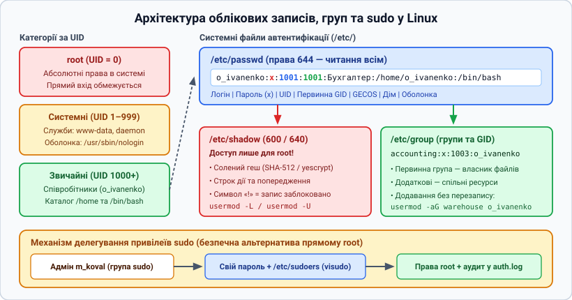

# Урок 31. Облікові записи користувачів і групи на сервері

<div class="how-to">

**Як працювати з уроком**

1. Ознайомтеся з теоретичною частиною: вивчіть структуру облікових записів у серверних ОС Linux, призначення конфігураційних файлів `/etc/passwd`, `/etc/shadow`, `/etc/group` та механізм делегування повноважень `sudo`.
2. Виконайте покрокове практичне завдання на сервері: створіть групи відділів підприємства, налаштуйте користувачів із визначеними оболонками та домашніми каталогами, призначте додаткові групи та перевірте права доступу.
3. Пройдіть підсумковий контрольний тест на 10 запитань наприкінці уроку.

</div>

## Мета уроку

Засвоїти принципи організації багатокористувацького середовища на базі серверних операційних систем, навчитися адмініструвати облікові записи та групи відповідно до принципу найменших привілеїв. На практиці ви:

- створите нові системні групи для підрозділів підприємства;
- створите та налаштуєте облікові записи користувачів за допомогою утиліт `useradd`, `passwd` та `usermod`;
- налаштуєте членство в первинних і додаткових групах;
- перевірите інформацію про користувачів у системних файлах та протестуєте доступ до привілеїв суперкористувача через `sudo`.

## Що знадобиться

- Сервер або віртуальна машина під керуванням серверної ОС **Linux (Ubuntu Server 22.04/24.04 LTS або Debian 11/12)**.
- Термінальний клієнт (локальна консоль або підключення через SSH).
- Обліковий запис із правами адміністратора (`sudo`).

## Теорія

Сучасні серверні операційні системи є багатокористувацькими та багатозадачними. Це означає, що десятки або сотні користувачів, а також мережеві служби можуть одночасно виконувати процеси на одному сервері, не заважаючи одне одному. Для гарантування інформаційної безпеки кожен процес у системі обов'язково виконується від імені конкретного **облікового запису** (*User Account*), а права доступу до файлів, портів і системних ресурсів суворо розмежовуються.

### Класифікація облікових записів у Linux

В операційних системах сімейства Linux користувачі ідентифікуються не лише текстовим логіном, а й унікальним числовим ідентифікатором — **UID (*User Identifier*)**. За призначенням облікові записи поділяються на три основні категорії:

| Категорія | Діапазон UID (Debian/Ubuntu) | Призначення та особливості |
| :--- | :--- | :--- |
| **Суперкористувач (root)** | `0` | Має абсолютні повноваження в системі. Може читати, змінювати та видаляти будь-які файли, зупиняти системні процеси, налаштовувати ядро та мережу. Вхід під root напряму зазвичай блокується з міркувань безпеки. |
| **Системні (службові) користувачі** | `1 – 999` | Створюються автоматично під час встановлення ОС або серверних пакетів (`daemon`, `www-data`, `bind`, `nobody`). Вони запускають фонові демони й сервіси з обмеженими правами. Не мають права інтерактивного входу (оболонка `/usr/sbin/nologin` або `/bin/false`). |
| **Звичайні користувачі** | `1000 – 60000+` | Облікові записи реальних людей (співробітників компанії, операторів, системних адміністраторів). Мають власний домашній каталог (`/home/username`) і права на роботу лише зі своїми файлами та загальнодоступними ресурсами. |

### Базові системні файли автентифікації

Вся інформація про користувачів, їхні паролі та групи зберігається у текстових конфігураційних файлах каталогу `/etc/`:

#### 1. Файл `/etc/passwd`
Містить базові відомості про всі облікові записи в системі. Цей файл доступний для читання всім користувачам (`644`), оскільки системним утилітам (наприклад, `ls -l`) потрібно перетворювати числові UID у зрозумілі текстові імена. Кожен рядок описує одного користувача та містить 7 полів, розділених двокрапкою:

```text
o_ivanenko:x:1001:1001:Бухгалтер Іваненко О.В.,Каб. 204,,:/home/o_ivanenko:/bin/bash
```

1. **`o_ivanenko`** — логін користувача (ім'я входу);
2. **`x`** — позначка пароля (символ `x` вказує, що зашифрований пароль перенесено в безпечний файл `/etc/shadow`);
3. **`1001`** — числовий ідентифікатор користувача (UID);
4. **`1001`** — числовий ідентифікатор основної групи (GID);
5. **`Бухгалтер Іваненко О.В.,...`** — коментар GECOS (повне ім'я, номер кабінету, службовий телефон);
6. **`/home/o_ivanenko`** — шлях до домашнього каталогу;
7. **`/bin/bash`** — командна оболонка за замовчуванням (shell). Якщо вказано `/usr/sbin/nologin`, користувач не зможе відкрити термінал.

#### 2. Файл `/etc/shadow`
Зберігає захищені геш-суми паролів користувачів та параметри терміну їхньої дії. Цей файл критично захищений: права доступу дозволяють читання лише користувачу `root` (`права 640 або 600`). У ньому зберігаються:
- геш пароля із застосуванням криптографічної солі (зазвичай алгоритми SHA-512 або yescrypt);
- дата останньої зміни пароля;
- мінімальний і максимальний термін дії пароля у днях;
- період попередження користувача про необхідність зміни пароля до його блокування.

#### 3. Файли `/etc/group` та `/etc/gshadow`
Файл `/etc/group` описує групи користувачів:
```text
accounting:x:1005:o_ivanenko,m_koval
```
Поля: ім'я групи, позначка пароля (`x`), числовий GID та список додаткових користувачів через кому.

### Первинні та додаткові групи

Кожен користувач в Linux обов'язково належить щонайменше до однієї **первинної (основної) групи** (*Primary Group*). Коли користувач створює новий файл чи каталог, цей об'єкт автоматично отримує групового власника, що відповідає поточній первинній групі.

Крім того, користувач може належати до будь-якої кількості **додаткових (вторинних) груп** (*Supplementary / Secondary Groups*). Додаткові групи використовуються для надання доступу до спільних проєктів, файлів інших підрозділів або системних привілеїв (наприклад, доступ до сканерів `scanner`, спільних мережевих дисків або запуск віртуальних машин `kvm`).

### Керування привілеями: механізм sudo

У повсякденній роботі адміністратора прямий вхід під суперкористувачем `root` категорично заборонений корпоративними стандартами безпеки. Якщо оператор допустить помилку в команді під обліковим записом `root` (наприклад, помилковий пробіл у команді `rm -rf / dir`), система буде знищена без попередження. Крім того, прямі дії `root` неможливо прив'язати до конкретної посадової особи в журналах аудиту.

Замість цього застосовується утиліта **`sudo` (*SuperUser DO*)**. Вона дозволяє призначеним користувачам виконувати окремі адміністративні команди від імені `root`, вводячи **власний** пароль.
- Усі дії під `sudo` протоколюються в системному журналі `/var/log/auth.log` (або `journalctl -u sudo`).
- У дистрибутивах Ubuntu / Debian для надання адміністративних прав достатньо включити користувача до системної групи **`sudo`**.
- Головний файл налаштувань — `/etc/sudoers`. Його редагування дозволяється **виключно через спеціалізовану утиліту `visudo`**, яка перевіряє синтаксис перед збереженням і захищає систему від випадкового блокування.

<div class="clip">



*Рис. Архітектура облікових записів, груп та sudo у Linux*

</div>

<div class="more-link">

**Хочете знати більше?** <span class="optional">Необов’язково</span>

У великих корпоративних мережах сотні серверів і тисячі робочих станцій не налаштовують локальними файлами `/etc/passwd`. Замість цього розгортають **централізовані служби каталогів**:
- **Active Directory (AD)** на базі протоколів Kerberos та LDAP у середовищі Windows Server;
- **FreeIPA** або **OpenLDAP** у корпоративному середовищі Linux.

Завдяки цьому співробітник має єдиний логін і пароль (**SSO — Single Sign-On**) для входу на будь-який сервер, комп'ютер чи файлове сховище організації, а системний адміністратор керує доступом централізовано з одного пульта.

</div>

## Покроково

Розглянемо практичну ситуацію: оператор з обробки інформації отримав завдання підготувати сервер для роботи бухгалтерії та служби ІТ-підтримки підприємства: створити групи підрозділів, завести облікові записи співробітників, задати безпечні оболонки та делегувати привілеї.

### 1. Перевірка власного ідентифікатора та перегляд груп

Перш ніж створювати нові записи, перевірте, під яким обліковим записом ви працюєте, та перегляньте системні файли:

```bash
whoami
id
```

Знайдіть у системі відомості про суперкористувача та поточного користувача:

```bash
grep -E '^root|^'$(whoami) /etc/passwd
```

### 2. Створення груп підрозділів підприємства

Для розмежування доступу до файлів відділу створено групи: `accounting` (бухгалтерія) та `it-support` (технічна підтримка). Використайте команду `groupadd`:

```bash
sudo groupadd accounting
sudo groupadd it-support
```

Перевірте, які GID було автоматично присвоєно створеним групам:

```bash
tail -n 2 /etc/group
```

### 3. Створення облікового запису користувача за допомогою useradd

Створимо обліковий запис для бухгалтера `o_ivanenko`. Команда повинна автоматично створити домашній каталог (`-m`), призначити командну оболонку bash (`-s /bin/bash`), задати службовий коментар (`-c`) та додати співробітника до додаткової групи `accounting` (`-G`):

```bash
sudo useradd -m -s /bin/bash -c "Бухгалтер Іваненко О.В." -G accounting o_ivanenko
```

Встановіть початковий пароль для користувача (під час введення пароль не відображається на екрані):

```bash
sudo passwd o_ivanenko
```

### 4. Створення облікового запису системного адміністратора та налаштування sudo

Створимо обліковий запис для співробітника відділу підтримки `m_koval`, який повинен мати право адміністрування сервера. Додамо його одразу до груп `it-support` та системної адміністративної групи `sudo`:

```bash
sudo useradd -m -s /bin/bash -c "Адміністратор Коваль М.П." -G it-support,sudo m_koval
sudo passwd m_koval
```

### 5. Перевірка призначених ідентифікаторів та груп

Переконайтеся, що облікові записи створені коректно, а групи прив'язані правильно:

```bash
id o_ivanenko
id m_koval
```

Команда `id o_ivanenko` виведе рядок виду:
`uid=1001(o_ivanenko) gid=1001(o_ivanenko) groups=1001(o_ivanenko),1003(accounting)`

Зверніть увагу: первинна група була створена автоматично з тим самим іменем, що й логін (механізм *User Private Groups*), а група `accounting` стала додатковою.

### 6. Модифікація облікового запису та блокування

Якщо співробітника `o_ivanenko` призначено додатково відповідальним за складські програми, його можна додати до ще однієї групи без перезапису наявних за допомогою прапорця `-aG` (*append to groups*):

```bash
sudo groupadd warehouse
sudo usermod -aG warehouse o_ivanenko
id o_ivanenko
```

<div class="try">

**Спробуйте самі**

Ситуація з безпеки: співробітник `o_ivanenko` йде у відпустку, і його обліковий запис необхідно тимчасово заблокувати, щоб унеможливити авторизацію на сервері. Після повернення запис слід розблокувати.
1. Заблокуйте обліковий запис за допомогою команди `usermod -L`.
2. Перевірте у файлі `/etc/shadow`, який символ з'явився на початку гешу пароля.
3. Розблокуйте обліковий запис командою `usermod -U` та переконайтеся у знятті блокування.

<details>
<summary>Перевірити очікуваний результат і повний розв’язок</summary>

Команди для тимчасового блокування та розблокування облікового запису:

```bash
# 1. Тимчасове блокування користувача
sudo usermod -L o_ivanenko

# 2. Перевірка стану гешу пароля в /etc/shadow
sudo grep o_ivanenko /etc/shadow
```

Очікуваний результат: на початку поля гешу пароля з'явиться знак оклику `!`:
`o_ivanenko:!$y$j9T$...:19800:0:99999:7:::`
Наявність знака оклику робить геш недійсним, тому жоден введений пароль не співпаде, і авторизація буде відхилена.

```bash
# 3. Розблокування облікового запису після відпустки
sudo usermod -U o_ivanenko

# Перевірка зняття блокування (знак '!' зник)
sudo grep o_ivanenko /etc/shadow
```

</details>

</div>

## Підсумок

- Користувачі в Linux ідентифікуються числовим **UID**, а групи — **GID**. Суперкористувач `root` завжди має `UID=0`.
- Облікові записи та їхні параметри описуються у файлі `/etc/passwd`, геші паролів надійно захищені у `/etc/shadow`, а список груп — у `/etc/group`.
- Для створення та налаштування користувачів застосовуються утиліти `useradd`, `passwd` та `usermod`. Додавати нові групи до наявних слід строго з прапорцем `-aG`.
- Робота під обліковим записом `root` замінюється використанням механізму **`sudo`**, що підвищує безпеку сервера та фіксує дії кожного адміністратора в журналі аудиту.

## Тест

<div class="test-box">

10 запитань за матеріалом уроку. На початку тесту вкажіть **прізвище, ім’я та групу**.

<!-- GOOGLE_FORM_START:lesson-31 -->
[Відкрити тест у новій вкладці](https://docs.google.com/forms/d/e/1FAIpQLSf-wInrbrccGsGWsyxiTH0Qc22I0Ekx-pKai0PtTuplPAGPtg/viewform)

<iframe src="https://docs.google.com/forms/d/e/1FAIpQLSf-wInrbrccGsGWsyxiTH0Qc22I0Ekx-pKai0PtTuplPAGPtg/viewform?embedded=true" loading="lazy" title="Тест lesson-31">Завантаження…</iframe>
<!-- GOOGLE_FORM_END:lesson-31 -->

</div>

## Додаткове завдання

<span class="optional">Необов’язково</span> Виконуйте для закріплення навичок адміністрування облікових записів.

**Базовий рівень.** Створіть обліковий запис для стажера `intern_student` без права створення домашнього каталогу та з призначеною оболонкою `/usr/sbin/nologin`. Спробуйте перемкнутися на цього користувача за допомогою `su - intern_student` і поясніть поведінку системи.

**Проєктний рівень.** Дослідіть параметри утиліти `chage` для керування політикою безпеки паролів. Встановіть для користувача `o_ivanenko` вимогу обов'язкової зміни пароля кожні 90 днів із попередженням за 7 днів до закінчення терміну дії. Перевірте встановлену політику командою `chage -l o_ivanenko`.
