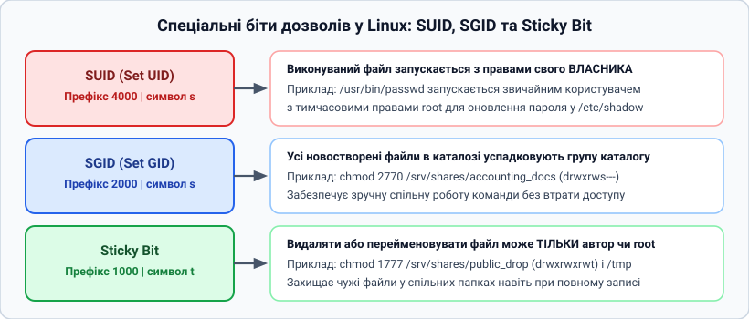

# Урок 32. Дискові квоти та права доступу

<div class="how-to">

**Як працювати з уроком**

1. Ознайомтеся з теоретичним матеріалом: вивчіть традиційну модель прав доступу UGO, дію спеціальних бітів (SUID, SGID, Sticky Bit), можливості розширених списків доступу (POSIX ACL) та принципи квотування дискового простору.
2. Виконайте покрокове практичне завдання: створіть спільний каталог для відділу із закріпленням групового власника, налаштуйте безпечну папку обміну зі Sticky Bit, надайте персоналізований доступ через ACL та обмежте використання дискового простору квотами.
3. Дайте відповіді на 10 запитань підсумкового тесту наприкінці сторінки.

</div>

## Мета уроку

Опанувати багаторівневу систему розмежування прав доступу до файлових ресурсів сервера та навчитися контролювати використання дискової підсистеми для запобігання відмовам у роботі операційної системи. На практиці ви:

- навчитеся обчислювати та встановлювати числові й символьні права доступу за моделлю UGO;
- налаштуєте каталог спільної роботи зі спеціальними бітами SGID та Sticky Bit;
- налаштуєте вибіркові дозволи для окремих користувачів за допомогою списків контролю доступу (ACL);
- розрахуєте та активуєте дискові квоти (soft та hard limits) для облікових записів співробітників.

## Що знадобиться

- Сервер або віртуальна машина з операційною системою **Linux (Ubuntu Server або Debian)**.
- Доступ до термінала з правами адміністратора (`sudo`).
- Встановлені системні пакети `acl` та `quota`.

## Теорія

<div class="clip">


*Концепція хмарних обчислень<sup>[1]</sup>*

</div>

На сервері, де одночасно працюють десятки додатків і сотні користувачів, безпека даних залежить від двох ключових факторів: **хто має право читати чи змінювати файл** (права доступу) та **скільки місця на накопичувачі користувач може зайняти** (дискові квоти). Помилка в правах доступу веде до витоку конфіденційної інформації, а відсутність квот може спричинити повну зупинку сервера через переповнення системного розділу.

### Класична модель прав UNIX (UGO)

У файлових системах Linux кожен файл або каталог має двох закріплених власників: **користувача-власника (*User/Owner*)** та **групу-власника (*Group*)**. Усі інші облікові записи в системі називаються **іншими (*Others*)**. Звідси походить скорочення **UGO**.

Для кожної з цих трьох категорій суб'єктів визначаються три базові операції:

| Право | Символ | Числове значення | Дія над звичайним файлом | Дія над каталогом (директорією) |
| :---: | :---: | :---: | :--- | :--- |
| **Читання** (*Read*) | `r` | **4** | Дозволяє переглядати вміст файлу | Дозволяє переглядати список файлів у каталозі (`ls`) |
| **Запис** (*Write*) | `w` | **2** | Дозволяє змінювати та дописувати вміст файлу | Дозволяє створювати, перейменовувати та видаляти файли в каталозі |
| **Виконання** (*Execute*) | `x` | **1** | Дозволяє запускати файл як програму або скрипт | Дозволяє увійти в каталог (`cd`) та отримати доступ до його підкаталогів |

Права доступу записуються дев'ятьма символами, розбитими на трійки (наприклад, `-rwxr-xr--`):
- перша трійка (`rwx`) — права користувача-власника (**u**);
- друга трійка (`r-x`) — права групи-власника (**g**);
- третя трійка (`r--`) — права решти користувачів системи (**o**).

Для зміни прав використовується утиліта **`chmod`**, а для зміни власників — **`chown`** та **`chgrp`**:
- `chmod 750 document.pdf` (встановлює `rwxr-x---`: повний доступ власнику, читання й запуск групі, решті заборонено);
- `chown o_ivanenko:accounting document.pdf` (призначає власником `o_ivanenko`, а групою — `accounting`).

### Спеціальні біти дозволів: SUID, SGID та Sticky Bit

Класичної трійки `rwx` часто недостатньо для корпоративних серверних завдань. Для цього існують спеціальні біти:

<div class="clip">



*Спеціальні біти дозволів у Linux: SUID, SGID та Sticky Bit*

</div>

Для спільних папок робочих груп ідеальною є комбінація **`chmod 2770 /шлях`** (SGID + повний доступ для власника й групи, іншим доступ закритий).

### Розширені списки контролю доступу (POSIX ACL)

Що робити, якщо до каталогу бухгалтерії потрібно дати доступ на читання аудитору, який не належить до групи `accounting`? Якщо відкрити доступ іншим (`Others`), файл зможуть читати всі користувачі сервера.

Для вирішення цієї проблеми призначені списки **ACL (*Access Control Lists*)**:
- **`getfacl filename`** — перегляд поточного розширеного списку прав;
- **`setfacl -m u:auditor:rx filename`** — надання користувачу `auditor` прав на читання та виконання;
- **`setfacl -m g:auditors:r filename`** — надання прав усій зовнішній групі;
- **`setfacl -b filename`** — скидання всіх спеціальних правил ACL.

Коли файл має додаткові правила ACL, у кінці рядка дозволів команди `ls -l` з'являється символ плюса (наприклад, `drwxrwx---+`).

### Дискові квоти: контроль обсягу накопичувачів

**Дискова квота** — це встановлене адміністратором обмеження на максимальний обсяг дискового простору або кількість файлів, які може створити конкретний користувач чи група на даній файловій системі.

Квоти поділяються на два типи:
1. **За обсягом пам'яті (Blocks)** — ліміт на зайняті мегабайти/гігабайти на диску.
2. **За кількістю файлів (Inodes)** — ліміт на кількість створених записів і файлів (захищає диск від вичерпання таблиці інодів багатьма дрібними файлами).

Параметри обмеження:
- **М'яке обмеження (*Soft Limit*)** — поріг, при досягненні якого система виводить попередження користувачеві, але ще дозволяє записувати файли;
- **Пільговий період (*Grace Period*)** — час (за замовчуванням 7 днів), протягом якого користувач після перевищення Soft Limit повинен видалити зайві файли;
- **Жорстке обмеження (*Hard Limit*)** — абсолютна стеля. При досягненні цього ліміту запис на диск миттєво блокується операційною системою з помилкою `Disk quota exceeded`.

<div class="more-link">

**Хочете знати більше?** <span class="optional">Необов’язково</span>

У сучасних промислових файлових системах **XFS** та **ZFS** традиційні утиліти `quota` замінено нативними інструментами ядра.
Наприклад, у системі **ZFS** квотування налаштовується однією миттєвою командою без перезавантаження сервера та окремої перевірки файлової структури:
`zfs set userquota@o_ivanenko=15G tank/home`
А у файловій системі **XFS** використовуються проєктні квоти (*Project Quotas*), які дозволяють обмежити розмір окремого каталогу незалежно від того, які саме користувачі записують у нього файли.

</div>

## Покроково

Розглянемо практичну роботу: системний оператор має створити корпоративне сховище документів для бухгалтерії зі спільним доступом, організувати загальну «скриньку» для обміну файлами, надати вибіркові права зовнішньому аудитору через ACL та встановити дискові обмеження для користувача.

### 1. Підготовка робочих каталогів

Створіть на сервері два каталоги для спільної роботи:

```bash
sudo mkdir -p /srv/shares/accounting_docs
sudo mkdir -p /srv/shares/public_drop
```

### 2. Налаштування спільної папки підрозділу з бітом SGID

Каталог `accounting_docs` призначений для спільної роботи бухгалтерії. Призначте груповим власником групу `accounting`, а права встановіть у значення `2770` (де цифра 2 вмикає біт SGID):

```bash
# Призначення власника та групи
sudo chown root:accounting /srv/shares/accounting_docs

# Встановлення прав rwxrws--- (2770)
sudo chmod 2770 /srv/shares/accounting_docs

# Перевірка налаштування
ls -ld /srv/shares/accounting_docs
```

Результат виведе: `drwxrws--- 2 root accounting ...`. Символ `s` у позиції виконання для групи означає, що відтепер будь-який файл, створений користувачем `o_ivanenko`, автоматично отримає групу-власника `accounting`, і всі колеги зможуть із ним працювати.

### 3. Налаштування загальної папки обміну зі Sticky Bit

Каталог `public_drop` має бути доступний для запису всім користувачам підприємства, але співробітники не повинні мати можливості видалити чи пошкодити чужі файли. Для цього встановлюють права `1777` (де цифра 1 вмикає Sticky Bit):

```bash
sudo chmod 1777 /srv/shares/public_drop
ls -ld /srv/shares/public_drop
```

Результат виведе: `drwxrwxrwt 2 root root ...`. Символ `t` наприкінці вказує на активний Sticky Bit (аналогічно до системного каталогу `/tmp`).

### 4. Надання персонального доступу аудитору за допомогою POSIX ACL

Створимо обліковий запис аудитора `auditor_petrenko`. Він не повинен входити до групи `accounting`, але зобов'язаний мати доступ на перегляд та читання документів у `/srv/shares/accounting_docs`:

```bash
sudo useradd -m -s /bin/bash auditor_petrenko
sudo passwd auditor_petrenko
```

Встановіть спеціальне правило доступу через `setfacl`:

```bash
sudo setfacl -m u:auditor_petrenko:rx /srv/shares/accounting_docs
```

Перевірте встановлені правила за допомогою команди `getfacl`:

```bash
getfacl /srv/shares/accounting_docs
```

Вивід покаже:
```text
# file: srv/shares/accounting_docs
# owner: root
# group: accounting
# flags: -s-
user::rwx
user:auditor_petrenko:r-x
group::rwx
mask::rwx
other::---
```

Тепер аудитор має доступ лише на читання, група `accounting` — повний доступ, а для решти користувачів каталог повністю закритий.

### 5. Налаштування та моніторинг дискових квот

Встановимо квоту для користувача `o_ivanenko` за допомогою утиліти `setquota`. Задамо м'яке обмеження 50 МБ (51200 КБ) та жорстке обмеження 60 МБ (61440 КБ):

```bash
# Встановлення дискової квоти: soft_block hard_block soft_inode hard_inode
sudo setquota -u o_ivanenko 51200 61440 0 0 /home

# Перевірка встановленої квоти для користувача
sudo quota -vs o_ivanenko
```

Зведена таблиця використання дискового простору всіма користувачами генерується командою:

```bash
sudo repquota -as
```

<div class="try">

**Спробуйте самі**

Перевірте дію встановленого біта **Sticky Bit** у каталозі `/srv/shares/public_drop`:
1. Увійдіть під користувачем `o_ivanenko` та створіть файл `report_ivanenko.txt`.
2. Увійдіть під користувачем `auditor_petrenko` та спробуйте видалити створений чужий файл `rm /srv/shares/public_drop/report_ivanenko.txt`.
3. Зафіксуйте повідомлення операційної системи та поясніть причину відхилення операції.

<details>
<summary>Перевірити очікуваний результат і повний розв’язок</summary>

Послідовність команд для перевірки:

```bash
# 1. Створення файлу від імені o_ivanenko
sudo -u o_ivanenko touch /srv/shares/public_drop/report_ivanenko.txt
ls -l /srv/shares/public_drop/report_ivanenko.txt

# 2. Спроба видалення файлу користувачем auditor_petrenko
sudo -u auditor_petrenko rm /srv/shares/public_drop/report_ivanenko.txt
```

Очікуваний результат:
Команда завершиться помилкою:
`rm: cannot remove '/srv/shares/public_drop/report_ivanenko.txt': Operation not permitted`

Пояснення: Завдяки встановленому біту **Sticky Bit (`+t`)** право запису в каталог дозволяє додавати нові файли всім користувачам, проте видаляти або перейменовувати наявний файл дозволено **виключно його автору (користувачу-власнику)** або адміністратору `root`.

</details>

</div>

## Підсумок

- Класична модель прав Linux регулює доступ для трьох категорій суб'єктів (**User, Group, Others**) за трьома базовими дозволами (**Read — 4, Write — 2, Execute — 1**).
- Спеціальний біт **SGID (`2000`)** на каталозі забезпечує автоматичне успадкування групового власника для всіх новостворених файлів, що спрощує командну роботу.
- Спеціальний біт **Sticky Bit (`1000`)** на каталогах із загальним доступом (`/tmp`, публічні сховища) захищає файли від видалення чужими користувачами.
- Механізм **POSIX ACL (`setfacl`, `getfacl`)** знімає обмеження моделі UGO, дозволяючи призначати персоналізовані права довільній кількості окремих користувачів і груп.
- **Дискові квоти** обмежують займаний обсяг (блоки) та кількість файлів (іноди), а поділ на **Soft Limit** та **Hard Limit** запобігає переповненню дискового простору сервера.

## Тест

<div class="test-box">

10 запитань за матеріалом уроку. На початку тесту вкажіть **прізвище, ім’я та групу**.

🔗 <!-- GOOGLE_FORM_URL:lesson-32 --> *(Посилання на Google Форму буде додано після масового імпорту тесту)*

</div>

## Додаткове завдання

<span class="optional">Необов’язково</span> Виконуйте для поглиблення знань про права доступу та квоти.

**Базовий рівень.** Переведіть символьні права доступу `rwxr-x---`, `rw-rw-r--`, `rwxrwxrwt` у відповідні числові (восьмеричні) значення. Які права відповідають числовому значенню `640`?

**Проєктний рівень.** Дослідіть налаштування успадкування розширених прав ACL за замовчуванням (*Default ACL*). Налаштуйте для каталогу `/srv/shares/accounting_docs` правило за замовчуванням, щоб будь-який новостворений у ньому підкаталог чи файл автоматично отримував право читання для користувача `auditor_petrenko` без повторного виконання команди `setfacl`.

## Джерела

1. [Cloud_computing.svg](https://commons.wikimedia.org/wiki/File:Cloud_computing.svg), Wikimedia Commons.
