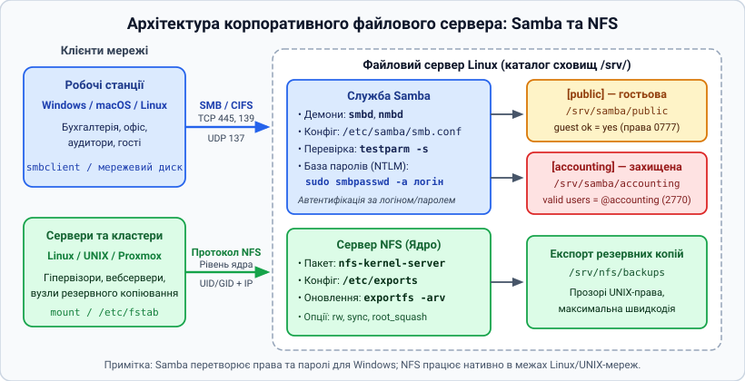

# Урок 33. Файловий сервер (Samba, NFS)

<div class="how-to">

**Як працювати з уроком**

1. Ознайомтеся з теоретичною частиною: з'ясуйте призначення мережевих файлових служб, архітектуру та протоколи Samba (SMB/CIFS) для взаємодії з Windows-клієнтами та NFS для прямого обміну даними між системами Linux/Unix.
2. Виконайте покрокове завдання: розгорніть сервер Samba, налаштуйте публічний і захищений доступ до каталогів, створіть користувачів у базі Samba та сконфігуруйте мережевий експорт NFS.
3. Дайте відповіді на 10 запитань підсумкового тесту наприкінці сторінки.

</div>

## Мета уроку

Опанувати технології розгортання та адміністрування корпоративних файлових сховищ для забезпечення спільної роботи користувачів гетерогенних мереж (Windows та Linux). На практиці ви:

- встановите та налаштуєте файлову службу **Samba**;
- організуєте загальнодоступний мережевий ресурс (гостьова папка) та захищений розділ для підрозділу з автентифікацією;
- навчитеся керувати базою користувачів Samba за допомогою утиліти `smbpasswd`;
- перевірите коректність синтаксису конфігурації утилітою `testparm` та протестуєте з'єднання через `smbclient`;
- налаштуєте мережевий експорт каталогу через протокол **NFS** для серверів резервного копіювання.

## Що знадобиться

- Сервер або віртуальна машина з операційною системою **Linux (Ubuntu Server або Debian)**.
- Термінальний доступ із правами `sudo`.
- Мережевий доступ до сервера (IP-адреса локальної мережі).
- Встановлені пакети `samba`, `smbclient`, `nfs-kernel-server`.

## Теорія

У будь-якій організації виникає потреба у спільному використанні файлів: бухгалтерія працює з однією базою первинних документів, дизайнери та верстальники обмінюються макетами, а оператори вивантажують щоденні звіти. Передавати файли на флешках чи через месенджери небезпечно та незручно. Основним рішенням є створення **файлового сервера** (*File Server*) — централізованого мережевого сховища з чітким розмежуванням прав доступу.

У корпоративних мережах використовуються два головні стандарти:
1. **SMB/CIFS (Samba)** — універсальний стандарт для мереж із робочими станціями під керуванням ОС Windows, macOS та Linux.
2. **NFS (Network File System)** — високоефективний рідний протокол для взаємодії між серверами та робочими станціями сімейства Unix/Linux.

### Служба Samba та протокол SMB/CIFS

**Samba** — це комплекс вільного програмного забезпечення, що реалізує мережевий протокол **SMB (*Server Message Block*)** / **CIFS (*Common Internet File System*)**. Завдяки Samba сервер під керуванням Linux розпізнається комп'ютерами з Windows як рідний файловий сервер Windows Server і відображається в мережевому оточенні (*Network Neighborhood*).

#### Демони служби Samba:
- **`smbd`** — забезпечує безпосередній файловий доступ, автентифікацію користувачів, спільне використання принтерів і блокування файлів під час спільного редагування (порти 139 NetBIOS та 445 TCP direct SMB).
- **`nmbd`** — відповідає за розпізнавання імен NetBIOS, роботу списків комп'ютерів у мережі та WINS-запити (порт 137 UDP).

#### Конфігурація: файл `/etc/samba/smb.conf`
Файл конфігурації має секційну структуру у форматі `ini`:
1. Секція **`[global]`** — загальні параметри сервера:
   - `workgroup = WORKGROUP` — назва робочої групи;
   - `server string = File Server` — опис комп'ютера в мережі;
   - `security = user` — автентифікація на рівні користувача.
2. Секції спільних ресурсів (наприклад, **`[public]`**, **`[accounting]`**):
   - `path = /srv/samba/share` — абсолютний шлях до каталогу на диску;
   - `browseable = yes` — видимість ресурсу в списку мережевого оточення;
   - `read only = no` (або `writable = yes`) — дозвіл на запис файлів;
   - `guest ok = yes` — доступ без пароля (гостьовий режим);
   - `valid users = o_ivanenko, @accounting` — список дозволених користувачів та груп (групи позначаються символом `@`);
   - `create mask = 0664` та `directory mask = 0775` — маски прав, які автоматично встановлюються на нові файли та каталоги.

#### База облікових записів Samba
Сервер Samba використовує власний криптографічний механізм збереження паролів (геші NTLM), несумісний із системним файлом `/etc/shadow`. Тому користувачеві необхідно встановити окремий пароль для Samba:
- користувач обов'язково повинен попередньо існувати в системі Linux (`/etc/passwd`);
- пароль Samba встановлюється адміністратором за допомогою команди:
  `sudo smbpasswd -a o_ivanenko`

### Мережева файлова система NFS

**NFS (*Network File System*)** — мережевий протокол, розроблений компанією Sun Microsystems, що дозволяє клієнтським комп'ютерам прозоро монтувати віддалені каталоги сервера у власну файлову систему так, ніби це локальний диск.

#### Особливості NFS:
- **Мінімальні накладні витрати та максимальна швидкість** — на відміну від Samba, NFS інтегрований безпосередньо в ядро Linux (*Kernel-space server*).
- **Прозорість прав UNIX** — зберігає рідні права доступу UGO, числові UID та GID без складної трансляції протоколів.
- **Стандарт для кластерів і серверів** — використовується для підключення сховищ гіпервізорів (Proxmox, KVM), каталогів резервного копіювання та вебсерверів.

#### Налаштування NFS: файл `/etc/exports`
Кожен рядок файлу визначає експортований каталог, IP-адресу клієнта та набір параметрів:
```text
/srv/nfs/backups 192.168.1.0/24(rw,sync,no_subtree_check,root_squash)
```
- **`rw`** — права на читання та запис (`ro` — лише читання);
- **`sync`** — підтвердження запису надсилається лише після фактичного збереження даних на диск (забезпечує надійність);
- **`no_subtree_check`** — вимикає перевірку піддерев, що підвищує стабільність передачі файлів;
- **`root_squash`** — важлива функція безпеки: перетворює запити від імені клієнтського користувача `root` на безпечного анонімного користувача `nobody`.

### Порівняння Samba та NFS

| Характеристика | Samba (SMB/CIFS) | NFS (Network File System) |
| :--- | :--- | :--- |
| **Основні клієнти** | Windows, macOS, Linux | Linux, UNIX, гіпервізори |
| **Автентифікація** | Логін та пароль (база Samba, Active Directory) | За IP-адресами клієнтів або протоколом Kerberos |
| **Складність налаштування** | Середня (багато директив у smb.conf) | Дуже проста (один файл /etc/exports) |
| **Швидкодія на Linux** | Добра | Максимальна (нативний рівень ядра) |
| **Призначення в організації** | Спільні документи співробітників, папки відділів | Серверні бекапи, спільні сховища віртуалізації |

<div class="clip">



*Рис. Архітектура корпоративного файлового сервера: Samba та NFS*

</div>

<div class="more-link">

**Хочете знати більше?** <span class="optional">Необов’язково</span>

У сучасних дата-центрах замість ручного налаштування файлових серверів часто встановлюють спеціалізовані операційні системи для мережевих сховищ (**NAS — Network Attached Storage**), такі як **TrueNAS** або **OpenMediaVault**. Вони пропонують зручний веб-інтерфейс, підтримують сучасну файлову систему **ZFS** зі збереженням миттєвих знімків (*Snapshots*) та дозволяють керувати службами Samba, NFS, FTP і блоковим протоколом **iSCSI** одночасно.

</div>

## Покроково

Створимо файловий сервер підприємства:
1. Відкриту «гостьову» папку для загальних шаблонів та інструкцій (доступ без пароля для всіх комп'ютерів локальної мережі).
2. Захищену папку бухгалтерії з доступом виключно для членів групи `accounting` за персональним паролем.
3. Експорт каталогу для створення резервних копій серверів через протокол NFS.

### 1. Встановлення серверних пакетів

Оновіть списки пакетів репозиторію та встановіть Samba, клієнтську утиліту `smbclient` та NFS-сервер:

```bash
sudo apt update
sudo apt install -y samba smbclient nfs-kernel-server
```

### 2. Створення каталогів файлового сховища на диску

Підготуйте структуру каталогів у системному каталозі `/srv/`:

```bash
# Каталог загального доступу
sudo mkdir -p /srv/samba/public

# Каталог для документів бухгалтерії
sudo mkdir -p /srv/samba/accounting

# Каталог для резервних копій NFS
sudo mkdir -p /srv/nfs/backups
```

Налаштуйте права доступу на рівні файлової системи Linux:

```bash
# Відкриваємо публічну папку для всіх
sudo chmod 0777 /srv/samba/public

# Для папки бухгалтерії встановлюємо власника root:accounting та права 2770 (SGID)
sudo chown -R root:accounting /srv/samba/accounting
sudo chmod -R 2770 /srv/samba/accounting

# Для папки NFS призначаємо службового користувача nobody
sudo chown nobody:nogroup /srv/nfs/backups
sudo chmod 0777 /srv/nfs/backups
```

### 3. Налаштування спільних ресурсів Samba

Створіть резервну копію оригінального конфігураційного файлу `/etc/samba/smb.conf`:

```bash
sudo cp /etc/samba/smb.conf /etc/samba/smb.conf.bak
```

Відкрийте файл конфігурації у текстовому редакторі `nano`:

```bash
sudo nano /etc/samba/smb.conf
```

Перейдіть у кінець файлу та додайте описи двох ресурсів:

```ini
[public]
   comment = Загальнодоступні матеріали компанії
   path = /srv/samba/public
   browseable = yes
   read only = no
   guest ok = yes
   create mask = 0666
   directory mask = 0777

[accounting]
   comment = Документи бухгалтерії
   path = /srv/samba/accounting
   browseable = yes
   read only = no
   guest ok = no
   valid users = @accounting
   create mask = 0660
   directory mask = 0770
```

Збережіть файл (натисніть `Ctrl+O`, `Enter`, потім `Ctrl+X`).

### 4. Додавання користувача до бази Samba

Додайте обліковий запис бухгалтера `o_ivanenko` (створений на уроці 31) до бази паролів Samba:

```bash
sudo smbpasswd -a o_ivanenko
```

Введіть новий пароль для доступу до мережевих папок (рекомендується використовувати надійний пароль).

### 5. Перевірка синтаксису конфігурації та перезапуск служб

Samba має вбудовану утиліту **`testparm`**, яка сканує `smb.conf` на наявність друкарських помилок і невірних параметрів:

```bash
testparm -s
```

Якщо помилок немає, перезапустіть службу `smbd` та активуйте автозапуск:

```bash
sudo systemctl restart smbd
sudo systemctl enable smbd
```

### 6. Налаштування мережевого експорту NFS

Відкрийте файл експортів `/etc/exports`:

```bash
sudo nano /etc/exports
```

Додайте рядок для експорту каталогу бекапів для комп'ютерів локальної мережі:

```text
/srv/nfs/backups *(rw,sync,no_subtree_check,root_squash)
```

Застосуйте нову конфігурацію без перезапуску служби за допомогою утиліти `exportfs`:

```bash
sudo exportfs -arv
```

Команда виведе: `exporting *:/srv/nfs/backups`. Переконайтеся, що служба NFS активна:

```bash
sudo systemctl restart nfs-kernel-server
sudo systemctl status nfs-kernel-server --no-pager
```

### 7. Тестування файлового сервера утилітою smbclient

Перевірте доступність ресурсів Samba локально за допомогою утиліти `smbclient`:

```bash
# Перегляд списку доступних ресурсів сервера під обліковим записом o_ivanenko
smbclient -L localhost -U o_ivanenko
```

Підключіться до загальнодоступного ресурсу `public` у режимі гостя (без пароля):

```bash
smbclient //localhost/public -N
```

У запрошенні командного рядка `smb: \>` перевірте вміст та завантажте тестовий файл:

```text
smb: \> ls
smb: \> help
smb: \> exit
```

<div class="try">

**Спробуйте самі**

Керівництво компанії доручило відкрити доступ до ресурсу `[accounting]` для аудитора `auditor_petrenko`, але суворо в режимі **«тільки для читання»** (щоб аудитор міг переглядати й копіювати документи, але не міг нічого змінити чи видалити), тоді як бухгалтери повинні зберегти право запису.
1. Зареєструйте аудитора в базі Samba за допомогою `smbpasswd -a auditor_petrenko`.
2. Відредагуйте секцію `[accounting]` у файлі `/etc/samba/smb.conf`, використавши директиви `read list` та `write list`.
3. Перевірте файл через `testparm -s` та перезавантажте конфігурацію командою `sudo systemctl reload smbd`.

<details>
<summary>Перевірити очікуваний результат і повний розв’язок</summary>

Налаштування секції `[accounting]` у файлі `/etc/samba/smb.conf`:

```ini
[accounting]
   comment = Документи бухгалтерії
   path = /srv/samba/accounting
   browseable = yes
   guest ok = no
   valid users = @accounting, auditor_petrenko
   read list = auditor_petrenko
   write list = @accounting
   create mask = 0660
   directory mask = 0770
```

Команди для застосування змін:

```bash
# 1. Додавання аудитора до бази Samba
sudo smbpasswd -a auditor_petrenko

# 2. Перевірка конфігурації
testparm -s

# 3. М'яке перечитування конфігурації демоном
sudo systemctl reload smbd
```

Очікуваний результат: Під час підключення аудитора `smbclient //localhost/accounting -U auditor_petrenko` спроба створити файл командою `put` буде відхилена сервером із повідомленням `NT_STATUS_ACCESS_DENIED`.

</details>

</div>

## Підсумок

- **Файловий сервер** — це критична мережева служба, що забезпечує централізоване зберігання та розмежування доступу до корпоративних файлів.
- **Samba (SMB/CIFS)** забезпечує сумісність Linux із клієнтами Windows та macOS, надаючи функції мережевого оточення, гостьового та авторизованого доступу.
- Паролі користувачів Samba зберігаються окремо від паролів ОС Linux у власній захищеній базі й встановлюються утилітою **`smbpasswd`**.
- Конфігурація Samba перевіряється вбудованою утилітою **`testparm`**, що запобігає збоям під час перезапуску служби.
- Протокол **NFS** вирізняється максимальною продуктивністю та простотою інтеграції для взаємодії між серверами Linux, системами віртуалізації та резервного копіювання.

## Тест

<div class="test-box">

10 запитань за матеріалом уроку. На початку тесту вкажіть **прізвище, ім’я та групу**.

🔗 <!-- GOOGLE_FORM_URL:lesson-33 --> *(Посилання на Google Форму буде додано після масового імпорту тесту)*

</div>

## Додаткове завдання

<span class="optional">Необов’язково</span> Виконуйте для закріплення навичок керування мережевими сховищами.

**Базовий рівень.** З'ясуйте, якою командою в операційній системі Windows монтується мережева папка Samba у вигляді мережевого диска з літерою `Z:`. Запишіть синтаксис команди `net use`.

**Проєктний рівень.** Дослідіть налаштування постійного монтування ресурсу NFS на клієнтському комп'ютері Linux через системний файл `/etc/fstab`. Складіть рядок для монтування ресурсу `192.168.1.10:/srv/nfs/backups` у точку монтування `/mnt/backup_share` з опціями `_netdev`, `defaults` та `nofail`.
