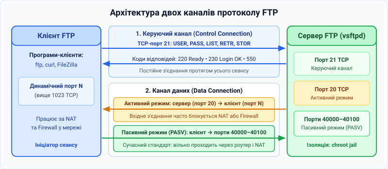

# Урок 34. FTP-сервер (vsftpd)

<div class="how-to">

**Як працювати з уроком**

1. Ознайомтеся з теоретичним матеріалом: вивчіть принципи роботи протоколу FTP, архітектуру двох з'єднань (керуючого та передачі даних), відмінності активного й пасивного режимів передачі та можливості безпечного демона `vsftpd`.
2. Виконайте покрокове практичне завдання: встановіть сервер `vsftpd`, налаштуйте ізоляцію облікових записів у домашніх каталогах (механізм chroot), задайте діапазон пасивних портів і протестуйте завантаження та вивантаження файлів клієнтом.
3. Пройдіть підсумковий контрольний тест на 10 запитань наприкінці сторінки.

</div>

## Мета уроку

Засвоїти технології організації служб передавання файлів на базі протоколу FTP, навчитися конфігурувати захищений демон `vsftpd` та забезпечувати безпеку файлового сховища за допомогою ізоляції користувачів. На практиці ви:

- встановите та налаштуєте серверний демон **vsftpd**;
- забезпечите безпеку сервера, заблокувавши анонімний доступ та заборонивши вихід користувачів за межі домашнього каталогу (**chroot jail**);
- налаштуєте параметри пасивного режиму (**Passive FTP**) для безперешкодної роботи через корпоративні маршрутизатори та міжмережеві екрани;
- протестуєте передачу даних за допомогою консольних утиліт `ftp` та `curl`.

## Що знадобиться

- Сервер або віртуальна машина з операційною системою **Linux (Ubuntu Server або Debian)**.
- Доступ до термінала з правами адміністратора (`sudo`).
- Встановлені пакети `vsftpd` та консольний клієнт `ftp`.

## Теорія

<div class="clip">


*Рівні хмарних сервісів: IaaS, PaaS, SaaS<sup>[1]</sup>*

</div>

**FTP (*File Transfer Protocol* — протокол передавання файлів)** — це один із найстаріших мережевих протоколів прикладного рівня моделі OSI (стандартизований у RFC 959 ще у 1985 році). Незважаючи на появу хмарних сховищ, FTP залишається популярним стандартом для вивантаження файлів вебсайтів на хостинг, оновлення прошивок мережевого обладнання та обміну технічною документацією.

### Архітектура двох каналів зв'язку

На відміну від більшості мережевих служб (наприклад, HTTP або SSH, де всі команди й дані передаються в межах однієї TCP-сесії), класичний протокол FTP використовує **два роздільні канали з'єднання**:

1. **Керуюче з'єднання (*Control Connection*)** — встановлюється на **порт 21 TCP** сервера. Через цей канал клієнт надсилає текстові команди (`USER`, `PASS`, `LIST`, `RETR`, `STOR`), а сервер повертає тризначні коди статусів (`220 Ready`, `230 Logged in`, `550 Access denied`). Це з'єднання залишається відкритим протягом усього сеансу.
2. **З'єднання для передавання даних (*Data Connection*)** — динамічний канал, який відкривається окремо для кожної файлової операції (передача файлу або виведення списку каталогу) і закривається одразу після завершення передачі.

<div class="clip">



*Архітектура двох каналів зв'язку протоколу FTP: керуючий канал (порт 21 TCP) та канал передавання даних (активний і пасивний режими)*

</div>

### Активний та пасивний режими роботи

Існує два принципово різні способи встановлення з'єднання для передавання даних:

#### 1. Активний режим (*Active FTP Mode*)
- Клієнт відкриває довільний локальний порт $N$ і надсилає серверу керуючим каналом команду `PORT` із зазначенням своєї IP-адреси та цього порту.
- Сервер самостійно **зі свого порту 20 TCP ініціює вихідне з'єднання** на вказаний порт клієнта.
- *Головний недолік:* Якщо клієнт перебуває за роутером домашньої мережі або офісним шлюзом із трансляцією адрес (**NAT**) чи міжмережевим екраном (**Firewall**), вхідне підключення від сервера буде заблоковане. Активний режим сьогодні практично не застосовується.

#### 2. Пасивний режим (*Passive FTP Mode*)
- Клієнт надсилає команду `PASV`.
- Сервер виділяє **випадковий високий TCP-порт** (наприклад, із наперед визначеного діапазону 40000–40100), відкриває його для прослуховування та надсилає цей номер клієнтові.
- Клієнт **сам ініціює вихідне підключення** на отриманий порт сервера.
- *Перевага:* Клієнтські роутери та брандмауери без проблем пропускають вихідні з'єднання. Саме пасивний режим є сучасним стандартом за замовчуванням.

### Проблема безпеки та альтернативи: FTPS проти SFTP

Традиційний протокол FTP розроблявся в епоху довірених академічних мереж, тому він передає логіни, паролі та вміст файлів **відкритим текстом** (*plaintext*). Будь-який зловмисник із перехоплювачем пакетів (*sniffer*, Wireshark) у локальній мережі може легко прочитати облікові дані.

Для захисту даних використовуються сучасні захищені протоколи:
- **FTPS (*FTP over SSL/TLS*)** — класичний FTP, у якому керуючий канал і канал даних шифруються за допомогою протоколів TLS/SSL та цифрових сертифікатів (підтримується сервером `vsftpd`).
- **SFTP (*SSH File Transfer Protocol*)** — принципово інший протокол, що є розширенням служби безпечної оболонки **SSH (порт 22 TCP)**. Він не має стосунку до демона FTP, а використовує єдиний надійний зашифрований тунель SSH.

### Демон vsftpd та його переваги

**`vsftpd` (*Very Secure FTP Daemon*)** — це серверне програмне забезпечення з відкритим вихідним кодом для Unix/Linux систем. Його було розроблено з акцентом на абсолютну безпеку, стійкість до мережевих атак і максимальну швидкість обробки тисяч одночасних підключень.

#### Ключові можливості:
- **Мінімальні системні привілеї** — демон розбиває процес на кілька дочірніх процесів із мінімальними правами доступу.
- **Ізоляція користувача (`chroot`)** — обмеження доступу користувача виключно рамками його домашнього каталогу («пісочниця» або «тюрма»). Користувач не може виконати команду `cd ..` і побачити системні файли сервера `/etc/`, `/var/`, `/home/`.
- **Гнучке керування правами** — підтримка списків заборонених та дозволених користувачів, квот і регулювання пропускної здатності каналу.

<div class="more-link">

**Хочете знати більше?** <span class="optional">Необов’язково</span>

Для ввімкнення сучасного криптографічного захисту **FTPS** у конфігураційний файл `vsftpd.conf` достатньо додати параметри шифрування та вказати шлях до SSL-сертифіката:
```text
ssl_enable=YES
allow_anon_ssl=NO
force_local_data_ssl=YES
force_local_logins_ssl=YES
ssl_tlsv1_2=YES
rsa_cert_file=/etc/ssl/certs/vsftpd.pem
rsa_private_key_file=/etc/ssl/private/vsftpd.key
```
Після цього клієнти (наприклад, FileZilla) передаватимуть логіни й паролі в надійно зашифрованому вигляді через TLS 1.2 / TLS 1.3.

</div>

## Покроково

Розглянемо практичну роботу: системний оператор має розгорнути FTP-сервер для зовнішніх партнерів організації, створити виділений обліковий запис `ftp_partner`, ізолювати його в межах власного каталогу за допомогою `chroot` та налаштувати діапазон пасивних портів для коректної взаємодії через маршрутизатор.

### 1. Встановлення vsftpd та клієнта

Оновіть списки пакунків та встановіть сервер `vsftpd` і тестовий консольний клієнт `ftp`:

```bash
sudo apt update
sudo apt install -y vsftpd ftp curl
```

### 2. Створення виділеного облікового запису користувача

З міркувань кібербезпеки FTP-користувачам ніколи не надають права інтерактивного входу через SSH. Створимо обліковий запис `ftp_partner` із командною оболонкою `/usr/sbin/nologin`:

```bash
sudo useradd -m -s /usr/sbin/nologin ftp_partner
sudo passwd ftp_partner
```

### 3. Організація каталогу користувача для роботи з chroot

Механізм безпеки `vsftpd` вимагає, щоб кореневий домашній каталог користувача, зачиненого в `chroot`, **не мав прав на запис** для самого користувача (інакше зловмисник міг би модифікувати параметри середовища). Для завантаження файлів усередині створюють підкаталог:

```bash
# Забороняємо запис у корінь домашнього каталогу користувача
sudo chown root:root /home/ftp_partner
sudo chmod 755 /home/ftp_partner

# Створюємо робочий каталог для файлів і віддаємо права користувачу
sudo mkdir /home/ftp_partner/upload
sudo chown ftp_partner:ftp_partner /home/ftp_partner/upload
sudo chmod 755 /home/ftp_partner/upload
```

### 4. Редагування конфігурації /etc/vsftpd.conf

Зробіть копію конфігураційного файлу за замовчуванням:

```bash
sudo cp /etc/vsftpd.conf /etc/vsftpd.conf.bak
```

Відкрийте файл конфігурації у редакторі `nano`:

```bash
sudo nano /etc/vsftpd.conf
```

Знайдіть і відредагуйте наступні базові параметри, або додайте їх у кінець файлу:

```ini
# Забороняємо анонімний доступ
anonymous_enable=NO

# Дозволяємо вхід локальним системним обліковим записам
local_enable=YES

# Дозволяємо операції запису та завантаження файлів на сервер
write_enable=YES

# Встановлюємо маску прав за замовчуванням (файли отримають 644, папки 755)
local_umask=022

# Вмикаємо ізоляцію користувачів у домашніх каталогах (chroot jail)
chroot_local_user=YES

# Дозволяємо роботу в chroot, якщо кореневий каталог доступний на запис
allow_writeable_chroot=YES

# Налаштовуємо пасивний режим і діапазон портів
pasv_enable=YES
pasv_min_port=40000
pasv_max_port=40100
```

Збережіть файл (`Ctrl+O`, `Enter`) та закрийте редактор (`Ctrl+X`).

### 5. Перезапуск та перевірка стану служби

Перезапустіть службу `vsftpd`, щоб нові налаштування набули чинності:

```bash
sudo systemctl restart vsftpd
sudo systemctl enable vsftpd
sudo systemctl status vsftpd --no-pager
```

Переконайтеся, що служба слухає 21-й порт TCP:

```bash
sudo ss -tulpn | grep :21
```

### 6. Тестування завантаження та вивантаження файлів

Перевірте підключення до сервера локально за допомогою консольного клієнта `ftp`:

```bash
ftp localhost
```

У запрошенні авторизації введіть:
- `Name: ftp_partner`
- Введіть пароль користувача `ftp_partner`.

Після успішного входу ви побачите рядок вітання `230 Login successful`. Перейдіть у каталог завантаження та перевірте вміст:

```text
ftp> pwd
ftp> cd upload
ftp> ls
ftp> quit
```

Зверніть увагу: команда `pwd` повертає корінь `/` замість повного шляху `/home/ftp_partner`. Це підтверджує, що механізм **chroot** надійно ізолював користувача, і він не має доступу до решти каталогу сервера.

<div class="try">

**Спробуйте самі**

Налаштуйте політику контролю доступу через **«білий список»** користувачів. Тільки користувачам, які внесені до окремого файлу `/etc/vsftpd.userlist`, має дозволятися вхід на FTP-сервер, а для всіх інших користувачів системи доступ повинен блокуватися.
1. Додайте директиви `userlist_enable=YES`, `userlist_file=/etc/vsftpd.userlist`, `userlist_deny=NO` у файл `/etc/vsftpd.conf`.
2. Створіть файл `/etc/vsftpd.userlist` та внесіть туди логін `ftp_partner`.
3. Перезапустіть службу `vsftpd` та спробуйте підключитися іншим системним користувачем (наприклад, `o_ivanenko`).

<details>
<summary>Перевірити очікуваний результат і повний розв’язок</summary>

Налаштування параметрів білого списку в `/etc/vsftpd.conf`:

```ini
userlist_enable=YES
userlist_file=/etc/vsftpd.userlist
userlist_deny=NO
```

Команди для створення списку та перезапуску:

```bash
# Створення білого списку із дозволеним користувачем
echo "ftp_partner" | sudo tee /etc/vsftpd.userlist

# Перезапуск служби vsftpd
sudo systemctl restart vsftpd
```

Очікуваний результат під час спроби входу користувачем `o_ivanenko`, якого немає у списку:
`530 Permission denied.`
З'єднання негайно скидається ще до перевірки пароля. Вхід під користувачем `ftp_partner` відбувається успішно: `230 Login successful.`

</details>

</div>

## Підсумок

- Протокол **FTP (порт 21 TCP)** працює за моделлю двох з'єднань: керуючий канал для команд та окремий канал для передавання даних.
- **Пасивний режим (Passive FTP)** є обов'язковим стандартом для роботи через сучасні маршрутизатори з трансляцією адрес (NAT) та брандмауери.
- Сервер **`vsftpd`** забезпечує високий рівень захисту завдяки ізоляції користувачів у їхніх каталогах (**chroot jail**), унеможливлюючи несанкціонований доступ до системних файлів.
- Обліковим записам, призначеним лише для передачі файлів, слід встановлювати оболонку `/usr/sbin/nologin`, що блокує можливість небезпечного інтерактивного входу через SSH.

## Тест

<div class="test-box">

10 запитань за матеріалом уроку. На початку тесту вкажіть **прізвище, ім’я та групу**.

🔗 <!-- GOOGLE_FORM_URL:lesson-34 --> *(Посилання на Google Форму буде додано після масового імпорту тесту)*

</div>

## Додаткове завдання

<span class="optional">Необов’язково</span> Виконуйте для закріплення навичок налаштування FTP-серверів.

**Базовий рівень.** З'ясуйте призначення директиви `local_umask = 022` у конфігурації `vsftpd.conf`. Які права доступу отримає файл, завантажений користувачем на сервер за такої маски?

**Проєктний рівень.** Дослідіть налаштування обмеження швидкості завантаження файлів для користувачів. Знайдіть у документації `vsftpd` директиву, що обмежує максимальну швидкість передачі даних для локальних користувачів (наприклад, не більше 2 МБ/с = 2097152 байт/с), пропишіть її в конфігурацію та перевірте дію.

## Джерела

1. [Cloud_Computing_Stack.svg](https://commons.wikimedia.org/wiki/File:Cloud_Computing_Stack.svg), Wikimedia Commons.
