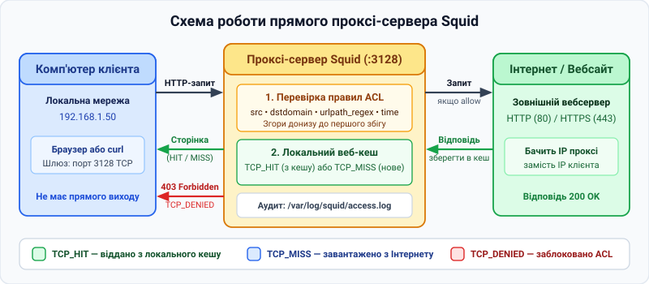

# Урок 35. Проксі-сервер (Squid)

<div class="how-to">

**Як працювати з уроком**

1. Ознайомтеся з теоретичним матеріалом: з'ясуйте призначення проксі-серверів (прямий, зворотний, прозорий), можливості кешування веб-трафіку, механізми фільтрації запитів за списками ACL та принципи аналізу системних журналів.
2. Виконайте покрокове практичне завдання: встановіть кешуючий проксі-сервер Squid, налаштуйте контроль доступу для локальної підмережі, створіть правила блокування розважальних сайтів і небезпечних файлів, протестуйте роботу через клієнтські запити.
3. Пройдіть підсумковий контрольний тест на 10 запитань наприкінці сторінки.

</div>

## Мета уроку

Опанувати принципи функціонування та адміністрування корпоративних проксі-серверів для оптимізації інтернет-трафіку, захисту локальної мережі від кіберзагроз і реалізації політик інформаційної безпеки. На практиці ви:

- розгорнете та налаштуєте популярний проксі-сервер **Squid**;
- створите списки контролю доступу (**ACL**) за IP-адресами джерела, доменами та розширеннями файлів;
- налаштуєте правила доступу (`http_access`) з урахуванням пріоритетності першого збігу;
- перевірите коректність конфігурації утилітою `squid -k parse` та протестуєте фільтрацію за допомогою `curl`;
- навчитеся аналізувати журнал доступу `/var/log/squid/access.log` у реальному часі.

## Що знадобиться

- Сервер або віртуальна машина з операційною системою **Linux (Ubuntu Server або Debian)**.
- Доступ до термінала з правами адміністратора (`sudo`).
- Встановлені пакети `squid` та утиліта `curl`.

## Теорія

У корпоративних мережах пряме неконтрольоване підключення комп'ютерів співробітників до Інтернету створює численні ризики: витік конфіденційних даних, завантаження шкідливого програмного забезпечення (*malware*), непродуктивне витрачання робочого часу на розважальні портали та перевантаження каналу зв'язку. Для вирішення цих проблем встановлюють **проксі-сервер** (*Proxy Server* — від англ. *proxy*, «посередник, уповноважений представник»).

**Проксі-сервер** — це спеціалізований мережевий сервіс, який розташовується між користувацькими комп'ютерами локальної мережі та ресурсами глобальної мережі Інтернет, перехоплює всі клієнтські веб-запити, перевіряє їх на відповідність правилам безпеки та виконує їх від власного імені.

<div class="clip">



*Схема роботи прямого проксі-сервера Squid: фільтрація за ACL, локальне кешування та аудит запитів*

</div>

### Види проксі-серверів

За розташуванням у мережі та призначенням проксі-сервери поділяються на три основні категорії:

| Тип проксі | Схема роботи | Основне призначення |
| :--- | :--- | :--- |
| **Прямий проксі (*Forward Proxy*)** | Встановлюється всередині корпоративної мережі; браузери клієнтів спеціально налаштовуються надсилати трафік на порт проксі | Контроль виходу співробітників в Інтернет, блокування шкідливих ресурсів, економія трафіку через кешування |
| **Зворотний проксі (*Reverse Proxy*)** | Встановлюється перед власними публічними вебсерверами компанії (наприклад, Nginx або HAProxy) | Захист вебсерверів від DDoS-атак, балансування навантаження між кількома серверами, прискорення завантаження сайтів |
| **Прозорий проксі (*Transparent Proxy*)** | Встановлюється на мережевому шлюзі (маршрутизаторі); весь веб-трафік примусово перенаправляється правилами фільтрації | Централізована фільтрація без необхідності ручного налаштування браузерів на кожному комп'ютері |

### Основні функції сервера Squid

**Squid** — це один із найпотужніших та найнадійніших веб-проксі-серверів із відкритим кодом. Він підтримує протоколи HTTP, HTTPS, FTP і забезпечує:

1. **Кешування вмісту (*Web Caching*)**: Статичні елементи сайтів (зображення, стилі CSS, скрипти, документи), які завантажив один користувач, зберігаються в оперативній пам'яті або на швидкому накопичувачі сервера. Коли інший співробітник відкриває ту саму сторінку, Squid миттєво віддає дані з локального кешу, не витрачаючи зовнішній інтернет-канал.
2. **Контроль та фільтрація доступу**: Адміністратор може гнучко забороняти доступ до окремих вебсайтів, соціальних мереж або цілих категорій ресурсів, а також блокувати завантаження потенційно небезпечних виконуваних файлів (`.exe`, `.bat`, `.msi`) чи медіафайлів.
3. **Облік та аудит**: Кожне звернення до будь-якої вебсторінки обов'язково фіксується в журналі доступу із зазначенням точного часу, IP-адреси клієнта, URL-адреси та статусу відповіді.

### Механізм списків контролю доступу (ACL) у Squid

Стандартний мережевий порт сервера Squid — **3128 TCP**. Головний файл конфігурації розташований за шляхом **`/etc/squid/squid.conf`**.

Керування трафіком у Squid будується за двохетапним принципом:
1. **Оголошення списку ACL**: визначення критерію фільтрації за допомогою директиви `acl`:
   `acl назва_правила тип_правила значення`
2. **Застосування дії**: дозвіл або заборона для оголошеного списку за допомогою директиви `http_access`:
   `http_access allow назва_правила` або `http_access deny назва_правила`

#### Поширені типи ACL:
- **`src`** — фільтрація за IP-адресою джерела (клієнта):
  `acl localnet src 192.168.1.0/24`
- **`dstdomain`** — фільтрація за доменним ім'ям призначення (крапка перед доменом позначає сам домен і всі його піддомени):
  `acl bad_sites dstdomain .facebook.com .tiktok.com`
- **`urlpath_regex`** — пошук регулярних виразів у шляху URL (з прапорцем `-i` для ігнорування регістру символів):
  `acl danger_files urlpath_regex -i \.(exe|msi|bat|torrent)$`
- **`time`** — обмеження за часом та днями тижня (S — неділя, M — понеділок, T — вівторок, W — середа, H — четвер, F — п'ятниця, A — субота):
  `acl work_time time M T W H F 09:00-18:00`

#### Важливе правило порядку обробки:
Squid перевіряє правила `http_access` **послідовно згори донизу до першого збігу**. Щойно запит підпадає під правило, перевірка негайно припиняється і виконується вказана дія (дозвіл чи заборона). Тому конкретні заборонні правила завжди розміщують **перед** загальними дозволами, а в кінці конфігурації обов'язково розміщують директиву за замовчуванням:
`http_access deny all`

### Аналіз журналів доступу

Усі події фіксуються у файлі **`/var/log/squid/access.log`**. Типовий запис має вигляд:
```text
1710582000.123  15 192.168.1.50 TCP_DENIED/403 3812 GET http://www.game-portal.com/ - HIER_NONE/- text/html
1710582015.456  42 192.168.1.50 TCP_HIT/200 15200 GET http://example.com/logo.png - HIER_NONE/- image/png
```

Ключові статуси кешування:
- **`TCP_HIT`** — об'єкт знайдено в локальному кеші Squid і віддано клієнту без звернення до Інтернету (максимальна швидкість);
- **`TCP_MISS`** — об'єкта немає в кеші; його завантажено зі стороннього сервера в Інтернеті та збережено в кеш;
- **`TCP_DENIED`** — запит заблоковано сервером через спрацювання заборонного правила ACL (клієнту повернено сторінку з помилкою 403 Forbidden).

<div class="more-link">

**Хочете знати більше?** <span class="optional">Необов’язково</span>

Оскільки понад 90% сучасного інтернет-трафіку шифрується протоколом **HTTPS (порт 443 TCP)**, звичайний проксі-сервер бачить лише ім'я домену (завдяки заголовку SNI), але не бачить повний URL і вміст сторінки.
Для глибокого аналізу та антивірусної перевірки всередині HTTPS-трафіку у Squid реалізовано технологію **SslBump (SSL Peek and Splice)**. Проксі-сервер виступає посередником у сертифікації, розшифровує потік, перевіряє його вміст на віруси та повторно зашифровує корпоративним кореневим сертифікатом безпеки.

</div>

## Покроково

Розглянемо практичну роботу: системний оператор має розгорнути проксі-сервер Squid для офісної локальної мережі, відкрити доступ для внутрішньої підмережі, налаштувати централізоване блокування розважальних порталів і завантаження небезпечних виконуваних файлів, а також перевірити роботу журналювання.

### 1. Встановлення проксі-сервера Squid

Оновіть списки пакетів та встановіть серверну службу `squid` і консольну утиліту `curl`:

```bash
sudo apt update
sudo apt install -y squid curl
```

### 2. Створення резервної копії та створення списків блокування

Збережіть оригінальний конфігураційний файл:

```bash
sudo cp /etc/squid/squid.conf /etc/squid/squid.conf.bak
```

Створіть текстовий файл `/etc/squid/blocked_domains.txt`, де перелічіть небажані сайти (по одному на рядок):

```bash
sudo bash -c 'cat > /etc/squid/blocked_domains.txt' << 'DOMAIN_LIST'
.facebook.com
.instagram.com
.tiktok.com
.casino.com
DOMAIN_LIST
```

### 3. Налаштування списків доступу у squid.conf

Відкрийте файл `/etc/squid/squid.conf` у текстовому редакторі `nano`:

```bash
sudo nano /etc/squid/squid.conf
```

Знайдіть секцію опису правил ACL та додайте налаштування для нашої корпоративної мережі (або додайте їх на початку блоку `http_access`):

```squid
# Опис дозволеної локальної підмережі
acl office_network src 192.168.0.0/16 10.0.0.0/8 127.0.0.1

# Список заборонених доменів із файлу
acl bad_domains dstdomain "/etc/squid/blocked_domains.txt"

# Заборона завантаження потенційно небезпечних типів файлів
acl danger_extensions urlpath_regex -i \.(exe|bat|msi|vbs|torrent)$

# Застосування заборонних правил (ПЕРЕД правилами дозволу)
http_access deny bad_domains
http_access deny danger_extensions

# Дозвіл доступу для внутрішньої мережі
http_access allow office_network

# Заборона будь-якого іншого доступу (останнє правило!)
http_access deny all
```

Переконайтеся, що порт прослуховування залишається стандартним:
```squid
http_port 3128
```

Збережіть файл (`Ctrl+O`, `Enter`) та вийдіть із редактора (`Ctrl+X`).

### 4. Перевірка синтаксису конфігурації

Утиліта Squid має спеціальний ключ для тестування файлу без зупинки працюючого сервісу:

```bash
sudo squid -k parse
```

Якщо команда не вивела фатальних помилок (*FATAL*), перезапустіть службу:

```bash
sudo systemctl restart squid
sudo systemctl enable squid
sudo systemctl status squid --no-pager
```

### 5. Перевірка відкритих портів сервера

Переконайтеся, що служба Squid очікує вхідні клієнтські запити на порту 3128:

```bash
sudo ss -tulpn | grep :3128
```

Вивід покаже рядок з адресою `*:3128` або `0.0.0.0:3128`.

### 6. Тестування роботи проксі-сервера клієнтськими запитами

Скористайтеся утилітою `curl` із зазначенням прапорця `-x` (вказання адреси проксі-сервера):

Спроба завантажити дозволений вебсайт:
```bash
curl -I -x http://localhost:3128 http://example.com
```
Сервер поверне статус `HTTP/1.1 200 OK`.

Спроба відкрити заблокований домен зі списку:
```bash
curl -I -x http://localhost:3128 http://www.tiktok.com
```
Сервер негайно поверне статус **`HTTP/1.1 403 Forbidden`** (помилка заборони доступу).

Спроба завантажити виконуваний файл:
```bash
curl -I -x http://localhost:3128 http://example.com/software/installer.exe
```
Сервер також поверне статус **`HTTP/1.1 403 Forbidden`**, оскільки спрацювало правило `danger_extensions`.

### 7. Моніторинг журналу доступу в реальному часі

Відкрийте перегляд подій журналу `access.log`:

```bash
sudo tail -f /var/log/squid/access.log
```

Ви побачите докладні записи:
```text
127.0.0.1 TCP_MISS/200 1256 GET http://example.com/ - HIER_DIRECT/93.184.216.34 text/html
127.0.0.1 TCP_DENIED/403 3812 GET http://www.tiktok.com/ - HIER_NONE/- text/html
127.0.0.1 TCP_DENIED/403 3812 GET http://example.com/software/installer.exe - HIER_NONE/- text/html
```
Для завершення режиму моніторингу натисніть `Ctrl+C`.

<div class="try">

**Спробуйте самі**

Налаштуйте розклад доступу (**Time-based ACL**):
1. Створіть правило часу `lunch_time`, що визначає обідню перерву в робочі дні з 13:00 до 14:00 (понеділок — п'ятниця).
2. Налаштуйте правила так, щоб доступ до соціальних мереж із файлу `blocked_domains.txt` був **дозволений лише під час обіду**, але заблокований у робочі години.
3. Перевірте конфігурацію утилітою `sudo squid -k parse` та перезавантажте конфігурацію без перезапуску служби командою `sudo squid -k reconfigure`.

<details>
<summary>Перевірити очікуваний результат і повний розв’язок</summary>

Налаштування часових списків у `/etc/squid/squid.conf`:

```squid
# Оголошення часового проміжку обідньої перерви
acl lunch_time time M T W H F 13:00-14:00

# Дозволяємо соціальні мережі ТІЛЬКИ в обідній час для нашої мережі
http_access allow bad_domains office_network lunch_time

# У будь-який інший час забороняємо доступ до цих сайтів
http_access deny bad_domains

# Решта правил локальної мережі
http_access allow office_network
http_access deny all
```

Команди для застосування змін:

```bash
# Перевірка правильності написання конфігурації
sudo squid -k parse

# М'яке застосування конфігурації на льоту
sudo squid -k reconfigure
```

Пояснення: Якщо користувач звернеться до сайту о 13:30, спрацює перше комбіноване правило `allow bad_domains office_network lunch_time`. Якщо ж запит надійде о 10:00, цей рядок не спрацює, і запит перейде до наступного рядка `deny bad_domains`, який заблокує з'єднання.

</details>

</div>

## Підсумок

- **Проксі-сервер** є ключовою ланкою безпеки корпоративної мережі, захищаючи клієнтів від шкідливого вмісту та оптимізуючи навантаження на канал зв'язку.
- **Squid** використовує механізм списків контролю доступу (**ACL**) за адресами джерел, доменами, регулярними виразами URL та часовими інтервалами.
- Порядок правил `http_access` має вирішальне значення: перевірка здійснюється зверху вниз **до першого збігу**, тому детальні заборони завжди розташовують перед загальними дозволами.
- Журнал **/var/log/squid/access.log** надає системному оператору вичерпні дані щодо інтернет-активності користувачів та ефективності кешування (`TCP_HIT`, `TCP_MISS`, `TCP_DENIED`).

## Тест

<div class="test-box">

10 запитань за матеріалом уроку. На початку тесту вкажіть **прізвище, ім’я та групу**.

🔗 <!-- GOOGLE_FORM_URL:lesson-35 --> *(Посилання на Google Форму буде додано після масового імпорту тесту)*

</div>

## Додаткове завдання

<span class="optional">Необов’язково</span> Виконуйте для поглиблення знань про конфігурацію проксі-серверів.

**Базовий рівень.** З'ясуйте, як у налаштуваннях операційної системи Windows 10/11 або в браузері Mozilla Firefox вручну вказати адресу проксі-сервера (IP-адреса та порт).

**Проєктний рівень.** Дослідіть налаштування розміру дискового кешу в Squid за допомогою директиви `cache_dir ufs /var/spool/squid ...`. Налаштуйте розмір сховища кешу на 5 ГБ (5120 МБ) із 16 каталогами першого рівня та 256 каталогами другого рівня.
