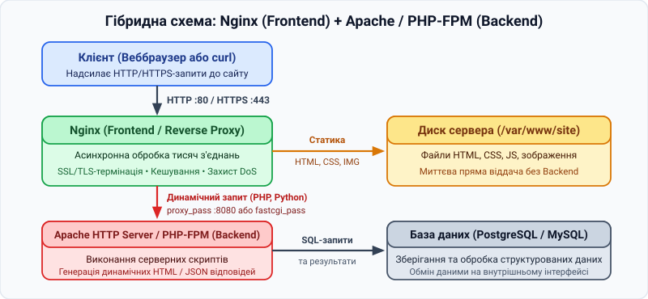

# Урок 36. Вебсервер (Apache, Nginx)

<div class="how-to">

**Як працювати з уроком**

1. Ознайомтеся з архітектурними відмінностями вебсерверів Apache HTTP Server та Nginx, протоколами HTTP/HTTPS і принципами віртуального хостингу.
2. Покроково встановіть вебсервер Nginx у середовищі Linux, створіть власний віртуальний хост (Server Block) та протестуйте віддачу вебсторінки.
3. Дайте відповіді на 10 запитань перевірочного тесту для закріплення навичок адміністрування вебслужб.

</div>

## Мета уроку

Ви навчитеся розуміти принципи функціонування вебсерверів, порівнювати їхню архітектуру та виконувати практичне налаштування серверного програмного забезпечення. На практиці ви:

- з'ясуєте призначення та відмінності між класичним багатопроцесним вебсервером Apache та асинхронним сервером Nginx;
- вивчите структуру конфігураційних файлів вебсервера Nginx (`nginx.conf`, блоки `server` та `location`);
- налаштуєте віртуальний хост для ізольованого обслуговування навчального вебсайту;
- протестуєте роботу сервера, перевірите синтаксис конфігурації утилітою `nginx -t` та проаналізуєте логи доступу й помилок.

## Що знадобиться

- Операційна система Linux (Ubuntu Server, Debian або інший дистрибутив із підтримкою `systemd` та пакетного менеджера `apt`).
- Термінальний емулятор та доступ із правами суперкористувача (`sudo`).
- Текстовий редактор (`nano` або `vim`).
- Консольний клієнт `curl` або веббраузер для тестування мережевих відповідей.

## Теорія

Вебсервер — це програмне забезпечення (або комп'ютер, на якому воно працює), що приймає мережеві запити від клієнтів (зазвичай веббраузерів) за протоколами **HTTP** (порт за замовчуванням 80) або захищеним **HTTPS** (порт 443) і повертає у відповідь гіпертекстові документи (HTML), стилі (CSS), скрипти (JS), медіафайли або дані у форматі JSON.

У сучасній ІТ-інфраструктурі найпоширенішими вебсерверами для операційних систем сімейства Linux є **Apache HTTP Server** та **Nginx**. Кожен із них має унікальну архітектуру та сферу застосування.

### 1. Порівняння Apache HTTP Server та Nginx

| Характеристика | Apache HTTP Server | Nginx |
| :--- | :--- | :--- |
| **Архітектурна модель** | Процесно-орієнтована або багатопотокова (MPM: prefork, worker, event). На кожне підключення виділяється окремий процес або потік. | Подієво-орієнтована, асинхронна (Event-driven, non-blocking). Один робочий процес обслуговує тисячі з'єднань одночасно. |
| **Споживання пам'яті (RAM)** | Зростає лінійно зі збільшенням кількості одночасних підключень. | Стабільно низьке, практично не залежить від кількості відкритих з'єднань. |
| **Віддача статичного контенту** | Добра, але створює відчутне навантаження при високому трафіку. | Надзвичайно швидка з мінімальними затримками (лідер у віддачі медіа й статики). |
| **Децентралізоване налаштування** | Підтримує файли `.htaccess` у каталогах сайтів, що дозволяє користувачам змінювати правила без доступу до головної конфігурації. | Не підтримує `.htaccess` задля швидкодії та безпеки; усі налаштування зберігаються виключно в централізованих конфігураційних файлах. |
| **Робота з динамічним кодом** | Може виконувати код (наприклад, PHP) безпосередньо всередині процесу вебсервера за допомогою вбудованих модулів (`mod_php`). | Не виконує динамічний код самостійно; передає запити окремим менеджерам процесів через FastCGI (наприклад, `php-fpm`), uWSGI або Reverse Proxy. |
| **Роль Reverse Proxy / Балансувальника** | Можлива через додаткові модулі, але не є основною спеціалізацією. | Є стандартом де-факто для зворотного проксі-сервера (Reverse Proxy) та балансування навантаження між серверами застосунків. |

### 2. Типова гібридна схема використання

На високонавантажених серверах дуже часто застосовують зв'язку з обох сервісів:
- **Nginx (Frontend / Reverse Proxy):** стоїть першим на портах 80 та 443. Він самостійно блискавично віддає клієнтам статичні файли (зображення, відео, CSS, JS), забезпечує шифрування SSL/TLS і захист від базових DoS-атак.
- **Apache або PHP-FPM (Backend):** працює на внутрішньому порті (наприклад, 8080) або через Unix-сокет. Nginx передає сюди лише складні динамічні запити, що потребують генерації сторінок скриптами та запитів до бази даних.

<div class="clip">



*Гібридна архітектура вебсервера: Nginx як зворотний проксі (Frontend) для статики та Apache / PHP-FPM (Backend) для динамічного коду*

</div>

### 3. Структура конфігурації Nginx у Debian та Ubuntu

Головний каталог конфігурації Nginx знаходиться за шляхом `/etc/nginx/`. Основними елементами є:
- `nginx.conf` — головний системний конфігураційний файл, де задаються глобальні параметри (кількість робочих процесів `worker_processes`, ліміти з'єднань `worker_connections`, формати журналів).
- `sites-available/` — каталог, у якому зберігаються файли конфігурації всіх віртуальних хостів (сайтів), налаштованих на сервері.
- `sites-enabled/` — каталог, що містить символічні посилання (symlinks) на файли з `sites-available/`. Тільки сайти, посилання на які є в цьому каталозі, активуються сервером.
- `snippets/` — фрагменти конфігурацій, які можна багаторазово підключати директивою `include` (наприклад, загальні параметри SSL).

Базовий блок конфігурації сайту (`server block`) має такий вигляд:

```nginx
server {
    listen 80;
    server_name example.local www.example.local;

    root /var/www/example.local/html;
    index index.html index.htm;

    location / {
        try_files $uri $uri/ =404;
    }

    access_log /var/log/nginx/example_access.log;
    error_log /var/log/nginx/example_error.log;
}
```

Ключові директиви:
- `listen 80;` — визначає IP-адресу та мережевий порт, на якому сервер приймає вхідні з'єднання.
- `server_name` — доменне ім'я сайту, за яким вебсервер розпізнає, який саме блок конфігурації повинен відповісти на запит.
- `root` — кореневий каталог у файловій системі сервера, де зберігаються файли вебсайту.
- `index` — перелік назв файлів, які відкриваються за замовчуванням при переході на головну сторінку.
- `location /` — правила обробки URI-шляхів запиту.

<div class="more-link">

**Хочете знати більше?** <span class="optional">Необов’язково</span>

**Сучасні вебпротоколи та безпека:** Окрім традиційного HTTP/1.1, вебсервери підтримують протокол **HTTP/2**, який передає декілька запитів одночасно через одне TCP-з'єднання (мультиплексування) і стискає заголовки. Найновіший протокол **HTTP/3** працює поверх UDP за допомогою транспортного протоколу QUIC, що усуває блокування черги та суттєво прискорює завантаження сайтів на мобільних пристроях. Для захищеного HTTPS-з'єднання використовують безкоштовні SSL/TLS сертифікати від некомерційного центру сертифікації **Let's Encrypt**, автоматизоване встановлення й поновлення яких виконується утилітою `certbot`.

</div>

## Покроково

Розгорнемо на сервері Nginx віртуальний хост для локального навчального сайту `student.lab`.

### 1. Встановіть Nginx та перевірте стан служби

1. Оновіть списки пакетів та інсталюйте вебсервер:
   ```bash
   sudo apt update
   sudo apt install -y nginx
   ```
2. Перевірте, чи служба запустилася автоматично:
   ```bash
   systemctl status nginx
   ```
   У виводі статус має бути `active (running)`.
3. Перевірте, що сервер прослуховує 80-й порт:
   ```bash
   ss -tulpn | grep :80
   ```

### 2. Створіть структуру каталогів та тестову сторінку

1. Створіть каталог для розміщення файлів сайту та надайте коректні права:
   ```bash
   sudo mkdir -p /var/www/student.lab/html
   sudo chown -R www-data:www-data /var/www/student.lab/html
   sudo chmod -R 755 /var/www/student.lab
   ```
2. Створіть тестову головну сторінку `index.html`:
   ```bash
   echo '<!DOCTYPE html><html lang="uk"><head><meta charset="UTF-8"><title>Навчальний сервер Nginx</title></head><body><h1>Вебсервер Nginx успішно працює!</h1><p>Хост: student.lab</p></body></html>' | sudo tee /var/www/student.lab/html/index.html
   ```

### 3. Створіть конфігураційний файл віртуального хосту

Створіть файл конфігурації для сайту `student.lab`:
```bash
sudo tee /etc/nginx/sites-available/student.lab << 'NETCONF'
server {
    listen 80;
    server_name student.lab;

    root /var/www/student.lab/html;
    index index.html;

    location / {
        try_files $uri $uri/ =404;
    }

    access_log /var/log/nginx/student_access.log;
    error_log /var/log/nginx/student_error.log;
}
NETCONF
```

### 4. Активуйте конфігурацію та перевірте синтаксис

1. Створіть символічне посилання в каталог `sites-enabled`:
   ```bash
   sudo ln -s /etc/nginx/sites-available/student.lab /etc/nginx/sites-enabled/
   ```
2. Завжди перед перезавантаженням служби перевіряйте синтаксис конфігураційних файлів:
   ```bash
   sudo nginx -t
   ```
   Якщо помилок немає, команда поверне:
   `nginx: the configuration file /etc/nginx/nginx.conf syntax is ok`
   `nginx: configuration file /etc/nginx/nginx.conf test is successful`
3. Застосуйте нову конфігурацію без розриву поточних з'єднань (reload):
   ```bash
   sudo systemctl reload nginx
   ```

<div class="try">

**Спробуйте самі**

1. Додайте до файлу конфігурації `/etc/nginx/sites-available/student.lab` власну сторінку обробки помилки **404 Not Found** (директива `error_page 404 /custom_404.html;`).
2. Створіть файл `/var/www/student.lab/html/custom_404.html` з текстом: `<h2>Вибачте, запитану сторінку не знайдено на сервері student.lab</h2>`.
3. Виконайте `sudo nginx -t` та `sudo systemctl reload nginx`.
4. Протестуйте запит до неіснуючого файлу за допомогою утиліти `curl`:
   ```bash
   curl -I -H "Host: student.lab" http://127.0.0.1/nonexistent.html
   ```

<details>
<summary>Перевірити очікуваний результат і повний розв’язок</summary>

У файлі конфігурації `/etc/nginx/sites-available/student.lab` всередині блоку `server` має бути додано:

```nginx
error_page 404 /custom_404.html;
location = /custom_404.html {
    root /var/www/student.lab/html;
    internal;
}
```

Після оновлення конфігурації та виконання команди `curl -I -H "Host: student.lab" http://127.0.0.1/nonexistent.html` сервер поверне HTTP-заголовок зі статусом 404:

```text
HTTP/1.1 404 Not Found
Server: nginx/...
Date: ...
Content-Type: text/html
Content-Length: ...
Connection: keep-alive
```

А виконання команди без прапорця `-I` (`curl -H "Host: student.lab" http://127.0.0.1/nonexistent.html`) поверне текст створеного вами файлу `custom_404.html`.

</details>

</div>

## Підсумок

- **Вебсервер** забезпечує доставку вебсторінок і контенту клієнтам за протоколами HTTP (порт 80) та HTTPS (порт 443).
- **Apache** базується на багатопроцесній/багатопотоковій моделі та підтримує файли конфігурації `.htaccess`, тоді як **Nginx** використовує асинхронну подієву архітектуру, що гарантує високу продуктивність при мінімальному використанні оперативної пам'яті.
- У дистрибутивах Debian/Ubuntu сайти описуються у каталозі `/etc/nginx/sites-available/` та активуються створенням символічних посилань у `/etc/nginx/sites-enabled/`.
- Перевірка правильності конфігурації обов'язково здійснюється командою `sudo nginx -t` перед застосуванням змін через `sudo systemctl reload nginx`.

## Тест

<div class="test-box">

10 запитань за матеріалом уроку. На початку тесту вкажіть **прізвище, ім’я та групу**.

🔗 <!-- GOOGLE_FORM_URL:lesson-36 --> *(Посилання на Google Форму буде додано після масового імпорту тесту)*

</div>

## Додаткове завдання

<span class="optional">Необов’язково</span> Завдання для закріплення навичок системного адміністрування.

**Базовий рівень.** Встановіть вебсервер Apache (`sudo apt install -y apache2`). Змініть порт прослуховування у файлі `/etc/apache2/ports.conf` з 80 на 8080, щоб обидва вебсервери (Nginx і Apache) могли одночасно працювати на одній системі. Переконайтеся за допомогою `ss -tulpn`, що обидва сервери активні.

**Проєктний рівень.** Налаштуйте Nginx як зворотний проксі (Reverse Proxy) перед вебсервером Apache. У конфігурації віртуального хосту Nginx налаштуйте директиву `proxy_pass http://127.0.0.1:8080;` для передачі запитів до Apache, передавши реальну IP-адресу клієнта через заголовок `X-Forwarded-For`.
