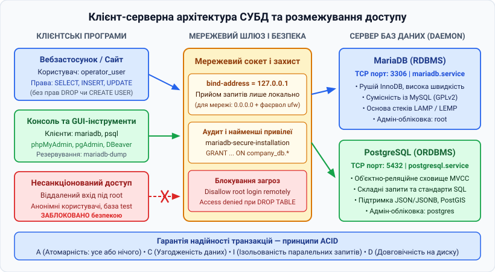

# Урок 37. Сервер баз даних (MariaDB, PostgreSQL)

<div class="how-to">

**Як працювати з уроком**

1. Дослідіть принципи клієнт-серверної архітектури СУБД, мережеві порти та порівняйте можливості MariaDB і PostgreSQL.
2. Покроково встановіть СУБД MariaDB, виконайте первинний аудит безпеки, створіть навчальну базу даних та налаштуйте користувача з обмеженими правами.
3. Дайте відповіді на 10 запитань тесту для перевірки знань з адміністрування серверів баз даних.

</div>

## Мета уроку

Ви навчитеся розуміти роботу серверних систем керування базами даних (СУБД), розгортати та захищати їх в ОС Linux. На практиці ви:

- з'ясуєте призначення та ключові відмінності між СУБД MariaDB та PostgreSQL;
- виконаєте первинну ініціалізацію та налаштування безпеки сервера СУБД утилітою `mariadb-secure-installation`;
- створите базу даних, таблицю та заповните її початковими записами через командну консоль;
- створите виділеного системного користувача бази даних із чітко розмежованими привілеями відповідно до принципу найменших привілеїв.

## Що знадобиться

- Серверна або десктопна ОС Linux (Ubuntu, Debian тощо).
- Термінал із правами `sudo`.
- Встановлений пакетний менеджер `apt` для інсталяції серверного програмного забезпечення.

## Теорія

Сервер баз даних — це спеціалізоване програмне забезпечення (СУБД), яке керує структурованим зберіганням, обробкою, пошуком та захистом даних і надає доступ до них клієнтським програмам (вебсайтам, ERP/CRM-системам, аналітичним утилітам) за мережевими протоколами.

На відміну від локальних файлових баз даних (як-от SQLite або MS Access), серверні СУБД функціонують як мережева служба-демон (daemon), що прослуховує мережевий сокет і здатна паралельно обслуговувати сотні й тисячі клієнтських транзакцій.

### 1. MariaDB та PostgreSQL: огляд та порівняння

У світі вільного програмного забезпечення двома беззаперечними лідерами серед реляційних СУБД є **MariaDB** та **PostgreSQL**.

- **MariaDB:** прямий форк популярної СУБД MySQL, започаткований її первинним автором Мікаелем «Монті» Віденіусом після поглинання Sun Microsystems корпорацією Oracle. MariaDB є повністю відкритою (GPLv2), високосумісною із MySQL (використовує ті самі протоколи, порти та структуру таблиць) і входить до стандартного набору дистрибутивів Debian/Ubuntu. Вона є серцем класичних стеків LAMP (Linux, Apache, MySQL/MariaDB, PHP) та LEMP (Linux, Nginx, MariaDB, PHP).
- **PostgreSQL:** об'єктно-реляційна СУБД (ORDBMS), створена в Каліфорнійському університеті в Берклі. Відома своїм безкомпромісним дотриманням міжнародних стандартів SQL, потужною підтримкою складних аналітичних запитів, повноцінною роботою з документами JSON/JSONB та геопросторовими даними (розширення PostGIS).

| Характеристика | MariaDB | PostgreSQL |
| :--- | :--- | :--- |
| **Тип СУБД** | Реляційна (RDBMS) | Об'єктно-реляційна (ORDBMS) |
| **Стандартний мережевий порт** | `3306` (TCP) | `5432` (TCP) |
| **Основні рушії зберігання** | InnoDB (підтримка транзакцій), Aria, Memory | Єдине вбудоване транзакційне сховище (MVCC) |
| **Сильні сторони** | Висока швидкість простих операцій читання/запису, легкість адміністрування, вебсайти, CMS (WordPress, Drupal) | Складні аналітичні запити, сувора перевірка цілісності, робота з великими масивами даних і JSON |
| **Консольний клієнт** | `mariadb` (або `mysql`) | `psql` |
| **Популярні графічні інтерфейси** | phpMyAdmin, HeidiSQL, DBeaver | pgAdmin, DBeaver |

### 2. Клієнт-серверна модель та мережеве прослуховування

Сервер баз даних запускається як служба (`mariadb.service` або `postgresql.service`). За замовчуванням задля безпеки більшість дистрибутивів налаштовують директиву:

```ini
bind-address = 127.0.0.1
```

Це означає, що СУБД приймає підключення **тільки від локальних процесів**, запущених на цьому ж комп'ютері (наприклад, локального вебсервера Nginx або скриптів PHP). Якщо до бази потрібен прямий доступ з іншого сервера або робочого місця оператора, цю директиву змінюють на реальну IP-адресу мережевого інтерфейсу або `0.0.0.0` (усі інтерфейси), обов'язково захищаючи порт фаєрволом (`ufw`).

### 3. Безпека та принцип найменших привілеїв

Головний обліковий запис адміністратора СУБД — `root` (у MariaDB) або `postgres` (у PostgreSQL). Робота програм під обліковим записом `root` є грубим порушенням правил інформаційної безпеки.

Для кожного інформаційного застосунку (наприклад, системи обліку заявок чи сайту) системний оператор зобов'язаний:
1. Створити окрему базу даних.
2. Створити окремого користувача з надійним паролем.
3. Надати цьому користувачеві виключно ті привілеї, які необхідні для його роботи (`SELECT`, `INSERT`, `UPDATE`, `DELETE`), без прав створення користувачів чи видалення інших баз.

<div class="clip">



*Рис. Клієнт-серверна архітектура СУБД MariaDB / PostgreSQL та розмежування доступу*

</div>

<div class="more-link">

**Хочете знати більше?** <span class="optional">Необов’язково</span>

**Транзакції та надійність даних (ACID):** Професійні СУБД гарантують надійність обробки даних за допомогою концепції ACID:
- **A (Atomicity — Атомарність):** транзакція виконується або повністю, або не виконується взагалі (немає проміжних половинчастих станів).
- **C (Consistency — Узгодженість):** дані до і після транзакції відповідають усім правилам цілісності.
- **I (Isolation — Ізольованість):** паралельні запити не впливають на результат один одного.
- **D (Durability — Довговічність):** зафіксовані зміни збережуться навіть у разі раптового знеструмлення сервера.

Для масштабування та відмовостійкості використовують кластеризацію та реплікацію: **Master-Slave** (один сервер записує, інші лише віддають дані на читання) або мультимайстер-кластери (наприклад, **Galera Cluster** для MariaDB).

</div>

## Покроково

Встановимо сервер MariaDB, налаштуємо його захист, створимо базу даних `company_db` та виділеного користувача.

### 1. Встановіть MariaDB та перевірте стан служби

1. Інсталюйте сервер та клієнтську частину MariaDB:
   ```bash
   sudo apt update
   sudo apt install -y mariadb-server mariadb-client
   ```
2. Переконайтеся, що служба активна та додана в автозавантаження:
   ```bash
   sudo systemctl status mariadb
   ```
3. Перевірте мережевий сокет:
   ```bash
   sudo ss -tulpn | grep 3306
   ```
   Ви побачите, що служба слухає адресу `127.0.0.1:3306`.

### 2. Виконайте первинне налаштування безпеки

У дистрибутивах Linux разом із MariaDB постачається спеціальний скрипт `mariadb-secure-installation` (або `mysql_secure_installation`), який усуває типові потенційні вразливості:

```bash
sudo mariadb-secure-installation
```

Під час виконання інтерактивного майстра виберіть такі відповіді:
- *Enter current password for root:* натисніть `Enter` (пароль порожній за замовчуванням).
- *Switch to unix_socket authentication?* введіть `n` (або `Y` залежно від політики).
- *Change the root password?* введіть `Y` і встановіть надійний адміністративний пароль.
- *Remove anonymous users?* введіть `Y` (видалити тестових анонімних користувачів).
- *Disallow root login remotely?* введіть `Y` (заборонити віддалене підключення користувача root через мережу).
- *Remove test database and access to it?* введіть `Y` (видалити тестову базу `test`).
- *Reload privilege tables now?* введіть `Y` (негайно перечитати таблиці прав).

### 3. Створіть базу даних та таблицю обліку обладнання

1. Увійдіть до інтерактивної консолі СУБД:
   ```bash
   sudo mariadb -u root -p
   ```
   Введіть встановлений пароль root.
2. Створіть базу даних з кодуванням UTF-8:
   ```sql
   CREATE DATABASE company_db CHARACTER SET utf8mb4 COLLATE utf8mb4_unicode_ci;
   SHOW DATABASES;
   ```
3. Перейдіть до створеної бази даних:
   ```sql
   USE company_db;
   ```
4. Створіть таблицю `devices` для обліку комп'ютерної техніки:
   ```sql
   CREATE TABLE devices (
       id INT AUTO_INCREMENT PRIMARY KEY,
       device_name VARCHAR(100) NOT NULL,
       inventory_no VARCHAR(30) UNIQUE NOT NULL,
       ip_address VARCHAR(15),
       status VARCHAR(20) DEFAULT 'active'
   );
   ```
5. Додайте два тестові записи:
   ```sql
   INSERT INTO devices (device_name, inventory_no, ip_address, status)
   VALUES
   ('Сервер баз даних', 'INV-2026-001', '192.168.1.10', 'active'),
   ('Комутатор Cisco 2960', 'INV-2026-002', '192.168.1.2', 'active');

   SELECT * FROM devices;
   ```

### 4. Створіть обліковий запис оператора з обмеженими правами

1. Створіть користувача `operator_user` з доступом тільки з локальної машини (`localhost`):
   ```sql
   CREATE USER 'operator_user'@'localhost' IDENTIFIED BY 'PassOperator2026!';
   ```
2. Надайте йому права на читання, додавання та зміну даних у створеній базі `company_db`:
   ```sql
   GRANT SELECT, INSERT, UPDATE ON company_db.* TO 'operator_user'@'localhost';
   FLUSH PRIVILEGES;
   ```
3. Завершіть сеанс адміністратора:
   ```sql
   EXIT;
   ```
4. Перевірте вхід під новим користувачем:
   ```bash
   mariadb -u operator_user -p company_db
   ```
   (Введіть пароль `PassOperator2026!`). Виконайте `SELECT * FROM devices;` і переконайтеся, що дані доступні. Спробуйте виконати команду видалення таблиці `DROP TABLE devices;` — сервер поверне помилку доступу (Access denied), що свідчить про правильне обмеження прав.

<div class="try">

**Спробуйте самі**

Створіть резервну копію (дамп) створеної бази даних `company_db` за допомогою консольної утиліти `mariadb-dump` (або `mysqldump`):

1. Виконайте команду створення дампу у файл `company_backup.sql`:
   ```bash
   mariadb-dump -u operator_user -p company_db > company_backup.sql
   ```
2. Перегляньте перші 20 рядків створеного SQL-дампу:
   ```bash
   head -n 20 company_backup.sql
   ```
3. Знайдіть у файлі команду створення таблиці `CREATE TABLE` та команди вставки даних `INSERT INTO`.

<details>
<summary>Перевірити очікуваний результат і повний розв’язок</summary>

Файл `company_backup.sql` містить текстовий набір SQL-команд, що повністю відтворюють структуру та наповнення бази даних:

```sql
-- MariaDB dump 10.19  Distrib 10.x.x-MariaDB ...
-- Host: localhost    Database: company_db
-- ...
DROP TABLE IF EXISTS `devices`;
CREATE TABLE `devices` (
  `id` int(11) NOT NULL AUTO_INCREMENT,
  `device_name` varchar(100) NOT NULL,
  `inventory_no` varchar(30) NOT NULL,
  `ip_address` varchar(15) DEFAULT NULL,
  `status` varchar(20) DEFAULT 'active',
  PRIMARY KEY (`id`),
  UNIQUE KEY `inventory_no` (`inventory_no`)
) ENGINE=InnoDB DEFAULT CHARSET=utf8mb4 ...;

INSERT INTO `devices` VALUES (1,'Сервер баз даних','INV-2026-001','192.168.1.10','active'),(2,'Комутатор Cisco 2960','INV-2026-002','192.168.1.2','active');
```

Для відновлення такої бази на будь-якому іншому сервері достатньо виконати команду:
```bash
mariadb -u root -p new_database < company_backup.sql
```

</details>

</div>

## Підсумок

- **Сервер баз даних (СУБД)** забезпечує централізоване, багатокористувацьке зберігання інформації за клієнт-серверною моделлю.
- **MariaDB** є відкритим нащадком MySQL, працює за замовчуванням на TCP-порті `3306`, вирізняється простотою та швидкістю.
- **PostgreSQL** — об'єктно-реляційна СУБД (порт `5432`), орієнтована на складні аналітичні системи, JSON-документи та строгу відповідність стандартам SQL.
- Первинна безпека СУБД вимагає обов'язкового запуску `mariadb-secure-installation` та створення прикладних користувачів із мінімально необхідними правами (`GRANT SELECT, INSERT...`).

## Тест

<div class="test-box">

10 запитань за матеріалом уроку. На початку тесту вкажіть **прізвище, ім’я та групу**.

<!-- GOOGLE_FORM_START:lesson-37 -->
[Відкрити тест у новій вкладці](https://docs.google.com/forms/d/e/1FAIpQLSe6A7sbpL4rQVB1rijpXOlz2w2y8DprBd48Y9fO6nlVEN2g4Q/viewform)

<iframe src="https://docs.google.com/forms/d/e/1FAIpQLSe6A7sbpL4rQVB1rijpXOlz2w2y8DprBd48Y9fO6nlVEN2g4Q/viewform?embedded=true" loading="lazy" title="Тест lesson-37">Завантаження…</iframe>
<!-- GOOGLE_FORM_END:lesson-37 -->

</div>

## Додаткове завдання

<span class="optional">Необов’язково</span> Завдання для поглибленого вивчення СУБД.

**Базовий рівень.** Додайте до таблиці `devices` нове поле `location` (розташування пристрою, рядок до 50 символів) за допомогою SQL-інструкції `ALTER TABLE devices ADD COLUMN location VARCHAR(50);`. Оновіть існуючі записи інструкцією `UPDATE`.

**Проєктний рівень.** Налаштуйте MariaDB для дозволу підключення з локальної мережі. Знайдіть у каталозі `/etc/mysql/mariadb.conf.d/` файл `50-server.cnf`, замініть `bind-address = 127.0.0.1` на `bind-address = 0.0.0.0`, перезапустіть службу (`systemctl restart mariadb`) і створіть користувача з маскою мережі `'operator_remote'@'192.168.1.%'`.
