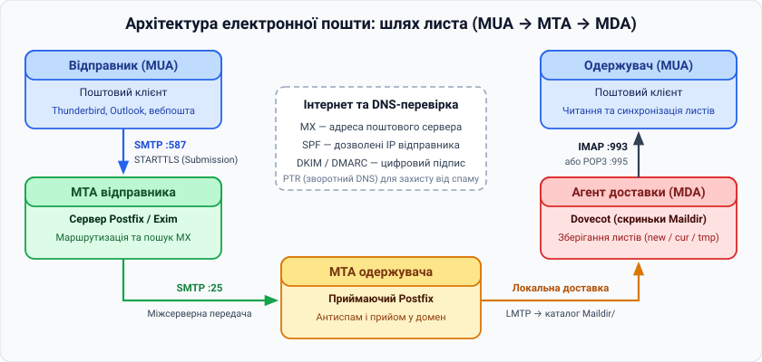

# Урок 38. Поштовий сервер: принципи роботи та налаштування

<div class="how-to">

**Як працювати з уроком**

1. Ознайомтеся з архітектурою електронної пошти (MUA, MTA, MDA), протоколами передачі та отримання поштових повідомлень, а також критичними записами DNS (MX, SPF, DKIM).
2. Покроково встановіть і налаштуйте поштовий агент Postfix у середовищі Linux з форматом скриньок `Maildir`, надішліть тестовий лист і проаналізуйте його службові заголовки.
3. Пройдіть перевірочний тест із 10 запитань для закріплення принципів роботи корпоративної пошти.

</div>

## Мета уроку

Ви навчитеся розуміти механізми функціонування серверів електронної пошти, їхню взаємодію у глобальній мережі та методи конфігурації поштових служб. На практиці ви:

- з'ясуєте ролі поштових компонентів: поштового клієнта (MUA), агента передачі (MTA) та агента доставки (MDA);
- вивчите призначення поштових протоколів (SMTP, IMAP, POP3) та їхніх стандартних захищених портів;
- опануєте налаштування поштового сервера Postfix у Linux для внутрішнього домену;
- проаналізуєте службові заголовки RFC-повідомлення (Received, Message-ID, MIME) у форматі зберігання `Maildir`.

## Що знадобиться

- Операційна система Linux (Ubuntu Server або Debian).
- Термінал із доступом користувача `sudo`.
- Встановлені утиліти командного рядка: пакет `postfix`, `mailutils` та утиліти діагностики мережі (`ss`, `curl`).

## Теорія

<div class="clip">


*Серверна інфраструктура дата-центру<sup>[1]</sup>*

</div>

Електронна пошта (E-mail) — одна з найстаріших і найбільш фундаментальних служб Інтернету. На відміну від месенджерів із закритими протоколами, електронна пошта побудована на відкритих міжнародних стандартах і розподіленій федеративній архітектурі: користувач одного сервера (наприклад, `@gmail.com`) може вільно листуватися з користувачем будь-якого іншого сервера (наприклад, `@ukr.net` чи корпоративного `@college.edu.ua`).

### 1. Архітектурні компоненти поштової системи

Доставка листа від відправника до одержувача складається з взаємодії трьох ключових класів програм:

<div class="clip">



*Архітектура електронної пошти: взаємодія поштових клієнтів MUA, серверів передачі MTA та агента доставки MDA*

</div>

1. **MUA (Mail User Agent — Клієнтський поштовий агент):** програма, в якій користувач пише та читає листи (Mozilla Thunderbird, Microsoft Outlook, мобільні додатки або веб-інтерфейс у браузері).
2. **MTA (Mail Transfer Agent — Агент передачі пошти):** серверне програмне забезпечення, яке маршрутизує та передає листи між серверами через Інтернет за протоколом SMTP. Найпопулярніші сервери MTA під Linux — **Postfix**, **Exim** та класичний **Sendmail**.
3. **MDA / LDA (Mail Delivery Agent — Агент локальної доставки):** приймає лист від MTA і записує його у відповідну поштову скриньку на диску сервера, а також надає клієнтам доступ до скриньок за протоколами IMAP або POP3. Найпоширеніший MDA — **Dovecot**.

### 2. Мережеві протоколи та порти електронної пошти

| Протокол | Призначення | Стандартний порт | Захищений порт (SSL/TLS) |
| :--- | :--- | :--- | :--- |
| **SMTP** (Simple Mail Transfer Protocol) | Передача листів між серверами MTA, а також відправка від клієнта MUA до сервера MTA. | `25` (сервер-сервер), `587` (Submission клієнт-сервер) | `465` (SMTPS) або `587` (зі STARTTLS) |
| **IMAP** (Internet Message Access Protocol) | Двостороння синхронізація листів, статусів (прочитано/видалено) та папок безпосередньо на сервері. | `143` | `993` (IMAPS) |
| **POP3** (Post Office Protocol v3) | Просте завантаження листів із сервера на локальний комп'ютер клієнта (зазвичай із видаленням із сервера). | `110` | `995` (POP3S) |

> [!NOTE]
> Сьогодні протокол **IMAP** майже повністю витіснив POP3, оскільки сучасний користувач працює з однією поштовою скринькою одночасно з кількох пристроїв (смартфон, ноутбук, робочий ПК).

### 3. Записи DNS, необхідні для роботи пошти

Щоб поштовий сервер міг приймати пошту з глобальної мережі й щоб його власні листи не потрапляли до спаму, у доменній зоні DNS налаштовують спеціальні записи:
- **MX (Mail Exchanger):** вказує ім'я хоста поштового сервера, який приймає кореспонденцію для даного домену (наприклад, `mail.example.com` із пріоритетом 10).
- **SPF (Sender Policy Framework):** спеціальний текстовий TXT-запис у DNS, який чітко визначає список IP-адрес серверів, яким дозволено надсилати листи від імені цього домену (наприклад, `v=spf1 ip4:192.0.2.1 -all`).
- **DKIM (DomainKeys Identified Mail):** технологія цифрового підпису. Сервер-відправник підписує кожен лист закритим криптографічним ключем, а приймаючий сервер перевіряє справжність листа відкритим ключем, опублікованим у DNS домену відправника.
- **DMARC:** політика, яка вказує приймаючому серверу, що саме робити з листом, якщо він не пройшов перевірку SPF або DKIM (наприклад, відхилити або помістити в спам).
- **PTR (Зворотний DNS):** відповідність IP-адреси доменному імені хоста (Reverse DNS). Більшість поштових провайдерів миттєво відхиляють листи від серверів, у яких відсутній або не збігається PTR-запис.

### 4. Формати зберігання листів на сервері: mbox vs Maildir

- **mbox:** усі листи користувача дописуються в один великий файл. Якщо два процеси одночасно намагаються модифікувати скриньку, виникає блокування (lock contention), а пошкодження одного файлу веде до втрати всього листування.
- **Maildir:** сучасний промисловий стандарт. Поштова скринька є каталогом, розділеним на три підкаталоги: `new/` (нові непрочитані листи), `cur/` (поточні переглянуті листи) та `tmp/` (тимчасові файли доставки). Кожен лист зберігається в **окремому унікальному файлі**. Це гарантує надійність, паралельність і безпеку.

<div class="more-link">

**Хочете знати більше?** <span class="optional">Необов’язково</span>

**Фільтрація спаму та веб-інтерфейс:** Корпоративний поштовий сервер завжди оснащується багаторівневим захистом. Фільтр **SpamAssassin** оцінює вхідні листи за сотнями евристичних правил і присвоює їм «бали підозрілості». Антивірусний сканер **ClamAV** автоматично перевіряє файлові вкладення на наявність шкідливого коду. Для зручного доступу користувачів до пошти через браузер розгортають відкритий веб-клієнт **Roundcube**, що працює за протоколом IMAP поверх вебсервера Nginx/Apache.

</div>

## Покроково

Налаштуємо поштовий сервер Postfix для обслуговування внутрішнього локального домену `lab.local` та протестуємо доставку повідомлень у форматі `Maildir`.

### 1. Встановіть пакет Postfix

1. Оновіть списки пакетів та інсталюйте Postfix разом з утилітою `mailutils`:
   ```bash
   sudo DEBIAN_FRONTEND=noninteractive apt update
   sudo DEBIAN_FRONTEND=noninteractive apt install -y postfix mailutils
   ```
2. Під час автоматичної інсталяції тип конфігурації встановлюється як *Local only* або *Internet Site*.

### 2. Налаштуйте конфігурацію Postfix (`main.cf`)

Головний файл налаштувань Postfix — `/etc/postfix/main.cf`. Застосуємо налаштування для обслуговування локального домену та ввімкнемо формат зберігання `Maildir`:

```bash
sudo postconf -e "myhostname = mail.lab.local"
sudo postconf -e "mydomain = lab.local"
sudo postconf -e "myorigin = \$mydomain"
sudo postconf -e "mydestination = \$myhostname, localhost.\$mydomain, localhost, \$mydomain"
sudo postconf -e "home_mailbox = Maildir/"
sudo postconf -e "inet_interfaces = loopback-only"
```

Пояснення директив:
- `myhostname`: повне доменне ім'я (FQDN) нашого сервера.
- `mydomain`: поштовий домен, який обслуговує сервер.
- `myorigin`: домен, який автоматично дописуватиметься до адрес без знака `@`.
- `home_mailbox = Maildir/`: визначає створення поштової скриньки у домашньому каталозі користувача у сучасному форматі Maildir.
- `inet_interfaces = loopback-only`: обмежує прослуховування лише локальним інтерфейсом задля навчальної безпеки.

### 3. Перезапустіть службу та перевірте мережевий порт

1. Перезапустіть службу Postfix для застосування налаштувань:
   ```bash
   sudo systemctl restart postfix
   ```
2. Перевірте статус служби:
   ```bash
   sudo systemctl status postfix
   ```
3. Перевірте, що порт 25 відкритий:
   ```bash
   sudo ss -tulpn | grep :25
   ```

### 4. Створіть навчальних користувачів та надішліть лист

1. Створіть двох системних користувачів для тестування пошти:
   ```bash
   sudo useradd -m -s /bin/bash student1
   sudo useradd -m -s /bin/bash student2
   echo "student1:Pass123!" | sudo chpasswd
   echo "student2:Pass123!" | sudo chpasswd
   ```
2. Від імені користувача `student1` надішліть електронний лист адресату `student2@lab.local`:
   ```bash
   echo "Доброго дня! Це перевірка доставки повідомлення в системі Postfix." | mail -s "Лабораторна робота: пошта" student2@lab.local
   ```
3. Перевірте системний журнал пошти `/var/log/mail.log` (або вивід `journalctl -u postfix`):
   ```bash
   sudo journalctl -u postfix -n 10 --no-pager
   ```
   У журналі буде зафіксовано запис `status=sent (delivered to maildir)`.

<div class="try">

**Спробуйте самі**

1. Перейдіть до каталогу вхідної пошти користувача `student2`:
   ```bash
   sudo ls -la /home/student2/Maildir/new/
   ```
2. Знайдіть створений файл листа та перегляньте його вміст утилітою `cat`:
   ```bash
   sudo cat /home/student2/Maildir/new/*
   ```
3. Проаналізуйте заголовки отриманого повідомлення: знайдіть `Return-Path:`, `Received:`, `Date:`, `From:`, `To:`, `Subject:` та унікальний ідентифікатор `Message-Id:`.

<details>
<summary>Перевірити очікуваний результат і повний розв’язок</summary>

У каталозі `/home/student2/Maildir/new/` буде створено файл з унікальною назвою (наприклад, `1731792000.V801I1234M...:2,`). Вміст цього файлу є текстовим документом за стандартом RFC 5322:

```text
Return-Path: <student1@lab.local>
X-Original-To: student2@lab.local
Delivered-To: student2@lab.local
Received: by mail.lab.local (Postfix, from userid 1001)
	id 4XYZb12345; Mon, 16 Nov 2026 12:00:00 +0200 (EET)
Subject: Лабораторна робота: пошта
To: <student2@lab.local>
X-Mailer: mail (GNU Mailutils 3.x)
Message-Id: <20261116100000.4XYZb12345@mail.lab.local>
Date: Mon, 16 Nov 2026 12:00:00 +0200
From: student1 <student1@lab.local>

Доброго дня! Це перевірка доставки повідомлення в системі Postfix.
```

Цей результат підтверджує, що MTA Postfix успішно прийняв лист, проставив штамп `Received`, присвоїв системний `Message-Id` та зберіг його у форматі Maildir.

</details>

</div>

## Підсумок

- Інфраструктура електронної пошти складається з клієнтів **MUA**, агентів передачі між серверами **MTA** (Postfix) та агентів доставки **MDA** (Dovecot).
- Протокол **SMTP** (порти 25, 587) відповідає за відправку та передачу пошти, а протоколи **IMAP** (порт 993) та **POP3** (порт 995) — за доступ користувача до своєї скриньки.
- Для гарантованої та безпечної доставки пошти в Інтернеті обов'язково налаштовуються DNS-записи: **MX**, **SPF**, **DKIM**, **DMARC** та зворотний запис **PTR**.
- Формат **Maildir** зберігає кожен лист в окремому файлі, забезпечуючи високу надійність порівняно зі застарілим монолітним форматом `mbox`.

## Тест

<div class="test-box">

10 запитань за матеріалом уроку. На початку тесту вкажіть **прізвище, ім’я та групу**.

🔗 <!-- GOOGLE_FORM_URL:lesson-38 --> *(Посилання на Google Форму буде додано після масового імпорту тесту)*

</div>

## Додаткове завдання

<span class="optional">Необов’язково</span> Завдання для самостійного поглибленого опрацювання.

**Базовий рівень.** Налаштуйте перенаправлення (псевдонім) пошти. Відкрийте файл `/etc/aliases`, додайте рядок `admin: student1`, щоб уся пошта на адресу `admin@lab.local` автоматично надходила користувачу `student1`. Оновіть базу псевдонімів командою `sudo newaliases` та протестуйте відправлення листа.

**Проєктний рівень.** Опишіть алгоритм підключення MDA Dovecot: які пакети необхідно встановити (`dovecot-imapd`), який порт прослуховуватиметься (`993`) та як вказати спільне розташування поштових скриньок `mail_location = maildir:~/Maildir` у конфігурації `/etc/dovecot/conf.d/10-mail.conf`.

## Джерела

1. [SPNN_file_server_rack.jpg](https://commons.wikimedia.org/wiki/File:SPNN_file_server_rack.jpg), Wikimedia Commons.
