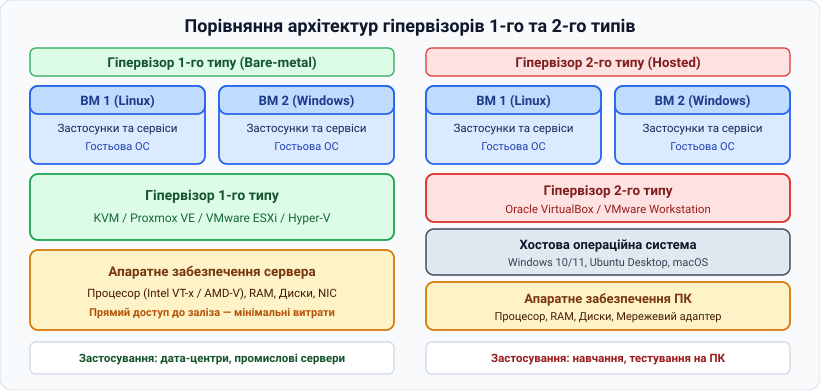

# Урок 39. Віртуалізація серверів (KVM, Proxmox VE)

<div class="how-to">

**Як працювати з уроком**

1. Ознайомтеся з концепцією серверної віртуалізації, відмінностями між гіпервізорами 1-го та 2-го типів і можливостями платформи Proxmox VE.
2. Покроково перевірте апаратну підтримку віртуалізації в Linux, вивчіть базові команди керування `virsh` та створіть віртуальний диск формату QCOW2 зі знімком стану (snapshot).
3. Дайте відповіді на 10 запитань тесту для перевірки знань з віртуалізації серверних систем.

</div>

## Мета уроку

Ви навчитеся розуміти принципи функціонування серверної віртуалізації, аналізувати архітектуру гіпервізорів та виконувати базові операції з обслуговування віртуальних дисків і машин. На практиці ви:

- з'ясуєте різницю між гіпервізорами 1-го типу (bare-metal) та 2-го типу (hosted);
- дізнаєтеся про роль технології KVM у ядрі Linux та можливості платформи Proxmox Virtual Environment;
- перевірите апаратні інструкції процесора (Intel VT-x / AMD-V) за допомогою термінальних утиліт;
- створите динамічний віртуальний диск формату QCOW2 та виконаєте керування знімками стану за допомогою утиліти `qemu-img`.

## Що знадобиться

- Серверна або робоча станція з ОС Linux.
- Процесор з апаратною підтримкою віртуалізації (Intel або AMD).
- Встановлені системні пакети `qemu-utils`, `qemu-kvm`, `libvirt-clients` або доступ до тестового стенда з Proxmox VE.

## Теорія

Віртуалізація серверів — це технологія, що дозволяє розділити фізичні ресурси одного потужного комп'ютера (процесорні ядра, оперативну пам'ять, дискові масиви та мережеві карти) між кількома незалежними віртуальними машинами (ВМ). Кожна ВМ функціонує як окремий повноцінний комп'ютер зі своєю власною операційною системою (гостьова ОС), власними службами та конфігураціями.

Головні переваги віртуалізації:
- **Консолідація обладнання:** замість десятка слабо завантажених фізичних серверів використовується один потужний сервер.
- **Ізоляція та безпека:** збій або компрометація одного вебсервера у віртуальній машині не впливає на базу даних в іншій ВМ.
- **Гнучкість і резервування:** створення миттєвих знімків стану (snapshots), легке клонування та резервне копіювання образів дисків.

### 1. Класифікація гіпервізорів

Гіпервізор (Hypervisor або Virtual Machine Monitor, VMM) — це програмне забезпечення, що створює віртуальне середовище та керує розподілом апаратних ресурсів.

<div class="clip">



*Порівняння архітектур гіпервізорів 1-го типу (Bare-metal) та 2-го типу (Hosted)*

</div>

- **Гіпервізори 1-го типу (Bare-metal — «на голому залізі»):** працюють безпосередньо на фізичному обладнанні без посередництва звичайної настільної ОС. Забезпечують максимальну швидкодію та мінімальні накладні витрати. Приклади: **KVM** (у складі ядра Linux), **Proxmox VE**, **VMware ESXi**, **Microsoft Hyper-V Server**.
- **Гіпервізори 2-го типу (Hosted — розміщені):** запускаються як звичайна прикладна програма всередині хостової ОС (наприклад, Windows 10/11 або Ubuntu Desktop). Використовуються для тестування та навчання. Приклади: **Oracle VirtualBox**, **VMware Workstation**.

### 2. Технологія KVM у ядрі Linux

**KVM (Kernel-based Virtual Machine)** — це модуль ядра Linux, який перетворює саме ядро на гіпервізор 1-го типу. Для роботи KVM обов'язково потрібна апаратна підтримка віртуалізації з боку центрального процесора:
- інструкції **Intel VT-x** (позначаються прапорцем `vmx` у системних відомостях);
- інструкції **AMD-V** (позначаються прапорцем `svm`).

Для емуляції решти обладнання (материнської плати, дискових контролерів, мережевих карт VirtIO) KVM використовує утиліту **QEMU**. Для керування віртуальними машинами використовується бібліотека **libvirt** та консольна утиліта **virsh**.

### 3. Платформа віртуалізації Proxmox VE

**Proxmox Virtual Environment (Proxmox VE)** — це повноцінна промислова відкрита платформа віртуалізації корпоративного рівня, побудована на базі дистрибутива Debian GNU/Linux.

Ключові можливості Proxmox VE:
- **Два типи віртуалізації в одній системі:**
  1. Повні віртуальні машини на базі **KVM** (для будь-яких ОС: Windows, Linux, BSD).
  2. Легковажні ізольовані контейнери **LXC (Linux Containers)** (для запуску сервісів Linux із практично нульовими накладними витратами).
- **Зручний вебінтерфейс:** адміністрування здійснюється через звичайний браузер на захищеному порті **8006** (`https://ip_сервера:8006`).
- **Підтримка сховищ даних:** підтримка ZFS, Ceph, LVM, NFS та iSCSI.
- **Кластеризація та жива міграція (Live Migration):** можливість перенесення працюючої ВМ з одного фізичного сервера на інший без переривання роботи користувачів.
- **Вбудований фаєрвол та планувальник резервного копіювання.**

### 4. Формати віртуальних дисків: RAW vs QCOW2

- **RAW:** "сирий" двійковий образ диска. Має максимальну швидкість читання/запису, але фіксовано займає на накопичувачі весь заявлений обсяг (наприклад, 50 ГБ відразу резервуються на диску). Не підтримує розширені функції, як-от знімки стану чи стиснення.
- **QCOW2 (QEMU Copy-On-Write 2):** найпопулярніший формат у KVM та Proxmox VE. Використовує динамічне виділення простору (thin provisioning): якщо створено диск на 50 ГБ, а даних записано лише 2 ГБ, файл на фізичному диску займатиме лише 2 ГБ. Підтримує багаторівневі **знімки стану (snapshots)**, компресію та AES-шифрування.

<div class="more-link">

**Хочете знати більше?** <span class="optional">Необов’язково</span>

**Мережевий міст (Linux Bridge) та прокидання пристроїв:** У серверній віртуалізації гостьові машини найчастіше підключають не через NAT, а через віртуальний мережевий міст (**Linux Bridge**, у Proxmox це інтерфейс `vmbr0`). Міст об'єднує фізичну мережеву карту сервера з віртуальними картами машин, завдяки чому кожна ВМ отримує власну реальну IP-адресу з локальної мережі підприємства. Для задач із високими вимогами (наприклад, машинне навчання або 3D-рендеринг) застосовують технологію **PCI Passthrough** — пряме підключення фізичної відеокарти (GPU) сервера безпосередньо у віртуальну машину.

</div>

## Покроково

Опануємо базові прийоми роботи з віртуалізацією KVM у терміналі Linux: перевіримо процесор, створимо диск QCOW2 та виконаємо операції зі знімками стану.

### 1. Перевірте апаратну підтримку віртуалізації

1. Виконайте пошук прапорців апаратної віртуалізації у системному файлі процесора:
   ```bash
   egrep -c '(vmx|svm)' /proc/cpuinfo
   ```
   Якщо результат **більше 0** — апаратне прискорення підтримується процесором.
2. Перевірте статус утилітою `kvm-ok` (якщо пакет `cpu-checker` встановлено):
   ```bash
   kvm-ok
   ```
   Очікуваний вивід: `INFO: /dev/kvm exists` та `KVM acceleration can be used`.

### 2. Перевірте роботу демона віртуалізації libvirt

1. Перевірте стан системної служби керування віртуалізацією:
   ```bash
   sudo systemctl status libvirtd
   ```
2. Перегляньте перелік наявних віртуальних машин за допомогою утиліти `virsh`:
   ```bash
   virsh list --all
   ```
3. Перегляньте конфігурацію віртуальної мережі за замовчуванням:
   ```bash
   virsh net-list --all
   ```

### 3. Створіть віртуальний диск формату QCOW2

Для створення та маніпулювання образами віртуальних дисків використовується утиліта `qemu-img`:

1. Створіть каталог для навчальних образів:
   ```bash
   mkdir -p ~/virtual_disks
   cd ~/virtual_disks
   ```
2. Створіть динамічний диск формату `qcow2` розміром 10 ГБ:
   ```bash
   qemu-img create -f qcow2 srv-node01.qcow2 10G
   ```
3. Перегляньте детальну технічну інформацію про створений диск:
   ```bash
   qemu-img info srv-node01.qcow2
   ```
4. Порівняйте віртуальний розмір і фактичний розмір на накопичувачі:
   ```bash
   ls -lh srv-node01.qcow2
   ```
   Зверніть увагу: хоча віртуальний розмір становить `10 GiB`, фактичний початковий розмір файлу на диску складає лише близько `196 KiB`!

<div class="try">

**Спробуйте самі**

1. Створіть знімок стану (snapshot) створеного диска перед умовною зміною конфігурації сервера:
   ```bash
   qemu-img snapshot -c snapshot-clean srv-node01.qcow2
   ```
2. Виведіть список наявних знімків стану для цього диска:
   ```bash
   qemu-img snapshot -l srv-node01.qcow2
   ```
3. Створіть ще один знімок під назвою `snapshot-update`:
   ```bash
   qemu-img snapshot -c snapshot-update srv-node01.qcow2
   ```
4. Переконайтеся, що в таблиці відображаються обидві контрольні точки повернення.

<details>
<summary>Перевірити очікуваний результат і повний розв’язок</summary>

Команда `qemu-img info srv-node01.qcow2` повертає повну специфікацію диска та список збережених знімків стану:

```text
image: srv-node01.qcow2
file format: qcow2
virtual size: 10 GiB (10737418240 bytes)
disk size: 196 KiB
cluster_size: 65536
Snapshot list:
ID        TAG                 VM SIZE                DATE       VM CLOCK
1         snapshot-clean            0 2026-11-16 12:00:00   00:00:00.000
2         snapshot-update           0 2026-11-16 12:05:00   00:00:00.000
Format specific information:
    compat: 1.1
    compression type: zlib
    lazy refcounts: false
    refcount bits: 16
    corrupt: false
```

Для відкату диска до попереднього стабільного стану використовується команда:
```bash
qemu-img snapshot -a snapshot-clean srv-node01.qcow2
```
А для видалення непотрібного знімка:
```bash
qemu-img snapshot -d snapshot-update srv-node01.qcow2
```

</details>

</div>

## Підсумок

- **Віртуалізація** дозволяє запускати кілька ізольованих операційних систем на одному фізичному сервері, оптимізуючи витрати та спрощуючи адміністрування.
- **Гіпервізори 1-го типу (KVM, Proxmox VE)** працюють безпосередньо на обладнанні та забезпечують найвищу продуктивність, необхідну для серверних задач.
- **Proxmox VE** поєднує повну віртуалізацію KVM та легкі контейнери LXC, керуючись через захищений вебінтерфейс на порті `8006`.
- Формат дисків **QCOW2** підтримує динамічне виділення пам'яті (тонкі диски) та створення миттєвих знімків стану (**snapshots**) для захисту від помилок оновлень.

## Тест

<div class="test-box">

10 запитань за матеріалом уроку. На початку тесту вкажіть **прізвище, ім’я та групу**.

🔗 <!-- GOOGLE_FORM_URL:lesson-39 --> *(Посилання на Google Форму буде додано після масового імпорту тесту)*

</div>

## Додаткове завдання

<span class="optional">Необов’язково</span> Завдання для самостійної роботи з віртуалізацією.

**Базовий рівень.** Дослідіть параметри утиліти `qemu-img`. Перетворіть формат створеного диска `srv-node01.qcow2` у монолітний двійковий формат `raw` командою `qemu-img convert -O raw srv-node01.qcow2 srv-node01.raw`. Порівняйте розміри обох файлів за допомогою `ls -lh`.

**Проєктний рівень.** Складіть технологічну схему розгортання кластера Proxmox VE з двох фізичних серверів: опишіть необхідні мережеві інтерфейси (для трафіку керування, кластерної синхронізації Corosync та віртуальних машин), а також організацію спільного мережевого сховища на базі протоколу NFS.
