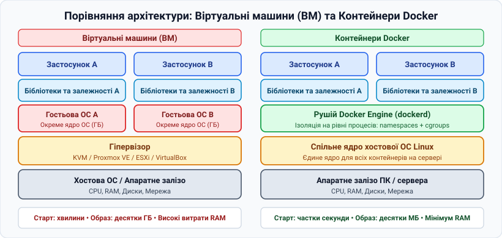

# Урок 40. Контейнеризація (Docker): основні поняття

<div class="how-to">

**Як працювати з уроком**

1. Ознайомтеся з принципами контейнеризації на рівні операційної системи, відмінностями між контейнерами та віртуальними машинами, а також архітектурою платформи Docker.
2. Покроково виконайте запуск контейнера з вебсервером, прокиньте мережеві порти, підключіть зовнішній каталог із даними та навчіться керувати життєвим циклом контейнерів.
3. Дайте відповіді на 10 запитань підсумкового тесту для перевірки розуміння базових концепцій Docker.

</div>

## Мета уроку

Ви навчитеся розуміти технологію контейнеризації, її переваги для розгортання інформаційних систем та опануєте базові операції з платформою Docker. На практиці ви:

- з'ясуєте різницю між апаратною віртуалізацією та ізоляцією на рівні ядра ОС Linux (namespaces і cgroups);
- вивчите ключові сутності Docker: клієнт, демон, образи (Images), контейнери (Containers) та реєстри (Registry);
- завантажите офіційний образ та запустите контейнер із вебсервером у фоновому режимі з трансляцією портів;
- організуєте персистентне зберігання даних за допомогою монтування каталогів хостової системи (Bind Mounts).

## Що знадобиться

- Комп'ютер або віртуальна машина з ОС Linux (Ubuntu, Debian тощо).
- Встановлений рушій Docker (пакети `docker.io` або `docker-ce`).
- Користувач, доданий до групи `docker` (для роботи з командами без `sudo`).

## Теорія

Традиційне розгортання програм стикається з вічною проблемою розробників та системних операторів: *«На моєму комп'ютері все працювало, а на сервері чомусь видає помилку!»*. Причиною зазвичай є невідповідність версій бібліотек, конфігурацій, системних залежностей або змінних середовища.

Технологія **контейнеризації** повністю розв'язує цю проблему, пакуючи додаток разом із усіма його залежностями, бібліотеками та конфігураціями в єдиний стандартизований ізольований блок — **контейнер**.

### 1. Віртуальні машини vs Контейнери Docker

На відміну від важких віртуальних машин, контейнери не містять власного ядра операційної системи та не емулюють фізичне «залізо». Усі контейнери на сервері **спільно використовують одне спільне ядро хостової операційної системи Linux**.

<div class="clip">



*Архітектурне порівняння віртуальних машин (ВМ) та контейнерів Docker*

</div>

| Критерій | Віртуальна машина (KVM, ESXi) | Контейнер Docker |
| :--- | :--- | :--- |
| **Архітектура** | Повна віртуалізація заліза + окреме ядро гостьової ОС | Ізоляція процесів на рівні спільного ядра ОС Linux |
| **Час запуску** | Від кількох десятків секунд до кількох хвилин | Частки секунди (миттєво, як звичайний процес) |
| **Споживання пам'яті** | Резервує фіксовані гігабайти RAM під кожну гостьову ОС | Споживає лише стільки пам'яті, скільки реально треба процесу (мегабайти) |
| **Розмір образу** | Десятки гігабайтів (ISO або повний образ диска) | Від кількох мегабайтів (Alpine: ~5 МБ) до сотень мегабайтів |
| **Рівень ізоляції** | Найвищий (повна апаратна ізоляція) | Високий (ізоляція на рівні просторів імен ядра) |

### 2. Системні механізми Linux, на яких побудовано контейнери

Docker використовує дві ключові вбудовані підсистеми ядра Linux:
1. **Простори імен (Namespaces):** відповідають за те, що процес **може бачити**. Кожен контейнер отримує власний простір процесів (`pid`), власний мережевий стек з IP-адресою (`net`), власні точки монтування дисків (`mnt`), користувачів (`user`) та ім'я хоста (`uts`). Процеси всередині контейнера «впевнені», що вони працюють на окремому ізольованому комп'ютері.
2. **Контрольні групи (Control Groups / cgroups):** відповідають за те, скільки ресурсів процес **може використати**. За допомогою `cgroups` системний оператор обмежує максимальну кількість процесорного часу (наприклад, не більше 2 ядер CPU) та обсяг оперативної пам'яті (наприклад, ліміт 512 МБ RAM), запобігаючи виснаженню ресурсів хоста.

### 3. Архітектура та ключові поняття Docker

- **Docker Client:** утиліта командного рядка (`docker`), за допомогою якої оператор віддає команди.
- **Docker Daemon (`dockerd`):** фонова системна служба, яка приймає запити через REST API, керує створенням контейнерів, завантаженням образів і мережевими адаптерами.
- **Образ (Image):** незмінний шаблон, що складається з шарів «тільки для читання» (read-only). Містить операційне оточення, системні бібліотеки та сам додаток.
- **Контейнер (Container):** запущений виконуваний екземпляр образу. Поверх незмінних шарів образу Docker додає тонкий шар читання/запису (read-write layer). При видаленні контейнера цей шар стирається.
- **Реєстр (Registry):** централізоване сховище готових образів. За замовчуванням використовується глобальний публічний реєстр **Docker Hub** (`hub.docker.com`).

### 4. Анатомія інструкцій файлу Dockerfile

Створення власного образу описується у текстовому файлі з назвою `Dockerfile`:

```dockerfile
FROM alpine:latest
WORKDIR /app
COPY . /app
RUN apk add --no-cache python3
EXPOSE 8000
CMD ["python3", "-m", "http.server", "8000"]
```

- `FROM` — базовий батьківський образ, на основі якого будується новий.
- `WORKDIR` — робочий каталог всередині контейнера.
- `COPY` — копіювання файлів із комп'ютера розробника в образ.
- `RUN` — виконання команд під час збирання образу (встановлення пакетів).
- `EXPOSE` — декларація порту, який додаток прослуховуватиме.
- `CMD` — команда за замовчуванням, яка виконується під час запуску контейнера.

<div class="more-link">

**Хочете знати більше?** <span class="optional">Необов’язково</span>

**Багатоконтейнерні системи та оркестрація:** Коли інформаційна система складається з кількох взаємопов'язаних служб (наприклад, Nginx + PHP-FPM + MariaDB + Redis), запускати кожен контейнер окремими довгими командами незручно. Для цього використовують утиліту **Docker Compose**. Вона дозволяє описати всю інфраструктуру проєкту в єдиному файлі `docker-compose.yml` і підняти її однією командою `docker compose up -d`. Для масштабних промислових хмарних систем із сотнями серверів застосовують системи оркестрації, беззаперечним лідером серед яких є **Kubernetes (K8s)**.

</div>

## Покроково

Опануємо роботу з контейнерами: завантажимо образ вебсервера Nginx, запустимо його у фоновому режимі, налаштуємо трансляцію портів та підключимо власні статичні сторінки.

### 1. Перевірте встановлення та стан Docker

1. Перевірте версію клієнта та демона Docker:
   ```bash
   docker --version
   ```
2. Переконайтеся, що системна служба `docker` активна:
   ```bash
   systemctl status docker
   ```
3. Перевірте, що поточний користувач може виконувати команди Docker без `sudo`:
   ```bash
   docker info
   ```

### 2. Завантажте офіційний образ Nginx

1. Завантажте компактний образ вебсервера на базі мінімалістичного дистрибутива Alpine Linux:
   ```bash
   docker pull nginx:alpine
   ```
2. Перегляньте перелік завантажених локальних образів:
   ```bash
   docker images
   ```
   Зверніть увагу на колонку `SIZE`: повнофункціональний вебсервер Nginx займає лише близько 20–40 МБ!

### 3. Запустіть контейнер із прокиданням портів

1. Запустіть контейнер під назвою `lab-web` у фоновому режимі:
   ```bash
   docker run -d --name lab-web -p 8080:80 nginx:alpine
   ```
   Розбір параметрів команди:
   - `-d` (*detached*): запустити контейнер у фоновому режимі, звільнивши термінал.
   - `--name lab-web`: надати контейнеру зрозуміле людиночитне ім'я.
   - `-p 8080:80`: налаштувати перенаправлення (портмаппінг) — вхідні запити на порт `8080` фізичного сервера перенаправляти на порт `80` всередині контейнера.
   - `nginx:alpine`: назва та тег образу, з якого створюється контейнер.
2. Перевірте список активних контейнерів:
   ```bash
   docker ps
   ```
3. Протестуйте роботу вебсервера в контейнері за допомогою утиліти `curl` або відкрийте у браузері `http://localhost:8080`:
   ```bash
   curl -I http://localhost:8080
   ```
   Сервер поверне статус `HTTP/1.1 200 OK` та заголовок `Server: nginx/...`.

### 4. Перегляньте логи та підключіться всередину контейнера

1. Перегляньте журнал звернень до контейнера:
   ```bash
   docker logs lab-web
   ```
2. Підключіться до інтерактивної командної оболонки всередині контейнера:
   ```bash
   docker exec -it lab-web sh
   ```
   Ви опинитеся в ізольованому середовищі контейнера. Виконайте:
   ```sh
   uname -a
   cat /etc/os-release
   exit
   ```
   Команда `exit` повертає вас назад у термінал хостової ОС.

<div class="try">

**Спробуйте самі**

Організуйте персистентне зберігання даних за допомогою монтування каталогу (**Bind Mount**):

1. Створіть на хостовій машині каталог `~/my-web-content` та створіть у ньому файл `index.html`:
   ```bash
   mkdir -p ~/my-web-content
   echo "<h1>Контейнеризація Docker працює бездоганно!</h1>" > ~/my-web-content/index.html
   ```
2. Запустіть новий контейнер `custom-web` на порті `8081`, підмонтувавши створений каталог у стандартну папку документів Nginx:
   ```bash
   docker run -d --name custom-web -p 8081:80 -v ~/my-web-content:/usr/share/nginx/html:ro nginx:alpine
   ```
3. Перевірте вміст відповіді:
   ```bash
   curl http://localhost:8081
   ```
4. Відредагуйте файл `~/my-web-content/index.html` на хості та повторіть команду `curl`. Переконайтеся, що зміни відображаються миттєво без перезапуску контейнера!

<details>
<summary>Перевірити очікуваний результат і повний розв’язок</summary>

При зверненні до порту `8081`:
```bash
curl http://localhost:8081
```
Сервер поверне:
```html
<h1>Контейнеризація Docker працює бездоганно!</h1>
```

Якщо додати новий текст у вихідний файл `echo "<h2>Новий рядок додано успішно</h2>" >> ~/my-web-content/index.html`, повторний запит `curl http://localhost:8081` негайно відобразить оновлений вміст. Це демонструє розділення незмінного середовища виконання (образ) та змінних даних сайту (зовнішнє сховище/монтування).

Для очищення навчальних контейнерів використовують команди:
```bash
docker stop lab-web custom-web
docker rm lab-web custom-web
```

</details>

</div>

## Підсумок

- **Контейнеризація** забезпечує запуск додатків в ізольованих середовищах (контейнерах), які спільно використовують єдине ядро хостової ОС Linux.
- Ізоляція досягається за допомогою механізмів ядра **namespaces** (простори імен, ізоляція бачення) та **cgroups** (контрольні групи, обмеження споживання ресурсів ЦП і пам'яті).
- **Образ (Image)** є незмінним шаблоном тільки для читання, а **Контейнер (Container)** — його запущеним екземпляром із власним тонким шаром запису.
- Для збереження даних поза межами життєвого циклу контейнера застосовують томи (**Volumes**) або монтування каталогів хоста (**Bind Mounts**).

## Тест

<div class="test-box">

10 запитань за матеріалом уроку. На початку тесту вкажіть **прізвище, ім’я та групу**.

🔗 <!-- GOOGLE_FORM_URL:lesson-40 --> *(Посилання на Google Форму буде додано після масового імпорту тесту)*

</div>

## Додаткове завдання

<span class="optional">Необов’язково</span> Завдання для розвитку навичок контейнеризації.

**Базовий рівень.** Створіть у поточному каталозі найпростіший `Dockerfile`, що базується на `nginx:alpine` та копіює ваш власний файл `index.html` всередину образу за допомогою інструкції `COPY index.html /usr/share/nginx/html/index.html`. Зберіть власний образ командою `docker build -t my-first-site:v1 .` та перевірте його появу у виводі `docker images`.

**Проєктний рівень.** Створіть файл `docker-compose.yml`, що описує запуск вебсервера Nginx та бази даних MariaDB в одній спільній віртуальній мережі Docker (`bridge network`). Запустіть проєкт командою `docker compose up -d` і перевірте статус обох служб через `docker compose ps`.
