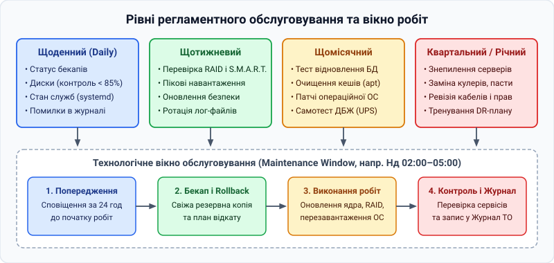

# Урок 41. Регламентні роботи з обслуговування серверів і операційних систем

<div class="how-to">

**Як працювати з уроком**

1. Ознайомтеся з класифікацією регламентних робіт, періодичністю їх проведення, поняттям технологічного вікна обслуговування та апаратними й програмними чеклистами.
2. Виконайте покрокове практичне завдання: проведіть системну діагностику сервера, напишіть автоматизований bash-скрипт регламентного аудиту дискового простору, пам'яті й служб та сформуйте запис у журналі технічного обслуговування.
3. Закріпіть отримані знання, відповівши на 10 запитань підсумкового тесту наприкінці уроку.

</div>

## Мета уроку

Ви дізнаєтеся, чому регулярне технічне обслуговування є основою безперебійної роботи ІТ-інфраструктури підприємства, чим планово-попереджувальні роботи відрізняються від аварійного ремонту, що таке «вікно обслуговування» (*Maintenance Window*), як контролювати фізичний стан апаратних компонентів (охолодження, RAID-масиви, блоки живлення, ДБЖ) та програмну частину серверних ОС (дисковий простір, оновлення безпеки, журнал робіт). На практиці ви:

- проведете експрес-діагностику робочого сервера засобами командного рядка Linux;
- виявите аномалії в роботі системних служб та переповнені дискові розділи;
- напишете bash-скрипт регламентного контролю та автоматичного очищення тимчасових каталогів;
- сформуєте стандартизований звіт регламентного обслуговування за результатами перевірки.

## Що знадобиться

- Комп'ютер або віртуальна машина з операційною системою Linux (Ubuntu Server, Debian, Rocky Linux або WSL2 у Windows);
- Термінал (командний рядок bash) з правами суперкористувача (`sudo`);
- Стандартні утиліти діагностики: `df`, `free`, `uptime`, `systemctl`, `du`, текстовий редактор `nano`.

## Теорія

### Чому сервери потребують регламентного обслуговування?

Сервери розраховані на цілодобову роботу в режимі $24/7/365$. Проте навіть найнадійніше серверне обладнання та операційні системи схильні до деградації:
- **Апаратні фактори:** накопичення пилу в радіаторах і вентиляторах призводить до перегріву процесорів; підшипники кулерів зношуються; диски RAID-масиву виробляють свій ресурс запису (TBW) і накопичують збійні сектори (*bad sectors*); акумулятори джерел безперебійного живлення (ДБЖ) поступово втрачають ємність.
- **Програмні фактори:** системні журнали (`/var/log`) та кеші пакетних менеджерів поступово заповнюють увесь дисковий простір; у ядрі ОС та службах виявляються вразливості нульового дня, що потребують патчів; завислі процеси можуть накопичувати витоки пам'яті (*memory leaks*).

Існує дві стратегії обслуговування:
1. **Реактивна (аварійна):** усунення проблем лише після того, як сервер відмовив і підприємство зазнало фінансових збитків через простої.
2. **Проактивна (регламентна, планово-попереджувальна):** системне виконання затвердженого переліку робіт за заздалегідь узгодженим графіком. Це дозволяє виявити збійний накопичувач, витік пам'яті чи нестачу місця на диску **до** того, як це зупинить роботу користувачів.

---

### Періодичність регламентних робіт

Регламентні роботи поділяють за періодичністю на чотири основні рівні:

| Рівень | Періодичність | Основні завдання оператора / системного адміністратора |
| :--- | :--- | :--- |
| **Щоденний** (*Daily*) | Кожного робочого дня зранку | Перевірка статусу резервного копіювання (бекапів); аудит вільного місця на системних розділах (`/`, `/var`, `/home`); моніторинг помилок у панелі сповіщень; перевірка стану критичних служб (вебсервер, СКБД, файл-сервер). |
| **Щотижневий** (*Weekly*) | 1 раз на тиждень (у вихідні) | Перевірка стану апаратних дисків та RAID-масивів; аналіз пікових навантажень за минулий тиждень; аудит наявності оновлень безпеки операційної системи; ротація застарілих лог-файлів. |
| **Щомісячний** (*Monthly*) | 1 раз на місяць | Тестове відновлення контрольної бази даних з бекапу; очищення тимчасових каталогів і кешів пакетів; встановлення накопичених оновлень ОС; тестування роботи акумуляторів ДБЖ (*Battery Self-Test*). |
| **Квартальний / Річний** (*Quarterly / Annual*) | 1–4 рази на рік | Фізичне знепилення серверних стійок і шасі; заміна зношених кулерів і термопасти; ревізія кабельного господарства; аудит облікових записів звільнених працівників; тренування з аварійного відновлення (*Disaster Recovery*). |

---

### Технологічне вікно обслуговування (*Maintenance Window*)

**Вікно обслуговування** — це заздалегідь узгоджений з керівництвом і користувачами інтервал часу (наприклад, щонеділі з 02:00 до 05:00), протягом якого сервери або окремі інформаційні сервіси можуть бути тимчасово вимкнені, перезавантажені або переведені в режим зниженої продуктивності.

> **Золоте правило регламенту:** Будь-які роботи, що передбачають перезавантаження сервера, оновлення ядра ОС (*Kernel update*), реконфігурацію мережі чи перебудову RAID-масивів, проводяться **виключно** у межах вікна обслуговування!

Перед початком робіт оператор зобов'язаний:
1. За 24 години сповістити користувачів про планові технічні роботи.
2. Переконатися у наявності **свіжої та перевіреної резервної копії**.
3. Підготувати план повернення до початкового стану (*Rollback Plan*) на випадок невдалого оновлення.

<div class="clip">



*Рівні регламентного обслуговування та технологічне вікно робіт*

</div>

---

### Апаратне та програмне обслуговування

#### Апаратна профілактика
- **Моніторинг RAID-масивів:** сучасні сервери використовують дискові кошики *Hot-Swap* (гаряча заміна дисків без вимкнення сервера). Зелений індикатор свідчить про штатну роботу, миготливий бурштиновий/червоний — про деградацію масиву чи відмову диска. Завдання оператора — вчасно помітити аномалію та ініціювати заміну диска з пулу гарячого резерву (*Hot Spare*).
- **Дублювання блоків живлення (*RPS*):** сервер зазвичай підключають до двох незалежних ліній електроживлення через два різні ДБЖ. Під час огляду перевіряють статус обох блоків живлення.
- **Температурний режим:** температура у серверній кімнаті має підтримуватися на рівні $+18 \dots +22^\circ\text{C}$ за відносної вологості $40\dots 60\%$.

#### Програмна профілактика
- **Критична межа диска:** заповнення розділів понад $85\dots 90\%$ вважається аварійною ситуацією. Якщо на системному розділі закінчується вільне місце, СКБД зупиняє запис транзакцій, вебсервер не може створити сесії користувачів, а операційна система може заблокувати вхід користувачів.
- **Очищення кешу пакетів:** утиліти на кшталт `apt clean` або `dnf clean all` звільняють гігабайти місця, видаляючи завантажені `.deb` або `.rpm` пакети.
- **Аудит служб:** перевірка служб у статусі `failed` допомагає усунути приховані збої ще до звернення користувачів.

### Журнал технічного обслуговування

Кожна регламентна операція повинна фіксуватися у фізичному або електронному **Журналі регламентних робіт** (Service Logbook). Стандартний запис містить:
- дату й точний час початку та завершення робіт;
- ПІБ та посаду спеціаліста, що проводив регламент;
- перелік виконаних операцій (перевірка бекапів, очищення кешу, оновлення);
- виявлені відхилення (наприклад: *«диск /dev/sdb має 3 reallocated sectors, рекомендована заміна»*);
- підсумковий статус системи після перевірки.

<div class="more-link">

**Хочете знати більше?** <span class="optional">Необов’язково</span>

У сучасних дата-центрах фізичний підхід оператора до сервера є рідкістю завдяки підсистемам **Out-of-Band Management (OOBM)**:
- **iLO** (HP Integrated Lights-Out);
- **iDRAC** (Dell Integrated Dell Remote Access Controller);
- **IPMI** (Intelligent Platform Management Interface).

Це незалежний мікрокомп'ютер зі своїм власним мережевим портом і процесором, вбудований безпосередньо в материнську плату сервера. Він працює завжди, поки на сервер подається живлення (навіть якщо сам сервер вимкнений). Через вебінтерфейс iLO/iDRAC оператор може дистанційно переглянути температуру всіх модулів, стан планок пам'яті, лог апаратних збоїв, підключити віртуальний екран (Virtual KVM), дистанційно увімкнути живлення або змонтувати образ ОС для відновлення.

</div>

## Покроково

Сьогодні ви виконаєте роль чергового оператора, який проводить щоденний регламент обслуговування сервера: проведете системну діагностику, напишете скрипт аудиту та автоматизуєте контроль ключових вузлів.

### 1. Проведіть експрес-оцінку стану системи

Відкрийте термінал сервера та виконайте базові діагностичні команди:

1. Перевірте час безперервної роботи та середнє завантаження системи (*Load Average*):
   ```bash
   uptime
   ```
   *Зверніть увагу на значення за останні 1, 5 та 15 хвилин. Для одноядерної системи значення до 1.0 є нормальним.*

2. Оцініть використання оперативної пам'яті у зрозумілих мегабайтах:
   ```bash
   free -m
   ```
   *Переконайтеся, що значення `available` не наближається до нуля, а розділ підкачки (`Swap`) не переповнений.*

3. Перевірте стан дискових накопичувачів:
   ```bash
   df -h
   ```
   *Шукайте рядки, де відсоток використання `Use%` перевищує 80%. Особливу увагу зверніть на кореневу файлову систему `/` та каталог `/var`.*

4. Знайдіть системні служби, які аварійно завершили роботу:
   ```bash
   systemctl --failed
   ```
   *У справній системі результат має бути: `0 loaded units listed`.*

---

### 2. Створіть скрипт щоденного регламенту

Щоб не вводити десятки команд вручну кожного ранку, оператор створює регламентний скрипт. Створіть файл скрипта:

```bash
nano server_maintenance.sh
```

Введіть наступний код на мові bash:

```bash
#!/bin/bash
# Скрипт щоденного регламентного огляду сервера
# Професія 4113: Оператор з обробки інформації та ПЗ

LOG_FILE="/tmp/daily_maintenance_$(date +%Y%m%d).log"

echo "==================================================" | tee "$LOG_FILE"
echo "  РЕГЛАМЕНТНИЙ ЗВІТ СТАНУ СЕРВЕРА: $(date '+%Y-%m-%d %H:%M:%S')" | tee -a "$LOG_FILE"
echo "  Вузол: $(hostname) | Ядро: $(uname -r)" | tee -a "$LOG_FILE"
echo "==================================================" | tee -a "$LOG_FILE"

# 1. Час роботи та навантаження
echo -e "
[1] АКТИВНІСТЬ ТА СЕРЕДНЄ НАВАНТАЖЕННЯ:" | tee -a "$LOG_FILE"
uptime | tee -a "$LOG_FILE"

# 2. Оцінка використання оперативної пам'яті
echo -e "
[2] ВИКОРИСТАННЯ ПАМ'ЯТІ (RAM):" | tee -a "$LOG_FILE"
free -h | tee -a "$LOG_FILE"

# 3. Аудит дискового простору
echo -e "
[3] ДИСКОВИЙ ПРОСТІР (КОНТРОЛЬ ПОНАД 80%):" | tee -a "$LOG_FILE"
df -h -x tmpfs -x devtmpfs | tee -a "$LOG_FILE"

# 4. Перевірка збійних служб systemd
echo -e "
[4] ЗБІЙНІ СЛУЖБИ СИСТЕМИ:" | tee -a "$LOG_FILE"
FAILED_SERVICES=$(systemctl --failed --no-legend | wc -l)
if [ "$FAILED_SERVICES" -eq 0 ]; then
    echo "  [OK] Усі зареєстровані служби працюють штатно." | tee -a "$LOG_FILE"
else
    echo "  [УВАГА] Виявлено збійні служби ($FAILED_SERVICES):" | tee -a "$LOG_FILE"
    systemctl --failed --no-legend | tee -a "$LOG_FILE"
fi

# 5. Профілактичне очищення тимчасових каталогів
echo -e "
[5] ПРОФІЛАКТИЧНЕ ОЧИЩЕННЯ ТИМЧАСОВИХ ДАНИХ:" | tee -a "$LOG_FILE"
echo "  Очищення кешу пакетного менеджера..." | tee -a "$LOG_FILE"
if command -v apt-get &> /dev/null; then
    sudo apt-get clean
    echo "  [OK] Кеш APT очищено успішно." | tee -a "$LOG_FILE"
elif command -v dnf &> /dev/null; then
    sudo dnf clean all
    echo "  [OK] Кеш DNF очищено успішно." | tee -a "$LOG_FILE"
fi

echo -e "
==================================================" | tee -a "$LOG_FILE"
echo "  РЕГЛАМЕНТ ЗАВЕРШЕНО. Звіт збережено у: $LOG_FILE" | tee -a "$LOG_FILE"
echo "==================================================" | tee -a "$LOG_FILE"
```

Збережіть файл (`Ctrl+O`, `Enter`) та закрийте редактор (`Ctrl+X`).

---

### 3. Надайте права на виконання та протестуйте регламент

1. Зробіть скрипт виконуваним:
   ```bash
   chmod +x server_maintenance.sh
   ```

2. Запустіть регламентний скрипт:
   ```bash
   ./server_maintenance.sh
   ```

3. Перегляньте згенерований звіт у текстовому переглядачі:
   ```bash
   cat /tmp/daily_maintenance_$(date +%Y%m%d).log
   ```

<div class="try">

**Спробуйте самі**

Додайте до вашого скрипта `server_maintenance.sh` перевірку критичного заповнення кореневого розділу `/`: якщо відсоток зайнятого місця перевищує 85%, скрипт має вивести червоне або виділене попередження `[КРИТИЧНО: Мало місця на диску!]`, знайти 3 найбільші каталоги у `/var/log` і вивести їхній розмір для аналізу оператором.

<details>
<summary>Перевірити очікуваний результат і повний розв’язок</summary>

Для реалізації цієї перевірки додайте у блок перевірки дисків наступний фрагмент коду:

```bash
# Додаткова автоматична валідація розділу /
ROOT_USAGE=$(df / | awk 'NR==2 {print $5}' | tr -d '%')

echo "  Поточне заповнення розділу /: ${ROOT_USAGE}%" | tee -a "$LOG_FILE"
if [ "$ROOT_USAGE" -ge 85 ]; then
    echo "  [КРИТИЧНО: Мало місця на диску! Заповнено ${ROOT_USAGE}%]" | tee -a "$LOG_FILE"
    echo "  Топ-3 найбільші каталоги у /var/log:" | tee -a "$LOG_FILE"
    sudo du -sh /var/log/* 2>/dev/null | sort -rh | head -n 3 | tee -a "$LOG_FILE"
else
    echo "  [OK] Запас вільного простору на системному диску достатній." | tee -a "$LOG_FILE"
fi
```

**Очікуваний результат виконання:**
Скрипт автоматично витягує числовий відсоток використання кореневого розділу. Якщо значення становить, наприклад, 91%, оператор одразу отримує попередження та бачить конкретні каталоги (наприклад, `/var/log/journal` розміром 2.4G), які спричинили переповнення.

</details>

</div>

---

### 4. Внесіть запис у Журнал регламентних робіт

Після виконання регламенту оператор заповнює службову форму:

```text
================ ЖУРНАЛ РЕГЛАМЕНТНОГО ОБСЛУГОВУВАННЯ ================
Дата і час: 2026-11-17 08:30
Сервер: srv-app-01 (IP: 192.168.10.15)
Оператор: Іваненко О. В. (група ОП-21)
Вид регламенту: Щоденний ранковий огляд

Результати контролю:
- Load Average: 0.15, 0.22, 0.18 (Норма)
- Вільна оперативна пам'ять: 5.2 GB з 8.0 GB (Норма)
- Вільне місце на диску (/): 62% зайнято (Норма)
- Збійні служби: 0
- Профілактичні дії: виконано очищення кешу пакетів apt (звільнено 340 MB)
- Зауваження: Відхилень не виявлено, система готова до навантаження.
Підпис оператора: ____________
======================================================================
```

## Підсумок

- **Регламентні роботи** — це проактивний комплекс технічних заходів, спрямований на запобігання аваріям та забезпечення безперебійної роботи серверних систем.
- **Періодичність обслуговування** чітко регламентує завдання: щоденний моніторинг дисків, пам'яті й бекапів, щотижневий аудит RAID та оновлень, щомісячне тестування відновлення даних та акумуляторів ДБЖ.
- **Вікно обслуговування (*Maintenance Window*)** — обов'язкова вимога для робіт, що загрожують доступності сервісів чи вимагають перезавантаження серверної ОС.
- **Автоматизація рутинних перевірок** за допомогою скриптів командного рядка суттєво підвищує точність щоденної діагностики та зменшує ризик людської помилки.
- **Фіксація в журналі обслуговування** забезпечує юридичну та технічну простежуваність стану критичної інфраструктури.

## Тест

<div class="test-box">

10 запитань за матеріалом уроку. На початку тесту вкажіть **прізвище, ім’я та групу**.

<!-- GOOGLE_FORM_START:lesson-41 -->
[Відкрити тест у новій вкладці](https://docs.google.com/forms/d/e/1FAIpQLSf1hKUlbaKxSmzaTwwIJFvwiuPc2-LbyndfTcCDN0L4R3j9_w/viewform)

<iframe src="https://docs.google.com/forms/d/e/1FAIpQLSf1hKUlbaKxSmzaTwwIJFvwiuPc2-LbyndfTcCDN0L4R3j9_w/viewform?embedded=true" loading="lazy" title="Тест lesson-41">Завантаження…</iframe>
<!-- GOOGLE_FORM_END:lesson-41 -->

</div>

## Додаткове завдання

<span class="optional">Необов’язково</span> Виконуйте для поглиблення системних навичок автоматизації.

**Базовий рівень.** Налаштуйте автоматичний запуск вашого скрипта `server_maintenance.sh` кожного робочого дня о 07:30 ранку за допомогою системного планувальника завдань `cron` (`crontab -e`).

**Проєктний рівень.** Дослідіть стан апаратних дисків вашої системи за допомогою утиліти `smartctl` (з пакета `smartmontools`). Напишіть розширення до скрипта, яке опитує параметр SMART `Health Status` або кількість перепризначених секторів (*Reallocated Sector Count*) накопичувача і формує запит на превентивну заміну диска при появі перших помилок.
