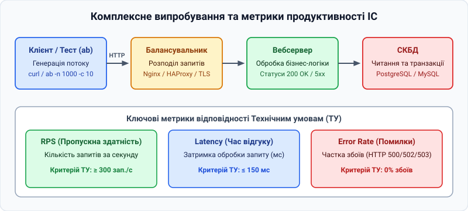

# Урок 42. Технічні умови та методи випробування комплексів інформаційних систем

<div class="how-to">

**Як працювати з уроком**

1. Ознайомтеся з поняттям технічних умов (ТУ), класифікацією видів випробувань інформаційних комплексів та ключовими метриками продуктивності й відмовостійкості.
2. Виконайте покрокове практичне завдання: розгорніть тестовий сервіс, проведіть його функціональне та навантажувальне тестування утилітою Apache Benchmark (`ab`) і складіть стандартизований Протокол випробувань.
3. Закріпіть отримані знання, відповівши на 10 запитань контрольного тесту наприкінці сторінки.

</div>

## Мета уроку

Ви дізнаєтеся, як регламентується передача створеної інформаційної системи в промислову експлуатацію, що таке технічні умови (*ТУ*) та програма й методика випробувань (*ПМВ*), чим автономні випробування відрізняються від комплексних, які бувають види тестування продуктивності (навантажувальне, стресове, на відмовостійкість) та як документувати результати перевірки. На практиці ви:

- перевірите доступність і заголовки відповідей вебсервісу за допомогою утиліти `curl`;
- проведете навантажувальне випробування за допомогою інструмента Apache Benchmark (`ab`);
- визначите реальну пропускну здатність системи у запитах за секунду (*RPS*) та час затримки (*Latency*);
- складете підсумковий протокол випробувань із висновком щодо відповідності технічним умовам.

## Що знадобиться

- Комп'ютер або віртуальна машина з ОС Linux (Ubuntu / Debian / Rocky Linux або WSL2);
- Термінал з правами `sudo`;
- Пакет утиліт вебтестування: `apache2-utils` (містить бенчмарк `ab`) та інструмент `curl`;
- Локальний вебсервер або тестовий HTTP-сервер на мові Python.

## Теорія

<div class="clip">


*Симетричне та асиметричне шифрування даних<sup>[1]</sup>*

</div>

### Що таке комплекс інформаційної системи та Технічні умови?

**Комплекс інформаційної системи (ІС)** — це взаємопов'язана сукупність технічних засобів (сервери, сховища даних, мережеве обладнання), системного програмного забезпечення (ОС, СКБД, вебсервери) та прикладного ПЗ, що працюють як єдине ціле для вирішення завдань організації.

Перед тим як допустити інформаційну систему до обробки реальних даних клієнтів чи виробництва, необхідно переконатися, що вона відповідає встановленим вимогам. Ці вимоги зафіксовані в нормативному документі — **Технічних умовах (ТУ)** або **Технічному завданні (ТЗ)**:

- **Функціональні вимоги:** чи виконує система всі передбачені завдання (авторизація, запис до бази, формування звітів, передача файлів).
- **Вимоги до продуктивності:** яку кількість одночасних користувачів повинна витримувати система, яка мінімальна пропускна здатність (*Requests Per Second, RPS*) та максимальний допустимий час відгуку (*Response Time / Latency*).
- **Вимоги до надійності та безперервності:** коефіцієнт доступності сервісу (наприклад, $SLA = 99.9\%$), час відновлення після збою (*RTO*).
- **Вимоги до безпеки:** захист каналів зв'язку шифруванням TLS/HTTPS, стійкість до несанкціонованого доступу, коректна реакція на некоректні дані.

---

### Класифікація видів випробувань

Перевірка працездатності комплексу ІС здійснюється відповідно до документа **«Програма та методика випробувань (ПМВ)»**, де чітко розписано, що, якими засобами та в якій послідовності перевіряється.

Виділяють такі основні етапи та методи випробувань:

| Вид випробувань | Мета та особливості проведення | Хто виконує |
| :--- | :--- | :--- |
| **Автономні (попередні)** | Перевірка кожного модуля або сервера окремо в ізольованому середовищі (наприклад, тестування тільки бази даних або тільки мережевого комутатора). | Розробники, інженери з налаштування |
| **Комплексні** | Перевірка взаємодії всіх складових частин інформаційного комплексу між собою (клієнт $\rightarrow$ балансувальник $\rightarrow$ вебсервер $\rightarrow$ СКБД). | Системні інтегратори, тестувальники, оператори ІС |
| **Навантажувальні** (*Load Testing*) | Подання на систему прогнозованого робочого навантаження з метою вимірювання часу відгуку та відсутності втрат даних. | Інженери з тестування продуктивності |
| **Стресові** (*Stress Testing*) | Збільшення навантаження понад максимальні межі з метою з'ясувати точку відмови («зламу») системи та перевірити відновлення після піку. | Спеціалісти з надійності (SRE) |
| **На відмовостійкість** (*Failover*) | Штучне відключення одного з резервних серверів, диска чи лінії зв'язку для перевірки автоматичного переходу на дублюючий канал. | Системні адміністратори |
| **Дослідна експлуатація** (*Pilot Run*) | Експлуатація системи невеликою групою реальних користувачів протягом визначеного терміну (наприклад, 1 місяць) для виявлення прихованих дефектів. | Реальні користувачі під наглядом операторів |
| **Приймально-здавальні (ПЗВ)** | Фінальний етап перевірки всієї функціональності в присутності комісії замовника. Завершується підписанням Акту приймання. | Державна або відомча приймальна комісія |

---

### Ключові метрики під час випробувань продуктивності

Під час випробування мережевих та серверних комплексів оператор аналізує три ключові показники:

1. **RPS (*Requests Per Second*)** — кількість успішно оброблених запитів за одну секунду. Що вище це число, то більшу пропускну здатність має система.
2. **Час відповіді / Затримка (*Latency / Response Time*)** — проміжок часу від моменту надсилання запиту клієнтом до моменту отримання повної відповіді. Вимірюється у мілісекундах (мс). У якісних системах середній час відповіді не повинен перевищувати $100\dots 200\text{ мс}$.
3. **Рівень помилок (*Error Rate*)** — відсоток запитів, які завершилися невдачею (мережевий тайм-аут, помилки сервера з кодами HTTP `500 Internal Server Error`, `502 Bad Gateway`, `503 Service Unavailable`). За ТУ рівень помилок за номінального навантаження має становити $0\%$.

<div class="clip">



*Схема комплексного випробування та ключові метрики продуктивності інформаційної системи*

</div>

### Документування результатів: Протокол випробувань

Будь-яке випробування має юридичну силу лише за наявності належно оформленого документа — **Протоколу випробувань**.
Протокол обов'язково містить:
- дату та місце проведення випробування;
- склад комісії (ПІБ, посади представників замовника та виконавця);
- опис об'єкта випробувань (версії ПЗ, конфігурація серверів, топологія мережі);
- перелік пунктів програми випробувань та фактично отримані числові результати;
- підсумковий висновок (наприклад: *«Комплекс випробування витримав, показники відповідають вимогам розділу 4 ТУ. Рекомендовано до введення в дослідну експлуатацію»*).

<div class="more-link">

**Хочете знати більше?** <span class="optional">Необов’язково</span>

У сучасних хмарних та мікросервісних комплексах випробування не проводять вручну раз на рік. Використовують концепцію **Continuous Performance Testing** (безперервне тестування продуктивності), інтегроване в конвеєри CI/CD.

Популярні інструменти промислового тестування:
- **k6** — сучасний інструмент для автоматизованого навантажувального тестування на базі JavaScript із побудовою детальних графіків;
- **Apache JMeter** — потужне середовище для тестування протоколів HTTP, JDBC, FTP, SOAP/REST;
- **Chaos Engineering** (інженерія хаосу) — практика штучного випадкового відключення окремих мікросервісів у працюючому кластері (наприклад, утилітою Chaos Mesh), щоб довести абсолютну неперервність системи для користувача.

</div>

## Покроково

Сьогодні ви виступите в ролі техніка приймальної комісії: розгорнете тестовий сервер, проведете його функціональну перевірку, здійсните серію навантажувальних випробувань за допомогою утиліти `ab` та сформуєте офіційний протокол.

### 1. Підготуйте робоче середовище

1. Встановіть інструменти тестування (якщо вони ще не встановлені):
   ```bash
   sudo apt-get update && sudo apt-get install -y apache2-utils curl
   ```

2. Створіть робочий каталог для тестування та перейдіть у нього:
   ```bash
   mkdir -p ~/testing_lab && cd ~/testing_lab
   ```

3. Створіть простий тестовий файл вебсервісу:
   ```bash
   cat << 'EOF' > index.html
   <!DOCTYPE html>
   <html>
   <head><meta charset="utf-8"><title>Тестовий комплекс ІС</title></head>
   <body>
   <h1>Інформаційна система підприємства</h1>
   <p>Статус комплексу: Працює в штатному режимі.</p>
   </body>
   </html>
   EOF
   ```

4. Запустіть легкий HTTP-сервер на порту 8080 у фоновому режимі:
   ```bash
   python3 -m http.server 8080 &
   ```
   *Запам'ятайте: сервер слухає локальний порт 8080.*

---

### 2. Проведіть попереднє функціональне випробування

Перед навантаженням переконайтеся, що сервер відповідає коректно:

1. Надішліть тестовий HTTP-запит і перевірте заголовок відповіді:
   ```bash
   curl -I http://127.0.0.1:8080/index.html
   ```
   *Ви маєте побачити статусний рядок `HTTP/1.0 200 OK` або `HTTP/1.1 200 OK`, правильний розмір `Content-Length` та тип вмісту `text/html`.*

2. Виміряйте точний час одиничного відгуку за допомогою `curl`:
   ```bash
   curl -o /dev/null -s -w "HTTP-код: %{http_code} | Час з'єднання: %{time_connect} c | Загальний час: %{time_total} c
" http://127.0.0.1:8080/index.html
   ```

---

### 3. Проведіть навантажувальне випробування за допомогою `ab`

Відповідно до ТУ, сервер повинен успішно обробити **1000 запитів**, при цьому одночасно можуть надходити запити від **10 користувачів** (`concurrency = 10`).

Запустіть утиліту Apache Benchmark:

```bash
ab -n 1000 -c 10 http://127.0.0.1:8080/index.html
```

Уважно розгляньте виведений звіт утиліти:

```text
Benchmarking 127.0.0.1 (be patient)
Completed 100 requests
Completed 200 requests
...
Completed 1000 requests
Finished 1000 requests

Concurrency Level:      10
Time taken for tests:   0.452 seconds
Complete requests:      1000
Failed requests:        0
Total transferred:      312000 bytes
HTML transferred:       168000 bytes
Requests per second:    2212.39 [#/sec] (mean)
Time per request:       4.520 [ms] (mean)
Time per request:       0.452 [ms] (mean, across all concurrent requests)
Transfer rate:          673.84 [Kbytes/sec] received

Percentage of the requests served within a certain time (ms)
  50%      4
  66%      5
  75%      5
  80%      5
  90%      6
  95%      7
  98%      9
  99%     11
 100%     18 (longest request)
```

---

### 4. Інтерпретуйте отримані метрики

Зіставте отримані показники з вимогами умовних ТУ:
- **Кількість успішних запитів (*Complete requests*):** `1000` (100% виконано).
- **Збійні запити (*Failed requests*):** `0` (норма за ТУ: 0).
- **Пропускна здатність (*Requests per second*):** понад 2000 запитів/сек (вимога ТУ: не менше 300 запитів/сек $\rightarrow$ **ВИКОНАНО**).
- **Середній час відповіді (*Time per request*):** близько 4.5 мс (вимога ТУ: не більше 150 мс $\rightarrow$ **ВИКОНАНО**).
- **99-й процентиль:** 99% усіх запитів було обслуговано менш ніж за 11 мс.

<div class="try">

**Спробуйте самі**

Проведіть стресове випробування: збільште кількість запитів до **5000**, а кількість одночасних потоків до **100** (`ab -n 5000 -c 100 http://127.0.0.1:8080/index.html`). 

Порівняйте показники:
1. Як змінилася пропускна здатність (*Requests per second*)?
2. Як змінився максимальний час найповільнішого запиту (*longest request*)?
3. Чи з'явилися збійні запити (*Failed requests*)?

<details>
<summary>Перевірити очікуваний результат і повний розв’язок</summary>

Команда для запуску стрес-тесту:
```bash
ab -n 5000 -c 100 http://127.0.0.1:8080/index.html
```

**Очікувані зміни в показниках:**
1. **Зростання часу очікування:** Середній час обробки запиту при 100 паралельних потоках помітно зросте (наприклад, з 4.5 мс до $30\dots 60\text{ мс}$), оскільки запити шикуються в чергу ядра ОС до сокета сервера.
2. **Найдовший запит (*longest request*):** зросте до $80\dots 150\text{ мс}$.
3. **Збійні запити:** Якщо тестовий Python HTTP-сервер є однопотоковим, при 100 одночасних клієнтах можливе виникнення помилок переповнення черги з'єднань (`Failed requests: ... Connection reset by peer`). У промисловому вебсервері (Nginx / Apache) з пулом воркерів таких помилок бути не повинно.

**Висновок для оператора:** Стрес-тест наочно показує фізичну межу можливостей обраного серверного рушія.

</details>

</div>

---

### 5. Складіть офіційний Протокол випробувань

На основі отриманих даних оператор оформлює протокол у робочому зошиті або електронному звіті:

```text
ПРОТОКОЛ ВИПРОБУВАНЬ № 14-ІС
Комплексу інформаційної системи обліку та обробки інформації

Дата проведення: 17 листопада 2026 року
Місце: Лабораторія системного супроводу ІС, стенд № 3
Об'єкт тестування: Тестовий вузол вебсервісу ІС (порт TCP 8080)
Програма та методика: ПМВ-2026/04 «Оцінка продуктивності вебкомплексу»

Результати контрольних замірів:
1. Функціональне тестування (curl): HTTP статус 200 OK — Відповідає.
2. Номінальне навантаження (ab, n=1000, c=10):
   - Фактична продуктивність: 2212.39 запитів/с (Вимога ТУ: >= 300) -> ВІДПОВІДАЄ
   - Середній час відповіді: 4.52 мс (Вимога ТУ: <= 150 мс) -> ВІДПОВІДАЄ
   - Збійних запитів: 0 (Вимога ТУ: 0) -> ВІДПОВІДАЄ
3. Стресове навантаження (ab, n=5000, c=100):
   - Зафіксовано зростання затримки до 48 мс, збоїв не виявлено.

ВИСНОВОК КОМІСІЇ:
Комплекс інформаційної системи витримав випробування в повному обсязі.
Параметри продуктивності та надійності відповідають вимогам Технічних умов.
Комплекс рекомендовано до введення в дослідну експлуатацію.

Підписи членів комісії:
Оператор з обробки інформації: (підпис) ____________ / Шевченко Д. М. /
Керівник випробувань:          (підпис) ____________ / Коваленко І. П. /
```

Після завершення тесту обов'язково зупиніть фоновий тестовий вебсервер:
```bash
killall python3 2>/dev/null || pkill -f "http.server 8080"
```

## Підсумок

- **Технічні умови (ТУ)** встановлюють чіткі числові критерії якості, продуктивності та безпеки, яким зобов'язана відповідати інформаційна система.
- **Програма та методика випробувань (ПМВ)** визначає послідовність тестів: від ізольованих автономних перевірок до комплексних навантажувальних випробувань.
- **Утиліта Apache Benchmark (`ab`)** є стандартним і зручним інструментом оператора для вимірювання швидкодії серверних служб у запитах за секунду (*RPS*) та мілісекундах затримки (*Latency*).
- **Стрес-тестування** дозволяє визначити запас міцності комплексу та точку відмови за екстремальних умов роботи.
- **Протокол випробувань** є обов'язковим звітним документом, на підставі якого приймається рішення про передачу системи в реальну промислову експлуатацію.

## Тест

<div class="test-box">

10 запитань за матеріалом уроку. На початку тесту вкажіть **прізвище, ім’я та групу**.

<!-- GOOGLE_FORM_START:lesson-42 -->
[Відкрити тест у новій вкладці](https://docs.google.com/forms/d/e/1FAIpQLSdLGqTruASGlhcCtaowHF633E5SAaYr2-NyuSUCuBQ5mK7D-w/viewform)

<iframe src="https://docs.google.com/forms/d/e/1FAIpQLSdLGqTruASGlhcCtaowHF633E5SAaYr2-NyuSUCuBQ5mK7D-w/viewform?embedded=true" loading="lazy" title="Тест lesson-42">Завантаження…</iframe>
<!-- GOOGLE_FORM_END:lesson-42 -->

</div>

## Додаткове завдання

<span class="optional">Необов’язково</span> Виконуйте для закріплення навичок діагностики продуктивності.

**Базовий рівень.** Збережіть результати роботи утиліти `ab` у файл формату CSV за допомогою ключа `-e results.csv` та імпортуйте отримані дані у LibreOffice Calc для побудови графіка розподілу часу відповіді (процентилів).

**Проєктний рівень.** Дослідіть роботу спеціалізованої утиліти тестування пропускної здатності комп'ютерної мережі `iperf3`. Запустіть один вузол у режимі сервера (`iperf3 -s`), а інший у режимі клієнта (`iperf3 -c IP_сервера`) та оцініть реальну пропускну здатність мережевого кабелю (Мбіт/с) і рівень джиттеру (*Jitter*).

## Джерела

1. [Symmetric–asymmetric_%28textless%29.svg](https://commons.wikimedia.org/wiki/File:Symmetric–asymmetric_%28textless%29.svg), Wikimedia Commons.
