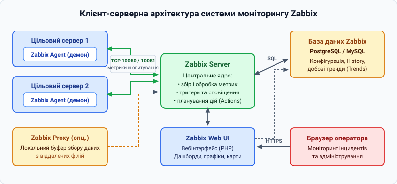

# Урок 43. Моніторинг роботи серверів і служб (Zabbix)

<div class="how-to">

**Як працювати з уроком**

1. Ознайомтеся з архітектурою платформи Zabbix, базовими сутностями моніторингу (вузли, елементи даних, тригери, шаблони) та відмінностями між пасивними й активними перевірками.
2. Виконайте покрокове практичне завдання: встановіть і налаштуйте Zabbix Agent, розширте його функціонал за допомогою власного `UserParameter` та протестуйте зняття метрик консольною утилітою `zabbix_get`.
3. Закріпіть отримані знання, пройшовши підсумковий тест на 10 запитань наприкінці сторінки.

</div>

## Мета уроку

Ви дізнаєтеся, чому система моніторингу є обов'язковим елементом надійної ІТ-інфраструктури, як побудована архітектура популярної платформи з відкритим кодом **Zabbix**, які компоненти входять до її складу (Server, Database, Web Frontend, Agent, Proxy), як налаштовуються правила збору числових показників (*Items*) та логіка виявлення аварій (*Triggers*). На практиці ви:

- налаштуєте файл конфігурації агента моніторингу `zabbix_agentd.conf`;
- створите власний користувацький параметр (*UserParameter*) для вимірювання системних показників;
- запустите та перевірите працездатність служби агента моніторингу в Linux;
- застосуєте утиліту `zabbix_get` для імітації серверного опитування локальних і кастомних метрик.

## Що знадобиться

- Комп'ютер або віртуальна машина з операційною системою Linux (Ubuntu / Debian або інший дистрибутив із правами `sudo`);
- Встановлені пакети `zabbix-agent` та `zabbix-get` (або доступ до інтернет-репозиторіїв);
- Текстовий редактор `nano` та базові навички роботи в командному рядку.

## Теорія

### Навіщо потрібен моніторинг інфраструктури?

У сучасному центрі обробки даних можуть працювати сотні серверів, мережевих комутаторів, джерел безперебійного живлення та тисячі програмних процесів. Людина фізично не здатна кожні п'ять хвилин вручну підключатися до кожного комп'ютера й перевіряти вільне місце на диску чи завантаження процесора.

**Система моніторингу** виконує три критичні завдання:
1. **Оперативне сповіщення про аварії (*Alerting*):** якщо впала база даних або відмовив блок живлення, черговий оператор отримує сповіщення (в Telegram, Slack або SMS) за лічені секунди, до того як про це почнуть масово повідомляти клієнти.
2. **Проактивне попередження (*Proactive detection*):** система відстежує тенденцію росту дискового простору чи пам'яті та сигналізує: *«Увага: розділ /var заповниться через 4 дні»*.
3. **Аналіз трендів і планування місткості (*Capacity Planning*):** графіки навантаження допомагають обґрунтувати закупівлю додаткових серверів або оптимізацію ПЗ.

---

### Архітектура системи Zabbix

**Zabbix** — одна з найпопулярніших у світі відкритих систем моніторингу рівня підприємства (*Enterprise-ready*). Вона має модульну клієнт-серверну архітектуру:

<div class="clip">



*Клієнт-серверна архітектура системи моніторингу Zabbix*

</div>

- **Zabbix Server:** центральне ядро системи. Воно опитує пристрої, приймає дані від агентів, обчислює формули тригерів, записує історію в базу даних і відправляє сповіщення при аваріях.
- **База даних (*Zabbix Database*):** зберігає всі конфігурації, поточні та історичні значення метрик (*History*) і добові статистичні показники (*Trends*). Зазвичай використовують PostgreSQL з розширенням TimescaleDB або MySQL.
- **Вебінтерфейс (*Zabbix Web Frontend*):** графічна панель на базі PHP/Web-сервера, через яку оператор переглядає дашборди, графіки, карту мережі та налаштовує правила моніторингу.
- **Zabbix Agent:** легкий фоновий процес (демон), який встановлюється безпосередньо на контрольованій машині (Windows, Linux, macOS). Агент зчитує системні показники ядра ОС і передає їх серверу.
- **Zabbix Proxy:** проміжний сервер для збору даних з віддалених географічних філій. Він збирає дані локально й пакетно передає на центральний сервер, зменшуючи мережевий трафік та ізолюючи контури безпеки.

---

### Основні поняття Zabbix (Глосарій оператора)

| Поняття | Англійська назва | Призначення та приклад |
| :--- | :--- | :--- |
| **Вузол мережі** | *Host* | Будь-який об'єкт моніторингу з IP-адресою: сервер, комутатор, база даних, сайт. |
| **Елемент даних** | *Item* | Конкретна метрика, яка вимірюється на вузлі. Наприклад: `system.cpu.load` (завантаження CPU), `vm.memory.size[available]` (вільна RAM), `net.if.in[eth0]` (вхідний трафік). |
| **Тригер** | *Trigger* | Логічний вираз умови проблеми. Поки вираз хибний ($0$) — статус `OK`. Коли вираз стає істинним ($1$) — статус `PROBLEM`. Наприклад: `last(/srv1/vfs.fs.size[/,pfree]) < 10` (вільного місця на диску менше 10%). |
| **Важливість тригера** | *Severity* | Рівень загрози: *Information* (інформаційний), *Warning* (попередження), *Average* (середній), *High* (високий), *Disaster* (катастрофа). |
| **Дія** | *Action* | Автоматична реакція системи на подію тригера: відправка Email/Telegram або виконання віддаленої команди (наприклад: перезапуск служби `systemctl restart nginx`). |
| **Шаблон** | *Template* | Заздалегідь налаштований пакет, що об'єднує десятки Items, Triggers та графіків. Прив'язка шаблону `Linux by Zabbix agent` автоматично підключає всі стандартні перевірки до вузла. |

---

### Режими перевірок: Пасивний та Активний

Zabbix Agent підтримує два фундаментальні режими опитування:

1. **Пасивні перевірки (*Passive checks*):**
   - Сервер Zabbix сам підключається до агента на TCP-порт **10050** і запитує: *«Дай мені значення ключа system.cpu.load»*.
   - Агент вимірює значення і миттєво віддає відповідь.
2. **Активні перевірки (*Active checks*):**
   - Агент сам ініціює TCP-з'єднання з сервером на TCP-порт **10051**.
   - Агент запитує у сервера перелік своїх метрик, періодично збирає їх локально та пакетом відправляє на сервер.
   - *Перевага:* дозволяє моніторити комп'ютери, що знаходяться за NAT або брандмауером, куди сервер не може достукатися напряму.

### Користувацькі параметри (*UserParameter*)

Якщо стандартного набору ключів Zabbix недостатньо, системний адміністратор може навчити агента вимірювати будь-що за допомогою механізму **UserParameter** у файлі конфігурації:

$$\text{UserParameter}=\text{ключ\_метрики},\text{командний\_рядок\_ОС}$$

Наприклад: `UserParameter=system.users.count,who | wc -l` навчає агента повертати кількість авторизованих користувачів через команду `who | wc -l`.

<div class="more-link">

**Хочете знати більше?** <span class="optional">Необов’язково</span>

У сучасних хмарних інфраструктурах і середовищах мікросервісів (Kubernetes, Docker) поряд із Zabbix широко використовують зв'язку **Prometheus + Grafana**:
- **Prometheus** спеціалізується на зборі метрик у вигляді часових рядів (*Time-Series Data*) за моделлю *Pull* через HTTP-ендпоінти `/metrics`.
- **Grafana** надає потужні дизайнерські можливості візуалізації метрик, побудови інтерактивних дашбордів із фільтрами та картограмами.
- Проте Zabbix залишається лідером класичного комплексного моніторингу залізничної, банківської та телекомунікаційної інфраструктури завдяки централізованому управлінню та гнучкій системі агентів.

</div>

## Покроково

Сьогодні ви на практиці налаштуєте Zabbix Agent, додасте кастомні метрики моніторингу та протестуєте роботу системи опитування.

### 1. Встановіть Zabbix Agent та тестову утиліту

Виконайте встановлення агента та консольної утиліти `zabbix-get`:

```bash
sudo apt-get update
sudo apt-get install -y zabbix-agent zabbix-get
```

Перевірте статус служби агента:
```bash
systemctl status zabbix-agent --no-pager
```

---

### 2. Налаштуйте конфігурацію агента

Головний файл конфігурації агента знаходиться за шляхом `/etc/zabbix/zabbix_agentd.conf`.

1. Відкрийте файл для редагування:
   ```bash
   sudo nano /etc/zabbix/zabbix_agentd.conf
   ```

2. Знайдіть та перевірте такі ключові директиви:
   - `Server=127.0.0.1` — IP-адреса, з якої дозволено приймати пасивні запити (для навчального стенда вказуємо локальний комп'ютер);
   - `ListenPort=10050` — порт прослуховування агента;
   - `Hostname=srv-operator-lab` — унікальне ім'я цього комп'ютера у системі моніторингу;
   - `Include=/etc/zabbix/zabbix_agentd.d/*.conf` — директива, що дозволяє підключати додаткові модульні файли конфігурації.

3. Збережіть файл (`Ctrl+O`, `Enter`) та вийдіть (`Ctrl+X`).

---

### 3. Створіть власні метрики (*UserParameter*)

Замість редагування великого головного файлу професійні оператори створюють окремі конфігураційні файли в підкаталозі `zabbix_agentd.d/`.

1. Створіть файл користувацьких параметрів:
   ```bash
   sudo nano /etc/zabbix/zabbix_agentd.d/custom_system.conf
   ```

2. Додайте дві нові корисні метрики:
   ```ini
   # Метрика 1: Кількість активних користувачів у системі
   UserParameter=custom.users.count,who | wc -l

   # Метрика 2: Кількість активних TCP-з'єднань на сервері
   UserParameter=custom.net.tcp_established,ss -tan state established | grep -v Recv-Q | wc -l

   # Метрика 3: Статус вебсервера (1 - запущено, 0 - зупинено)
   UserParameter=custom.service.nginx_status,systemctl is-active --quiet nginx && echo 1 || echo 0
   ```

3. Збережіть файл і перезапустіть службу агента для застосування змін:
   ```bash
   sudo systemctl restart zabbix-agent
   ```

---

### 4. Протестуйте зняття метрик за допомогою `zabbix_get`

Утиліта `zabbix_get` імітує поведінку справжнього Zabbix Server: вона підключається до агента за вказаною IP-адресою і запитує значення за назвою ключа.

1. Запитайте стандартну метрику часу безперервної роботи ОС (*Uptime*):
   ```bash
   zabbix_get -s 127.0.0.1 -p 10050 -k "system.uptime"
   ```
   *Агент поверне кількість секунд із моменту старту ОС.*

2. Запитайте завантаження процесора (*CPU Load Average* за 1 хвилину):
   ```bash
   zabbix_get -s 127.0.0.1 -p 10050 -k "system.cpu.load[all,avg1]"
   ```

3. Запитайте створені вами кастомні метрики `UserParameter`:
   ```bash
   zabbix_get -s 127.0.0.1 -p 10050 -k "custom.users.count"
   zabbix_get -s 127.0.0.1 -p 10050 -k "custom.net.tcp_established"
   zabbix_get -s 127.0.0.1 -p 10050 -k "custom.service.nginx_status"
   ```
   *Переконайтеся, що агент повертає коректні числові відповіді!*

<div class="try">

**Спробуйте самі**

Додайте до файлу `/etc/zabbix/zabbix_agentd.d/custom_system.conf` новий параметр `custom.disk.used_perc`, який повертає точний числовий відсоток використання кореневого розділу `/` (без знака `%`). 

Перезапустіть агента та перевірте значення за допомогою `zabbix_get`. Після цього запишіть у зошиті формулу тригера Zabbix для цього ключа, яка повинна переходити в статус проблеми `Warning`, якщо заповнення диска перевищить 80%, та `High`, якщо заповнення перевищить 90%.

<details>
<summary>Перевірити очікуваний результат і повний розв’язок</summary>

1. Рядок для додавання у `/etc/zabbix/zabbix_agentd.d/custom_system.conf`:
   ```ini
   UserParameter=custom.disk.used_perc,df / | awk 'NR==2 {print $5}' | tr -d '%'
   ```

2. Команди перевірки:
   ```bash
   sudo systemctl restart zabbix-agent
   zabbix_get -s 127.0.0.1 -p 10050 -k "custom.disk.used_perc"
   ```
   *Очікуваний результат: одне ціле число (наприклад, `54` або `78`).*

3. Формули тригерів Zabbix (синтаксис тригерних виразів Zabbix 6.x/7.x):
   - **Рівень Warning (80%):**
     `last(/srv-operator-lab/custom.disk.used_perc) >= 80`
   - **Рівень High (90%):**
     `last(/srv-operator-lab/custom.disk.used_perc) >= 90`

**Пояснення:** Функція `last()` аналізує останнє отримане значення елемента даних. Якщо воно сягає $80$ чи $90$, Zabbix негайно відкриває подію проблеми та сповіщає персонал.

</details>

</div>

## Підсумок

- **Моніторинг** є незамінним інструментом підтримки надійності, що забезпечує миттєве сповіщення про аварії та проактивне виявлення збоїв.
- **Архітектура Zabbix** включає сервер обробки, базу даних, вебконсоль керування, агентів на вузлах та проксі-сервери.
- **Елементи даних (*Items*)** збирають сирі числові показники, а **Тригери (*Triggers*)** обчислюють логічні умови виникнення проблем за рівнями важливості (*Severity*).
- **Пасивний режим** передбачає запит сервера до порту 10050 агента, а **активний режим** — передачу метрик самим агентом на порт 10051 сервера.
- **Механізм `UserParameter`** дозволяє оператору легко створювати довільні власні метрики для моніторингу специфічного прикладного програмного забезпечення.

## Тест

<div class="test-box">

10 запитань за матеріалом уроку. На початку тесту вкажіть **прізвище, ім’я та групу**.

🔗 <!-- GOOGLE_FORM_URL:lesson-43 --> *(Посилання на Google Форму буде додано після масового імпорту тесту)*

</div>

## Додаткове завдання

<span class="optional">Необов’язково</span> Виконуйте для практичного оволодіння навичками інженера супроводу ІС.

**Базовий рівень.** Дослідіть наявність вбудованого в Zabbix механізму моніторингу наявності файлів і перевірте через `zabbix_get` стандартний ключ `vfs.file.exists[/etc/passwd]`.

**Проєктний рівень.** Напишіть bash-скрипт для UserParameter, який моніторить розмір головного системного журналу `/var/log/syslog` у мегабайтах. Складіть логіку сповіщення, яка попереджає про аномально швидкий ріст лог-файлу (наприклад, якщо його розмір перевищує 500 МБ).
