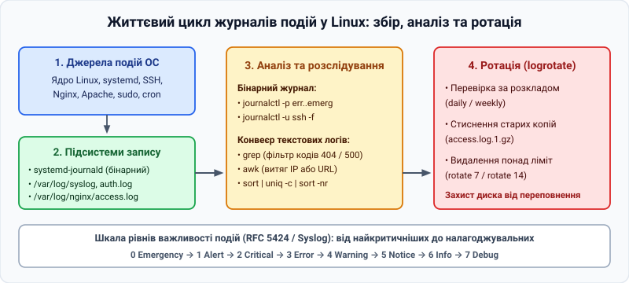

# Урок 44. Журнали подій та їх аналіз

<div class="how-to">

**Як працювати з уроком**

1. Ознайомтеся з роллю журналів подій (логів) у діагностиці та кібербезпеці, рівнями важливості повідомлень за стандартом Syslog та структурою журналів у Linux і Windows.
2. Виконайте покрокове практичне завдання: навчіться фільтрувати системні журнали за допомогою `journalctl`, побудуйте конвеєр командного рядка для розслідування інцидентів та створіть конфігурацію ротації логів `logrotate`.
3. Закріпіть отримані знання, пройшовши підсумковий тест на 10 запитань наприкінці сторінки.

</div>

## Мета уроку

Ви дізнаєтеся, чому журнал подій називають «чорною скринькою» будь-якої комп'ютерної системи, як структуровані повідомлення операційної системи, які існують рівні важливості подій за стандартом RFC 5424, як влаштована бінарна підсистема `systemd-journald` та традиційні текстові логи `/var/log`, а також як запобігти переповненню дисків за допомогою механізму ротації. На практиці ви:

- застосуєте утиліту `journalctl` для швидкого пошуку критичних системних помилок та відстеження подій у режимі реального часу;
- проаналізуєте журнал аутентифікації для виявлення ознак атак підбору паролів (*Brute-force*);
- побудуєте конвеєр консольних утиліт (`grep`, `awk`, `sort`, `uniq`) для швидкої агрегації та аналізу логів вебсервера;
- налаштуєте правила автоматичного архівування та ротації застарілих лог-файлів.

## Що знадобиться

- Комп'ютер або віртуальна машина з операційною системою Linux (Ubuntu / Debian або WSL2 у Windows);
- Термінал з правами `sudo`;
- Стандартні утиліти аналізу тексту: `journalctl`, `grep`, `awk`, `cut`, `sort`, `uniq`, текстовий редактор `nano`.

## Теорія

### Роль журналювання в інформаційних системах

Кожна дія в операційній системі — запуск програми, вхід користувача, зміна мережевих налаштувань, збій підключення до бази даних чи невдала спроба введення пароля — фіксується у вигляді запису з часовою міткою. Такі записи називають **журналами подій** (*Logs* або лог-файлами).

Без журналювання неможливо розв'язати три фундаментальні задачі:
1. **Технічна діагностика (*Troubleshooting*):** з'ясування причин аварійних збоїв чи уповільнення сервісів.
2. **Кібербезпека та розслідування інцидентів (*Digital Forensics*):** виявлення фактів несанкціонованого проникнення, компрометації паролів або витоку конфіденційної інформації.
3. **Аудит відповідності (*Compliance*):** підтвердження того, хто і коли вносив зміни в критичні дані згідно з вимогами законодавства про захист інформації.

---

### Рівні важливості подій (стандарт RFC 5424 / Syslog)

Усі повідомлення в комп'ютерних системах класифікуються за рівнем серйозності від 0 до 7:

| Рівень (Severity) | Назва | Опис | Приклад ситуації |
| :---: | :--- | :--- | :--- |
| **0** | **Emergency** (`emerg`) | Система повністю непрацездатна. | Паніка ядра ОС (*Kernel Panic*), відмова всіх накопичувачів. |
| **1** | **Alert** (`alert`) | Потрібне негайне втручання чергового персоналу. | Пошкодження файлової системи, відмова охолодження. |
| **2** | **Critical** (`crit`) | Критичний стан апаратного або програмного засобу. | Збій основного диска в RAID-масиві. |
| **3** | **Error** (`err`) | Помилка функціонування окремої служби чи додатка. | СКБД не може підключитися до бази даних клієнтів. |
| **4** | **Warning** (`warning`) | Попередження про можливу проблему в майбутньому. | Заповнення диска сягнуло 88%, високе споживання пам'яті. |
| **5** | **Notice** (`notice`) | Нормальна, але значуща подія життєвого циклу. | Службу успішно перезапущено оператором. |
| **6** | **Informational** (`info`) | Звичайні інформаційні повідомлення про штатну роботу. | Користувач `admin` успішно авторизувався через SSH. |
| **7** | **Debug** (`debug`) | Налагоджувальні повідомлення з надлишковими даними. | Трасування виконання SQL-запитів для розробника. |

---

### Журнали в операційній системі Linux

В сучасних дистрибутивах Linux діють дві взаємодоповнюючі системи журналювання:

1. **`systemd-journald`:**
   - Служба, що збирає повідомлення ядра, системних служб та стандартного виводу процесів (`stdout`/`stderr`).
   - Зберігає дані у **бінарному структурованому форматі** (що забезпечує захист від випадкового редагування та миттєву швидкість індексації).
   - Читання та фільтрація здійснюються виключно через утиліту **`journalctl`**.

2. **Традиційні текстові логи (`/var/log/`):**
   - Більшість демонів продукують зручні для читання текстові файли:
     - `/var/log/syslog` (у Debian/Ubuntu) або `/var/log/messages` (у RHEL/CentOS) — головний системний лог;
     - `/var/log/auth.log` (або `/var/log/secure`) — аутентифікація, виклики команди `sudo`, спроби входу через SSH;
     - `/var/log/nginx/` або `/var/log/apache2/` — `access.log` (хто звертався до вебсервера) та `error.log` (помилки обробки);
     - `/var/log/boot.log` — повідомлення під час завантаження комп'ютера.

---

### Ротація логів (*Log Rotation*)

Якщо сервер щосекунди обслуговує тисячі запитів, лог-файли за тиждень можуть розростися до десятків гігабайтів і повністю паралізувати роботу операційної системи.

Для запобігання цьому використовується служба **`logrotate`**:
- Вона за розкладом (щодня або щотижня) архівує поточний файл (наприклад, стискає у `access.log.1.gz`);
- Створює новий порожній `access.log` для поточних записів;
- Видаляє архіви, старіші за встановлений ліміт (наприклад, зберігати лише останні 14 днів).
- Конфігураційні правила зберігаються у каталозі `/etc/logrotate.d/`.

<div class="clip">



*Життєвий цикл журналів подій у Linux: збір, аналіз та ротація*

</div>

---

### Журнали у Windows (Windows Event Log)

В операційних системах Windows журнали подій переглядаються через графічну консоль **`eventvwr.msc`** (*Event Viewer / Переглядач подій*).
Основні журнали:
- **Application (Програми):** події прикладного ПЗ (наприклад, Microsoft SQL Server або 1C);
- **Security (Безпека):** успішні та невдалі спроби входу (*Event ID 4624* — успішний вхід, *Event ID 4625* — невдалий вхід із неправильним паролем);
- **System (Система):** події драйверів пристроїв, ядра Windows, мережевих карт.

Для автоматизації аналізу в Windows використовують PowerShell-команди `Get-WinEvent` та `Get-EventLog`.

<div class="more-link">

**Хочете знати більше?** <span class="optional">Необов’язково</span>

У масштабних організаціях логи з сотень серверів надсилають на централізовану платформу **SIEM** (*Security Information and Event Management*).
- **Стек ELK (Elasticsearch, Logstash, Kibana)** або **Grafana Loki** збирають терабайти логів за секунду, надаючи операторам миттєвий повнотекстовий пошук за будь-яким словом чи IP-адресою.
- Моніторинг безпеки (SOC — *Security Operations Center*) налаштовує правила кореляції: наприклад, якщо з одного IP за 60 секунд зафіксовано понад 10 подій з кодом 4625 (невдалий пароль), система автоматично блокує цю адресу на міжмережевому екрані.

</div>

## Покроково

Сьогодні ви виступите в ролі оператора служби кібербезпеки та технічної підтримки: навчитеся швидко знаходити критичні помилки через `journalctl`, дослідите підозрілу активність у логах та налаштуєте авторотацію.

### 1. Опануйте роботу з `journalctl`

1. Перегляньте останні 20 записів системного журналу:
   ```bash
   journalctl -n 20
   ```

2. Знайдіть усі системні помилки від рівня `err` (помилка) до `emerg` (катастрофа):
   ```bash
   journalctl -p err..emerg -n 25
   ```
   *Ця команда відфільтровує дрібні інформаційні повідомлення, фокусуючи увагу оператора виключно на реальних проблемах.*

3. Подивіться повідомлення конкретної служби (наприклад, системного планувальника `cron` або служби `ssh`):
   ```bash
   journalctl -u cron -n 15
   ```

4. Запустіть живий моніторинг журналу в реальному часі (*live follow*):
   ```bash
   journalctl -f
   ```
   *Натисніть `Ctrl+C`, щоб зупинити перегляд.*

---

### 2. Створіть навчальний лог-файл вебсервера для аналізу

Щоб відпрацювати навички розслідування інцидентів, створимо реалістичний журнал звернень до вебсервера:

```bash
mkdir -p ~/log_analysis && cd ~/log_analysis

cat << 'ENDLOG' > web_access.log
192.168.1.10 - - [17/Nov/2026:10:00:01 +0200] "GET /index.html HTTP/1.1" 200 4500
192.168.1.15 - - [17/Nov/2026:10:00:05 +0200] "GET /about.html HTTP/1.1" 200 2300
203.0.113.45 - - [17/Nov/2026:10:01:12 +0200] "GET /wp-login.php HTTP/1.1" 404 180
203.0.113.45 - - [17/Nov/2026:10:01:14 +0200] "GET /admin HTTP/1.1" 404 180
203.0.113.45 - - [17/Nov/2026:10:01:16 +0200] "GET /.env HTTP/1.1" 404 180
192.168.1.20 - - [17/Nov/2026:10:02:22 +0200] "GET /products HTTP/1.1" 500 520
203.0.113.45 - - [17/Nov/2026:10:02:30 +0200] "GET /config.json HTTP/1.1" 404 180
192.168.1.10 - - [17/Nov/2026:10:03:00 +0200] "GET /contact.html HTTP/1.1" 200 1200
203.0.113.45 - - [17/Nov/2026:10:03:15 +0200] "GET /api/v1/users HTTP/1.1" 403 210
192.168.1.30 - - [17/Nov/2026:10:04:10 +0200] "GET /index.html HTTP/1.1" 200 4500
ENDLOG
```

---

### 3. Побудуйте аналітичні конвеєри командного рядка

Професійний оператор не переглядає гігабайти файлів очима, а використовує ланцюжки утиліт (*pipes* `|`):

1. **Знайдіть усі критичні помилки сервера (код 500):**
   ```bash
   grep ' 500 ' web_access.log
   ```
   *Ви бачите, що користувач з IP 192.168.1.20 зіткнувся з помилкою бекенду на сторінці `/products`.*

2. **Підрахуйте кількість запитів з кожної IP-адреси:**
   ```bash
   awk '{print $1}' web_access.log | sort | uniq -c | sort -nr
   ```
   *Результат:*
   ```text
         5 203.0.113.45
         2 192.168.1.10
         1 192.168.1.30
         1 192.168.1.20
         1 192.168.1.15
   ```
   *Очевидно, що зовнішній хост `203.0.113.45` генерує підозріло високу активність.*

3. **Дослідіть дії підозрілої адреси:**
   ```bash
   grep '203.0.113.45' web_access.log
   ```
   *Висновок оператора: хост проводить сканування на типові вразливості (`wp-login.php`, `.env`, `/admin`, `config.json`). Дану IP-адресу необхідно передати адміністратору для блокування.*

---

### 4. Налаштуйте конфігурацію ротації логів `logrotate`

Створіть навчальне правило ротації для нашого сервісу:

1. Створіть файл конфігурації у поточному каталозі:
   ```bash
   cat << 'ENDCONF' > test_logrotate.conf
   /home/*/log_analysis/*.log {
       daily
       rotate 7
       compress
       missingok
       notifempty
   }
   ENDCONF
   ```

2. Зміст директив:
   - `daily` — перевіряти та ротувати файл щоденно;
   - `rotate 7` — зберігати не більше 7 останніх архівних копій;
   - `compress` — стискати старі файли архіватором gzip;
   - `missingok` — не видавати помилку, якщо лог-файл відсутній;
   - `notifempty` — не ротувати порожні файли.

<div class="try">

**Спробуйте самі**

Напишіть консольний конвеєр для файлу `web_access.log`, який:
1. Вибирає тільки ті рядки, де HTTP-код відповіді дорівнює **404** (не знайдено);
2. Витягує запитувану URL-адресу (7-ме поле у лозі);
3. Підраховує частоту звернення до кожного неіснуючого шляху і виводить результат від найбільш популярного до найменш популярного.

<details>
<summary>Перевірити очікуваний результат і повний розв’язок</summary>

Команда розв'язку:
```bash
grep ' 404 ' web_access.log | awk '{print $7}' | sort | uniq -c | sort -nr
```

**Очікуваний вивід у терміналі:**
```text
      1 /wp-login.php
      1 /config.json
      1 /admin
      1 /.env
```

**Пояснення:**
- `grep ' 404 '` — залишає тільки записи про помилки відсутності сторінки;
- `awk '{print $7}'` — витягує сьомий стовпець рядка, де зберігається запитаний URL;
- `sort` — впорядковує рядки за алфавітом (обов'язково перед `uniq`);
- `uniq -c` — підраховує кількість дублікатів для кожного рядка;
- `sort -nr` — числове сортування у зворотному напрямку (від найбільшої кількості до найменшої).

Цей прийом дозволяє оператору за лічені секунди виявити ботів-сканерів у лог-файлі з мільйонами рядків!

</details>

</div>

## Підсумок

- **Журнали подій (*Logs*)** є головним інструментом діагностики збоїв, розслідування інцидентів кібербезпеки та контролю змін в інформаційних системах.
- **Стандарт RFC 5424** встановлює єдину шкалу важливості від 0 (*Emergency*) до 7 (*Debug*), що дозволяє фільтрувати події за ступенем загрози.
- **Підсистема `systemd-journald`** та утиліта `journalctl` забезпечують швидку вибірку системних повідомлень у Linux за часом, службою та рівнем критичності.
- **Конвеєри Linux (`grep`, `awk`, `cut`, `sort`, `uniq`)** дають оператору можливість миттєво обробляти гігабайти логів без використання стороннього важкого ПЗ.
- **Служба `logrotate`** автоматизує стиснення та видалення застарілих логів, гарантуючи захист дискових накопичувачів від переповнення.

## Тест

<div class="test-box">

10 запитань за матеріалом уроку. На початку тесту вкажіть **прізвище, ім’я та групу**.

<!-- GOOGLE_FORM_START:lesson-44 -->
[Відкрити тест у новій вкладці](https://docs.google.com/forms/d/e/1FAIpQLScXznuX1dFVlBfbuqGBtvaiQYI3EywgeSAevpDnUOcFjojHGg/viewform)

<iframe src="https://docs.google.com/forms/d/e/1FAIpQLScXznuX1dFVlBfbuqGBtvaiQYI3EywgeSAevpDnUOcFjojHGg/viewform?embedded=true" loading="lazy" title="Тест lesson-44">Завантаження…</iframe>
<!-- GOOGLE_FORM_END:lesson-44 -->

</div>

## Додаткове завдання

<span class="optional">Необов’язково</span> Виконуйте для закріплення навичок форензіки та аудиту безпеки.

**Базовий рівень.** Дослідіть журнал аутентифікації вашої системи (`/var/log/auth.log` або команду `journalctl -u ssh`). Знайдіть випадки успішного виконання команд суперкористувача через `sudo` за допомогою команди `grep 'COMMAND=' /var/log/auth.log 2>/dev/null || journalctl _COMM=sudo`.

**Проєктний рівень.** Дослідіть інструмент захисту від підбору паролів **Fail2ban**. Дізнайтеся, як цей демон аналізує системні логи в реальному часі та автоматично додає IP-адреси зловмисників до правил блокування `iptables` / `nftables` при виявленні багаторазових помилок авторизації.
