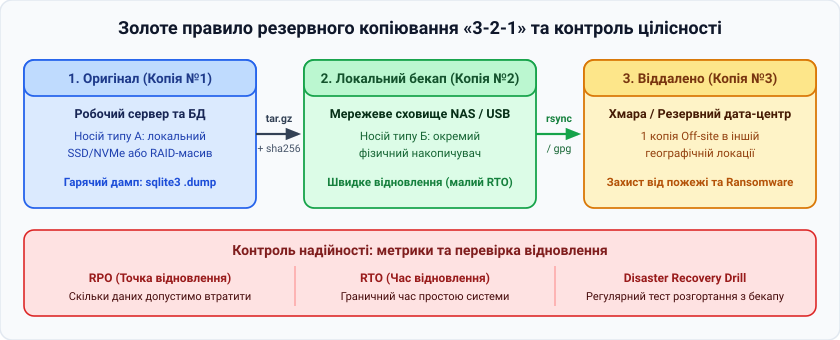

# Урок 45. Резервне копіювання баз даних і серверних даних

<div class="how-to">

**Як працювати з уроком**

1. Ознайомтеся з фундаментальними принципами резервного копіювання, правилом «3-2-1», метриками RPO та RTO, відмінностями між типами бекапів та специфікою збереження баз даних.
2. Виконайте покрокове практичне завдання: розробіть автоматизований скрипт резервування бази даних і файлів конфігурації, налаштуйте планувальник `cron` та проведіть тренувальне відновлення системи після штучного збою.
3. Закріпіть отримані знання, пройшовши підсумковий тест на 10 запитань наприкінці сторінки.

</div>

## Мета уроку

Ви дізнаєтеся, чому резервне копіювання (*Backup*) є єдиною абсолютною гарантією виживання організації при апаратних поломках чи кібератаках вірусів-вимагачів (*Ransomware*), що означають метрики $RPO$ та $RTO$, як застосовувати золоте правило надійності «3-2-1», чим повний бекап відрізняється від інкрементного та диференційного, а також чому бази даних вимагають створення спеціальних «гарячих» логічних дампів. На практиці ви:

- створите тестову реляційну базу даних та конфігураційний каталог;
- напишете комплексний bash-скрипт резервного копіювання зі стисненням, контролем цілісності та авторотацією;
- автоматизуєте виконання резервного копіювання за розкладом у планувальнику `cron`;
- проведете регламентне навчальне відновлення даних (*Disaster Recovery Drill*) для підтвердження цілісності бекапу.

## Що знадобиться

- Комп'ютер або віртуальна машина з операційною системою Linux (Ubuntu / Debian або WSL2);
- Термінал з правами `sudo`;
- Стандартні системні утиліти: `tar`, `gzip`, `sha256sum`, `cron`, пакет `sqlite3` для роботи з навчальною базою даних.

## Теорія

### Чому резервне копіювання — головна турбота оператора?

У світі системного адміністрування існує класичний вислів: *«Системні адміністратори поділяються на дві категорії: тих, хто ще не робить бекапи, і тих, хто вже робить»*.

Втрата інформації може статися будь-якої миті через:
- **Апаратні збої:** раптова поломка материнської плати, вихід з ладу контролера RAID або одночасна відмова двох дисків;
- **Людський фактор:** випадкове виконання деструктивної команди (`rm -rf` або `DROP TABLE`) оператором чи програмістом;
- **Шкідливе ПЗ:** шифрувальники-вимагачі (*Ransomware*), які блокують усі доступні диски підприємства та вимагають викуп;
- **Форс-мажорні обставини:** пожежа, затоплення водою, крадіжка обладнання з офісу.

---

### Метрики надійності: RPO та RTO

Під час планування політики резервного копіювання бізнес визначає два ключові параметри:

1. **RPO (*Recovery Point Objective* — цільова точка відновлення):**
   - Максимальний проміжок часу, за який допустимо втратити дані у разі аварії.
   - *Приклад:* якщо бекап бази виконується раз на добу о 02:00 ночі, а збій трапився о 18:00, дані за 16 годин роботи будуть безповоротно втрачені ($RPO = 16\text{ годин}$). Для банківських систем RPO становить лічені секунди (використовують миттєву реплікацію).
2. **RTO (*Recovery Time Objective* — цільовий час відновлення):**
   - Максимально допустимий час, необхідний на повне відновлення працездатності системи після катастрофи.
   - *Приклад:* якщо для розгортання сервера з архіву потрібно 3 години, то $RTO = 3\text{ години}$.

---

### Золоте правило резервування «3-2-1»

Загальновизнаний світовий стандарт надійності резервного копіювання передбачає дотримання формули **3-2-1**:

- **3 копії даних:** один робочий оригінал та щонайменше дві резервні копії.
- **2 різні типи носіїв:** заборонено зберігати копію на тому ж самому фізичному накопичувачі, де лежить оригінал! Слід комбінувати локальний RAID-масив, зовнішній жорсткий диск USB, мережеве сховище NAS або магнітну стрічку.
- **1 копія за межами майданчика (*Off-site*):** щонайменше одна копія повинна фізично перебувати в іншій географічній локації (в іншому місті, у хмарному сховищі AWS S3, Google Cloud або в іншому офісі), щоб зберегти дані при пожежі чи стихійному лиху.

<div class="clip">



*Золоте правило резервного копіювання «3-2-1», метрики RPO/RTO та контроль цілісності*

</div>

---

### Види резервного копіювання

| Тип бекапу | Що копіюється? | Швидкість створення | Швидкість відновлення | Складність ланцюжка |
| :--- | :--- | :---: | :---: | :--- |
| **Повний** (*Full Backup*) | Абсолютно всі файли та структури системи. | Найповільніша | Найшвидша | **1 файл:** потрібен лише сам повний архів. |
| **Диференційний** (*Differential*) | Усі файли, що змінилися або додалися з моменту останнього **повного** бекапу. | Середня | Швидка | **2 файли:** останній повний + найсвіжіший диференційний. |
| **Інкрементний** (*Incremental*) | Тільки ті файли, що змінилися з моменту **попереднього** бекапу будь-якого типу. | Найшвидша | Найповільніша | **Весь ланцюжок:** останній повний + абсолютно всі проміжні інкременти по черзі. |

---

### Специфіка резервування баз даних

Базу даних **не можна** просто скопіювати звичайною командою копіювання файлів (`cp` або `xcopy`), поки працює СКБД!
Причина: СКБД постійно тримає частину даних в оперативній пам'яті (буферах транзакцій) та відкриває файли в монопольному режимі. Файлова копія працюючої СКБД майже завжди буде пошкодженою (*corrupted*).

Існує два методи копіювання БД:
1. **Холодне копіювання (*Cold/Offline*):** служба СКБД повністю зупиняється (`systemctl stop mysql`), копіюються файли бази, після чого служба запускається знову. Метод гарантує цілісність, але вимагає зупинки сервісу, що неприпустимо для цілодобових систем.
2. **Гаряче копіювання (*Hot/Online*):** створення узгодженої копії без переривання роботи користувачів за допомогою спеціальних утиліт:
   - **Логічний дамп:** вивантаження схеми та даних у текстовий файл із набором SQL-інструкцій (`CREATE TABLE`, `INSERT INTO`). Інструменти: `mysqldump` (MySQL/MariaDB), `pg_dump` (PostgreSQL), `.dump` у SQLite.
   - **Фізичний бінарний бекап:** копіювання блоків даних із синхронізацією журналів транзакцій (наприклад, утиліта *Percona XtraBackup* або режим WAL-архівації).

> **Головний закон бекапу:** Бекап, процедура відновлення з якого не була протестована на практиці, вважається неіснуючим! Регулярні навчання з відновлення (*Disaster Recovery Drills*) — прямий обов'язок системного персоналу.

<div class="more-link">

**Хочете знати більше?** <span class="optional">Необов’язково</span>

У корпоративному середовищі велику популярність мають спеціалізовані клієнт-серверні комплекси резервного копіювання:
- **BorgBackup / Restic** — надшвидкі утиліти з підтримкою блочної **дедуплікації** (якщо 100 користувачів зберегли однаковий файл розміром 50 МБ, у сховище запишеться лише одна копія, економлячи 99% місця) та наскрізного криптографічного шифрування.
- **Veeam Backup & Replication** — промисловий стандарт створення безперервних знімків (*Snapshots*) віртуальних машин у середовищах VMware vSphere та Microsoft Hyper-V.

</div>

## Покроково

Сьогодні ви створите надійну навчальну підсистему резервного копіювання: підготуєте базу даних, напишете автоматизований bash-скрипт бекапу з контролем цілісності sha256, заплануєте його через `cron` і виконаєте аварійне відновлення.

### 1. Підготуйте навчальні дані

Встановіть клієнт SQLite та створіть тестову інфраструктуру:

1. Встановіть SQLite (якщо ще не встановлено):
   ```bash
   sudo apt-get update && sudo apt-get install -y sqlite3
   ```

2. Створіть структуру робочих каталогів:
   ```bash
   mkdir -p ~/backup_lab/data
   mkdir -p ~/backup_lab/configs
   mkdir -p ~/backup_lab/storage
   cd ~/backup_lab
   ```

3. Створіть навчальну базу даних `data/production.db` із таблицею обліку:
   ```bash
   sqlite3 data/production.db << 'SQL_EOF'
   CREATE TABLE inventory (
       id INTEGER PRIMARY KEY AUTOINCREMENT,
       item_name TEXT NOT NULL,
       serial_number TEXT UNIQUE,
       status TEXT
   );
   INSERT INTO inventory (item_name, serial_number, status) VALUES 
   ('Сервер Dell PowerEdge R640', 'SN-849204-DL', 'Активний'),
   ('Комутатор Cisco Catalyst 2960', 'SN-193842-CS', 'Активний'),
   ('ДБЖ APC Smart-UPS 3000', 'SN-994821-AP', 'В резерві');
   SQL_EOF
   ```

4. Створіть умовний конфігураційний файл:
   ```bash
   echo "PORT=8080
DB_PATH=/var/data/production.db
ENV=production" > configs/app.conf
   ```

---

### 2. Розробіть автоматизований скрипт бекапу `make_backup.sh`

Створіть файл скрипта:
```bash
nano make_backup.sh
```

Введіть код резервного копіювання:

```bash
#!/bin/bash
# Скрипт регламентного резервного копіювання
# Професія 4113: Оператор з обробки інформації та ПЗ

set -e # Зупинити виконання при будь-якій помилці

PROJECT_DIR="$HOME/backup_lab"
DATA_DIR="$PROJECT_DIR/data"
CONFIG_DIR="$PROJECT_DIR/configs"
STORAGE_DIR="$PROJECT_DIR/storage"
TIMESTAMP=$(date +%Y%m%d_%H%M%S)
BACKUP_NAME="backup_$TIMESTAMP"
TEMP_BACKUP_DIR="/tmp/$BACKUP_NAME"

echo "=== ПОЧАТОК РЕЗЕРВНОГО КОПІЮВАННЯ: $(date) ==="

# 1. Створення тимчасового каталогу для збору копій
mkdir -p "$TEMP_BACKUP_DIR"

# 2. Створення логічного дампа бази даних (Hot Backup)
echo "[1/4] Створення гарячого дампа бази даних SQLite..."
sqlite3 "$DATA_DIR/production.db" ".dump" > "$TEMP_BACKUP_DIR/db_dump.sql"

# 3. Копіювання конфігураційних файлів
echo "[2/4] Копіювання конфігурацій..."
cp -r "$CONFIG_DIR" "$TEMP_BACKUP_DIR/configs"

# 4. Створення стисненого архіву tar.gz
ARCHIVE_PATH="$STORAGE_DIR/${BACKUP_NAME}.tar.gz"
echo "[3/4] Стиснення архіву у $ARCHIVE_PATH..."
tar -czf "$ARCHIVE_PATH" -C "/tmp" "$BACKUP_NAME"

# 5. Обчислення контрольної суми для перевірки цілісності
echo "[4/4] Генерація контрольної суми SHA-256..."
sha256sum "$ARCHIVE_PATH" > "${ARCHIVE_PATH}.sha256"

# 6. Очищення тимчасових файлів
rm -rf "$TEMP_BACKUP_DIR"

# 7. Ротація застарілих копій (зберігати файли не старіші ніж 7 днів)
echo "Ротація застарілих архівів..."
find "$STORAGE_DIR" -type f -name "backup_*.tar.gz*" -mtime +7 -delete

echo "=== РЕЗЕРВНЕ КОПІЮВАННЯ УСПІШНО ЗАВЕРШЕНО ==="
echo "Архів: $ARCHIVE_PATH"
echo "Контрольна сума: $(cat ${ARCHIVE_PATH}.sha256)"
```

Збережіть файл та закрийте `nano`.

---

### 3. Запустіть скрипт і перевірте створений бекап

1. Зробіть скрипт виконуваним:
   ```bash
   chmod +x make_backup.sh
   ```

2. Запустіть процедуру резервування:
   ```bash
   ./make_backup.sh
   ```

3. Перегляньте створене сховище резервних копій:
   ```bash
   ls -lh storage/
   ```
   *Ви побачите стиснений архів `.tar.gz` та файл цифрового хешу `.sha256`.*

4. Перевірте цілісність створеного архіву за допомогою контрольної суми:
   ```bash
   sha256sum -c storage/*.sha256
   ```
   *Результат має бути: `... OK`.*

---

### 4. Налаштуйте розклад у системному планувальнику `cron`

Щоб бекап виконувався автоматично щоночі о 03:00 ночі:

1. Відкрийте таблицю завдань користувача:
   ```bash
   crontab -e
   ```

2. Додайте наприкінці рядок (вкажіть абсолютний шлях до скрипта):
   ```text
   0 3 * * * /bin/bash /home/USER/backup_lab/make_backup.sh >> /home/USER/backup_lab/backup.log 2>&1
   ```
   *(де `USER` — ім'я вашого користувача в системі).*

---

### 5. Навчальне тренування з відновлення (*Disaster Recovery Drill*)

Уявімо аварію: через помилку було видалено робочу базу даних!

1. Імітуйте катастрофу — видаліть файл БД:
   ```bash
   rm -f data/production.db
   ```
   *Перевірте: спроба прочитати дані поверне помилку `unable to open database file`.*

2. Знайдіть найсвіжіший архів у каталозі `storage/` та розпакуйте його:
   ```bash
   LATEST_BACKUP=$(ls -t storage/*.tar.gz | head -n 1)
   echo "Відновлюємося з: $LATEST_BACKUP"
   mkdir -p /tmp/restore_zone
   tar -xzf "$LATEST_BACKUP" -C /tmp/restore_zone
   ```

3. Відновіть базу даних із SQL-дампа:
   ```bash
   RESTORE_DIR=$(ls /tmp/restore_zone | head -n 1)
   sqlite3 data/production.db < "/tmp/restore_zone/$RESTORE_DIR/db_dump.sql"
   ```

4. Перевірте, чи всі записи на місці:
   ```bash
   sqlite3 data/production.db "SELECT * FROM inventory;"
   ```
   *Усі 3 одиниці обладнання повністю та бездоганно відновлені!*

5. Очистіть тимчасову зону відновлення:
   ```bash
   rm -rf /tmp/restore_zone
   ```

<div class="try">

**Спробуйте самі**

Напишіть окремий готовий скрипт аварійного відновлення `restore_database.sh`, який:
1. Приймає як аргумент шлях до архіву бекапу (наприклад: `./restore_database.sh storage/backup_xxxx.tar.gz`).
2. Спочатку обов'язково перевіряє контрольну суму через `sha256sum -c "${1}.sha256"`.
3. Якщо контрольна сума не зійшлася — виводить повідомлення про пошкодження копії та зупиняє роботу.
4. Якщо перевірка успішна — розпаковує SQL-дамп і автоматично відновлює файл `data/production.db`.

<details>
<summary>Перевірити очікуваний результат і повний розв’язок</summary>

Скрипт аварійного відновлення `restore_database.sh`:

```bash
#!/bin/bash
set -e

BACKUP_FILE="$1"

if [ -z "$BACKUP_FILE" ] || [ ! -f "$BACKUP_FILE" ]; then
    echo "Помилка: Вкажіть правильний шлях до файлу бекапу!"
    echo "Використання: $0 storage/backup_YYYYMMDD_HHMMSS.tar.gz"
    exit 1
fi

echo "Крок 1: Перевірка цілісності контрольної суми SHA-256..."
if [ -f "${BACKUP_FILE}.sha256" ]; then
    sha256sum -c "${BACKUP_FILE}.sha256"
    echo "  [OK] Контрольна сума збігається. Файл не пошкоджений."
else
    echo "  [УВАГА] Файл .sha256 відсутній, відновлення на власний ризик!"
fi

echo "Крок 2: Розпакування архіву..."
TEMP_RESTORE="/tmp/dr_restore_$$"
mkdir -p "$TEMP_RESTORE"
tar -xzf "$BACKUP_FILE" -C "$TEMP_RESTORE"

RESTORE_SUBDIR=$(ls "$TEMP_RESTORE" | head -n 1)
SQL_DUMP="$TEMP_RESTORE/$RESTORE_SUBDIR/db_dump.sql"

if [ -f "$SQL_DUMP" ]; then
    echo "Крок 3: Відновлення бази даних data/production.db..."
    mkdir -p data
    rm -f data/production.db
    sqlite3 data/production.db < "$SQL_DUMP"
    echo "  [OK] Базу даних успішно відновлено!"
else
    echo "  [ПОМИЛКА] Усередині архіву не знайдено db_dump.sql!"
    exit 2
fi

# Прибирання
rm -rf "$TEMP_RESTORE"
echo "=== АВАРІЙНЕ ВІДНОВЛЕННЯ ЗАВЕРШЕНО УСПІШНО ==="
```

**Очікуваний результат:**
Оператор запускає `./restore_database.sh storage/backup_20261117_101500.tar.gz`, скрипт автоматично валідує SHA-256, імпортує SQL-дамп і за кілька секунд повертає підприємство до робочого стану.

</details>

</div>

## Підсумок

- **Резервне копіювання** — єдиний гарантований спосіб захисту критичних даних організації від апаратних збоїв, помилок операторів та атак здирників (*Ransomware*).
- **Правило «3-2-1»** (3 копії, 2 типи носіїв, 1 копія віддалено) мінімізує ризик повної втрати інформації за будь-яких форс-мажорних обставин.
- **Метрики RPO та RTO** кількісно регламентують допустимий обсяг втрати даних і граничний час відновлення систем.
- **Бази даних** вимагають використання спеціальних інструментів створення гарячих логічних дампів (`mysqldump`, `pg_dump`, `sqlite3 .dump`), щоб уникнути пошкодження транзакцій.
- **Контрольні суми (SHA-256)** та регулярні **тренувальні відновлення** гарантують, що в критичний момент резервна копія дійсно розгорнеться без помилок.

## Тест

<div class="test-box">

10 запитань за матеріалом уроку. На початку тесту вкажіть **прізвище, ім’я та групу**.

🔗 <!-- GOOGLE_FORM_URL:lesson-45 --> *(Посилання на Google Форму буде додано після масового імпорту тесту)*

</div>

## Додаткове завдання

<span class="optional">Необов’язково</span> Виконуйте для поглиблення навичок архітектури відмовостійкості.

**Базовий рівень.** Дослідіть роботу утиліти `rsync` для синхронізації файлів. Напишіть команду, яка копіює вміст каталогу `storage/` на резервний сервер або зовнішній носій через протокол SSH: `rsync -avz storage/ user@remote_server:/backup_vault/`.

**Проєктний рівень.** Дослідіть налаштування інструменту шифрування `gpg`. Додайте до скрипта бекапу етап симетричного або асиметричного шифрування створеного архіву перед збереженням у сховище, щоб навіть у разі крадіжки файлу сторонні особи не змогли отримати доступ до конфіденційної бази даних підприємства.
