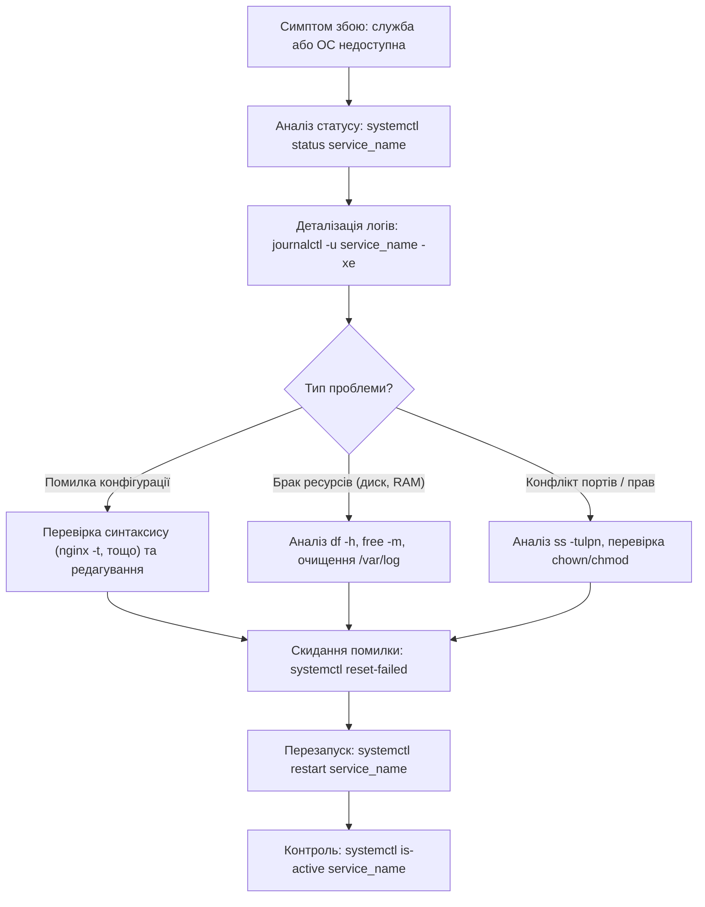
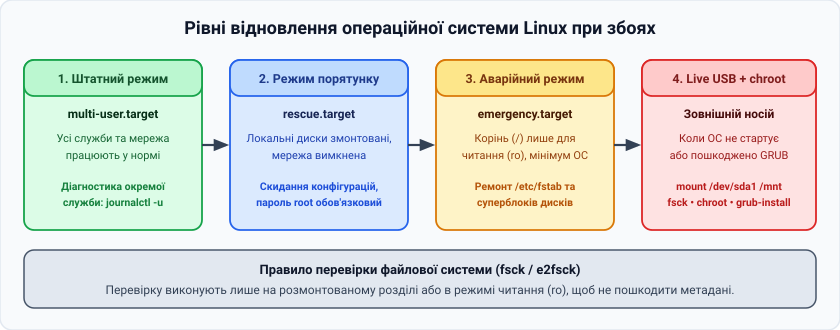

# Урок 46. Відновлення операційних систем і служб після збою

<div class="how-to">

**Як працювати з уроком**

1. Ознайомтеся з теоретичними положеннями щодо класифікації аварійних ситуацій, причин збоїв операційних систем і служб та інструментами їх діагностики (`systemd`, системні журнали, режими відновлення).
2. Виконайте покрокове практичне завдання: локалізуйте причину аварійної зупинки мережевої служби за допомогою `systemctl` та `journalctl`, виправте конфігураційну помилку та відновіть штатну роботу.
3. Закріпіть отримані знання, пройшовши підсумковий тест на 10 запитань наприкінці сторінки.

</div>

## Мета уроку

Ви дізнаєтеся, чому виникають критичні відмови в операційних системах та серверних службах, як правильно читати системні логи для локалізації аварії, якими засобами відновлювати цілісність файлових систем та конфігурацій, а також як повернути ОС до працездатного стану в аварійних режимах. На практиці ви:

- навчитеся проводити первинну експрес-діагностику аварійного стану служб за допомогою `systemctl status` та `journalctl`;
- локалізуєте критичну помилку в конфігурації служби за системними повідомленнями про збій;
- опануєте скидання лічильників аварійного стану через `systemctl reset-failed` та успішний перезапуск юніта;
- ознайомитеся з алгоритмом відновлення пошкоджених файлових систем за допомогою утиліт `fsck` та `chkdsk`;
- розглянете порядок завантаження Linux у режимах `rescue.target` та відновлення системи через середовище Live USB і команду `chroot`.

## Що знадобиться

- Робоча станція або віртуальна машина з операційною системою Linux (Ubuntu Server / Debian або аналог);
- Командний рядок термінала з правами адміністратора (`sudo`);
- Базові діагностичні утиліти: `systemctl`, `journalctl`, `nano` (або `micro`), `df`, `free`.

## Теорія

### Класифікація збоїв та алгоритм дій оператора

У роботі оператора з обробки інформації та програмного забезпечення інциденти з відмовою операційних систем і служб є найбільш відповідальними. Будь-який неробочий сервіс (вебсайт, файлове сховище, база даних або служба друку) призводить до зупинки бізнес-процесів організації.

Збої в інформаційних системах класифікують за рівнем виникнення:
1. **Апаратні збої:** вихід з ладу накопичувача (биті сектори), дефекти оперативної пам'яті (RAM), перегрів процесора, збої живлення.
2. **Збої файлових систем та завантажувача:** пошкодження суперблоку або метаданих через раптове знеструмлення, пошкодження завантажувального сектора (GRUB, BCD).
3. **Збої конфігурації та оновлень:** друкарські помилки або синтаксичні порушення в конфігураційних файлах після редагування, конфлікт версій залежностей після оновлення.
4. **Ресурсний колапс:** повне вичерпання дискового простору (100% заповнення кореневого розділу або каталогу `/var/log`), вичерпання інодів (`inode exhaustion`), дефіцит оперативної пам'яті, що викликає спрацьовування вбивці процесів **OOM Killer** (*Out of Memory Killer*).

**Золоте правило реагування на інцидент:**
> Не перезавантажуйте сервер наосліп. Перш ніж вносити будь-які зміни або перезапускати службу, зафіксуйте точний код помилки та останні записи в системних журналах. Перезавантаження може стерти сліди збою з тимчасових логів та ускладнити діагностику.



---

### Діагностика служб за допомогою systemd та journalctl

У сучасних дистрибутивах Linux керування службами здійснює підсистема ініціалізації **systemd**. Якщо служба аварійно завершує роботу, systemd переводить її в статус `failed`.

Ключові команди для аналізу та відновлення служб:
- `systemctl status <служба>` — відображає поточний стан, PID головного процесу, код виходу (*exit-code*), а також останні рядки повідомлень цієї служби.
- `systemctl is-failed <служба>` — повертає `failed`, якщо служба зупинилася внаслідок збою, або `active`, якщо все гаразд.
- `journalctl -u <служба> -n 50 --no-pager` — показує останні 50 записів системного журналу, що стосуються саме цієї служби.
- `journalctl -xe` — відкриває розширений журнал системи з переходом у кінець файлу та докладними поясненнями системних подій.
- `systemctl reset-failed <служба>` — скидає лічильник невдалих спроб запуску та очищає аварійний прапорець `failed`.
- `systemctl restart <служба>` — повторний запуск служби.

| Стан служби (ActiveState) | Опис стану | Дії оператора |
| :--- | :--- | :--- |
| `active (running)` | Служба успішно функціонує | Втручання не потрібне |
| `active (exited)` | Одноразове завдання успішно виконане | Норма для скриптів ініціалізації |
| `failed` | Процес завершився з ненульовим кодом помилки | Аналіз `journalctl -u`, виправлення конфігу |
| `activating (auto-restart)` | Служба в циклі перезапуску (crash loop) | Термінова зупинка `systemctl stop`, діагностика |
| `inactive (dead)` | Служба вимкнена планово | Запуск за потреби `systemctl start` |

---

### Відновлення операційної системи в аварійних режимах

Якщо внаслідок пошкодження конфігурації або системних файлів операційна система не здатна завантажитися у штатний багатокористувацький графічний або серверний режим, застосовують спеціальні цілі (targets) завантаження:

1. **Режим порятунку (Rescue Mode — `rescue.target`):**
   - Завантажується мінімальний набір системних компонентів;
   - Монтуються всі локальні файлові системи;
   - Мережеві інтерфейси залишаються неактивними;
   - Для входу вимагається пароль облікового запису `root`.
2. **Аварійний режим (Emergency Mode — `emergency.target`):**
   - Найбільш ізольований режим;
   - Коренева файлова система монтується виключно в режимі «лише для читання» (`ro`);
   - Інші дискові розділи не монтуються взагалі;
   - Використовується для ремонту критичних помилок таблиці розділів `/etc/fstab` або відновлення суперблоку файлової системи.

Якщо система взагалі не завантажується з жорсткого диска, оператор завантажує ПК із зовнішнього накопичувача **Live USB** та виконує операцію **chroot** (*change root*). Це дозволяє тимчасово змінити видимий кореневий каталог поточного командного інтерпретатора на файлову систему пошкодженої ОС, встановленої на диску:
```bash
# 1. Монтування пошкодженого кореневого розділу
mount /dev/sda1 /mnt

# 2. Прокидання віртуальних файлових систем ядра
mount --bind /dev /mnt/dev
mount --bind /proc /mnt/proc
mount --bind /sys /mnt/sys

# 3. Вхід у середовище встановленої системи
chroot /mnt /bin/bash

# Тепер можна відновити завантажувач GRUB або скинути забутий пароль:
grub-install /dev/sda
update-grub
exit
```

<div class="clip">



*Рівні відновлення операційної системи Linux: multi-user.target, rescue.target, emergency.target та Live USB із chroot*

</div>

---

### Перевірка та лікування файлових систем

Раптове зникнення напруги в електромережі під час операцій запису часто призводить до порушення структури метаданих файлових систем.

- **У Linux:** утиліта `fsck` (або `e2fsck` для ext4). Перевірка **ніколи** не повинна виконуватися на змонтованій файловій системі в режимі запису, оскільки це призведе до її безповоротного знищення! Розділ слід або розмонтувати (`umount /dev/sdb1`), або перевести в режим читання (`mount -o remount,ro /`).
- **У Windows:**
  - `chkdsk C: /f /r` — пошук помилок структури файлової системи та відновлення даних із пошкоджених секторів (виконується під час наступного перезавантаження).
  - `sfc /scannow` — сканування та відновлення оригінальних версій системних бібліотек Windows.
  - `DISM /Online /Cleanup-Image /RestoreHealth` — відновлення образу компонентів Windows через сховище Windows Update.

<div class="more-link">

**Хочете знати більше?** <span class="optional">Необов’язково</span>

У середовищі `systemd` службу можна налаштувати на автоматичне відновлення після збоїв. Для цього у файлі юніта (`/etc/systemd/system/myservice.service`) у секції `[Service]` вказують параметри:
- `Restart=on-failure` — перезапускати службу тільки якщо вона завершилася з аварійним кодом, була вбита сигналом або через таймаут watchdog;
- `RestartSec=5s` — затримка перед спробою перезапуску;
- `StartLimitIntervalSec=60s` та `StartLimitBurst=4` — якщо служба впала більше 4 разів за 60 секунд, systemd припинить марні спроби запуску, щоб не перевантажувати процесор.

</div>

## Покроково

У цій практичній роботі ви розгорнете тренувальну системну службу, зімітуєте типовий збій конфігурації, проведете аналітичну діагностику через командний рядок та успішно відновите роботу сервісу.

### 1. Створення тестової навчальної служби

Створіть простий скрипт сервісу, який імітує роботу внутрішньої служби моніторингу, та конфігураційний файл юніта systemd.

Виконайте команду для створення скрипта служби:
```bash
sudo bash -c 'cat << "EOF" > /usr/local/bin/cpto-healthcheck.sh
#!/bin/bash
echo "[$(date '+%Y-%m-%d %H:%M:%S')] Сервіс CPTO HealthCheck запущено успішно."
CONFIG_FILE="/etc/cpto-healthcheck.conf"

if [ ! -f "$CONFIG_FILE" ]; then
    echo "[ПОМИЛКА] Конфігураційний файл $CONFIG_FILE відсутній!" >&2
    exit 2
fi

source "$CONFIG_FILE"
if [ "$SERVICE_MODE" != "PRODUCTION" ]; then
    echo "[ПОМИЛКА] Невірне значення SERVICE_MODE: $SERVICE_MODE. Очікується PRODUCTION!" >&2
    exit 3
fi

echo "[$(date '+%Y-%m-%d %H:%M:%S')] Режим: $SERVICE_MODE. Служба працює в штатному режимі."
while true; do
    sleep 10
done
EOF'

sudo chmod +x /usr/local/bin/cpto-healthcheck.sh
```

Тепер створіть коректний конфігураційний файл:
```bash
sudo bash -c 'cat << "EOF" > /etc/cpto-healthcheck.conf
SERVICE_MODE=PRODUCTION
CHECK_INTERVAL=10
EOF'
```

Створіть юніт-файл для systemd:
```bash
sudo bash -c 'cat << "EOF" > /etc/systemd/system/cpto-health.service
[Unit]
Description=Навчальна служба перевірки здоров'я інформаційної системи (CPTO)
After=network.target

[Service]
Type=simple
ExecStart=/usr/local/bin/cpto-healthcheck.sh
Restart=on-failure
RestartSec=3s

[Install]
WantedBy=multi-user.target
EOF'
```

Оновіть конфігурацію systemd та запустіть створену службу:
```bash
sudo systemctl daemon-reload
sudo systemctl start cpto-health.service
sudo systemctl status cpto-health.service --no-pager
```
Переконайтеся, що служба має зелений статус `active (running)`.

---

### 2. Симуляція критичного збою служби

Уявімо ситуацію: оператор-стажер редагував файл конфігурації та випадково вніс недопустиме значення параметра.

Внесіть помилку в конфігураційний файл:
```bash
sudo sed -i 's/SERVICE_MODE=PRODUCTION/SERVICE_MODE=DEBUG_WRONG/' /etc/cpto-healthcheck.conf
```

Тепер примусово перезапустіть службу, щоб вона застосувала зміни:
```bash
sudo systemctl restart cpto-health.service
```

Служба спробує запуститися, кілька разів впаде та перейде в аварійний стан блокування!

---

### 3. Діагностика причин збою за системними журналами

Перевірте поточний статус юніта:
```bash
sudo systemctl status cpto-health.service --no-pager
```

Зверніть увагу на вивід:
- `Active: failed (Result: exit-code)`
- `Process: ... Exited with code 3`
- systemd зупинив спроби перезапуску через досягнення ліміту спроб (*start-limit-hit*).

Запитайте точний лог аварійних повідомлень служби:
```bash
sudo journalctl -u cpto-health.service -n 15 --no-pager
```

У логах чітко видно причину:
`[ПОМИЛКА] Невірне значення SERVICE_MODE: DEBUG_WRONG. Очікується PRODUCTION!`

---

### 4. Виправлення конфігурації та відновлення працездатності

Тепер, знаючи точну причину збою, поверніть коректне значення конфігурації:
```bash
sudo sed -i 's/SERVICE_MODE=DEBUG_WRONG/SERVICE_MODE=PRODUCTION/' /etc/cpto-healthcheck.conf
```

Скиньте аварійний прапорець збою в systemd:
```bash
sudo systemctl reset-failed cpto-health.service
```

Запустіть службу та перевірте її стан:
```bash
sudo systemctl start cpto-health.service
sudo systemctl status cpto-health.service --no-pager
```

Служба знову перебуває в робочому статусі `active (running)`.

---

### 5. Прибирання тренувальних файлів

Після завершення діагностичного практикуму зупиніть і видаліть тестову службу:
```bash
sudo systemctl stop cpto-health.service
sudo systemctl disable cpto-health.service 2>/dev/null
sudo rm -f /etc/systemd/system/cpto-health.service /usr/local/bin/cpto-healthcheck.sh /etc/cpto-healthcheck.conf
sudo systemctl daemon-reload
```

<div class="try">

**Спробуйте самі**

Напишіть коротку команду для перегляду списку **усіх** системних служб вашого сервера, які наразі перебувають у стані аварійного збою (`failed`), та збережіть цей звіт у текстовий файл `failed_services.txt`.

<details>
<summary>Перевірити очікуваний результат і повний розв’язок</summary>

Для швидкого отримання переліку лише аварійних юнітів використовується спеціальний ключ `--failed`:
```bash
systemctl --failed --type=service > failed_services.txt
cat failed_services.txt
```

Якщо в системі немає збійних служб, утиліта виведе:
`0 loaded units listed.`

Якщо ж виявлено аварійну службу, ви одразу побачите її назву в колонці `UNIT` та причину збою в колонці `SUB` (наприклад, `failed`).

</details>

</div>

## Підсумок

- **Діагностика перед дією:** не перезавантажуйте сервер без попереднього збору коду помилки та останніх записів у системному журналі.
- **Інструменти systemd:** команди `systemctl status` та `journalctl -u <служба> -xe` є головною ланкою для локалізації збоїв будь-яких сервісів.
- **Скидання стану збою:** після усунення проблеми в конфігурації слід скинути внутрішній лічильник відмов командою `systemctl reset-failed`.
- **Аварійні режими:** режими `rescue.target` та відновлення через середовище Live USB з використанням `chroot` дозволяють реанімувати операційну систему навіть за відмови штатного завантажувача.
- **Цілісність файлових систем:** перевірка дискових томів за допомогою `fsck` проводиться виключно на розмонтованих або змонтованих у режимі «лише для читання» розділах.

## Тест

<div class="test-box">

10 запитань за матеріалом уроку. На початку тесту вкажіть **прізвище, ім’я та групу**.

<!-- GOOGLE_FORM_START:lesson-46 -->
[Відкрити тест у новій вкладці](https://docs.google.com/forms/d/e/1FAIpQLSfvVMsvSd_jTE4iE1neLJs6cmfOH7_uvUue3AVdxWZfulQQcg/viewform)

<iframe src="https://docs.google.com/forms/d/e/1FAIpQLSfvVMsvSd_jTE4iE1neLJs6cmfOH7_uvUue3AVdxWZfulQQcg/viewform?embedded=true" loading="lazy" title="Тест lesson-46">Завантаження…</iframe>
<!-- GOOGLE_FORM_END:lesson-46 -->

</div>

## Додаткове завдання

<span class="optional">Необов’язково</span> Виконуйте для поглиблення навичок системного адміністрування.

**Базовий рівень.** За допомогою команди `journalctl -p err..emerg -b` перегляньте всі повідомлення про помилки та аварійні події ядра і служб, що виникли з моменту останнього завантаження комп'ютера. Випишіть назви служб, які зафіксували помилки.

**Проєктний рівень.** Дослідіть налаштування параметрів безпечного перезапуску служби в systemd. Створіть юніт, у якому служба автоматично перезапускається через 5 секунд у разі аварійного завершення (`Restart=on-failure`), але якщо вона падає більше 3 разів за 30 секунд — спроби зупиняються. Протестуйте поведінку системи, примусово завершуючи процес через `kill -9 <PID>`.
