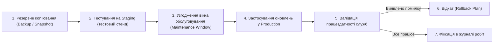
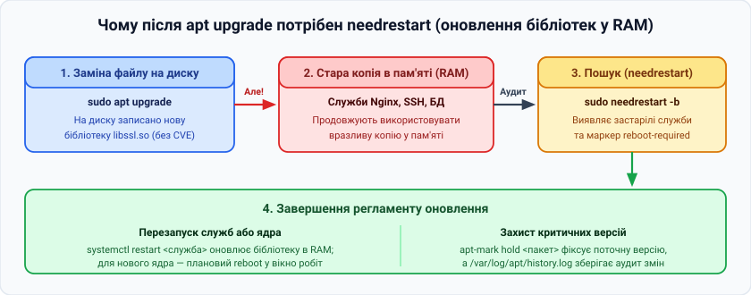

# Урок 47. Оновлення програмних засобів на сервері

<div class="how-to">

**Як працювати з уроком**

1. Ознайомтеся з теоретичними засадами безпечного оновлення серверного програмного забезпечення: поняттями технологічного вікна, плану відкату (Rollback Plan), менеджерів пакетів та відстеження оновлень ядра і бібліотек.
2. Виконайте покрокове практичне завдання: здійсніть симуляцію оновлення пакетів у консолі, налаштуйте фіксацію версій критичних компонентів (`apt-mark hold`), проаналізуйте журнал встановлення та перевірте процеси, що потребують перезапуску після оновлення бібліотек.
3. Закріпіть отримані знання, пройшовши підсумковий тест на 10 запитань наприкінці сторінки.

</div>

## Мета уроку

Ви дізнаєтеся, чому оновлення сервера кардинально відрізняється від оновлення домашнього комп'ютера, як своєчасно закривати вразливості безпеки (CVE) без ризику зупинки бізнес-сервісів, які правила регламентного обслуговування мінімізують час простою (*Downtime*), та як перевіряти стан пам'яті після оновлення бібліотек. На практиці ви:

- опануєте інструменти аудиту наявних оновлень у системі за допомогою `apt list --upgradable` та симуляції `apt-get upgrade -s`;
- навчитеся захищати критичні служби від випадкового оновлення версії за допомогою `apt-mark hold` / `apt-mark unhold`;
- дослідите журнали проведених оновлень у системних файлах `/var/log/dpkg.log` та `/var/log/apt/history.log`;
- виявите запущені процеси, які продовжують тримати в оперативній пам'яті застарілі файли бібліотек після заміни їх на диску;
- налаштуєте базові параметри автоматичного встановлення виправлень безпеки через `unattended-upgrades`.

## Що знадобиться

- Сервер або віртуальна машина з операційною системою Linux (Ubuntu Server або Debian);
- Командний рядок термінала з правами адміністратора (`sudo`);
- Встановлені або стандартні утиліти: `apt`, `dpkg`, `needrestart` (або `lsof`), `nano`.

## Теорія

### Чому оновлення сервера вимагає суворого регламенту?

На відміну від домашнього ноутбука, сервер обслуговує десятки, сотні чи навіть тисячі користувачів одночасно. Головна мета оператора інформаційних систем — забезпечити максимальну доступність і стабільність сервісів за формулою SLA (*Service Level Agreement*).

Оновлення програмних засобів вирішує два взаємопов'язані завдання:
1. **Ліквідація вразливостей (Security Patches):** виправлення помилок безпеки, зафіксованих у міжнародній базі **CVE** (*Common Vulnerabilities and Exposures*). Якщо сервер залишати без безпекових латок, зловмисники можуть перехопити керування або скомпрометувати конфіденційні дані.
2. **Підвищення надійності та функціональності:** виправлення витоків пам'яті (*memory leaks*), оптимізація швидкодії, сумісність із сучасними протоколами.

Проте будь-яке оновлення несе в собі **ризик збою**:
- Нова версія програми може вимагати іншого синтаксису у конфігураційному файлі (застарілі параметри стають нечинними);
- Оновлення залежної бібліотеки (наприклад, OpenSSL або Python) може порушити роботу прикладного бухгалтерського або складського ПЗ;
- Оновлення ядра (*Kernel*) вимагає перезавантаження сервера, що спричиняє технічний простій.



---

### Чотири золоті правила оновлення серверної інфраструктури

1. **Обов'язковий попередній бекап (No Backup — No Update):**
   Перед початком оновлення робиться знімок віртуальної машини (*VM Snapshot*) або повна резервна копія баз даних та конфігураційного каталогу `/etc`.
2. **Технологічне вікно обслуговування (Maintenance Window):**
   Роботи з оновлення плануються на години мінімального користувацького навантаження (зазвичай у вихідні або вночі). Користувачі заздалегідь попереджаються про можливі технічні перерви.
3. **Наявність плану швидкого відкату (Rollback Plan):**
   Адміністратор заздалегідь знає, як повернути попередню стабільну версію системи, якщо після оновлення головний вебсайт або база даних не запуститься.
4. **Розділення оновлень безпеки та оновлень релізу:**
   Оновлення безпеки (*security updates*) встановлюються оперативно. Масштабні оновлення релізу дистрибутива (наприклад, перехід з Ubuntu 22.04 на 24.04) проводяться лише після ретельного тестування на клоні системи (*Staging-сервері*).

---

### Керування пакетами в ОС Linux

У сімействі Debian/Ubuntu основним інструментом керування є менеджер пакетів `apt` (Advanced Package Tool).

Ключові команди та їх призначення:
- `sudo apt update` — **тільки завантажує** свіжі списки доступних пакетів із налаштованих репозиторіїв. Самі файли програм на сервері при цьому **не оновлюються**.
- `apt list --upgradable` — показує список пакетів, для яких у репозиторії вже доступна свіжіша версія.
- `sudo apt upgrade -s` — режим **симуляції** (*simulate*): виводить перелік дій і змін без їх реального виконання на диску.
- `sudo apt upgrade` — завантажує і встановлює оновлення лише для тих пакетів, які не вимагають видалення існуючих компонентів.
- `sudo apt full-upgrade` (або `dist-upgrade`) — інтелектуальне оновлення: може видалити застарілі пакети або встановити нові залежності (вимагає особливої уваги).
- `sudo apt-mark hold <пакет>` — **заморожує** поточну версію пакета. Менеджер пакетів ніколи не оновлюватиме цей пакет, доки його не «розморозять» командою `sudo apt-mark unhold <пакет>`.

| Дія | Debian / Ubuntu (APT) | RHEL / Rocky / AlmaLinux (DNF) |
| :--- | :--- | :--- |
| Оновлення індексу сховищ | `apt update` | `dnf check-update` |
| Безпечне оновлення пакетів | `apt upgrade` | `dnf upgrade` |
| Оновлення лише латок безпеки | `unattended-upgrade` | `dnf update --security` |
| Фіксація версії пакета | `apt-mark hold <pkg>` | `dnf versionlock add <pkg>` |
| Перегляд історії дій | `cat /var/log/apt/history.log` | `dnf history` |

---

### Проблема застарілих бібліотек у пам'яті (needrestart)

Коли оновлюється динамічна бібліотека (наприклад, `libssl.so`), менеджер пакетів замінює файл на жорсткому диску новим. Проте служби, які були запущені до моменту оновлення (наприклад, вебсервер Nginx або служба баз даних), **продовжують тримати в оперативній пам'яті стару версію файлу**.

Це означає, що попри успішне встановлення патча безпеки, система залишається вразливою, доки сервіс не буде перезапущено!

Для автоматичного виявлення таких процесів використовується утиліта **needrestart**:
- Вона сканує пам'ять процесів, знаходить посилання на видалені або замінені бібліотеки на диску;
- Повідомляє оператору перелік служб, які необхідно перезапустити;
- Визначає, чи оновилося ядро системи і чи вимагається повне перезавантаження сервера (наявність маркера `/var/run/reboot-required`).

<div class="clip">



*Схема виявлення застарілих бібліотек у оперативній пам'яті після оновлення за допомогою needrestart*

</div>

<div class="more-link">

**Хочете знати більше?** <span class="optional">Необов’язково</span>

У сучасних хмарних інфраструктурах і контейнерних середовищах (Docker / Kubernetes) оновлення здійснюється за концепцією **незмінної інфраструктури** (*Immutable Infrastructure*).
Замість оновлення програм на працюючому сервері адміністратори збирають новий образ контейнера з оновленими залежностями, тестують його автоматичними тестами та розгортають методом **Blue-Green Deployment** або **Canary Deployment** (поступове перемикання користувачів на нову версію без жодної секунди простою).

</div>

## Покроково

У цій практичній роботі ви виконаєте регламентне безпечне оновлення компонентів на сервері, заморозите версію критичного сервісу, проаналізуєте журнал оновлень та визначите стан системних процесів у пам'яті.

### 1. Перевірка доступних оновлень та імітація процесу

Синхронізуйте локальну базу даних про пакети із серверами репозиторіїв:
```bash
sudo apt update
```

Перегляньте, які саме пакети мають новіші версії:
```bash
apt list --upgradable
```

Виконайте безпечну симуляцію оновлення без реальних змін на диску:
```bash
sudo apt-get upgrade -s
```
Уважно огляньте вивід. Зверніть увагу на рядки:
`... upgraded, ... newly installed, ... to remove and ... not upgraded.`
Симуляція дозволяє переконатися, що оновлення не збирається видалити важливі системні компоненти.

---

### 2. Захист критичних пакетів від небажаного оновлення

Уявімо, що на нашому сервері встановлено спеціальну версію вебсервера або утиліти (наприклад, `curl`), оновлення якої суворо заборонено до завершення тестування розробниками.

Заблокуйте оновлення пакета `curl`:
```bash
sudo apt-mark hold curl
```

Перевірте список заблокованих пакетів у системі:
```bash
apt-mark showhold
```

Ви побачите у виводі `curl`. Тепер під час виконання загального оновлення системи менеджер `apt` повідомить: `The following packages have been kept back: curl`, гарантуючи незмінність його версії.

---

### 3. Резервне копіювання конфігурацій перед оновленням

Створіть резервний архів каталогу конфігурацій `/etc` перед внесенням змін. Це ваш базовий рятувальний круг у разі пошкодження параметрів служб:
```bash
sudo mkdir -p /var/backups/system-configs
sudo tar -czf /var/backups/system-configs/etc_backup_$(date +%Y%m%d_%H%M).tar.gz /etc/nginx /etc/ssh 2>/dev/null
ls -lh /var/backups/system-configs/
```

Тепер у вас є збережений стан конфігурацій ключових служб.

---

### 4. Оновлення конкретного пакета та аналіз системного журналу

Оновіть один окремий безпечний пакет (наприклад, архіватор `tar` або системний інструмент `grep`):
```bash
sudo apt install --only-upgrade tar -y
```

Знайдіть запис про цю подію в офіційному системному журналі оновлень APT:
```bash
tail -n 25 /var/log/apt/history.log
```

Зверніть увагу на поля журналу:
- `Start-Date` — точний час початку операції;
- `Commandline` — яка команда викликала оновлення;
- `Upgrade:` — старе і нове значення версії пакета;
- `End-Date` — час завершення.

---

### 5. Перевірка процесів у пам'яті за допомогою needrestart

Встановіть або запустіть утиліту аналізу застарілих бібліотек у пам'яті:
```bash
sudo apt install -y needrestart
sudo needrestart -b
```

Параметр `-b` вмикає пакетний (batch) режим аналізу.
Утиліта покаже:
- Чи потрібен перезапуск операційної системи через заміну ядра (`NEEDRESTART-KSTA: 1` або стан очікування перезавантаження);
- Які саме фонові служби тримають старі бібліотеки і рекомендуються до перезапуску (`NEEDRESTART-SVC: ...`).

---

### 6. Розморожування версії пакета

Після завершення навчального регламенту зніміть блокування з пакета `curl`:
```bash
sudo apt-mark unhold curl
apt-mark showhold
```
Переконайтеся, що список заблокованих пакетів порожній.

<div class="try">

**Спробуйте самі**

Складіть команду в терміналі, яка перевіряє, чи вимагає сервер повного перезавантаження після останніх оновлень компонентів або ядра (підказка: в Ubuntu/Debian статус сигналізується наявністю спеціального файлу в каталозі `/var/run/`).

<details>
<summary>Перевірити очікуваний результат і повний розв’язок</summary>

Під час оновлення компонентів ядра або критичних бібліотек система створює файл-маркер `/var/run/reboot-required`.
Перевірити його наявність можна за допомогою умови:
```bash
if [ -f /var/run/reboot-required ]; then
    echo "УВАГА! Необхідне перезавантаження сервера:"
    cat /var/run/reboot-required.pkgs
else
    echo "Перезавантаження сервера не потрібне. Система працює в штатному режимі."
fi
```
Цей маркер дозволяє оператору планувати рестарт сервера виключно в узгоджене технічне вікно.

</details>

</div>

## Підсумок

- **Серверний регламент:** оновлення у промисловому середовищі проводяться лише після створення резервних копій та в узгоджені технологічні вікна обслуговування.
- **Розвідка перед дією:** виконання симуляції через `apt upgrade -s` дозволяє заздалегідь оцінити, які компоненти будуть змінені, встановлені чи вилучені.
- **Захист критичного ПЗ:** утиліта `apt-mark hold` надійно запобігає випадковому оновленню критичних служб із зафіксованими версіями.
- **Журналювання робіт:** кожен крок оновлення фіксується у файлах `/var/log/apt/history.log` та `/var/log/dpkg.log` для аудиту та розслідування інцидентів.
- **Контроль пам'яті:** оновлення файлів на диску недостатньо — за допомогою `needrestart` слід перезапустити процеси, які використовують старі бібліотеки в RAM.

## Тест

<div class="test-box">

10 запитань за матеріалом уроку. На початку тесту вкажіть **прізвище, ім’я та групу**.

🔗 <!-- GOOGLE_FORM_URL:lesson-47 --> *(Посилання на Google Форму буде додано після масового імпорту тесту)*

</div>

## Додаткове завдання

<span class="optional">Необов’язково</span> Виконуйте для поглиблення навичок системного адміністрування.

**Базовий рівень.** Знайдіть у системному журналі `/var/log/dpkg.log` дату та час первинного встановлення або останнього оновлення вебсервера (або будь-якої іншої програми, наприклад `openssh-server`), скориставшись утилітою `grep`.

**Проєктний рівень.** Налаштуйте пакет `unattended-upgrades` для автоматичного встановлення лише критичних латок безпеки (Security Updates) без участі людини. Переконайтеся, що конфігурація виключає оновлення звичайних прикладних програм та надсилає сповіщення оператору про необхідність перезавантаження.
