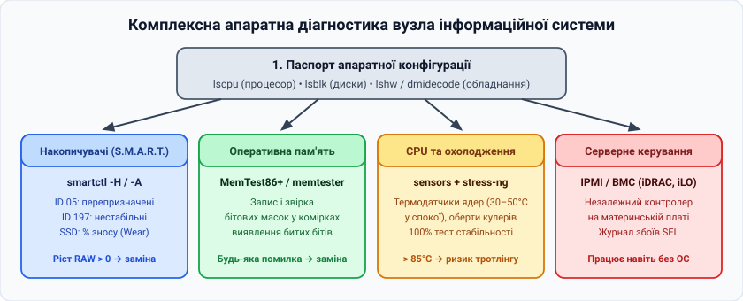

# Урок 48. Спеціальні програмні засоби діагностики апаратури інформаційних систем

<div class="how-to">

**Як працювати з уроком**

1. Ознайомтеся з теоретичними відомостями про методи апаратної діагностики комп'ютерних комплексів: моніторинг показників S.M.A.R.T. накопичувачів, тестування оперативної пам'яті (RAM), контроль термодатчиків та проведення стрес-тестів.
2. Виконайте покрокове практичне завдання: зберіть апаратну специфікацію робочої станції, проаналізуйте атрибути здоров'я диска за допомогою `smartctl`, зніміть покази температури процесора та проведіть короткочасний стрес-тест стабільності.
3. Закріпіть отримані знання, пройшовши підсумковий тест на 10 запитань наприкінці сторінки.

</div>

## Мета уроку

Ви дізнаєтеся, чому стабільність програмного забезпечення безпосередньо залежить від технічного стану «заліза», як завчасно виявляти приховану деградацію компонентів до повної втрати даних, як інтерпретувати показання самодіагностики S.M.A.R.T. та як виявляти апаратний перегрів чи збої пам'яті. На практиці ви:

- навчитеся збирати паспорт апаратної конфігурації комп'ютера за допомогою утиліт `lscpu`, `lsblk`, `lshw` та `dmidecode`;
- опануєте роботу з пакетом `smartmontools` для оцінки працездатності та зносу жорстких дисків і твердотільних накопичувачів (SSD/NVMe);
- навчитеся зчитувати критичні атрибути S.M.A.R.T. (перепризначені та нестабільні сектори);
- дослідите покази датчиків температури процесора за допомогою утиліти `sensors` (пакет `lm-sensors`);
- проведете контрольне навантажувальне стрес-тестування процесора та підсистеми пам'яті за допомогою утиліти `stress-ng`.

## Що знадобиться

- Комп'ютер або віртуальна машина з операційною системою Linux;
- Командний рядок термінала з правами адміністратора (`sudo`);
- Діагностичні утиліти: `smartmontools` (`smartctl`), `lm-sensors`, `stress-ng` (або `stress`), `lshw`, `pciutils`.

## Теорія

### Завдання та роль апаратної діагностики

У практичній діяльності оператора з обробки інформації та програмного забезпечення значна частка «програмних» помилок (раптові аварійні завершення програм, сині екрани смерті BSOD у Windows, Kernel Panic у Linux, пошкодження файлів баз даних) насправді зумовлена **апаратними несправностями**:
- збоями в окремих комірках мікросхем оперативної пам'яті (RAM);
- появою дефектних секторів (*bad sectors*) на поверхні магнітних дисків або зношенням флеш-пам'яті SSD;
- пересиханням термопасти та забиванням радіаторів охолодження пилом, що призводить до аварійного перегріву та тротлінгу (*Thermal Throttling*);
- пульсаціями напруги або деградацією конденсаторів блоку живлення.

Головне завдання діагностики — **профілактика**: виявити ознаки зносу чи нестабільності компонента до того, як він раптово вийде з ладу та знищить робочі дані користувачів.

---

### Діагностика накопичувачів: технологія S.M.A.R.T.

**S.M.A.R.T.** (*Self-Monitoring, Analysis and Reporting Technology*) — це вбудована в контролер накопичувача (HDD/SSD/NVMe) система апаратного самоконтролю, яка постійно відстежує стан диска, фіксує помилки читання/запису, контролює температуру та підраховує кількість відпрацьованих годин.

Для опитування контролера накопичувачів у середовищі Linux використовується стандартний галузевий пакет **smartmontools** (утиліта `smartctl`).

```mermaid
flowchart TD
    A["Накопичувач (HDD / SSD / NVMe)"] --> B["Вбудований контролер S.M.A.R.T."]
    B --> C["smartctl -H /dev/sdX (Загальний вердикт здоров'я: PASSED / FAILED)"]
    B --> D["smartctl -A /dev/sdX (Детальна таблиця критичних атрибутів)"]
    D --> E["ID 05: Reallocated Sectors (Перепризначені сектори)"]
    D --> F["ID 197: Current Pending Sectors (Кандидати на збій)"]
    D --> G["SSD: Wear Leveling / Percentage Used (Рівень зносу флеш-пам'яті)"]
    E --> H{"Чи є зростання значень RAW_VALUE?"}
    F --> H
    H -->|Так| I["КРИТИЧНО! Терміновий бекап та заміна диска"]
    H -->|Ні (значення 0)| J["Диск справний"]
```

#### Ключові атрибути S.M.A.R.T. для жорстких дисків (HDD):
- **ID 05 — Reallocated Sectors Count:** кількість перепризначених секторів. Якщо накопичувач знаходить збійний блок, він виключає його з адресації та замінює резервним. Будь-яке ненульове та зростаюче значення у графі `RAW_VALUE` свідчить про фізичну деградацію поверхні пластин — такий диск слід негайно замінити!
- **ID 197 — Current Pending Sector Count:** кількість «підозрілих» нестабільних секторів, які очікують повторної перевірки або перепризначення.
- **ID 198 — Offline Uncorrectable Sector Count:** сектори, які не вдалося прочитати чи виправити навіть за допомогою внутрішніх алгоритмів контролера.
- **ID 199 — UltraDMA CRC Error Count:** помилки контрольної суми під час передачі даних інтерфейсним кабелем. Зазвичай свідчать про пошкоджений або ненадійно закріплений SATA-кабель.

#### Особливості SSD та накопичувачів NVMe:
Твердотільні накопичувачі не мають механічних пластин і головок, але їхні комірки пам'яті мають обмежений ресурс циклів перезапису (*P/E cycles*).
- **Percentage Used / Wear Range Delta:** показує відсоток вичерпання гарантованого ресурсу накопичувача.
- **Available Spare:** обсяг залишку резервних комірок флеш-пам'яті. Якщо він падає нижче критичного порогу, контролер перемикає SSD у режим «лише для читання» для порятунку даних.
- **Media and Data Integrity Errors:** кількість випадків, коли контролер зафіксував некореговані помилки читання флеш-пам'яті.

---

### Діагностика оперативної пам'яті (RAM)

Несправності оперативної пам'яті є найбільш підступними, оскільки вони не залишають чітких слідів у файловій системі і проявляються спонтанними зависаннями системи в моменти пікових навантажень.

- **MemTest86 / MemTest86+:** еталонний галузевий інструмент для глибокого тестування RAM. Він завантажується з автономного USB-накопичувача без участі операційної системи і виконує багаторазовий запис спеціальних математичних патернів (бітових масок) у кожну комірку пам'яті з наступним звірянням результату. Якщо виявлено хоча б одну помилку — модуль пам'яті підлягає безумовній заміні.
- **Утиліта memtester (Linux):** консольна програма, що дозволяє виділити пул оперативної пам'яті в уже запущеній системі та перевірити його на наявність битих бітів без перезавантаження ПК.

---

### Температурний моніторинг та стрес-тести

- **lm-sensors:** набір утиліт Linux для зчитування даних із сенсорів материнської плати, вбудованих термодіодів процесора (Core Temperature, Package ID) та датчиків тахометрів кулерів охолодження (RPM).
- **Стрес-тестування (`stress-ng`):** інструмент генерації штучного максимального навантаження на обчислювальні ядра процесора, підсистему кешу та пам'ять. Дозволяє за 1–2 хвилини перевірити, чи здатна система охолодження стабільно відводити тепло при 100% завантаженні і чи не відбувається аварійне вимикання через перегрів.

<div class="clip">



*Комплексна апаратна діагностика вузла інформаційної системи: S.M.A.R.T., RAM, термомоніторинг та IPMI/BMC*

</div>

| Завдання діагностики | Інструменти Linux | Інструменти Windows |
| :--- | :--- | :--- |
| Здоров'я накопичувачів S.M.A.R.T. | `smartctl` (smartmontools) | CrystalDiskInfo, Victoria SSD/HDD |
| Тестування оперативної пам'яті | MemTest86+, `memtester` | Windows Memory Diagnostic, MemTest86 |
| Моніторинг температури та напруг | `lm-sensors` (`sensors`) | HWiNFO64, AIDA64, Core Temp |
| Стрес-тест процесора та стабільності | `stress-ng`, `mprime` (Prime95) | Prime95, OCCT, FurMark |
| Паспорт апаратного забезпечення | `lshw`, `dmidecode`, `inxi` | msinfo32, CPU-Z, HWiNFO |

<div class="more-link">

**Хочете знати більше?** <span class="optional">Необов’язково</span>

На корпоративних серверах (Dell PowerEdge, HP ProLiant, Lenovo ThinkSystem) діагностика апаратури виконується незалежно від основної ОС за допомогою апаратних мікроконтролерів віддаленого керування **IPMI / BMC** (Baseboard Management Controller), таких як **Dell iDRAC** або **HPE iLO**.
Такий модуль має власний мережевий інтерфейс і процесор, працює навіть при вимкненому сервері (доки підключено шнур живлення) і постійно записує всі апаратні збої (SEL — System Event Log), напруги та температури.

</div>

## Покроково

У цій практичній роботі ви проведете комплексне дослідження апаратного комплексу комп'ютера: знімете паспорт процесора і дисків, перевірите стан S.M.A.R.T., оціните температуру та протестуєте стабільність системи під навантаженням.

### 1. Збір паспорта апаратної конфігурації

Отримайте базову інформацію про процесор (кількість ядер, архітектура, частота):
```bash
lscpu | grep -E "Model name|Socket|Thread|CPU\(s\):|CPU max MHz"
```

Перегляньте схему підключених накопичувачів, їхні моделі, типи шин та розміри:
```bash
lsblk -o NAME,SIZE,TYPE,ROTA,MODEL,FSTYPE,MOUNTPOINT
```
Зверніть увагу на стовпчик `ROTA`: значення `1` вказує на магнітний диск HDD (обертовий), а `0` — на твердотільний накопичувач SSD або NVMe.

---

### 2. Діагностика здоров'я накопичувача за допомогою smartctl

Знайдіть ім'я свого головного системного диска (наприклад, `/dev/sda` або `/dev/nvme0n1`).

Перевірте загальний інтегральний вердикт працездатності диска:
```bash
sudo smartctl -H /dev/sda
```

Якщо у виводі вказано:
`=== START OF READ SMART DATA SECTION ===`
`SMART overall-health self-assessment test result: PASSED`
це означає, що жоден із критичних параметрів наразі не перетнув аварійний поріг виробника.

Тепер відкрийте детальну таблицю атрибутів накопичувача:
```bash
sudo smartctl -A /dev/sda
```
Знайдіть рядки атрибутів `05 Reallocated_Sector_Ct` та `197 Current_Pending_Sector`. Зверніть увагу на останню колонку `RAW_VALUE`. У справного диска значення в цій графі має дорівнювати `0`.

---

### 3. Зчитування показників датчиків температури

Перевірте наявність утиліти `sensors` (пакет `lm-sensors`):
```bash
sensors 2>/dev/null || (sudo apt update && sudo apt install -y lm-sensors)
sensors
```

У виводі ви побачите поточну температуру процесорних ядер (`Core 0`, `Package id 0`), а також критичні межі спрацьовування захисту (`high = +80.0°C`, `crit = +100.0°C`).
У стані простою нормальна робоча температура сучасного процесора становить приблизно **30–50°C**.

---

### 4. Контрольний стрес-тест стабільності системи

Запустіть утиліту `stress-ng` для симуляції інтенсивного обчислювального навантаження на всі доступні ядра процесора рівно на **20 секунд**:
```bash
sudo apt install -y stress-ng 2>/dev/null
stress-ng --cpu 0 --timeout 20s --metrics-brief
```

Опція `--cpu 0` задіє всі наявні ядра, а `--timeout 20s` гарантує безпечне автоматичне завершення тесту через 20 секунд.

Одразу після завершення тесту знову зніміть покази температури:
```bash
sensors
```
Порівняйте температуру під навантаженням із температурою у стані спокою. Якщо температура процесора не перевищила критичну позначку (85°C), а комп'ютер не завис і не вимкнувся — система охолодження та живлення працюють надійно!

---

### 5. Перевірка оперативної пам'яті утилітою memtester

Для швидкої експрес-перевірки оперативної пам'яті без перезавантаження системи протестуйте невеликий вільний блок (наприклад, 100 МБ) в один прохід:
```bash
sudo apt install -y memtester 2>/dev/null
sudo memtester 100M 1
```

Утиліта виконає цикл перевірок бітових масок (`Stuck Address`, `Random Value`, `Compare XOR`, `Bit Spread`).
Усі тести повинні мати вердикт `ok`.

<div class="try">

**Спробуйте самі**

Складіть команду термінала, яка автоматично витягує з таблиці S.M.A.R.T. вашого накопичувача тільки три ключові показники: час напрацювання в годинах (Power-On Hours), кількість циклів увімкнення (Power Cycle Count) та кількість перепризначених секторів (Reallocated Sector Count).

<details>
<summary>Перевірити очікуваний результат і повний розв’язок</summary>

Для вибірки конкретних атрибутів використовується фільтрація через регулярні вирази `grep -E`:
```bash
sudo smartctl -A /dev/sda | grep -E "Power_On_Hours|Power_Cycle_Count|Reallocated_Sector_Ct"
```
Очікуваний вивід міститиме відповідні рядки з ID атрибутів, пороговими значеннями та реальними показниками у стовпчику `RAW_VALUE`. Наприклад:
- `Power_On_Hours` — кількість годин безперервної роботи диска;
- `Reallocated_Sector_Ct` — число 0 (ознака відсутності дефектних секторів).

</details>

</div>

## Підсумок

- **Апаратне підґрунтя надійності:** значна частина програмних збоїв та пошкоджень даних спричинена перегрівом, дефектами пам'яті або зносом накопичувачів.
- **Технологія S.M.A.R.T.:** вбудована система моніторингу накопичувачів, де ключовими показниками для HDD є атрибути `Reallocated Sector Count` (ID 05) та `Current Pending Sector` (ID 197). Будь-яке зростання цих показників вимагає термінової заміни диска.
- **Діагностика пам'яті:** еталоном перевірки RAM є автономний тест MemTest86+, а для експрес-тесту в запущеній Linux використовується `memtester`.
- **Тепловий контроль:** регулярний моніторинг через `sensors` та контрольні стрес-тести за допомогою `stress-ng` дозволяють виявити несправність вентиляторів або висихання термопасти задовго до аварійного вимкнення сервера.

## Тест

<div class="test-box">

10 запитань за матеріалом уроку. На початку тесту вкажіть **прізвище, ім’я та групу**.

🔗 <!-- GOOGLE_FORM_URL:lesson-48 --> *(Посилання на Google Форму буде додано після масового імпорту тесту)*

</div>

## Додаткове завдання

<span class="optional">Необов’язково</span> Виконуйте для поглиблення навичок системного адміністрування.

**Базовий рівень.** За допомогою утиліти `smartctl -l error /dev/sda` перевірте внутрішній журнал апаратних помилок накопичувача. З'ясуйте, чи фіксував контролер диска апаратні збої або аварійні скидання інтерфейсу.

**Проєктний рівень.** Напишіть скрипт моніторингу `check_temp.sh`, який щохвилини опитує сенсори процесора через утиліту `sensors`. Якщо середня температура перевищує 75°C, скрипт повинен записувати попередження до системного журналу через команду `logger -p local0.warning "CPTO Alert: High CPU Temperature detected!"`.
