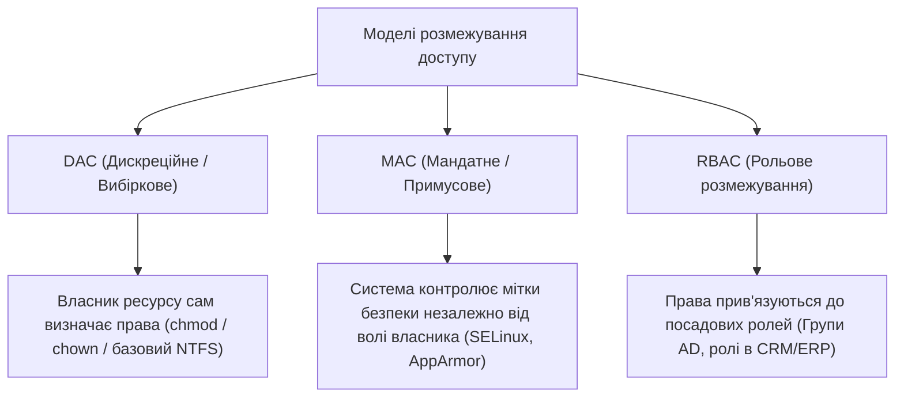
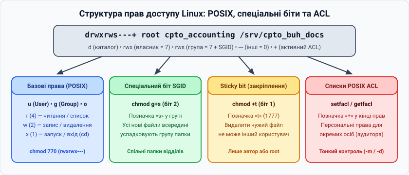

# Урок 49. Захист інформації в інформаційних системах: розмежування доступу

<div class="how-to">

**Як працювати з уроком**

1. Ознайомтеся з теоретичними положеннями інформаційної безпеки: тріадою CIA, моделями розмежування доступу (DAC, MAC, RBAC), стандартними правами Linux (POSIX) та спеціальними бітами (SUID, SGID, Sticky bit).
2. Виконайте покрокове практичне завдання: спроєктуйте та налаштуйте безпечну структуру каталогів підприємства, застосуйте спадкові права через SGID, захистіть файли від видалення за допомогою Sticky bit та налаштуйте точкові дозволи через списки ACL (`setfacl`).
3. Закріпіть отримані знання, пройшовши підсумковий тест на 10 запитань наприкінці сторінки.

</div>

## Мета уроку

Ви дізнаєтеся, як забезпечити надійний захист інформаційних ресурсів від несанкціонованого доступу, витоку чи модифікації, як реалізувати принцип найменших привілеїв (*Least Privilege*), у чому полягають відмінності між класичними правами доступу та розширеними списками ACL, а також як правильно налаштовувати спільні корпоративні сховища. На практиці ви:

- опануєте роботу зі стандартними правами доступу Linux у числовому та символьному форматах (`chmod`, `chown`, `chgrp`);
- налаштуєте спеціальний біт **SGID** на каталозі для автоматичного успадкування групи всіма новими документами;
- застосуєте **Sticky bit** для захисту файлів у загальнодоступній папці від видалення сторонніми користувачами;
- навчитеся використовувати списки контролю доступу **POSIX ACL** (`getfacl`, `setfacl`) для надання індивідуальних прав без зміни власника файлу;
- перевірите дієвість налаштованих правил безпеки шляхом імітації спроб доступу від імені різних облікових записів.

## Що знадобиться

- Сервер або робоча станція з операційною системою Linux;
- Командний рядок термінала з правами суперкористувача (`sudo`);
- Встановлені системні утиліти: `chmod`, `chown`, `setfacl`, `getfacl` (пакет `acl`), `useradd`, `groupadd`.

## Теорія

### Тріада безпеки та принцип найменших привілеїв

Інформаційна безпека будь-якої комп'ютерної системи базується на фундаментальній тріаді **CIA**:
1. **Конфіденційність (Confidentiality):** інформація повинна бути доступною виключно авторизованим користувачам, які мають законне право на її перегляд.
2. **Цілісність (Integrity):** захист даних від несанкціонованої модифікації, підробки, пошкодження чи видалення.
3. **Доступність (Availability):** гарантія своєчасного та безперешкодного доступу легітимних користувачів до інформаційних ресурсів та служб.

Головним принципом безпечного адміністрування є **принцип найменших привілеїв** (*Principle of Least Privilege — PoLP*):
> Користувачеві, системному процесу або програмі надається лише мінімально необхідний для виконання їхніх посадових чи технологічних завдань рівень прав, і ні бітом більше. Ніхто не повинен працювати під обліковим записом адміністратора `root` для виконання повсякденних офісних задач.



---

### Моделі контролю доступу

1. **Дискреційне керування доступом (DAC — Discretionary Access Control):**
   Базова модель в операційних системах Unix та Windows. Власник об'єкта (файлу чи папки) самостійно вирішує, які права надати іншим користувачам та групам.
2. **Мандатне керування доступом (MAC — Mandatory Access Control):**
   Примусова модель безпеки, де операційна система присвоює кожному процесу та файлу мітку конфіденційності. Навіть якщо власник файлу або root захоче відкрити доступ, політика ядра (наприклад, **SELinux** або **AppArmor**) заблокує це, якщо рівні довіри не співпадають.
3. **Рольове керування доступом (RBAC — Role-Based Access Control):**
   Права доступу групуються в «ролі» (наприклад, «Оператор введення даних», «Головний бухгалтер», «Системний аудитор»), а облікові записи користувачів призначаються членами відповідних груп ролей.

---

### Права доступу в Linux (POSIX DAC)

У файловій системі Linux кожен файл і каталог має закріпленого **користувача-власника** (*User/Owner* — `u`) та **групу-власника** (*Group* — `g`). Усі інші користувачі системи підпадають під категорію **інші** (*Others* — `o`).

Кожна категорія суб'єктів має три базових права:
- **`r` (Read — читання, вага 4):**
  - Для файлу: читання вмісту;
  - Для каталогу: перегляд списку імен файлів у папці (`ls`).
- **`w` (Write — запис, вага 2):**
  - Для файлу: зміна або перезапис вмісту;
  - Для каталогу: створення, перейменування та видалення файлів всередині папки!
- **`x` (Execute — виконання, вага 1):**
  - Для файлу: запуск як виконуваної бінарної програми або скрипта;
  - Для каталогу: **вхід** у каталог (`cd`) та доступ до метаданих файлів (розміру, прав тощо).

| Права | Числовий код | Для файлу | Для каталогу |
| :--- | :--- | :--- | :--- |
| `rwx` | **7** (4+2+1) | Повний доступ (читання, запис, запуск) | Повний доступ (вхід, читання, створення/видалення) |
| `rw-` | **6** (4+2) | Читання та зміна вмісту (стандарт для документів) | Неприпустимо (без 'x' у папку неможливо увійти) |
| `r-x` | **5** (4+1) | Читання та запуск програми | Вхід у папку та перегляд списку файлів (без права видалення) |
| `r--` | **4** | Лише перегляд вмісту | Перегляд імен файлів (без можливості прочитати їхній розмір чи увійти) |
| `---` | **0** | Доступ повністю заборонено | Доступ повністю заборонено |

---

### Спеціальні біти дозволів

1. **SUID (Set User ID — числовий біт 4):**
   Якщо встановлено на виконуваний файл (`chmod u+s /path/binary`), файл виконується з привілеями його **власника**, а не того користувача, який його запустив. Приклад: утиліта `/usr/bin/passwd` належить `root`, що дозволяє звичайному користувачеві оновлювати свій хеш пароля у захищеному системному файлі `/etc/shadow`.
2. **SGID (Set Group ID — числовий біт 2):**
   Якщо встановлено на **каталог** (`chmod g+s /shared/folder`), усі нові файли та підпапки, створені будь-яким користувачем всередині цього каталогу, автоматично **успадковують групу цього каталогу**, а не основну групу автора. Це фундаментальний механізм для спільних робочих папок відділів!
3. **Sticky bit (біт закріплення — числовий біт 1):**
   Якщо встановлено на **спільний каталог** (`chmod +t /tmp` або `chmod 1777`), видаляти або перейменовувати файл усередині цієї папки може **тільки безпосередній автор (власник) цього файлу** або суперкористувач `root`. Жоден інший користувач, навіть маючи повні права запису в каталог, не зможе стерти чужий документ!

---

### Розширені списки контролю доступу (POSIX ACL)

Класична модель дозволів Linux має суттєве обмеження: файл може належати лише **одному** користувачеві та **одній** групі.
Що робити, якщо до файлу звіту бухгалтерії треба надати право «лише для читання» внутрішньому аудиторові `taras`, не включаючи його в групу бухгалтерів і не відкриваючи доступ усім іншим?

Для цього застосовують **ACL** (*Access Control Lists*):
- `getfacl <файл_або_папка>` — показує повний перелік детальних прав доступу.
- `setfacl -m u:taras:r <файл>` — надає конкретному користувачеві `taras` право читання.
- `setfacl -m g:auditors:r-x <каталог>` — надає групі `auditors` право перегляду папки.
- `setfacl -d -m g:auditors:r-x <каталог>` — встановлює правило за замовчуванням (*Default ACL*): усі новостворені файли у цій папці автоматично отримуватимуть ці права.
- `setfacl -b <файл>` — видаляє всі розширені правила ACL, повертаючи об'єкт до стандартних прав POSIX.

<div class="clip">



*Структура прав доступу Linux: базові права POSIX, спеціальні біти SGID і Sticky bit та списки POSIX ACL*

</div>

<div class="more-link">

**Хочете знати більше?** <span class="optional">Необов’язково</span>

У корпоративних середовищах Windows Server керування правами здійснюється на рівні файлової системи **NTFS Permissions** та групових політик Active Directory. Права NTFS підтримують гнучке успадкування (*Inheritance*), явні дозволи (*Allow*) та пріоритетні заборони (*Deny*). Завжди діє правило: **явна заборона (Deny) має абсолютний пріоритет над будь-яким дозволом (Allow)**.

</div>

## Покроково

У цій практичній роботі ви розгорнете корпоративну структуру каталогів для спільної роботи відділу бухгалтерії, налаштуєте успадкування прав через SGID, захистите документи від видалення чужими колегами за допомогою Sticky bit та надасте права аудиту через ACL.

### 1. Підготовка користувачів та груп

Створіть навчальні групи та користувачів для симуляції підприємства:
```bash
sudo groupadd cpto_accounting 2>/dev/null || true
sudo groupadd cpto_auditors 2>/dev/null || true

sudo useradd -M -s /bin/bash -g cpto_accounting cpto_olena 2>/dev/null || true
sudo useradd -M -s /bin/bash -g cpto_accounting cpto_ivan 2>/dev/null || true
sudo useradd -M -s /bin/bash -g cpto_auditors cpto_taras 2>/dev/null || true
```
Тепер у нас є двоє бухгалтерів (`cpto_olena`, `cpto_ivan`) та один сторонній аудитор (`cpto_taras`).

---

### 2. Створення спільного робочого простору бухгалтерії

Створіть спільний каталог `/srv/cpto_buh_docs` та налаштуйте групове володіння:
```bash
sudo mkdir -p /srv/cpto_buh_docs
sudo chown root:cpto_accounting /srv/cpto_buh_docs
```

Встановіть базові права доступу:
- Власник `root`: читання, запис, вхід (`rwx` = 7);
- Група `cpto_accounting`: читання, запис, вхід (`rwx` = 7);
- Інші користувачі: повна заборона (`---` = 0).
```bash
sudo chmod 770 /srv/cpto_buh_docs
ls -ld /srv/cpto_buh_docs
```
Вивід команди підтвердить права: `drwxrwx--- root cpto_accounting`. Сторонні користувачі не зможуть навіть зайти в цей каталог!

---

### 3. Налаштування біта SGID для групової співпраці

Якщо зараз бухгалтер Олена створить файл у цій папці, його групою стане її особиста група. Якщо інший бухгалтер Іван спробує його відредагувати, можуть виникнути колізії прав.

Увімкніть біт **SGID** на спільному каталозі:
```bash
sudo chmod g+s /srv/cpto_buh_docs
ls -ld /srv/cpto_buh_docs
```
Зверніть увагу: у груповій трійці замість `x` з'явилася літера `s`: `drwxrws---`.
Тепер **будь-який** файл або підпапка, створена Оленою чи Іваном усередині, автоматично матиме групу-власника `cpto_accounting`!

---

### 4. Надання прав аудитору через POSIX ACL

Аудитор Тарас (`cpto_taras`) належить до групи `cpto_auditors`. Йому необхідно надати право переглядати звіти, але суворо заборонити створювати чи редагувати файли.

Застосуйте розширене правило ACL:
```bash
sudo setfacl -m u:cpto_taras:r-x /srv/cpto_buh_docs
sudo setfacl -d -m u:cpto_taras:r-x /srv/cpto_buh_docs
```
Прапорець `-m` змінює права на сам каталог, а `-d` задає правила за замовчуванням для майбутніх файлів.

Перевірте налаштовані списки доступу:
```bash
getfacl /srv/cpto_buh_docs
```

Зверніть увагу на наявність рядка `user:cpto_taras:r-x` та символу плюса `+` наприкінці прав у виводі `ls -ld` (`drwxrws---+`).

---

### 5. Практичне тестування доступу

Створіть тестовий бухгалтерський звіт від імені бухгалтера Олени:
```bash
sudo -u cpto_olena bash -c 'echo "Звіт за 3 квартал: прибуток 500 000 грн" > /srv/cpto_buh_docs/report_q3.txt'
ls -l /srv/cpto_buh_docs/report_q3.txt
```
Бачимо: файл належить Олені, але завдяки SGID його група автоматично `cpto_accounting`!

Тепер перевірте, чи може аудитор Тарас прочитати цей звіт:
```bash
sudo -u cpto_taras cat /srv/cpto_buh_docs/report_q3.txt
```
Текст успішно зчитується!

А чи зможе аудитор Тарас внести несанкціоновані зміни або додати новий рядок?
```bash
sudo -u cpto_taras bash -c 'echo "Хакерська правка" >> /srv/cpto_buh_docs/report_q3.txt' 2>&1
```
Система негайно заблокує спробу: `bash: /srv/cpto_buh_docs/report_q3.txt: Permission denied`.
Цілісність та конфіденційність інформаційної системи надійно захищені!

---

### 6. Прибирання навчальних ресурсів

Видаліть тренувальний каталог та створених користувачів:
```bash
sudo rm -rf /srv/cpto_buh_docs
sudo userdel cpto_olena 2>/dev/null || true
sudo userdel cpto_ivan 2>/dev/null || true
sudo userdel cpto_taras 2>/dev/null || true
sudo groupdel cpto_accounting 2>/dev/null || true
sudo groupdel cpto_auditors 2>/dev/null || true
```

<div class="try">

**Спробуйте самі**

Створіть каталог загального обміну файлами `/srv/public_drop`, надайте всім користувачам системи повні права створення та запису файлів (`777`), але встановіть спеціальний **Sticky bit**, щоб уникнути видалення чужих файлів хуліганами чи випадковими діями.

<details>
<summary>Перевірити очікуваний результат і повний розв’язок</summary>

Послідовність дій:
```bash
sudo mkdir -p /srv/public_drop
# Встановлення повних прав (777) разом зі Sticky bit (1):
sudo chmod 1777 /srv/public_drop
ls -ld /srv/public_drop
```
Очікуваний вивід міститиме літеру `t` на місці останнього біта виконання:
`drwxrwxrwt ... /srv/public_drop`

Завдяки цьому кожен співробітник може покласти свій файл у цю папку, але видалити чи перейменувати його зможе лише той, хто його створив!

</details>

</div>

## Підсумок

- **Тріада безпеки (CIA):** конфіденційність, цілісність та доступність є базовими орієнтирами при проєктуванні прав доступу.
- **Принцип найменших привілеїв:** користувачам призначаються лише ті права, які безумовно необхідні для виконання їхньої роботи.
- **Спеціальні біти:** біт `SGID` забезпечує успадкування групової власності у спільних робочих папках, а `Sticky bit` захищає файли від видалення сторонніми користувачами у загальнодоступних каталогах.
- **Списки ACL:** механізм POSIX ACL (`setfacl` / `getfacl`) долає обмеження моделі Unix, дозволяючи призначати персональні дозволи конкретним користувачам і групам.

## Тест

<div class="test-box">

10 запитань за матеріалом уроку. На початку тесту вкажіть **прізвище, ім’я та групу**.

<!-- GOOGLE_FORM_START:lesson-49 -->
[Відкрити тест у новій вкладці](https://docs.google.com/forms/d/e/1FAIpQLSeuu4sKkra3uEzuPzFYJgJ0MkPWGvRLg8IfOt4K1heR9_ADeg/viewform)

<iframe src="https://docs.google.com/forms/d/e/1FAIpQLSeuu4sKkra3uEzuPzFYJgJ0MkPWGvRLg8IfOt4K1heR9_ADeg/viewform?embedded=true" loading="lazy" title="Тест lesson-49">Завантаження…</iframe>
<!-- GOOGLE_FORM_END:lesson-49 -->

</div>

## Додаткове завдання

<span class="optional">Необов’язково</span> Виконуйте для поглиблення навичок системного адміністрування.

**Базовий рівень.** Знайдіть у файловій системі вашого комп'ютера всі виконувані файли, на яких активовано спеціальний біт **SUID**, за допомогою команди `find / -perm -4000 -type f 2>/dev/null`. З'ясуйте призначення утиліти `/usr/bin/sudo`.

**Проєктний рівень.** Налаштуйте делегування прав в `/etc/sudoers.d/operator_rules`: дозвольте користувачу `cpto_olena` перезапускати лише службу вебсервера Nginx (`systemctl restart nginx`) без запиту адміністративного пароля, але суворо заблокуйте доступ до виконання будь-яких інших системних команд від імені root.
