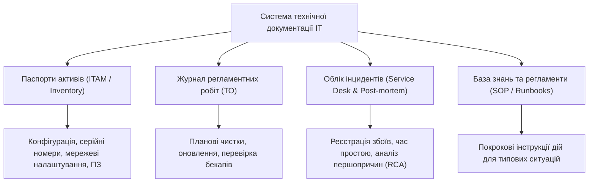
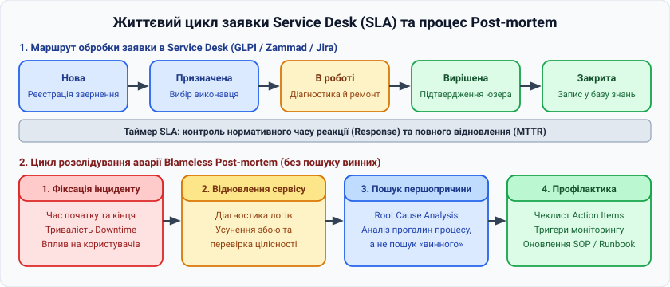

# Урок 50. Документування та облік робіт з обслуговування інформаційних систем

<div class="how-to">

**Як працювати з уроком**

1. Ознайомтеся з теоретичними стандартами ведення технічної документації в ІТ: видами паспортів робочих станцій і серверів, регламентними журналами ТО, системами обліку заявок (Service Desk/Helpdesk) та структурою звіту про аварії (Post-mortem).
2. Виконайте покрокове практичне завдання: здійсніть автоматизований збір параметрів комп'ютера через термінал, заповніть електронний технічний паспорт обладнання та оформіть професійну картку інциденту й акт регламентного обслуговування у форматі Markdown.
3. Закріпіть отримані знання, пройшовши підсумковий тест на 10 запитань наприкінці сторінки.

</div>

## Мета уроку

Ви дізнаєтеся, чому якісна технічна документація є запорукою надійності корпоративної ІТ-інфраструктури, як запобігти втраті критичних знань через «фактор автобуса» (*Bus Factor*), за якими стандартами вести облік технічного обслуговування обладнання та як працюють сучасні системи реєстрації заявок користувачів (Helpdesk/Service Desk). На практиці ви:

- навчитеся формувати структурований технічний паспорт комп'ютерного робочого місця за допомогою консольних утиліт аудиту;
- опануєте ведення журналу обліку регламентних робіт з технічного обслуговування (ТО);
- навчитеся складати звіт про аварійний інцидент за методологією **Blameless Post-mortem**;
- ознайомитеся з принципами обліку обладнання в системах класу ITAM (*IT Asset Management*, таких як GLPI);
- сформуєте стандартну робочу інструкцію (SOP / Runbook) для оператора з обробки інформації.

## Що знадобиться

- Робоча станція або сервер під керуванням Linux або Windows;
- Текстовий редактор (з підтримкою формату Markdown або звичайний текстовий процесор LibreOffice Writer);
- Базові утиліти аудиту конфігурації: `hostname`, `uname`, `lscpu`, `free`, `lsblk`, `ip`.

## Теорія

### Принцип обов'язкового документування в ІТ

У професійній діяльності системних адміністраторів та операторів з обробки інформації діє аксіома:
> **«Якщо дія або налаштування не задокументовані — їх не існує».**

Відсутність актуальної документації призводить до катастрофічних наслідків:
- **Критична залежність від однієї людини («фактор автобуса» / *Bus Factor*):** якщо єдиний фахівець, який знав паролі та схему з'єднань, звільниться чи захворіє, робота організації паралізується;
- **Збільшення часу простою (MTTR — *Mean Time To Recovery*):** під час аварії інженери витрачають години не на ліквідацію збою, а на з'ясування того, де встановлена програма і як вона налаштована;
- **Невідповідність законодавчим та галузевим вимогам:** для проходження атестації комплексної системи захисту інформації (КСЗІ) в Україні та стандартів ISO/IEC 27001 обов'язкова наявність затверджених формулярів і журналів обліку робіт.



---

### Основні види експлуатаційної документації

1. **Технічний паспорт комп'ютерного обладнання (робочого місця / сервера):**
   Документ, що фіксує повну апаратну та програмну конфігурацію:
   - Інвентарний номер та дата введення в експлуатацію;
   - Модель материнської плати, тип та серійний номер процесора;
   - Обсяг і тип оперативної пам'яті (кількість зайнятих слотів);
   - Накопичувачі: серійні номери, типи (SSD/HDD), ємність;
   - Мережеві реквізити: MAC-адреси мережевих карт, статична IP-адреса, ім'я хоста (*hostname*), номер розетки локальної мережі на робочому місці;
   - Перелік встановленої ліцензійної ОС та прикладного програмного забезпечення;
   - Прізвище матеріально відповідальної особи (користувача).
2. **Журнал обліку робіт із технічного обслуговування (ТО):**
   Хронологічний реєстр, де фіксуються щомісячні, щоквартальні та щорічні регламентні заходи: чищення від пилу системного блоку, заміна термопасти, перевірка зносу акумуляторів ДБЖ (UPS), аудит вільного місця на дисках, планове оновлення пакетів безпеки.
3. **Журнал інцидентів та звіт за результатами збою (Post-mortem):**
   Фіксує позаштатні аварійні події. У звіті аналізується:
   - Час початку та час відновлення сервісу (загальний час простою — *Downtime*);
   - Симптоми відмови та її вплив на користувачів (*Business Impact*);
   - Коренева причина (*Root Cause*);
   - Які дії дозволили повернути систему до життя;
   - Заходи профілактики (*Action Items*), щоб подібне не повторилося.
4. **Стандартні робочі інструкції (SOP — Standard Operating Procedures / Runbooks):**
   Чіткі алгоритми дій оператора у вигляді покрокових чеклистів для типових задач (наприклад: «Порядок реєстрації нового співробітника в корпоративній мережі», «Процедура щотижневої тестової перевірки відновлення даних із резервної копії»).

---

### Системи автоматизованого обліку та підтримки

Сучасні підприємства відмовляються від ведення документації виключно у паперових журналах на користь спеціалізованих цифрових платформ:

- **Service Desk / Helpdesk (GLPI, Zammad, Redmine, Jira Service Management):**
  Централізований прийом, класифікація та контроль виконання заявок від співробітників компанії.
  Життєвий цикл заявки:
  `Нова` $\rightarrow$ `Призначена виконавцю` $\rightarrow$ `В роботі` $\rightarrow$ `Очікує підтвердження користувача` $\rightarrow$ `Вирішена` $\rightarrow$ `Закрита`.
  Система автоматично фіксує дотримання **SLA** (*Service Level Agreement*) — нормативного часу реакції на інцидент.
- **IT Asset Management (ITAM — GLPI, Snipe-IT):**
  Системи обліку матеріальних та цифрових активів. Спеціальний клієнтський агент (наприклад, GLPI Agent), встановлений на ПК, автоматично сканує компоненти комп'ютера та передає в базу актуальні дані про серійні номери, вільне місце на диску, зміну планок оперативної пам'яті чи встановлення неавторизованих програм.
- **Корпоративні бази знань (Wiki):**
  Внутрішні портали на базі DokuWiki, BookStack або підходу **Docs-as-Code** (документація ведеться у форматі Markdown у репозиторії Git під версійним контролем).

| Вид документа | Періодичність оновлення | Головне призначення |
| :--- | :--- | :--- |
| Технічний паспорт ПК | Під час встановлення або модернізації заліза | Облік активів, гарантія, серійні номери |
| Журнал регламентного ТО | За графіком (щомісяця / щокварталу) | Фіксація профілактичних робіт та стану вузлів |
| Картка інциденту (Ticket) | При кожному зверненні або збої | Облік проблем, контроль SLA, оцінка надійності |
| Звіт Post-mortem | Після кожної критичної аварії | Аналіз кореневих причин та системна профілактика |
| Інструкція оператора (SOP) | При зміні технологічного процесу | Стандартизація дій, навчання нових кадрів |

<div class="clip">



*Життєвий цикл заявки Service Desk (SLA) та процес розслідування аварії Blameless Post-mortem*

</div>

<div class="more-link">

**Хочете знати більше?** <span class="optional">Необов’язково</span>

У сучасній практиці інженерії надійності сайтів (SRE — *Site Reliability Engineering*, розробленій у Google) діє концепція **Blameless Post-mortem** («Аналіз збоїв без пошуку винних»).
Головний постулат: помилка людини (оператора) є не першопричиною, а наслідком недосконалості робочих процесів, інтерфейсів або відсутності технічних запобіжників. Замість покарання оператора зусилля команди спрямовуються на автоматизацію та усунення системних вразливостей.

</div>

## Покроково

У цій практичній роботі ви виступите в ролі оператора інформаційних систем: здійсните автоматизований збір параметрів комп'ютера, сформуєте технічний паспорт робочої станції та оформите офіційний звіт про усунення аварійного інциденту.

### 1. Автоматизований збір апаратних та мережевих даних

За допомогою командного рядка зберіть необхідні показники для паспорта:
```bash
# 1. Мережеве ім'я хоста та версія операційної системи
echo "Хост: $(hostname)"
echo "ОС: $(uname -srmo)"

# 2. Модель та параметри процесора
lscpu | grep -E "Model name|CPU\(s\):"

# 3. Обсяг оперативної пам'яті
free -h | grep "Mem:"

# 4. Накопичувачі та дисковий простір
df -h / | awk 'NR==2 {print "Розділ /: Загальний=" $2 ", Використано=" $3 ", Вільно=" $4}'

# 5. Мережева IP-адреса та MAC-адреса
ip -brief address show
```

Всі ці відомості дозволяють заповнити паспорт за лічені секунди без ручного розбирання системного блоку.

---

### 2. Складання технічного паспорта комп'ютерного місця

Створіть у своїй робочій папці стандартизований електронний документ `passport_pc_101.md`:
```bash
cat << 'PASSPORT_EOF' > passport_pc_101.md
# ТЕХНІЧНИЙ ПАСПОРТ РОБОЧОЇ СТАНЦІЇ № 101

## 1. Загальні відомості
- **Інвентарний номер:** IT-INV-2026-0101
- **Місце встановлення:** Кабінет 12 (Бухгалтерія)
- **Відповідальна особа:** Оператор з ООІтаПЗ Бондаренко О. В.
- **Дата введення в експлуатацію:** 15.01.2026

## 2. Апаратна специфікація
- **Ім'я хоста в мережі:** `ws-buh-101`
- **Процесор (CPU):** 4 обчислювальні ядра, x86_64
- **Оперативна пам'ять (RAM):** 8.0 ГБ (DDR4)
- **Основний накопичувач:** SSD 256 ГБ (SATA-III), серійний номер: `S256SN2026A`
- **Мережевий адаптер:** Ethernet 1000BASE-T (MAC: `52:54:00:12:34:56`)
- **Статична IP-адреса:** `192.168.10.101/24`
- **Підключення до ЛОМ:** Розетка № R-12, порт комутатора SW-01/14

## 3. Програмне забезпечення
- **Операційна система:** Linux Ubuntu 24.04 LTS (Ядро 6.8.0)
- **Офісний пакет:** LibreOffice 24.x
- **Прикладне ПЗ:** Клієнт бази даних, корпоративний поштовий агент
PASSPORT_EOF

cat passport_pc_101.md
```

---

### 3. Ведення журналу обліку регламентних робіт (ТО)

Створіть реєстр планового технічного обслуговування `service_log.md` та внесіть запис про успішне виконання щомісячного регламенту:
```bash
cat << 'LOG_EOF' > service_log.md
# ЖУРНАЛ ОБЛІКУ РЕГЛАМЕНТНОГО ТЕХНІЧНОГО ОБСЛУГОВУВАННЯ

| Дата | Вузол / ПК | Зміст виконаних робіт | Стан за результатами перевірки | Виконавець (підпис) |
| :--- | :--- | :--- | :--- | :--- |
| 16.02.2026 | ws-buh-101 | Продування пилу системного блоку, контроль кулера CPU | Температура CPU під навантаженням 52°C, шум відсутній | Бондаренко О. В. |
| 16.02.2026 | ws-buh-101 | Перевірка цілісності накопичувача (S.M.A.R.T.) | Атрибут Reallocated Sectors = 0, стан PASSED | Бондаренко О. В. |
| 16.02.2026 | ws-buh-101 | Очищення тимчасових файлів, оновлення безпеки ОС | Встановлено 4 оновлення безпеки, вільно 142 ГБ | Бондаренко О. В. |
LOG_EOF

cat service_log.md
```

---

### 4. Оформлення звіту про інцидент (Post-mortem)

Змоделюйте ситуацію: на сервері баз даних раптово переповнився дисковий розділ через неконтрольоване зростання файлів системного журналу, що призвело до зупинки роботи операторів на 25 хвилин.

Оформіть офіційний звіт про аварію `incident_postmortem_20260216.md`:
```bash
cat << 'POSTMORTEM_EOF' > incident_postmortem_20260216.md
# ЗВІТ ПРО ІНЦИДЕНТ (POST-MORTEM) № INC-4029

- **Дата інциденту:** 16.02.2026
- **Сервіс, що зазнав збою:** Сервер баз даних `db-server-01`
- **Час початку інциденту:** 10:15
- **Час повного відновлення:** 10:40
- **Загальний час простою (Downtime):** 25 хвилин
- **Пріоритет інциденту:** P1 (Критичний)

## 1. Короткий зміст події
О 10:15 користувачі повідомили про неможливість збереження накладних у базі даних. Служба `mariadb.service` перейшла в аварійний стан `failed`.

## 2. Коренева причина (Root Cause)
Повне вичерпання дискового простору (100% заповнення розділу `/var/log`) через збій у конфігурації ротації логів `logrotate`. Захисний механізм СУБД заблокував запис нових транзакцій.

## 3. Вжиті заходи з відновлення
1. Зафіксовано статус збою через `systemctl status mariadb` та системні логи `journalctl`.
2. Виявлено переповнення диска за допомогою `df -h`.
3. Очищено старі заархівовані лог-файли за минулий рік, вивільнено 18 ГБ простору.
4. Службу бази даних успішно перезапущено (`systemctl restart mariadb`).
5. Проведено тестове збереження запису — цілісність даних збережена.

## 4. План попереджувальних дій (Action Items)
- [x] Виправити правило тижневої ротації логів у `/etc/logrotate.d/`.
- [ ] Налаштувати в системі моніторингу Zabbix тригер сповіщення при досягненні 85% заповнення диска.
POSTMORTEM_EOF

cat incident_postmortem_20260216.md
```

Завдяки такому звіту команда отримала чіткий план дій, а керівництво — вичерпне обґрунтування причин збою.

---

### 5. Прибирання тренувальних звітів

Після ознайомлення з форматом документів видаліть створені файли:
```bash
rm -f passport_pc_101.md service_log.md incident_postmortem_20260216.md
```

<div class="try">

**Спробуйте самі**

Напишіть короткий bash-скрипт `generate_quick_passport.sh`, який автоматично формує файл `my_machine_passport.txt`, записуючи в нього поточну дату, ім'я комп'ютера, версію ядра, загальний обсяг RAM та модель процесора.

<details>
<summary>Перевірити очікуваний результат і повний розв’язок</summary>

Скрипт автоматичної генерації паспорта:
```bash
cat << 'GEN_EOF' > generate_quick_passport.sh
#!/bin/bash
REPORT_FILE="my_machine_passport.txt"

echo "=== ЕКСПРЕС-ПАСПОРТ ОБЛАДНАННЯ ===" > "$REPORT_FILE"
echo "Дата формування: $(date '+%Y-%m-%d %H:%M:%S')" >> "$REPORT_FILE"
echo "Ім'я хоста:      $(hostname)" >> "$REPORT_FILE"
echo "Версія ядра ОС:  $(uname -r)" >> "$REPORT_FILE"
echo "Модель CPU:      $(lscpu | grep 'Model name:' | sed 's/Model name:[ \t]*//')" >> "$REPORT_FILE"
echo "Оперативна пам'ять: $(free -h | awk '/Mem:/ {print $2}')" >> "$REPORT_FILE"
echo "==================================" >> "$REPORT_FILE"

cat "$REPORT_FILE"
rm -f "$REPORT_FILE"
GEN_EOF

chmod +x generate_quick_passport.sh
./generate_quick_passport.sh
rm -f generate_quick_passport.sh
```
Цей скрипт дозволяє за одну секунду згенерувати точні паспортні дані для будь-якої кількості комп'ютерів підприємства!

</details>

</div>

## Підсумок

- **Культура документування:** будь-які зміни, налаштування та ремонти комп'ютерних систем повинні своєчасно й повно фіксуватися в технічній документації.
- **Технічний паспорт:** є основним обліковим документом одиниці обладнання, що закріплює апаратні характеристики, серійні номери, мережеві координати та відповідальну особу.
- **Журнал регламентних робіт:** забезпечує системність профілактичного обслуговування (ТО), подовжує термін служби апаратури та запобігає аваріям.
- **Аналіз інцидентів (Post-mortem):** бездоганний аналіз аварій фокусується на виявленні кореневих причин (RCA) та системному вдосконаленні інфраструктури, а не на покаранні працівників.
- **Сучасні платформи:** використання систем Service Desk та ITAM (GLPI) автоматизує облік заявок користувачів і технічних засобів компанії.

## Тест

<div class="test-box">

10 запитань за матеріалом уроку. На початку тесту вкажіть **прізвище, ім’я та групу**.

<!-- GOOGLE_FORM_START:lesson-50 -->
[Відкрити тест у новій вкладці](https://docs.google.com/forms/d/e/1FAIpQLScvQzOfnLDkkMdanqChdcS9crFzeiS_Ksl9x6ptUkg9hXQBsQ/viewform)

<iframe src="https://docs.google.com/forms/d/e/1FAIpQLScvQzOfnLDkkMdanqChdcS9crFzeiS_Ksl9x6ptUkg9hXQBsQ/viewform?embedded=true" loading="lazy" title="Тест lesson-50">Завантаження…</iframe>
<!-- GOOGLE_FORM_END:lesson-50 -->

</div>

## Додаткове завдання

<span class="optional">Необов’язково</span> Виконуйте для поглиблення навичок системного адміністрування.

**Базовий рівень.** Складіть у LibreOffice Writer або текстовому редакторі посадовий чеклист щоденного ранкового огляду оператора комп'ютерного залу (перевірка електроживлення, температурного режиму, стану дискового простору, наявності паперу в мережевих принтерах).

**Проєктний рівень.** Дослідіть структуру відкритої системи обліку заявок та активів **GLPI**. Опишіть, яким чином агент автоматичної інвентаризації (*GLPI Agent*) збирає та передає дані на сервер без участі людини, та які поля в картці обладнання оновлюються автоматично.
